# C4 architecture: containers and components

These diagrams show Tidepool in two of the C4 model's views. The container
view shows the programs, the files they use, and the people and outside
systems around them. The component views show the crates inside the
`tidepool` binary, the modules inside `xtask`, and the parts that exist only
for development: the fuzzer, the golden frames, the test harness, the
benchmark harness, and the fake tool crate still to come.

Drawn from the code and docs as of roadmap task M3.4 (2026-11-22, version 0.1), after M2.4, M2.7, M2.8, M2.5, M2.6, M3.1, M3.2, M3.5, M3.6, M3.7, M3.3 and M3.8. What the code has is drawn solid; what the roadmap plans is dashed and labelled with the task that builds it (ADR-0029).

## Legend

| Style | Means |
| :- | :- |
| Dark blue, rounded | A person |
| Blue box | Built: a container, crate or module the code has now |
| Blue cylinder | Files the code reads or writes now |
| Grey box or cylinder | Outside Tidepool: a program, a service, or the developer's own files |
| White box or cylinder with a dashed border | Planned: not built yet; the label names the task that builds it |
| Solid arrow | Uses, runs, reads, writes or depends on, as labelled, in the code now |
| Dotted arrow labelled "planned M#.#" | Planned: added by that roadmap task |

A crate that has code is drawn solid even where most of it is still
planned; its label says which parts are which. So `sys`, `platform` and
the binary are solid: M0.1 gave the first two a crate root that allows
`unsafe_code`, and the binary an empty `main`, M2.1 gave `sys` its
Linux declarations, and M2.2 gave `platform` its Linux window. A crate that is only its doc
comment, and for a library the `ReadmeDoctests` item that runs its README's
examples (M0.13) and the attribute that forbids `unsafe` in them (M0.15),
is drawn planned, with the task that gives it code first.

## 1. Containers

Tidepool is one binary for the developer, and dev-only tools for the people
who work on Tidepool. The two are drawn apart, and the binary in three
views: its frontends and files, the tools it drives, and the language
agents.

### 1.1 The tidepool binary, its frontends and its files

The binary is `crates/app`, run as `cargo tp`. It has a GUI and a TUI
frontend. Its `main` runs the event-driven main loop (M3.8, ADR-0012,
ADR-0059): it reads two settings, opens the GUI's window and shows the
shell (M3.4, ADR-0060), a `ui` tree the GUI paints, until the window is
closed; every other arrow from it is planned.

- Tidepool's TOML files are `settings.toml` in the user config directory,
  the keymaps and `languages/ID.toml` (M6.2). The default keymap,
  `keymaps/default.toml`, is compiled into `tidepool-editor` (M4.6,
  ADR-0064). The binary reads `settings.toml`'s `[ui] side_panel` and
  `bottom_panel` (M3.4, ADR-0060) and its `[keymap]` tables, the user's
  bindings (M4.6, ADR-0064), read-only, through `tidepool-workspace`'s
  settings (M4.7, ADR-0067), which can also write a value back with the
  file's comments kept; the binary writes nothing yet.
- The theme is not read at run time: `tidepool-ui` compiles
  `themes/tidepool-dark.toml` in with `include_str!`, and `gui`'s first
  frame takes its two text colors, `text` and `text-3`, from it (M3.2,
  ADR-0047); its backdrop is still `gfx`'s `BackdropStyle::jabbott_dev()`. The file is drawn with the repository's
  files (1.5); no task loads a user's theme yet.
- The managed-tool records are the `toolchains/TOOL.toml` descriptors and
  `toolchains.toml` in user data, which records what was found (M5.1).
- A workspace folder is one of the developer's projects, with its own
  `.tidepool/settings.toml`; the binary is to open, trust, edit and save
  it (M4.3), through `tidepool-workspace`'s folders and trust (M4.7).

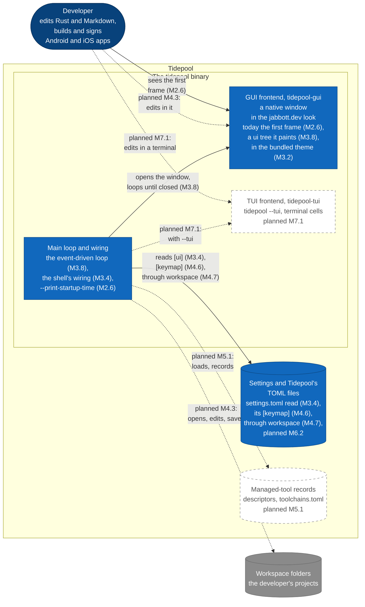

### 1.2 The tools the binary drives

Every tool is found, installed, updated and started by
`tidepool-toolchain` (ADR-0002), with consent before any install; that
crate's first task is M5.1. The core binary opens no sockets but its
connection to the local X server, over a Unix socket only (ADR-0039),
and the network is reached only through child processes (ADR-0009). What each
arrow's task adds:

- `curl`, HTTPS only: every download, its SHA-256 checked (M5.3).
- rustup, the Rust toolchain and `cargo`: installed (M5.5), and cargo
  tasks run (M6.4).
- rust-analyzer: installed (M5.5), and spoken to in LSP over stdio (M6.7).
- `git`: detected (M5.5), and run for status and diff (M8.1).
- The JDK, the Android SDK and NDK, and bundletool: installed and driven
  (M10.1).
- Xcode and its command-line tools, on macOS only: detected, and the
  install guided (M11.2).
- A remote Mac (ADR-0008): `ios::remote` syncs the project to it with
  `rsync` over `ssh`, runs the iOS pipeline there and copies the artifacts
  back (M11.5).
- A debug adapter, `lldb-dap` or CodeLLDB: installed, and spoken to in DAP
  (M13.1).

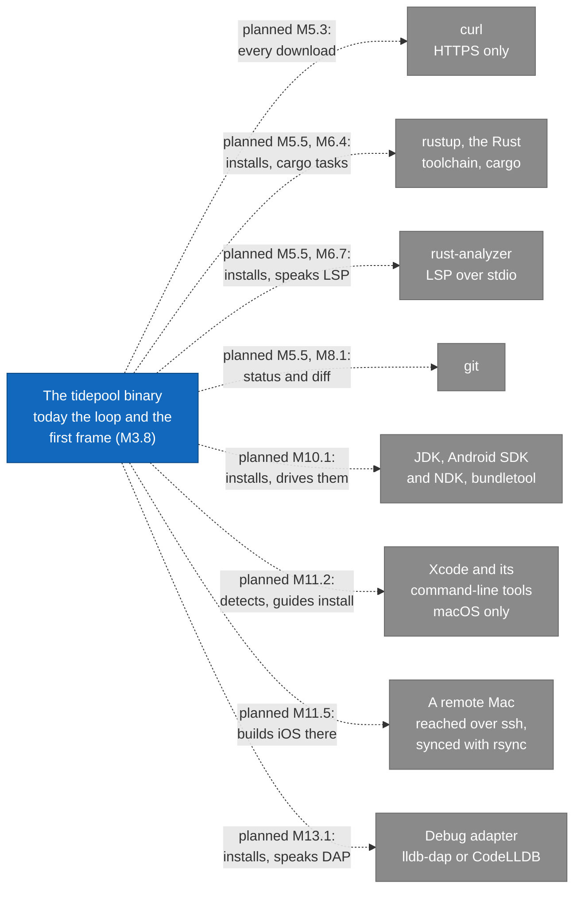

### 1.3 The language agents

Agents speak the Tidepool Agent Protocol (TAP) over stdio (M9.3). The
reference agents live in their own Cargo workspace, `agents/`, and are
never linked into Tidepool (`docs/01-architecture.md` → "Layers"):
`tp-agent-mock` (M9.2), and `tp-agent-local` and `tp-agent-claude` (M9.6),
which reach a model server through `curl`, or over plain HTTP on loopback.
Any other program with an `agent.toml` that speaks TAP is an agent too.

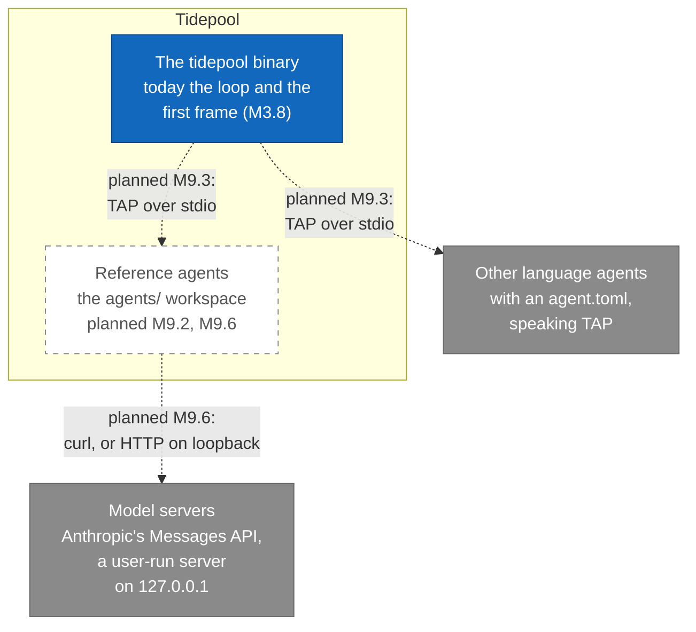

### 1.4 The development tools

`xtask` is built: the CI gate and fuzz smoke run through it, locally and on
GitHub Actions. It starts no program but `cargo` (ADR-0017, ADR-0027).

- `xtask` runs as `cargo xtask` with one of `ci`, `deps`, `layers`,
  `crates`, `features`, `unsafe-audit`, `headers`, `workflows`, `ucd`,
  `theme`, `golden`, `fuzz-smoke` and `site`. It starts `cargo` for `fmt`,
  `clippy`, `test`, `metadata`, `locate-project`, a `cargo test` of the
  golden scenes per drawing crate (ADR-0044), a `cargo test` per fuzz
  target, and `site`'s two `cargo run --example` (ADR-0030).
- `ci.yml` runs `cargo xtask ci`, whose `golden` step compares the golden
  frames, on Linux, macOS and Windows, on Linux under `xvfb-run` with the
  window tests on (ADR-0041), then `cargo xtask fuzz-smoke --secs 30` on
  Linux.
- `pages.yml` runs `cargo xtask site` once CI has passed on a push to
  `main`, and deploys the page it builds to GitHub Pages, at
  <https://jabbott.dev/Tidepool/> once the repository's Pages source is
  "GitHub Actions" (ADR-0030).
- `cargo` is the pinned toolchain, 1.99.0, from `rust-toolchain.toml`.

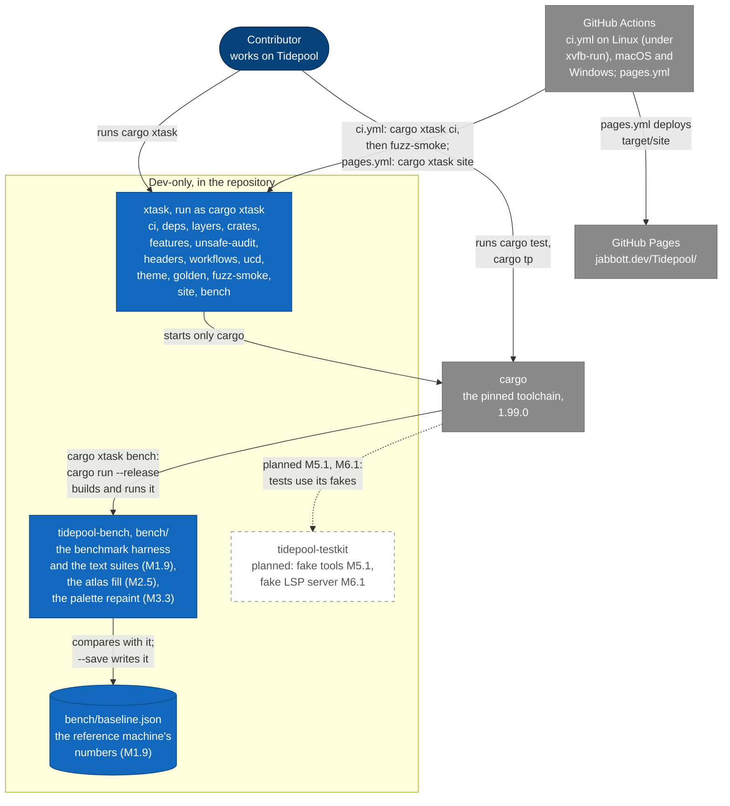

- Which crates' tests may use `tidepool-testkit` is decided in M5.1: today
  the matrix lets only `tidepool-bench` use it (`docs/04-quality.md` →
  `layers`).

### 1.5 What the development tools read and write

`xtask` reads the repository's files and changes only three things: the
generated grapheme tables, the golden references of the scenes that
`golden --bless` names, and, after a replay that died, the name of the
input the replay died on. `site` also writes the demo page into
`target/site`, or the directory `--out` names, and `golden` what the
scenes drew, and a failing scene's images, into `target/golden`.
`tidepool-bench`, which `cargo xtask bench` runs, reads
`bench/baseline.json` and writes it only with `--save` (ADR-0035).
`theme` reads each `themes/*.toml`, and building `tidepool-ui` compiles
`themes/tidepool-dark.toml` in (M3.2, ADR-0047); building
`tidepool-editor` compiles `keymaps/default.toml` in, and the `keymap`
fuzz target reads `keymaps/` as seeds (M4.6, ADR-0064).
`codeql.yml` analyzes the Rust code and the workflows.

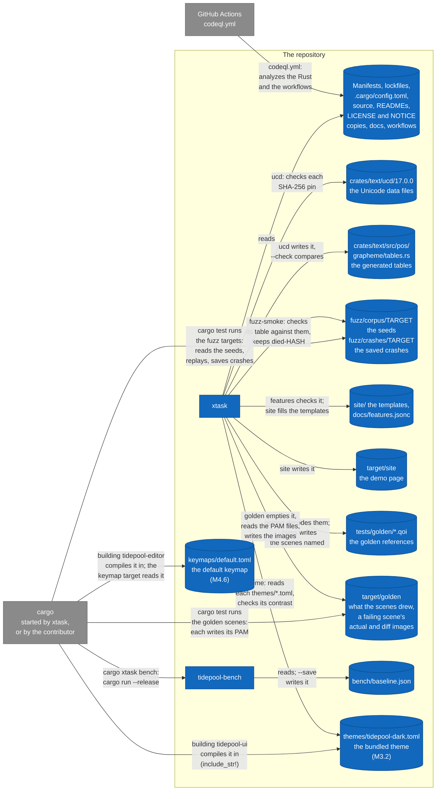

- `fuzz/crashes/` holds files only after a finding or a replay; the
  engine makes its directories as it needs them.

## 2. Components of the tidepool binary

The binary's crates by layer (`docs/01-architecture.md` → "Layers"), in
five diagrams. Every arrow is an edge of the dependency matrix. Only
`platform` (on `core` and `sys`, M2.2), `gfx` (on `core`, M2.3), `gui`
(on `core`, `platform`, `gfx` and `font`, M2.6, and `ui`, M3.2), the
binary (on `core`, `platform` and `gui`, M2.6, `ui`, M3.8, and `codec`
and `editor`, M3.4), `editor` (on `core` and `ui`, M3.4, `text`, M4.1,
and `codec`, M4.6) and `ui` (on
`core`, M3.1, `codec`, M3.2, and `text`, M3.6) declare dependencies yet; their
edges, and the three dev-dependencies on `tidepool-core` that the tests
of `codec`, `text` and `font` use, are solid. Every
other edge is dotted and labelled with the task the roadmap or spec ties to
its use. The diagrams run left to right, from a crate to the crates it
uses.

### 2.1 Layers 0 and 1: foundations, OS behavior, formats and engines

`core`, `codec` and `text` are built, `sys` has its Linux declarations
(M2.1, M2.2, M2.7), and `platform` its Linux window over X11 (M2.2), its
clipboard and the user's and tools' folders (M2.7). Those two
allow `unsafe_code`. `gfx` has its CPU rasterizer and the backdrop (M2.3),
and its golden scenes (M2.4). `font` has its TrueType parser and glyph
rasterizer (M2.8), and the bundled faces, fallback, layout, the glyph
atlas and its golden scenes (M2.5). The other two crates are empty.

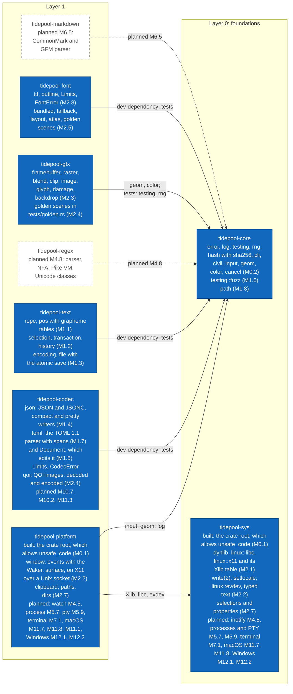

- The libraries of `codec`, `text` and `font` use nothing from `core`;
  the tests of `codec` and `text` use `core::testing` (property tests and
  the fuzz engine) and `core::rng`, and `font`'s use the fuzz engine and
  `core::hash`'s FNV-1a hash.

### 2.2 Layer 2: services

`ui` has its tree, layout, focus, input routing, text metrics, draw
lists and accessibility tree (M3.1), its theme, which reads theme
files with `codec`'s TOML parser (M3.2, ADR-0047), its controls,
whose fields move and delete by grapheme cluster with `text`'s
`pos::grapheme` (M3.6, ADR-0049), and its collections, tab strip,
splitter, card and code block, which cut what they show at the same
boundaries (M3.7, ADR-0052), and its overlays: the modal dialog, the
tooltip, the toast, and the command palette, over a layer of overlays in
the tree, the palette's rows widening what a query matched to the same
boundaries (M3.3, ADR-0052). `workspace` has its folders and ignore
files, trust and settings (M4.7, ADR-0067), reading TOML with `codec`
and saving settings with `text::file`; the other four service crates are
empty. Each arrow is labelled with the task whose module first needs that
crate.

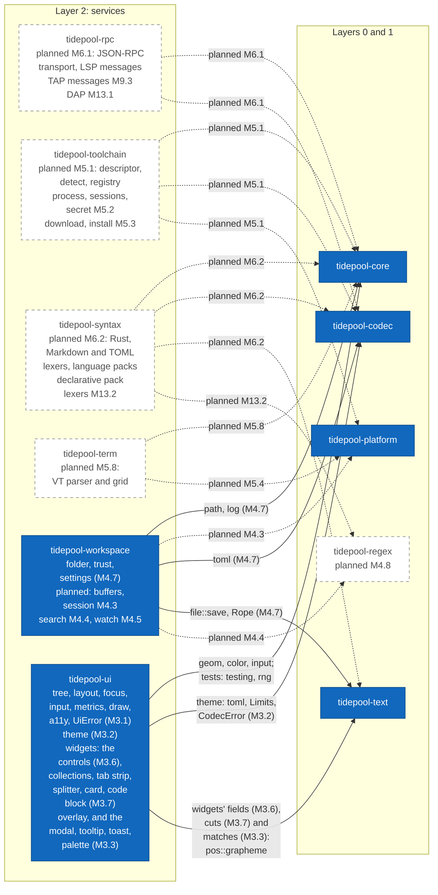

- `toolchain` first needs `platform` in M5.1, whose `detect` searches the
  standard tool locations that `platform::dirs` gives (M2.7). It reaches
  the OS through `platform::process` (M5.7, used from M5.2) and starts
  every outside program Tidepool drives. `term` gets its PTY from
  `platform::pty` (M5.9); the terminal panel (M5.4) reaches it through
  `term`, since `editor`'s row has no `platform`.

### 2.3 Layer 3: language and tool features

The four feature crates are empty. They reach outside programs only
through `toolchain`.

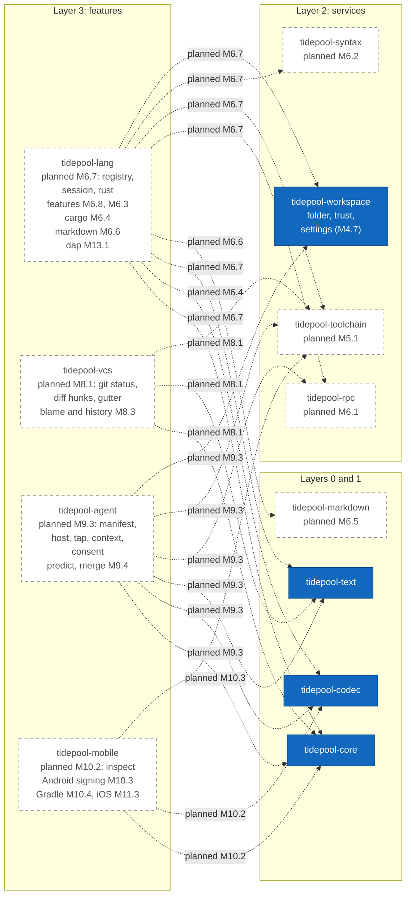

- `lang` and `agent` start their servers and agents through
  `toolchain::sessions` (M5.2) and speak to them over `rpc`'s JSON-RPC
  transport; `vcs` runs `git` through `toolchain::process`.

### 2.4 Layer 4: the editor

`tidepool-editor` is where every feature is written once (ADR-0003); it
draws through `ui` and never depends on `gui` or `tui`. Its thirteen edges
are added as its parts land: those to `core` and `ui` came with the shell
(M3.4), the one to `text` with the editor view (M4.1), and the one to
`codec` with the keymaps (M4.6).

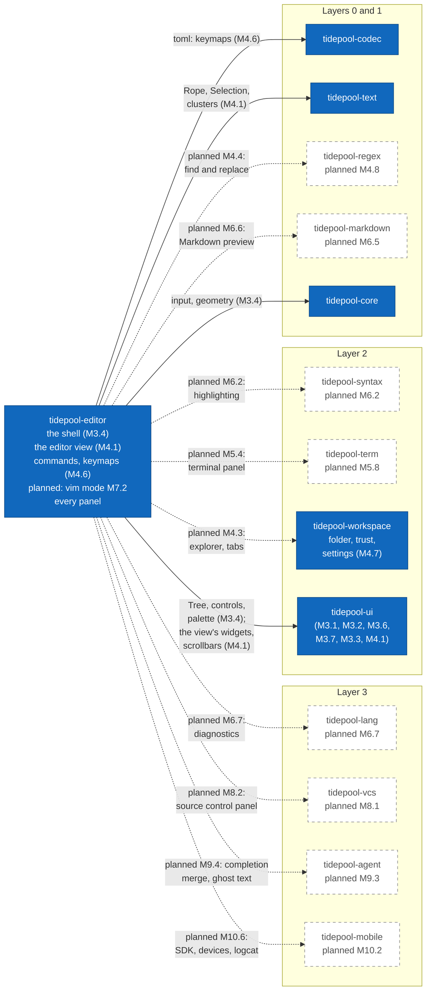

### 2.5 Layers 4 and 5: the frontends and the binary

Today `gui` paints `ui`'s draw lists with its painter (M3.5, ADR-0048)
in its window (M3.8, ADR-0059): the first frame's lines (M2.6), a `ui`
tree in `text` and `text-3` from `ui`'s bundled theme (M3.2, ADR-0047),
over the backdrop it builds off the main thread, until the shell replaces
them with the shell (M3.4, ADR-0060), whose activity bar shows `gui`'s
first icons; `tui` is to map them onto cells (M7.1). The frontends
know nothing of editors, languages or tools
(`docs/subsystems/frontends.md`). `app` connects
them to `editor`'s shell (M3.4), and is to show its editor view from
M4.3, when files open (ADR-0063); it reads its settings through
`workspace::settings` (M4.7, ADR-0067). The matrix lets `app` use every
crate in the rows above its own; only eight edges are drawn, each
labelled with the task whose work needs it.

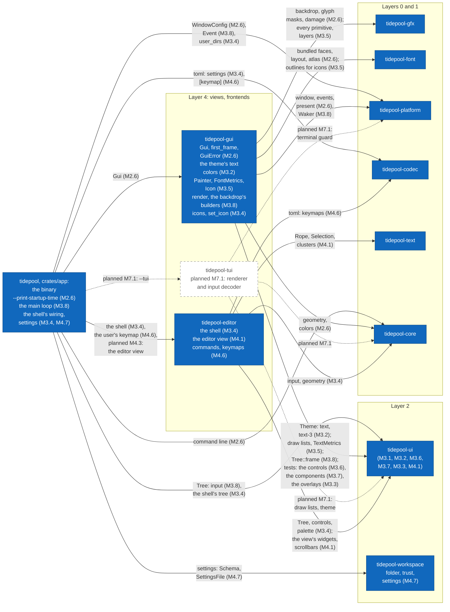

- The matrix also lets `gui` use `codec`; no task or spec gives it a use
  yet, so no edge is drawn.
- `editor` never depends on `gui` or `tui`, and the frontends never depend
  on `editor` (`docs/01-architecture.md` → "Dependency matrix").

## 3. Components of xtask

`xtask` links only `tidepool-core` and `tidepool-codec`, its row in the
matrix, and starts no program but `cargo`. Its modules are drawn in three
views: the commands and the checks, what the checks build on, and what each
check reads, runs and writes.

### 3.1 Modules: the commands and the checks

`main.rs` runs `ci`, one check, `golden`, `fuzz-smoke`, `site` or `bench`,
and exits 0, 1 or 2. `check` holds the `ci` steps in order, `theme` the
last (M3.2), and in its `LATER` table the commands still to come; `site`
runs the same steps through `check`'s one runner (ADR-0030). `golden` is a step of `ci`, and
`main.rs` also runs it on its own, for its `--bless` (ADR-0044). `bench`
is handled before the command line is parsed, so every argument after it
goes to `tidepool-bench` (ADR-0035).

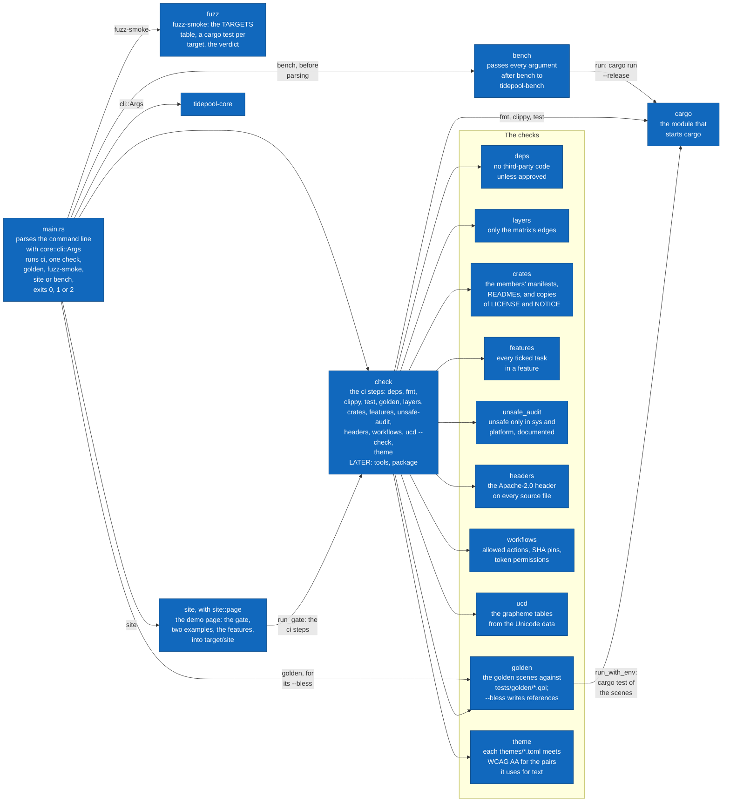

- `tools` and `package` are names in `check`'s `LATER` table and fail as
  not yet implemented (M5.1, M11.6, M12.4, M14.4); `ci`'s summary lists
  `tools`.

### 3.2 Modules: what the checks build on

An arrow goes to each module whose items a module uses. Arrows to `error`
and `walk`, which nearly every module uses, are left out, as are those to
`check` for its `Report` and `printable`. So `workflows`, which uses only
those, is not drawn here.

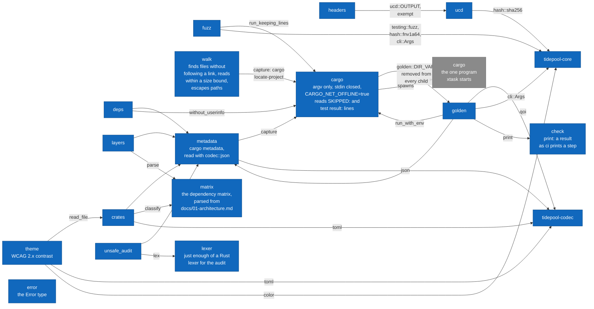

`features` and `site` (ADR-0030) build on the modules above. `site` runs
the steps of `ci` through `check::run_gate`, the runner `ci` itself uses,
and starts the two examples through `cargo::capture`.

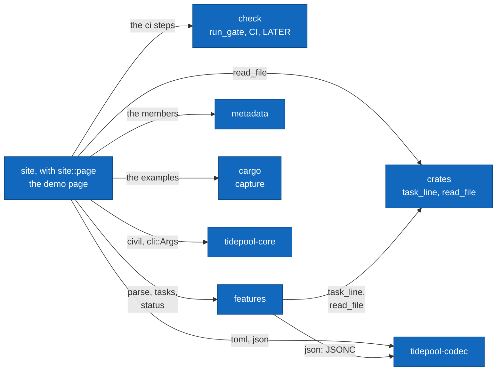

### 3.3 What each check reads, runs and writes

The checks find and read their files through `walk`, which never follows a
symbolic link and asks `cargo locate-project` which directories are
workspace roots; `ucd`, `fuzz` and `golden` also look at their own
directories without following a link, and `theme` its `themes/`. Only
`ucd`, `fuzz` and `golden`, with `--bless`, change anything in the
repository. `golden` also empties
and rewrites `target/golden` when a crate draws, with or without `--bless`; `site` writes its
output directory, and `target/golden` through the `golden` step of its
gate.

```mermaid
flowchart LR
    subgraph b_checks["xtask"]
        m_deps["deps"]
        m_layers["layers"]
        m_crates["crates"]
        m_features["features"]
        m_unsafe["unsafe_audit"]
        m_headers["headers"]
        m_workflows["workflows"]
        m_ucd["ucd"]
        m_fuzz["fuzz"]
        m_golden["golden"]
        m_theme["theme"]
        m_site["site"]
        m_bench["bench"]
        m_steps["check: the fmt, clippy and test steps of ci"]
    end
    e_cargo["cargo"]
    s_manifests[("Cargo.toml and Cargo.lock files, .cargo/config.toml in any directory")]
    s_allow[("xtask/deps-allowlist.txt")]
    s_every[("Every file in the repository<br/>for compiled artifacts and links")]
    s_arch[("docs/01-architecture.md<br/>the dependency matrix")]
    s_roadmap[("docs/roadmap.md<br/>the task lines")]
    s_readmes[("Each member's README.md")]
    s_license[("LICENSE and NOTICE<br/>the root's, and the copies<br/>beside each member's<br/>Cargo.toml")]
    s_rs[("Every .rs file")]
    s_source[("Source files: .rs, .sh, .github/workflows YAML,<br/>.html, .css, .js")]
    s_features[("docs/features.jsonc")]
    s_site[("site/: index.html, llms.txt,<br/>tidepool.css, tidepool.js;<br/>rust-toolchain.toml")]
    s_git[(".git: HEAD, its loose ref<br/>or packed-refs")]
    s_out[("target/site, or --out DIR,<br/>marked .tidepool-site")]
    s_wf[(".github/workflows YAML files")]
    s_ucd[("crates/text/ucd/17.0.0")]
    s_tables[("crates/text/src/pos/grapheme/tables.rs")]
    s_fuzz[("fuzz/, fuzz/corpus/, fuzz/crashes/")]
    s_golden[("tests/golden/SCENE.qoi<br/>the references")]
    s_goldout[("target/golden: rendered/PACKAGE/SCENE.pam,<br/>SCENE.actual.qoi, SCENE.diff.qoi")]
    s_themes[("themes/*.toml")]

    m_deps -->|"reads lockfiles as text, cargo configs"| s_manifests
    m_deps -->|"reads"| s_allow
    m_deps -->|"walks"| s_every
    m_deps -->|"cargo metadata --offline --locked, each workspace"| e_cargo
    m_layers -->|"parses the matrix"| s_arch
    m_layers -->|"cargo metadata --offline --no-deps"| e_cargo
    m_crates -->|"reads each member's and the root's Cargo.toml"| s_manifests
    m_crates -->|"the first line, the sections<br/>in order, the task IDs"| s_readmes
    m_crates -->|"compares each member's<br/>copies with the root's,<br/>byte for byte"| s_license
    m_crates -->|"reads the task IDs"| s_roadmap
    m_crates -->|"cargo metadata --offline --no-deps"| e_cargo
    m_features -->|"reads"| s_features
    m_features -->|"reads the task lines"| s_roadmap
    m_site -->|"reads the templates,<br/>copies the two files"| s_site
    m_site -->|"reads HEAD's hash<br/>in a local build"| s_git
    m_site -->|"writes the page,<br/>removes only what<br/>it wrote before"| s_out
    m_site -->|"the ci steps, then<br/>cargo run --example, twice"| e_cargo
    m_site -->|"the gate's golden step:<br/>empties and rewrites it"| s_goldout
    m_bench -->|"cargo run --release --quiet -p tidepool-bench"| e_cargo
    m_unsafe -->|"lexes"| s_rs
    m_unsafe -->|"cargo metadata --offline --no-deps, the crate roots"| e_cargo
    m_headers -->|"checks the header at the top of each"| s_source
    m_workflows -->|"reads line by line"| s_wf
    m_ucd -->|"checks five SHA-256 pins, parses three files"| s_ucd
    m_ucd -->|"writes it, or with --check compares"| s_tables
    m_fuzz -->|"checks the table against them, keeps died-HASH"| s_fuzz
    m_fuzz -->|"cargo test --profile fuzz, a target at a time"| e_cargo
    m_golden -->|"cargo metadata --offline --no-deps: the members with a golden test"| e_cargo
    m_golden -->|"cargo test --package PACKAGE --test golden, TIDEPOOL_GOLDEN_DIR set"| e_cargo
    m_golden -->|"decodes each; --bless writes the scenes named"| s_golden
    m_golden -->|"empties it, reads the PAM files, writes a failing scene's images"| s_goldout
    m_theme -->|"reads each with codec toml, its colors with core color; prints the contrast table"| s_themes
    m_steps -->|"fmt --check, clippy -D warnings, test --workspace"| e_cargo

    classDef built fill:#1168bd,stroke:#0b4884,color:#ffffff
    classDef external fill:#8a8a8a,stroke:#6b6b6b,color:#ffffff
    classDef store fill:#1168bd,stroke:#0b4884,color:#ffffff
    class m_deps,m_layers,m_crates,m_features,m_unsafe,m_headers,m_workflows,m_ucd,m_fuzz,m_golden,m_theme,m_site,m_bench,m_steps built
    class s_manifests,s_allow,s_every,s_arch,s_roadmap,s_readmes,s_license,s_rs,s_source,s_wf,s_ucd,s_tables,s_fuzz,s_golden,s_goldout,s_features,s_site,s_git,s_out,s_themes store
    class e_cargo external
```

- Every cargo child runs in the root with `CARGO_NET_OFFLINE=true` and its
  standard input closed; `ci` compiles nothing once `deps` has failed.
- `fuzz` renames the `.last-input` a replay wrote into `died-HASH`, or
  removes it when it is already a saved crash, through `core`'s
  `keep_died`.

## 4. The dev-only parts

What exists only to test and measure Tidepool: the fuzzer, the
property-test harness, the benchmark harness and the golden frames are
built; the fakes are planned.

### 4.1 The fuzz engine and its targets

Each parser crate has its targets in `tests/fuzz.rs`, run by every `cargo
test` on the saved crashes and seeds alone, and on mutated inputs when
`fuzz-smoke` sets `TIDEPOOL_FUZZ_SECS` (ADR-0027).

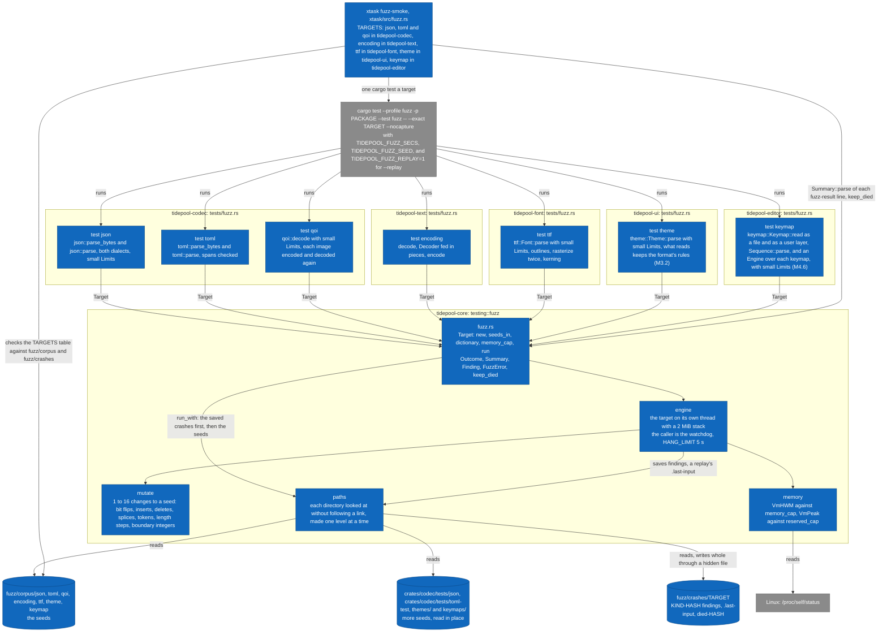

- Each later parser adds a target with its task: `regex` (M4.8), `vt`
  (M5.8), framing in `rpc` (M6.1), the Markdown parser (M6.5), git's
  parsers (M8.1), `inflate` and `png` (M10.7), and `zip` and `xml`
  (M10.2).

### 4.2 Test support: property tests, benchmarks and fakes

The property-test harness in `core::testing` (`check`, `check_sized` and
`assert_approx`, seeded by `TIDEPOOL_SEED`, and `rng::Pcg32`) is built and
used by the tests of `codec` and `text`, through a dev-dependency, and by
those of `ui` (M3.1), whose library depends on `core`. The benchmark harness,
`tidepool-bench` (M1.9), warms each suite up, takes samples within a time
budget, and reports the median and p95 against `bench/baseline.json`; its
suites measure the text engine: rope edits, positions, 10,000-caret
keystrokes, typing and graphemes (ADR-0035), the glyph atlas's fill
(M2.5), the command palette's repaint, its text measured with
`gui`'s `FontMetrics` as the window measures it (M3.3), and the editor
view: a wheel notch through a 10,000-line file at 1080p, with soft wrap
off and on, and the first layout of a 10,000-byte line, each handled as
the main loop does and its damage painted with `gui`'s `Painter` into a
`gfx` framebuffer (M4.1).
`tidepool-testkit` is an
empty crate; its edges are the matrix's row for it. `testkit` keeps fake
tools in
`crates/testkit/fake-tools/` (M5.1), and the fake LSP server's transcripts
in `crates/testkit/transcripts/` (M6.1).

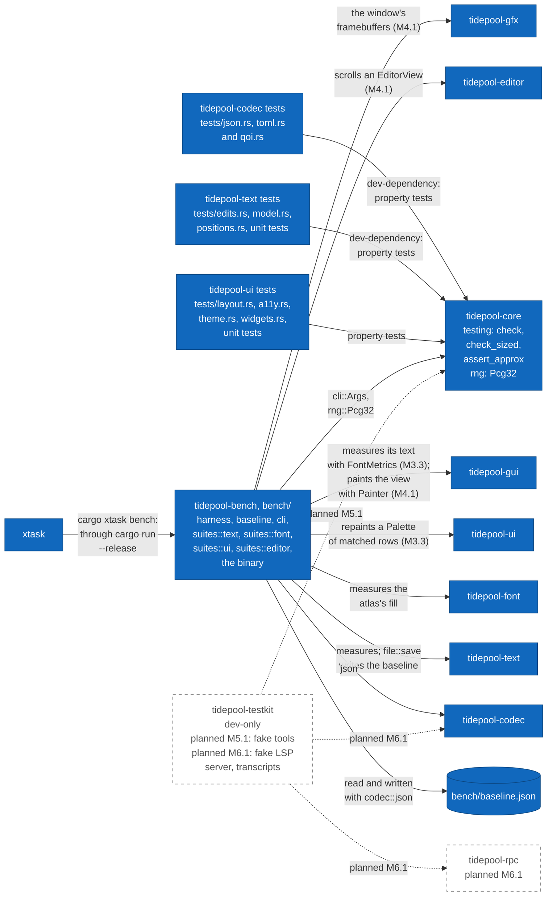

- The matrix lets `tidepool-bench` use any workspace crate, and lets only
  it use `tidepool-testkit`, and only from `[dev-dependencies]`. The edges
  from the tests of `toolchain`, `vcs`, `mobile`, `rpc` and `lang` to
  `testkit` are decided in M5.1, so none is drawn.
- The mock agent `tp-agent-mock` (M9.2), in `agents/`, plays the same part
  for TAP: the conformance suite runs against it.

### 4.3 The golden frames

`cargo xtask golden`, and the `golden` step of `ci`, draw each drawing
crate's scenes and compare what they drew with the references in
`tests/golden/`, exactly for `gfx` and `gui` and within 1 for `font`
(ADR-0044, ADR-0048). The matrix lets `xtask` use only `core` and
`codec`, and `gfx` and `font` only `core`, so the scenes are tests that
write what they drew as PAM files (`font`'s blending their glyphs'
coverage themselves, and `gui`'s painting `ui` trees with its painter,
`ui`'s controls among them, M3.6, its other components, M3.7, and its
overlays, M3.3),
and `xtask` reads those,
decodes the QOI references and writes the QOI images. `golden` asks
`cargo metadata` which members have a `golden` test; each needs a row in
`SCENES`, which gives its tolerance.

```mermaid
flowchart TB
    c_golden["xtask golden, xtask/src/golden.rs<br/>SCENES: tidepool-gfx, tolerance 0; tidepool-font, tolerance 1; tidepool-gui, tolerance 0<br/>cargo xtask golden, with --bless SCENE..., and the golden step of ci"]
    e_cargo["cargo test --package PACKAGE --test golden<br/>with TIDEPOOL_GOLDEN_DIR=target/golden/rendered/PACKAGE"]
    subgraph b_gfx["tidepool-gfx: tests/golden.rs"]
        t_scenes["14 scenes, one test each, gfx_fill_rect to gfx_backdrop_scale_2<br/>each primitive, clipping, a layer, images, glyph masks, the backdrop at scale 1 and 2"]
    end
    subgraph b_font["tidepool-font: tests/golden.rs"]
        t_font["8 scenes, one test each, font_saira to font_layout_scale_2<br/>both faces at 11 to 24 px, the uppercase labels, fallback, truncation, wrapping and tabs, at scale 1 and 2"]
    end
    k_font["tidepool-font library<br/>bundled, layout, Atlas"]
    subgraph b_gui["tidepool-gui: tests/golden.rs, with tests/controls/mod.rs, tests/components/mod.rs and tests/overlays/mod.rs"]
        t_ui["23 scenes, one test each, ui_rect to ui_scale_1_5<br/>ui trees painted by the painter: each draw command, clips and layers, at scale 1 and 2, and a mix at 1.5"]
        t_controls["16 scenes in controls/mod.rs, one test each, ui_buttons to ui_breadcrumbs_scale_2 (M3.6)<br/>ui's buttons, chips, text input, search field, scrollbar, status dot, titles and breadcrumbs, each a grid of a row a variant and a column a state: rest, hover, focus, pressed, disabled, at scale 1 and 2"]
        t_components["14 scenes in components/mod.rs, one test each, ui_list to ui_code_block_scale_2 (M3.7)<br/>ui's list, tree view, table, tab strip, splitter, card and code block, each a grid of a row a variant and a column a state: rest, hover, focus, pressed, disabled and each one's own, such as a selected row or tab, at scale 1 and 2"]
        t_overlays["8 scenes in overlays/mod.rs, one test each, ui_modal to ui_palette_scale_2 (M3.3)<br/>ui's modal dialog over a window it makes inert, tooltip, toast, and command palette, each a grid of a row a variant and a column a state, such as hover, keyboard focus, pressed and disabled, at scale 1 and 2"]
    end
    k_gui["tidepool-gui library<br/>Painter, FontMetrics, Icon"]
    k_gfx["tidepool-gfx library<br/>Framebuffer, raster, image, glyph, backdrop"]
    k_codec["tidepool-codec<br/>qoi::decode, qoi::encode"]
    s_rendered[("target/golden/rendered/PACKAGE/SCENE.pam<br/>premultiplied RGBA, rows from the top")]
    s_images[("target/golden/SCENE.actual.qoi and SCENE.diff.qoi<br/>a failing scene's images")]
    s_refs[("tests/golden/SCENE.qoi<br/>the references")]

    c_golden -->|"one cargo test a drawing crate"| e_cargo
    e_cargo -->|"runs"| t_scenes
    e_cargo -->|"runs"| t_font
    e_cargo -->|"runs"| t_ui
    e_cargo -->|"runs"| t_controls
    e_cargo -->|"runs"| t_components
    e_cargo -->|"runs"| t_overlays
    t_ui -->|"lays out with tidepool-ui, paints with"| k_gui
    t_ui -->|"each writes what it painted"| s_rendered
    t_controls -->|"puts ui::widgets in each state by events, paints each cell with"| k_gui
    t_controls -->|"each writes its grid"| s_rendered
    t_components -->|"puts each component in each state by events, paints each cell with"| k_gui
    t_components -->|"each writes its grid"| s_rendered
    t_overlays -->|"opens each overlay, puts it in each state by events, paints each cell with"| k_gui
    t_overlays -->|"each writes its grid"| s_rendered
    t_scenes -->|"draws with"| k_gfx
    t_scenes -->|"each writes what it drew"| s_rendered
    t_font -->|"lays out and rasterizes with"| k_font
    t_font -->|"each writes what it blended"| s_rendered
    c_golden -->|"empties target/golden, then reads them"| s_rendered
    c_golden -->|"decodes each; --bless writes the scenes named"| s_refs
    c_golden -->|"writes, for a scene that fails"| s_images
    c_golden -->|"decode, encode"| k_codec

    classDef built fill:#1168bd,stroke:#0b4884,color:#ffffff
    classDef external fill:#8a8a8a,stroke:#6b6b6b,color:#ffffff
    classDef planned fill:#ffffff,stroke:#888888,stroke-dasharray: 5 5,color:#555555
    classDef store fill:#1168bd,stroke:#0b4884,color:#ffffff
    class c_golden,t_scenes,t_font,t_ui,t_controls,t_components,t_overlays,k_gfx,k_font,k_gui,k_codec built
    class s_rendered,s_images,s_refs store
    class e_cargo external
```

- A scene passes when its reference has its size and no channel of any
  pixel differs from it by more than its crate's tolerance. A scene with
  no reference fails, as does a reference that no scene drew; `--bless`
  writes nothing when a scene command failed, a file could not be read,
  or a name is no scene's, but another scene's failure does not stop it.
- `ci` draws each scene twice: `test` runs the same tests with
  `TIDEPOOL_GOLDEN_DIR` unset, so they draw and write nothing, and then
  `golden` draws them again and compares.

## The crates

Every workspace member, its layer, its `unsafe` policy, what it has and
what is planned, and its declared workspace dependencies. "deny" is the
workspace's `unsafe_code = "deny"`, which every member inherits through
`[lints] workspace = true`; "allowed" is the `#![allow(unsafe_code)]` in
the crate's `src/lib.rs`. The edges each crate may have are in
`docs/01-architecture.md` → "Dependency matrix". Every member also has a
`README.md` in ADR-0028's shape and copies of the root's `LICENSE` and
`NOTICE`, and every library a `ReadmeDoctests` item that runs its README's
examples as doc tests (M0.13) and, but `sys` and `platform`, the attribute
that forbids `unsafe` in them (M0.15); the table leaves those out.

| Package | Path | Layer | `unsafe` | Built (task) | Planned (tasks) | Declared workspace dependencies |
| :- | :- | :- | :- | :- | :- | :- |
| `tidepool-core` | `crates/core` | 0, foundations | deny | `error`, `log`, `testing`, `rng`, `hash`, `cli`, `civil`, `input`, `geom`, `color`, `cancel` (M0.2); `testing::fuzz` (M1.6); `path` (M1.8) | — | none |
| `tidepool-sys` | `crates/sys` | 0, foundations | allowed | the crate root (M0.1); `dynlib`, `linux::libc`, `linux::x11` with the `Xlib` table (M2.1); `write(2)`, `setlocale`, `linux::evdev`, typed text and variadic tables (M2.2); the selections and properties the clipboard calls (M2.7) | M4.5, M5.7, M5.9, M7.1, M11.7, M11.8, M12.1, M12.2 | none |
| `tidepool-platform` | `crates/platform` | 1, OS behavior, formats, engines | allowed | the crate root (M0.1); `window`, `events` with the `Waker`, `surface` and the error, on Linux through X11 (M2.2); `clipboard`, `paths` and `dirs` on Linux (M2.7) | M4.5, M5.7, M5.9, M7.1, M11.7, M11.8, M11.1, M12.1, M12.2 | `core`, `sys` |
| `tidepool-codec` | `crates/codec` | 1, OS behavior, formats, engines | deny | `json` (M1.4), `toml` (M1.7) and its `Document` (M1.5), fuzz targets `json` and `toml` (M1.6); `qoi` and its fuzz target (M2.4) | M10.7, M10.2, M11.3 | `core`, dev only |
| `tidepool-text` | `crates/text` | 1, OS behavior, formats, engines | deny | `rope`, `pos` (M1.1); `selection`, `transaction`, `history` (M1.2); `encoding`, `file` (M1.3); fuzz target `encoding` (M1.6) | none: every planned module exists | `core`, dev only |
| `tidepool-regex` | `crates/regex` | 1, OS behavior, formats, engines | deny | nothing | M4.8 | none |
| `tidepool-gfx` | `crates/gfx` | 1, OS behavior, formats, engines | deny | `framebuffer`, `clip`, `blend`, `raster`, `image`, `glyph`, `damage`, `backdrop` and the error (M2.3); the golden scenes in `tests/golden.rs` (M2.4) | none: every planned module exists | `core` |
| `tidepool-font` | `crates/font` | 1, OS behavior, formats, engines | deny | `ttf`, `outline`, `Limits` and the error, and fuzz target `ttf` (M2.8); `bundled`, `fallback`, `layout`, `atlas`, and the golden scenes in `tests/golden.rs` (M2.5) | none: every planned module exists | `core`, dev only |
| `tidepool-markdown` | `crates/markdown` | 1, OS behavior, formats, engines | deny | nothing | M6.5 | none |
| `tidepool-rpc` | `crates/rpc` | 2, services | deny | nothing | M6.1, M9.3, M13.1 | none |
| `tidepool-toolchain` | `crates/toolchain` | 2, services | deny | nothing | M5.1, M5.2, M5.3, M5.5, M10.1, M11.2, M12.3, M15.8 | none |
| `tidepool-syntax` | `crates/syntax` | 2, services | deny | nothing | M6.2, M13.2, M13.3, M15.8 | none |
| `tidepool-term` | `crates/term` | 2, services | deny | nothing | M5.8, M5.4 | none |
| `tidepool-workspace` | `crates/workspace` | 2, services | deny | `folder` with its ignore files, `trust`, `settings` and the error, and fuzz targets `ignore` and `settings` (M4.7) | M4.3, M4.4, M4.5 | `core`, `codec`, `text` |
| `tidepool-ui` | `crates/ui` | 2, services | deny | `tree`, `layout`, `focus`, `input`, `metrics`, `draw`, `a11y` and the error (M3.1); `theme`, with the bundled `themes/tidepool-dark.toml`, the error's theme variants and fuzz target `theme` (M3.2); `widgets`, the controls, the theme the tree holds and `UiError::WrongWidget` (M3.6); `widgets`' collections (list, tree view, table), tab strip, splitter, card and code block, which each layout binds (M3.7); `overlay`, `widgets`' modal dialog, tooltip, toast, and command palette, `Row::matched`, `Response::blocked`, the accessibility tree's `modal`, `description`, and `active`, `TextMetrics::scale`, `input::PRESS_SLOP`, and the error's overlay variants (M3.3); the `current-line` token, and `widgets::is_hidden` and `widgets::flag_at` made public for the editor view (M4.1) | none: `anim` has no task yet | `core`, `codec`, `text` |
| `tidepool-lang` | `crates/lang` | 3, language and tool features | deny | nothing | M6.7, M6.8, M6.3, M6.4, M6.6, M13.1 | none |
| `tidepool-vcs` | `crates/vcs` | 3, language and tool features | deny | nothing | M8.1, M8.3 | none |
| `tidepool-agent` | `crates/agent` | 3, language and tool features | deny | nothing | M9.3, M9.4 | none |
| `tidepool-mobile` | `crates/mobile` | 3, language and tool features | deny | nothing | M10.2, M10.3, M10.4, M10.5, M10.6, M11.3, M11.4, M11.5 | none |
| `tidepool-editor` | `crates/editor` | 4, views and frontends | deny | the shell, `shell`, with its commands and matcher, `shell::commands`, and its widgets, `shell::parts` (M3.4); the editor view, `view`, with its error, `EditorError` (M4.1); the command registry, `command`, and the keymaps and their engine, `keymap`, with the default keymap `keymaps/default.toml` and fuzz target `keymap` (M4.6); editing, `edit`, with the editing commands' bindings in the default keymap (M4.2) | M4.3, M4.4, M5.4, M5.6, M6.2, M6.7, M6.8, M6.3, M6.6, M7.2, M7.3, M7.4, M8.2, M8.3, M9.4, M9.5, M10.6, M11.6, M13.4, M15.5, M15.6, M15.7, M15.8 | `core`, `codec`, `text`, `ui` |
| `tidepool-gui` | `crates/gui` | 4, views and frontends | deny | `Gui`, `first_frame`, the error, and the window test (M2.6), with `Gui::render` painting `ui` frames, the backdrop built on threads of its own and `first_frame::tree` (M3.8); the first frame's text colors from `ui`'s bundled theme (M3.2); `paint::Painter`, `metrics::FontMetrics`, `icon::Icon` and `ui`'s golden scenes (M3.5); the golden scenes of `ui`'s controls in `tests/controls/mod.rs` (M3.6); the golden scenes of `ui`'s M3.7 components in `tests/components/mod.rs` (M3.7); the golden scenes of `ui`'s overlays in `tests/overlays/mod.rs` (M3.3); the activity bar's six icons, `icons`, and `Gui::set_icon` (M3.4) | — | `core`, `platform`, `gfx`, `font`, `ui` |
| `tidepool-tui` | `crates/tui` | 4, views and frontends | deny | nothing | M7.1, M7.5 | none |
| `tidepool` (app) | `crates/app` | 5, application | deny | a `main` (M0.1) that opens the window, shows the first frame and takes `--print-startup-time` (M2.6); the event-driven main loop, with its window test (M3.8); the shell's wiring, the settings and the shell's golden scenes (M3.4); the editor view's golden scenes (M4.1); the user's keymap, `settings.toml`'s `[keymap]` (M4.6); the settings read through `workspace::settings` (M4.7) | M4.9, M7.1, M7.5, M14.4 | `core`, `platform`, `codec`, `workspace`, `gui`, `ui`, `editor` |
| `xtask` | `xtask` | 6, tools | deny | `deps`, `layers`, `unsafe-audit`, `ci` (M0.3), with `unsafe-audit`'s rules for doc tests, proc macros and pass-through macros (M0.15); `headers` (M0.7); `workflows` (M0.8); `crates` (M0.9), with ADR-0028's sections and order and the `LICENSE` and `NOTICE` copies (M0.13); escaped paths, links never resolved (M0.10); `ucd` (M1.1); `fuzz-smoke` (M1.6); `features` and `site`, with `headers` for HTML, CSS and JS (M0.14, which awaits its published page); `bench` (M1.9); `golden`, a step of `ci` (M2.4); `theme`, the last step of `ci` (M3.2) | `tools` (M5.1), `package` (M11.6, M12.4, M14.4) | `core`, `codec` |
| `tidepool-bench` | `bench` | 6, tools | deny | `harness`, `baseline`, `cli`, `suites::text` and the binary (M1.9); `suites::font` (M2.5); `suites::ui` (M3.3); `suites::editor` (M4.1), with the keystroke suites (M4.2) | suites for M4.4, M9.4, M14.3, M15.2, M15.5 | `core`, `codec`, `text`, `font`, `gfx`, `ui`, `gui`, `editor` |
| `tidepool-testkit` | `crates/testkit` | 6, tools (dev-only) | deny | nothing | M5.1, M6.1 | none |

## Sources

- `Cargo.toml`, `.cargo/config.toml`, `rust-toolchain.toml` and each
  member's `Cargo.toml`
- each member's `README.md` (`## Status`), and the root's `LICENSE` and
  `NOTICE` and each member's copies
- `crates/core/src/lib.rs`, `crates/core/src/testing.rs`,
  `crates/core/src/testing/fuzz.rs` and its modules `engine.rs`,
  `memory.rs`, `mutate.rs` and `paths.rs`
- `crates/codec/src/lib.rs`, `crates/codec/src/qoi.rs`,
  `crates/codec/tests/fuzz.rs`; `crates/gfx/tests/golden.rs`,
  `crates/gui/tests/golden.rs`, `crates/gui/tests/controls/mod.rs`,
  `crates/gui/tests/components/mod.rs` and
  `crates/gui/tests/overlays/mod.rs`, and the references in
  `tests/golden/`
- `crates/text/src/lib.rs`, `crates/text/tests/fuzz.rs`
- `crates/sys/src/lib.rs`, `dynlib.rs`, `linux.rs`, `linux/libc.rs`,
  `linux/x11.rs`; `crates/platform/src/lib.rs`,
  `crates/ui/src/lib.rs`, `crates/ui/src/theme.rs`,
  `crates/ui/src/overlay.rs`,
  `crates/ui/src/widgets.rs` and `crates/ui/src/widgets/`,
  `crates/gui/src/first_frame.rs`, `themes/tidepool-dark.toml`,
  `crates/app/src/main.rs`, every file in
  `bench/src/`, `crates/testkit/src/lib.rs`
- `xtask/Cargo.toml` and every file in `xtask/src/`
- `.github/workflows/ci.yml`, `.github/workflows/codeql.yml`
- `docs/00-overview.md`; `docs/01-architecture.md` for the layers, the
  dependency matrix and the data flow; `docs/04-quality.md` for the checks,
  golden frames, fuzz smoke, benchmarks and fakes; `docs/roadmap.md` for
  what is planned
- `docs/subsystems/toolchains.md`, `agents.md`, `languages.md`,
  `editor.md`, `frontends.md`, `ui-and-theme.md`, `rendering.md`,
  `sys-and-platform.md` and `mobile.md`
- `docs/decisions.md`: ADR-0002, ADR-0003, ADR-0008, ADR-0009, ADR-0010,
  ADR-0017, ADR-0018, ADR-0027, ADR-0028, ADR-0029, ADR-0044, ADR-0046,
  ADR-0047, ADR-0049, ADR-0052, ADR-0053, ADR-0054, ADR-0055 and ADR-0056
