# C4 architecture: containers and components

These diagrams show Tidepool in two of the C4 model's views. The container
view shows the programs, the files they use, and the people and outside
systems around them. The component views show the crates inside the
`tidepool` binary, the modules inside `xtask`, and the parts that exist only
for development: the fuzzer, the test harness, the benchmark harness, and
the fake tool crate still to come.

Drawn from the code and docs as of roadmap task M0.15 (2026-11-11, version 0.1). What the code has is drawn solid; what the roadmap plans is dashed and labelled with the task that builds it (ADR-0029).

## Legend

| Style | Means |
| :- | :- |
| Dark blue, rounded | A person |
| Blue box | Built: a container, crate or module the code has now |
| Blue cylinder | Files the code reads or writes now |
| Grey box or cylinder | Outside Tidepool: a program, a service, or the developer's own files |
| White box or cylinder with a dashed border | Planned: not built yet; the label names the task that builds it |
| Solid arrow | Uses, runs, reads, writes or depends on, as labelled, in the code now |
| Dotted arrow labelled "planned M#.#" | Planned: added by that roadmap task |

A crate that has code is drawn solid even where most of it is still
planned; its label says which parts are which. So `sys`, `platform` and
the binary are solid: M0.1 gave the first two a crate root that allows
`unsafe_code`, and the binary an empty `main`, and M2.1 gave `sys` its
Linux declarations. A crate that is only its doc
comment, and for a library the `ReadmeDoctests` item that runs its README's
examples (M0.13) and the attribute that forbids `unsafe` in them (M0.15),
is drawn planned, with the task that gives it code first.

## 1. Containers

Tidepool is one binary for the developer, and dev-only tools for the people
who work on Tidepool. The two are drawn apart, and the binary in three
views: its frontends and files, the tools it drives, and the language
agents.

### 1.1 The tidepool binary, its frontends and its files

The binary is `crates/app`, run as `cargo tp`. It has a GUI and a TUI
frontend. Its `main` is empty, so every arrow from it is planned.

- Tidepool's TOML files are `settings.toml` in the user config directory
  (M3.4), the keymaps (M4.6), `themes/NAME.toml` (M3.2) and
  `languages/ID.toml` (M6.2). It reads them all and writes settings back
  (M3.4, M4.7).
- The managed-tool records are the `toolchains/TOOL.toml` descriptors and
  `toolchains.toml` in user data, which records what was found (M5.1).
- A workspace folder is one of the developer's projects, with its own
  `.tidepool/settings.toml`; the binary opens, trusts, edits and saves it
  (M4.7, M4.3).

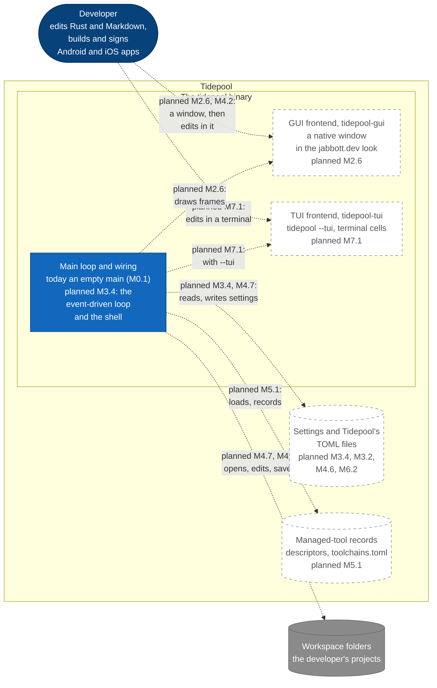

### 1.2 The tools the binary drives

Every tool is found, installed, updated and started by
`tidepool-toolchain` (ADR-0002), with consent before any install; that
crate's first task is M5.1. The core binary opens no sockets, and the
network is reached only through child processes (ADR-0009). What each
arrow's task adds:

- `curl`, HTTPS only: every download, its SHA-256 checked (M5.3).
- rustup, the Rust toolchain and `cargo`: installed (M5.5), and cargo
  tasks run (M6.4).
- rust-analyzer: installed (M5.5), and spoken to in LSP over stdio (M6.7).
- `git`: detected (M5.5), and run for status and diff (M8.1).
- The JDK, the Android SDK and NDK, and bundletool: installed and driven
  (M10.1).
- Xcode and its command-line tools, on macOS only: detected, and the
  install guided (M11.2).
- A remote Mac (ADR-0008): `ios::remote` syncs the project to it with
  `rsync` over `ssh`, runs the iOS pipeline there and copies the artifacts
  back (M11.5).
- A debug adapter, `lldb-dap` or CodeLLDB: installed, and spoken to in DAP
  (M13.1).

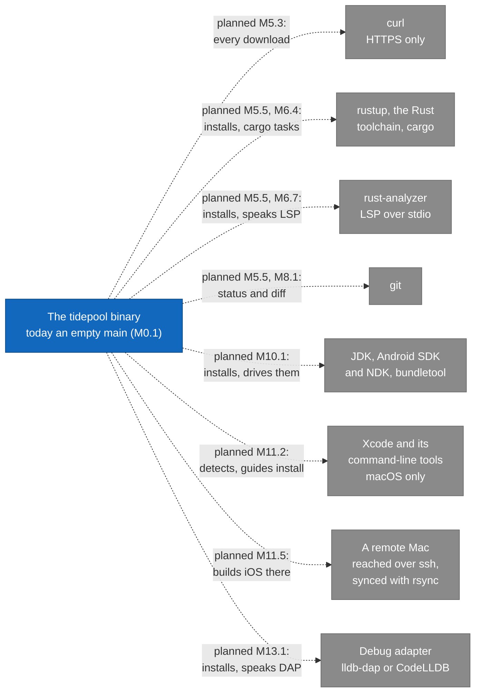

### 1.3 The language agents

Agents speak the Tidepool Agent Protocol (TAP) over stdio (M9.3). The
reference agents live in their own Cargo workspace, `agents/`, and are
never linked into Tidepool (`docs/01-architecture.md` → "Layers"):
`tp-agent-mock` (M9.2), and `tp-agent-local` and `tp-agent-claude` (M9.6),
which reach a model server through `curl`, or over plain HTTP on loopback.
Any other program with an `agent.toml` that speaks TAP is an agent too.

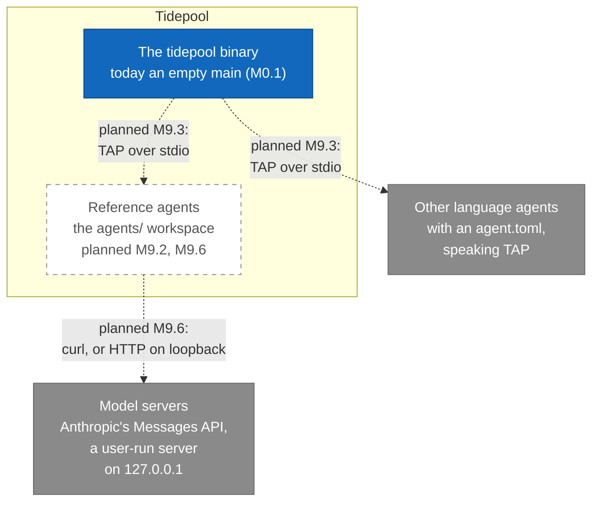

### 1.4 The development tools

`xtask` is built: the CI gate and fuzz smoke run through it, locally and on
GitHub Actions. It starts no program but `cargo` (ADR-0017, ADR-0027).

- `xtask` runs as `cargo xtask` with one of `ci`, `deps`, `layers`,
  `crates`, `features`, `unsafe-audit`, `headers`, `workflows`, `ucd`,
  `fuzz-smoke` and `site`. It starts `cargo` for `fmt`, `clippy`, `test`,
  `metadata`, `locate-project`, a `cargo test` per fuzz target, and
  `site`'s two `cargo run --example` (ADR-0030).
- `ci.yml` runs `cargo xtask ci` on Linux, macOS and Windows, then
  `cargo xtask fuzz-smoke --secs 30` on Linux.
- `pages.yml` runs `cargo xtask site` once CI has passed on a push to
  `main`, and deploys the page it builds to GitHub Pages, at
  <https://jabbott.dev/Tidepool/> once the repository's Pages source is
  "GitHub Actions" (ADR-0030).
- `cargo` is the pinned toolchain, 1.99.0, from `rust-toolchain.toml`.

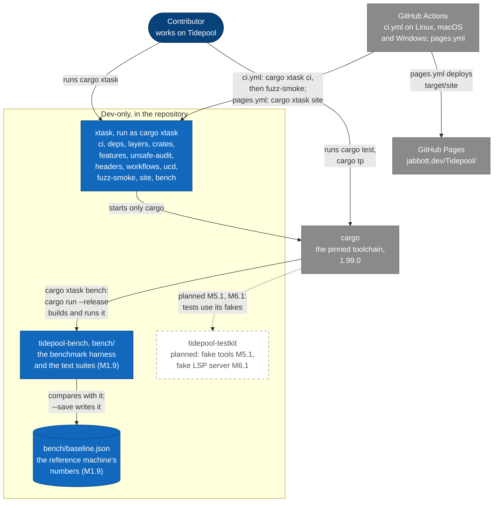

- Which crates' tests may use `tidepool-testkit` is decided in M5.1: today
  the matrix lets only `tidepool-bench` use it (`docs/04-quality.md` →
  `layers`).

### 1.5 What the development tools read and write

`xtask` reads the repository's files and changes only two things: the
generated grapheme tables, and, after a replay that died, the name of the
input the replay died on. `site` also writes the demo page into
`target/site`, or the directory `--out` names. `tidepool-bench`, which
`cargo xtask bench` runs, reads `bench/baseline.json` and writes it only
with `--save` (ADR-0035). `codeql.yml` analyzes the Rust code and the
workflows.

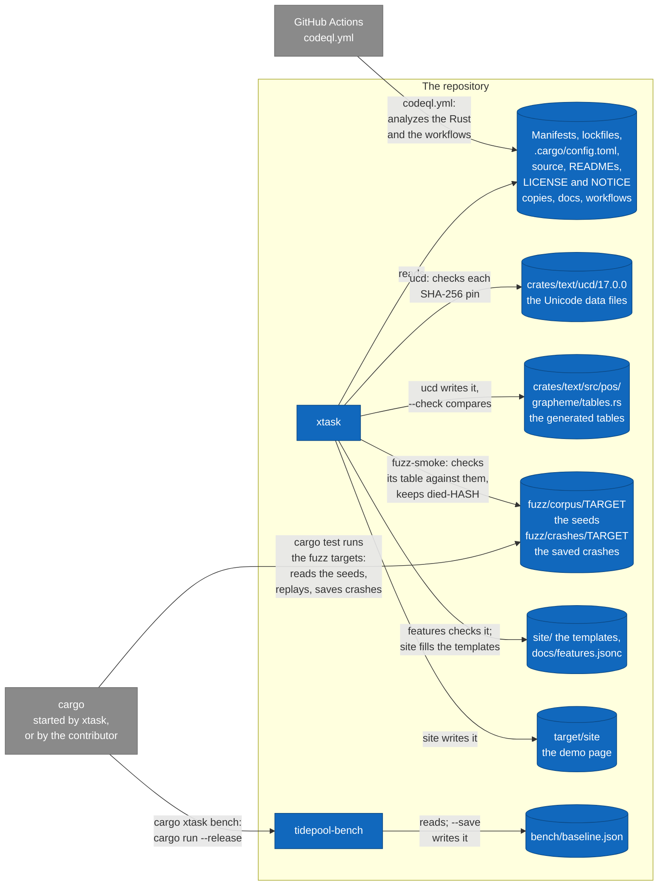

- `fuzz/crashes/` holds files only after a finding or a replay; the
  engine makes its directories as it needs them.

## 2. Components of the tidepool binary

The binary's crates by layer (`docs/01-architecture.md` → "Layers"), in
five diagrams. Every arrow is an edge of the dependency matrix. No crate of
the binary declares a dependency on another yet, so each edge is dotted and
labelled with the task the roadmap or spec ties to its use, except the two
dev-dependencies on `tidepool-core` that the tests of `codec` and `text`
use. The diagrams run left to right, from a crate to the crates it uses.

### 2.1 Layers 0 and 1: foundations, OS behavior, formats and engines

`core`, `codec` and `text` are built, and `sys` has its Linux declarations
(M2.1); `platform` is its crate root. Those two allow `unsafe_code`. The
other four crates are empty.

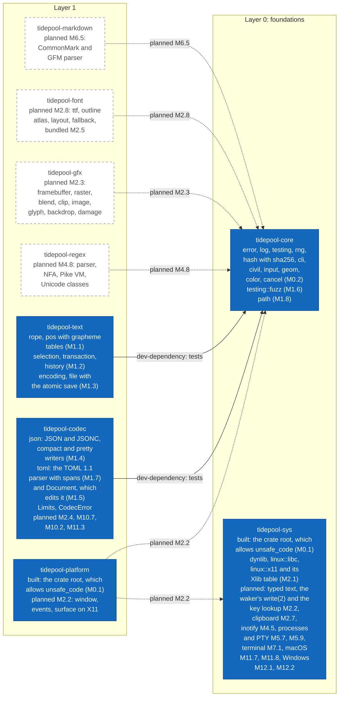

- The libraries of `codec` and `text` use nothing from `core`; their tests
  use `core::testing` (property tests and the fuzz engine) and `core::rng`.

### 2.2 Layer 2: services

All six service crates are empty. Each arrow is labelled with the task
whose module first needs that crate.

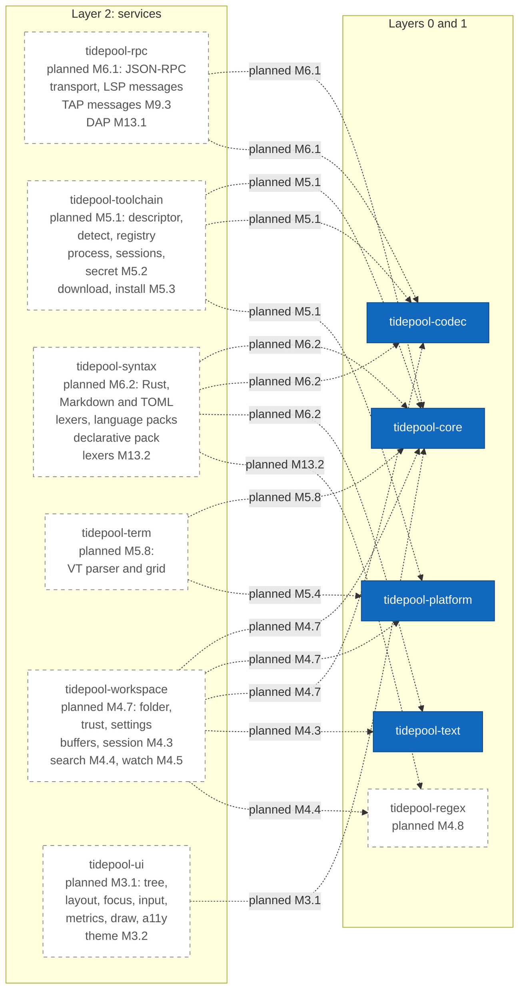

- `toolchain` first needs `platform` in M5.1, whose `detect` searches the
  standard tool locations that `platform::dirs` gives (M2.7). It reaches
  the OS through `platform::process` (M5.7, used from M5.2) and starts
  every outside program Tidepool drives. `term` gets its PTY from
  `platform::pty` (M5.9); the terminal panel (M5.4) reaches it through
  `term`, since `editor`'s row has no `platform`.

### 2.3 Layer 3: language and tool features

The four feature crates are empty. They reach outside programs only
through `toolchain`.

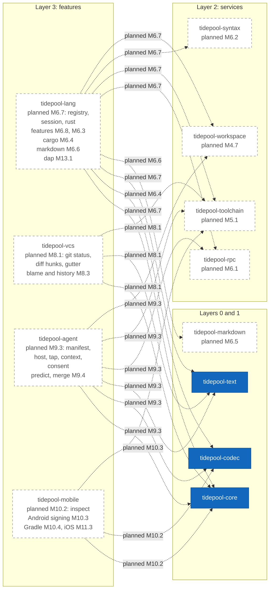

- `lang` and `agent` start their servers and agents through
  `toolchain::sessions` (M5.2) and speak to them over `rpc`'s JSON-RPC
  transport; `vcs` runs `git` through `toolchain::process`.

### 2.4 Layer 4: the editor

`tidepool-editor` is where every feature is written once (ADR-0003); it
draws through `ui` and never depends on `gui` or `tui`. Its thirteen edges
are added as its panels land.

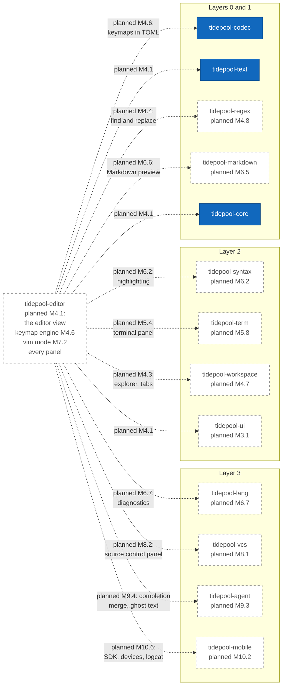

### 2.5 Layers 4 and 5: the frontends and the binary

The frontends paint `ui`'s draw lists and know nothing of editors,
languages or tools (`docs/subsystems/frontends.md`). `app` connects them to
`editor`. The matrix lets `app` use every crate in the rows above its own;
only six edges are drawn, each labelled with the task whose work needs it.

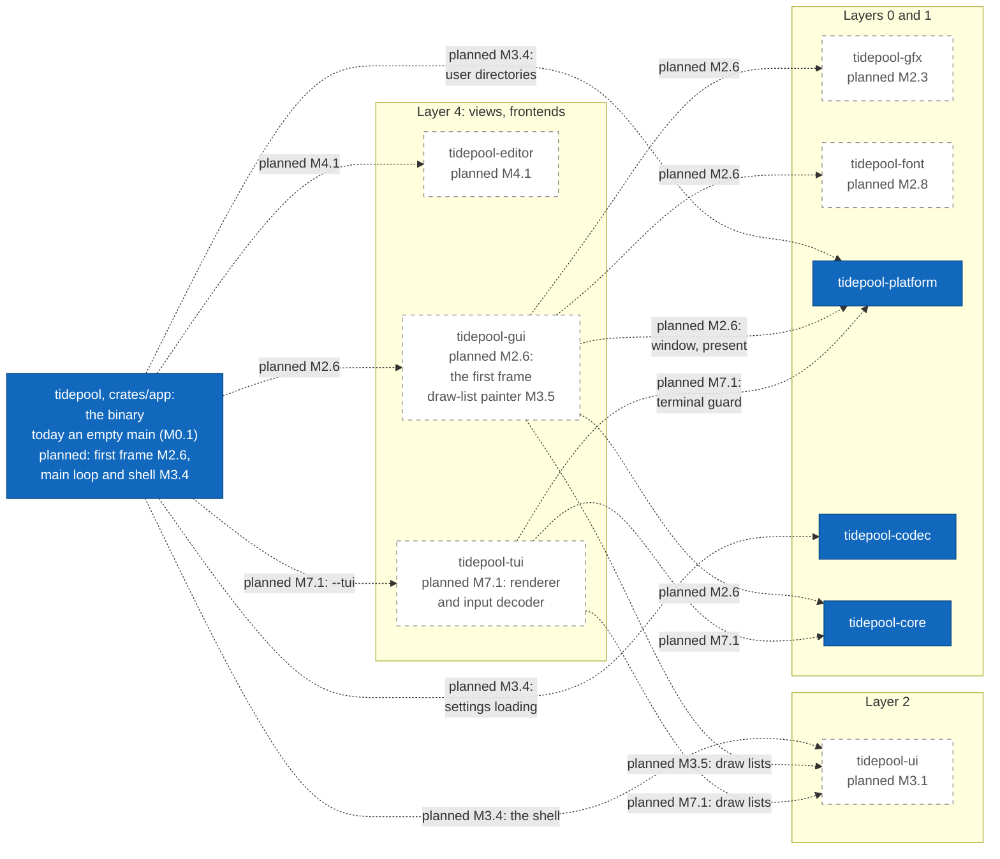

- The matrix also lets `gui` use `codec`; no task or spec gives it a use
  yet, so no edge is drawn.
- `editor` never depends on `gui` or `tui`, and the frontends never depend
  on `editor` (`docs/01-architecture.md` → "Dependency matrix").

## 3. Components of xtask

`xtask` links only `tidepool-core` and `tidepool-codec`, its row in the
matrix, and starts no program but `cargo`. Its modules are drawn in three
views: the commands and the checks, what the checks build on, and what each
check reads, runs and writes.

### 3.1 Modules: the commands and the checks

`main.rs` runs `ci`, one check, `fuzz-smoke`, `site` or `bench`, and exits
0, 1 or 2. `check` holds the `ci` steps in order, and in its `LATER` table
the commands still to come; `site` runs the same steps through `check`'s
one runner (ADR-0030). `bench` is handled before the command line is
parsed, so every argument after it goes to `tidepool-bench` (ADR-0035).

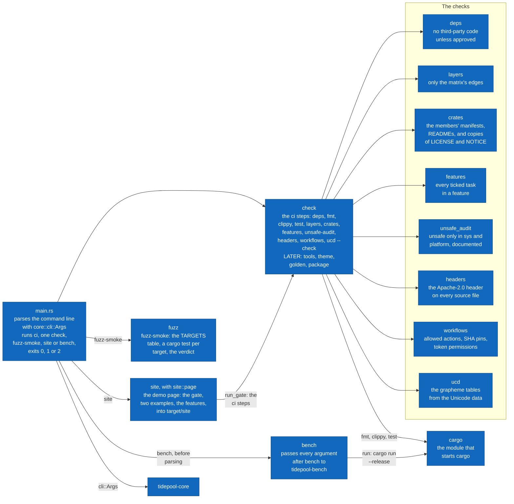

- `golden`, `theme`, `tools` and `package` are names in `check`'s `LATER`
  table and fail as not yet implemented (M2.4, M3.2, M5.1, M11.6, M12.4,
  M14.4); `ci`'s summary lists `tools` and `theme`.

### 3.2 Modules: what the checks build on

An arrow goes to each module whose items a module uses. Arrows to `error`
and `walk`, which nearly every module uses, are left out, as are those to
`check` for its `Report` and `printable`. So `workflows`, which uses only
those, is not drawn here.

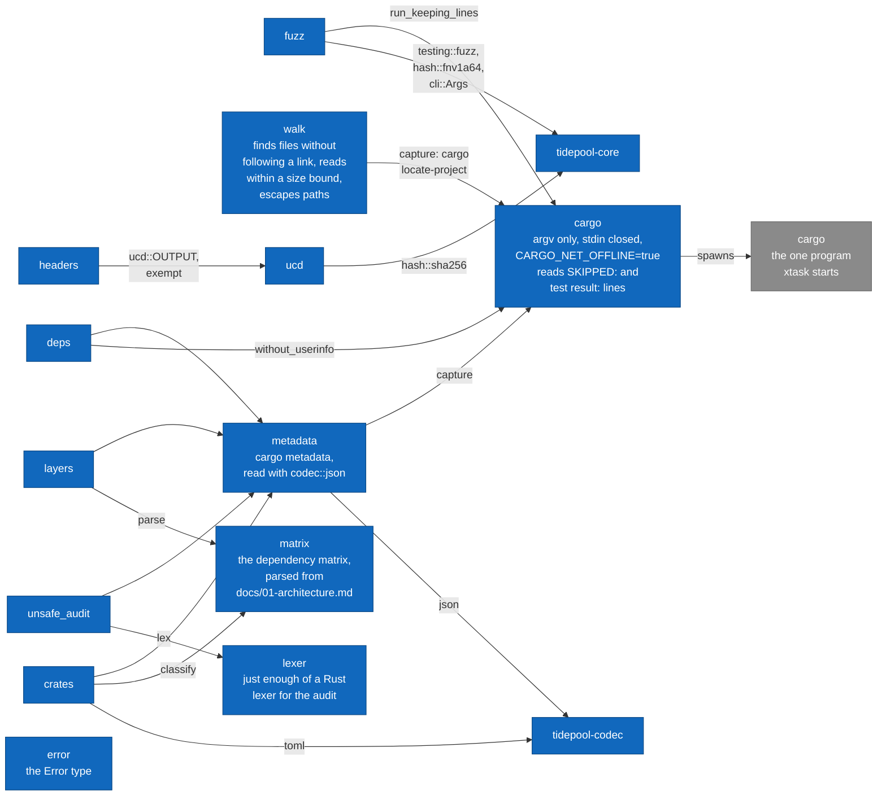

`features` and `site` (ADR-0030) build on the modules above. `site` runs
the steps of `ci` through `check::run_gate`, the runner `ci` itself uses,
and starts the two examples through `cargo::capture`.

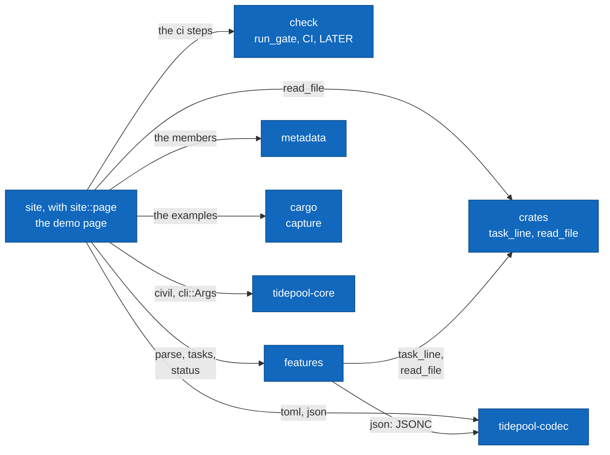

### 3.3 What each check reads, runs and writes

The checks find and read their files through `walk`, which never follows a
symbolic link and asks `cargo locate-project` which directories are
workspace roots; `ucd` and `fuzz` also look at their own directories
without following a link. Only `ucd` and `fuzz` change anything in the
repository; `site` writes only its output directory.

```mermaid
flowchart LR
    subgraph b_checks["xtask"]
        m_deps["deps"]
        m_layers["layers"]
        m_crates["crates"]
        m_features["features"]
        m_unsafe["unsafe_audit"]
        m_headers["headers"]
        m_workflows["workflows"]
        m_ucd["ucd"]
        m_fuzz["fuzz"]
        m_site["site"]
        m_bench["bench"]
        m_steps["check: the fmt, clippy and test steps of ci"]
    end
    e_cargo["cargo"]
    s_manifests[("Cargo.toml and Cargo.lock files, .cargo/config.toml in any directory")]
    s_allow[("xtask/deps-allowlist.txt")]
    s_every[("Every file in the repository<br/>for compiled artifacts and links")]
    s_arch[("docs/01-architecture.md<br/>the dependency matrix")]
    s_roadmap[("docs/roadmap.md<br/>the task lines")]
    s_readmes[("Each member's README.md")]
    s_license[("LICENSE and NOTICE<br/>the root's, and the copies<br/>beside each member's<br/>Cargo.toml")]
    s_rs[("Every .rs file")]
    s_source[("Source files: .rs, .sh, .github/workflows YAML,<br/>.html, .css, .js")]
    s_features[("docs/features.jsonc")]
    s_site[("site/: index.html, llms.txt,<br/>tidepool.css, tidepool.js;<br/>rust-toolchain.toml")]
    s_git[(".git: HEAD, its loose ref<br/>or packed-refs")]
    s_out[("target/site, or --out DIR,<br/>marked .tidepool-site")]
    s_wf[(".github/workflows YAML files")]
    s_ucd[("crates/text/ucd/17.0.0")]
    s_tables[("crates/text/src/pos/grapheme/tables.rs")]
    s_fuzz[("fuzz/, fuzz/corpus/, fuzz/crashes/")]

    m_deps -->|"reads lockfiles as text, cargo configs"| s_manifests
    m_deps -->|"reads"| s_allow
    m_deps -->|"walks"| s_every
    m_deps -->|"cargo metadata --offline --locked, each workspace"| e_cargo
    m_layers -->|"parses the matrix"| s_arch
    m_layers -->|"cargo metadata --offline --no-deps"| e_cargo
    m_crates -->|"reads each member's and the root's Cargo.toml"| s_manifests
    m_crates -->|"the first line, the sections<br/>in order, the task IDs"| s_readmes
    m_crates -->|"compares each member's<br/>copies with the root's,<br/>byte for byte"| s_license
    m_crates -->|"reads the task IDs"| s_roadmap
    m_crates -->|"cargo metadata --offline --no-deps"| e_cargo
    m_features -->|"reads"| s_features
    m_features -->|"reads the task lines"| s_roadmap
    m_site -->|"reads the templates,<br/>copies the two files"| s_site
    m_site -->|"reads HEAD's hash<br/>in a local build"| s_git
    m_site -->|"writes the page,<br/>removes only what<br/>it wrote before"| s_out
    m_site -->|"the ci steps, then<br/>cargo run --example, twice"| e_cargo
    m_bench -->|"cargo run --release --quiet -p tidepool-bench"| e_cargo
    m_unsafe -->|"lexes"| s_rs
    m_unsafe -->|"cargo metadata --offline --no-deps, the crate roots"| e_cargo
    m_headers -->|"checks the header at the top of each"| s_source
    m_workflows -->|"reads line by line"| s_wf
    m_ucd -->|"checks five SHA-256 pins, parses three files"| s_ucd
    m_ucd -->|"writes it, or with --check compares"| s_tables
    m_fuzz -->|"checks the table against them, keeps died-HASH"| s_fuzz
    m_fuzz -->|"cargo test --profile fuzz, a target at a time"| e_cargo
    m_steps -->|"fmt --check, clippy -D warnings, test --workspace"| e_cargo

    classDef built fill:#1168bd,stroke:#0b4884,color:#ffffff
    classDef external fill:#8a8a8a,stroke:#6b6b6b,color:#ffffff
    classDef store fill:#1168bd,stroke:#0b4884,color:#ffffff
    class m_deps,m_layers,m_crates,m_features,m_unsafe,m_headers,m_workflows,m_ucd,m_fuzz,m_site,m_bench,m_steps built
    class s_manifests,s_allow,s_every,s_arch,s_roadmap,s_readmes,s_license,s_rs,s_source,s_wf,s_ucd,s_tables,s_fuzz,s_features,s_site,s_git,s_out store
    class e_cargo external
```

- Every cargo child runs in the root with `CARGO_NET_OFFLINE=true` and its
  standard input closed; `ci` compiles nothing once `deps` has failed.
- `fuzz` renames the `.last-input` a replay wrote into `died-HASH`, or
  removes it when it is already a saved crash, through `core`'s
  `keep_died`.

## 4. The dev-only parts

What exists only to test and measure Tidepool: the fuzzer, the
property-test harness and the benchmark harness are built; the fakes are
planned.

### 4.1 The fuzz engine and its targets

Each parser crate has its targets in `tests/fuzz.rs`, run by every `cargo
test` on the saved crashes and seeds alone, and on mutated inputs when
`fuzz-smoke` sets `TIDEPOOL_FUZZ_SECS` (ADR-0027).

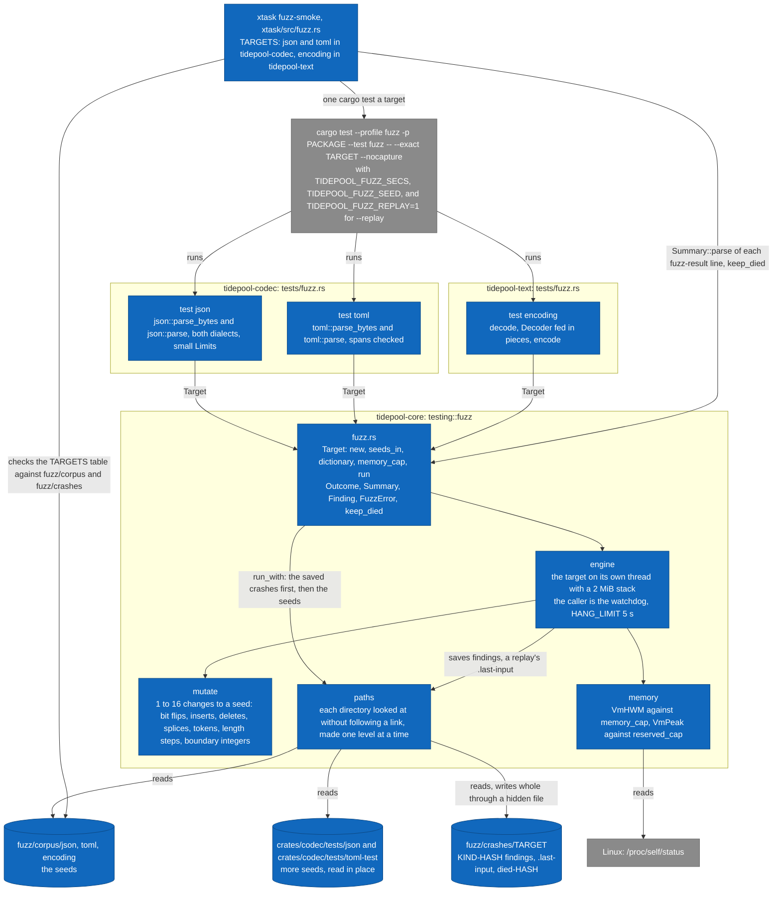

- Each later parser adds a target with its task: `qoi` (M2.4), `ttf`
  (M2.8), `regex` (M4.8), `vt` (M5.8), framing in `rpc` (M6.1), the
  Markdown parser (M6.5), git's parsers (M8.1), `inflate` and `png`
  (M10.7), and `zip` and `xml` (M10.2).

### 4.2 Test support: property tests, benchmarks and fakes

The property-test harness in `core::testing` (`check`, `check_sized` and
`assert_approx`, seeded by `TIDEPOOL_SEED`, and `rng::Pcg32`) is built and
used by the tests of `codec` and `text`. The benchmark harness,
`tidepool-bench` (M1.9), warms each suite up, takes samples within a time
budget, and reports the median and p95 against `bench/baseline.json`; its
suites measure the text engine: rope edits, positions, 10,000-caret
keystrokes, typing and graphemes (ADR-0035). `tidepool-testkit` is an
empty crate; its edges are the matrix's row for it. `testkit` keeps fake
tools in
`crates/testkit/fake-tools/` (M5.1), and the fake LSP server's transcripts
in `crates/testkit/transcripts/` (M6.1).

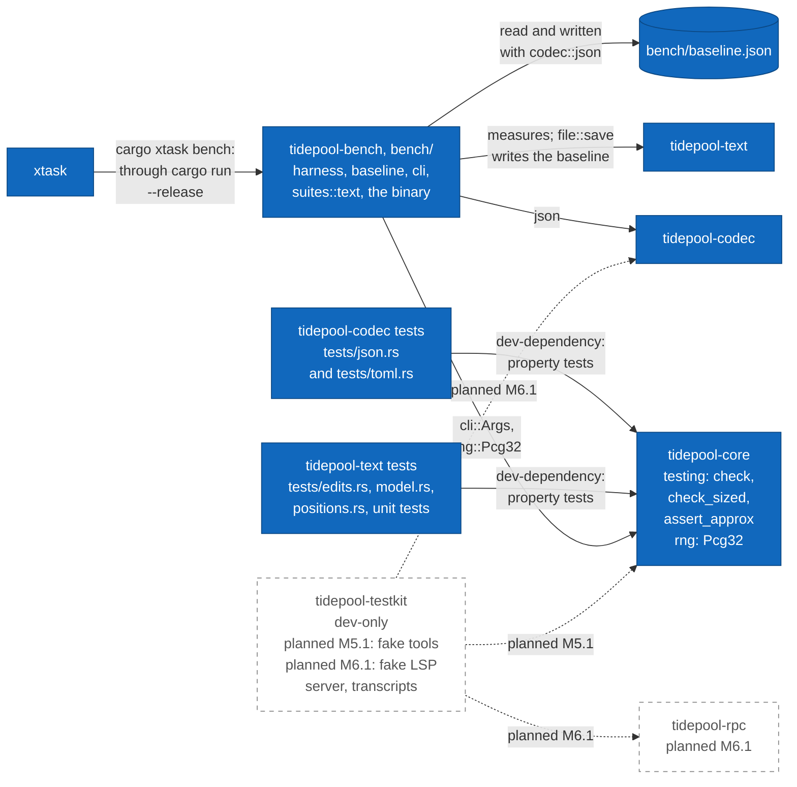

- The matrix lets `tidepool-bench` use any workspace crate, and lets only
  it use `tidepool-testkit`, and only from `[dev-dependencies]`. The edges
  from the tests of `toolchain`, `vcs`, `mobile`, `rpc` and `lang` to
  `testkit` are decided in M5.1, so none is drawn.
- The mock agent `tp-agent-mock` (M9.2), in `agents/`, plays the same part
  for TAP: the conformance suite runs against it.

## The crates

Every workspace member, its layer, its `unsafe` policy, what it has and
what is planned, and its declared workspace dependencies. "deny" is the
workspace's `unsafe_code = "deny"`, which every member inherits through
`[lints] workspace = true`; "allowed" is the `#![allow(unsafe_code)]` in
the crate's `src/lib.rs`. The edges each crate may have are in
`docs/01-architecture.md` → "Dependency matrix". Every member also has a
`README.md` in ADR-0028's shape and copies of the root's `LICENSE` and
`NOTICE`, and every library a `ReadmeDoctests` item that runs its README's
examples as doc tests (M0.13) and, but `sys` and `platform`, the attribute
that forbids `unsafe` in them (M0.15); the table leaves those out.

| Package | Path | Layer | `unsafe` | Built (task) | Planned (tasks) | Declared workspace dependencies |
| :- | :- | :- | :- | :- | :- | :- |
| `tidepool-core` | `crates/core` | 0, foundations | deny | `error`, `log`, `testing`, `rng`, `hash`, `cli`, `civil`, `input`, `geom`, `color`, `cancel` (M0.2); `testing::fuzz` (M1.6); `path` (M1.8) | — | none |
| `tidepool-sys` | `crates/sys` | 0, foundations | allowed | the crate root (M0.1); `dynlib`, `linux::libc`, `linux::x11` with the `Xlib` table (M2.1) | M2.2 (typed text, the waker's `write(2)`, the key lookup), M2.7, M4.5, M5.7, M5.9, M7.1, M11.7, M11.8, M12.1, M12.2 | none |
| `tidepool-platform` | `crates/platform` | 1, OS behavior, formats, engines | allowed | the crate root (M0.1) | M2.2, M2.7, M4.5, M5.7, M5.9, M7.1, M11.7, M11.8, M11.1, M12.1, M12.2 | none |
| `tidepool-codec` | `crates/codec` | 1, OS behavior, formats, engines | deny | `json` (M1.4), `toml` (M1.7) and its `Document` (M1.5), fuzz targets `json` and `toml` (M1.6) | M2.4, M10.7, M10.2, M11.3 | `core`, dev only |
| `tidepool-text` | `crates/text` | 1, OS behavior, formats, engines | deny | `rope`, `pos` (M1.1); `selection`, `transaction`, `history` (M1.2); `encoding`, `file` (M1.3); fuzz target `encoding` (M1.6) | none: every planned module exists | `core`, dev only |
| `tidepool-regex` | `crates/regex` | 1, OS behavior, formats, engines | deny | nothing | M4.8 | none |
| `tidepool-gfx` | `crates/gfx` | 1, OS behavior, formats, engines | deny | nothing | M2.3, M2.4 | none |
| `tidepool-font` | `crates/font` | 1, OS behavior, formats, engines | deny | nothing | M2.8, M2.5 | none |
| `tidepool-markdown` | `crates/markdown` | 1, OS behavior, formats, engines | deny | nothing | M6.5 | none |
| `tidepool-rpc` | `crates/rpc` | 2, services | deny | nothing | M6.1, M9.3, M13.1 | none |
| `tidepool-toolchain` | `crates/toolchain` | 2, services | deny | nothing | M5.1, M5.2, M5.3, M5.5, M10.1, M11.2, M12.3 | none |
| `tidepool-syntax` | `crates/syntax` | 2, services | deny | nothing | M6.2, M13.2, M13.3 | none |
| `tidepool-term` | `crates/term` | 2, services | deny | nothing | M5.8, M5.4 | none |
| `tidepool-workspace` | `crates/workspace` | 2, services | deny | nothing | M4.7, M4.3, M4.4, M4.5 | none |
| `tidepool-ui` | `crates/ui` | 2, services | deny | nothing | M3.1, M3.2, M3.6, M3.3 | none |
| `tidepool-lang` | `crates/lang` | 3, language and tool features | deny | nothing | M6.7, M6.8, M6.3, M6.4, M6.6, M13.1 | none |
| `tidepool-vcs` | `crates/vcs` | 3, language and tool features | deny | nothing | M8.1, M8.3 | none |
| `tidepool-agent` | `crates/agent` | 3, language and tool features | deny | nothing | M9.3, M9.4 | none |
| `tidepool-mobile` | `crates/mobile` | 3, language and tool features | deny | nothing | M10.2, M10.3, M10.4, M10.5, M10.6, M11.3, M11.4, M11.5 | none |
| `tidepool-editor` | `crates/editor` | 4, views and frontends | deny | nothing | M4.1, M4.6, M4.2, M4.3, M4.4, M5.4, M5.6, M6.2, M6.7, M6.8, M6.3, M6.6, M7.2, M7.3, M7.4, M8.2, M8.3, M9.4, M9.5, M10.6, M11.6, M13.4 | none |
| `tidepool-gui` | `crates/gui` | 4, views and frontends | deny | nothing | M2.6, M3.5 | none |
| `tidepool-tui` | `crates/tui` | 4, views and frontends | deny | nothing | M7.1, M7.5 | none |
| `tidepool` (app) | `crates/app` | 5, application | deny | an empty `main` (M0.1) | M2.6, M3.4, M4.9, M7.1, M7.5, M14.4 | none |
| `xtask` | `xtask` | 6, tools | deny | `deps`, `layers`, `unsafe-audit`, `ci` (M0.3), with `unsafe-audit`'s rules for doc tests, proc macros and pass-through macros (M0.15); `headers` (M0.7); `workflows` (M0.8); `crates` (M0.9), with ADR-0028's sections and order and the `LICENSE` and `NOTICE` copies (M0.13); escaped paths, links never resolved (M0.10); `ucd` (M1.1); `fuzz-smoke` (M1.6); `features` and `site`, with `headers` for HTML, CSS and JS (M0.14, which awaits its published page); `bench` (M1.9) | `golden` (M2.4), `theme` (M3.2), `tools` (M5.1), `package` (M11.6, M12.4, M14.4) | `core`, `codec` |
| `tidepool-bench` | `bench` | 6, tools | deny | `harness`, `baseline`, `cli`, `suites::text` and the binary (M1.9) | suites for M4.1, M4.2, M4.4, M9.4, M14.3 | `core`, `codec`, `text` |
| `tidepool-testkit` | `crates/testkit` | 6, tools (dev-only) | deny | nothing | M5.1, M6.1 | none |

## Sources

- `Cargo.toml`, `.cargo/config.toml`, `rust-toolchain.toml` and each
  member's `Cargo.toml`
- each member's `README.md` (`## Status`), and the root's `LICENSE` and
  `NOTICE` and each member's copies
- `crates/core/src/lib.rs`, `crates/core/src/testing.rs`,
  `crates/core/src/testing/fuzz.rs` and its modules `engine.rs`,
  `memory.rs`, `mutate.rs` and `paths.rs`
- `crates/codec/src/lib.rs`, `crates/codec/tests/fuzz.rs`
- `crates/text/src/lib.rs`, `crates/text/tests/fuzz.rs`
- `crates/sys/src/lib.rs`, `dynlib.rs`, `linux.rs`, `linux/libc.rs`,
  `linux/x11.rs`; `crates/platform/src/lib.rs`,
  `crates/app/src/main.rs`, every file in `bench/src/`, `crates/testkit/src/lib.rs`
- `xtask/Cargo.toml` and every file in `xtask/src/`
- `.github/workflows/ci.yml`, `.github/workflows/codeql.yml`
- `docs/00-overview.md`; `docs/01-architecture.md` for the layers, the
  dependency matrix and the data flow; `docs/04-quality.md` for the checks,
  fuzz smoke, benchmarks and fakes; `docs/roadmap.md` for what is planned
- `docs/subsystems/toolchains.md`, `agents.md`, `languages.md`,
  `editor.md`, `frontends.md`, `ui-and-theme.md`, `rendering.md`,
  `sys-and-platform.md` and `mobile.md`
- `docs/decisions.md`: ADR-0002, ADR-0003, ADR-0008, ADR-0009, ADR-0010,
  ADR-0017, ADR-0018, ADR-0027, ADR-0028 and ADR-0029
