# UML class diagrams

These diagrams show the types the built crates have: `tidepool-core`,
`tidepool-codec`, `tidepool-text`, `xtask`, `tidepool-bench`,
`tidepool-sys`, `tidepool-platform`, `tidepool-gfx` and `tidepool-font`.
Each shows what a type owns,
what it refers to, which traits it implements, and the few fields and
methods the design rests on, under their names in the code. An overview of
how the crates' types connect comes first, then one or more diagrams per
area, then a list in prose of the types the specs name for crates that are
still empty.

Drawn from the code and docs as of roadmap task M2.5 (2026-11-17, version 0.1), after M2.8, M2.4, M2.7 and ADR-0043. What the code has is drawn solid; what the roadmap plans is dashed and labelled with the task that builds it (ADR-0029).

## Legend

A class diagram here shows only types that exist in the code (ADR-0029).
None of its boxes or lines is planned work. The dashed lines below are
UML's own: realization and dependency. Planned types are listed in prose in
section 28, and drawn in the other files of `diagrams/` under the names
their specs give.

| Notation | Means |
| :- | :- |
| `A <\|.. B`, a dashed line with a hollow triangle | B implements the trait A |
| `A *-- B`, a filled diamond | A owns B: as a field, a `Vec`, an `Option`, a `Box` or an enum variant's value |
| `A o-- B`, a hollow diamond | A holds B without being its only owner: an `Arc`, a borrow or a `static` slice |
| `A --> B`, a solid arrow | A refers to B by an id or an index |
| `A ..> B`, a dashed arrow | A uses B in a method, or makes or returns one |
| `"1"`, `"0..*"`, `"1..*"` at a line's ends | How many of each side there are |
| `+` | Public. In `xtask`, a binary, `+` marks `pub(crate)`: what its other modules use |
| `-` | Private, `pub(crate)` or `pub(super)` (outside `xtask`) |
| `<<enumeration>>` | An enum; the box lists its variants, and some of its methods |
| `<<trait>>` | A trait |
| `<<alias>>` | A type alias |
| `<<union>>` | A C union, `#[repr(C)] union` |
| `<<module>>` | A module's free functions and constants, in one box |
| A name such as `core::cli::Args` | A type from another crate or module, shown for context |

Generic parameters show as `Vec~T~`, which GitHub draws as `Vec<T>`.
References, lifetimes and the error type of a `Result` are left out; a
bare `Result` returns nothing on success. A fixed-size array shows as, for
example, `32 bytes`. Each box shows only some of its fields and methods.

## 1. Overview: types across crates

`tidepool-codec`, `tidepool-text` and `tidepool-font` use nothing from
`tidepool-core` in their libraries; their `tests/fuzz.rs` use
`core::testing::fuzz` as a dev-dependency, and make one
`core::testing::fuzz::Target` per fuzz target (section 26 for `font`).
`xtask` uses `core` and `codec`, as the dependency matrix allows: it reads
`cargo metadata` with `codec::json`, manifests with `codec::toml`, the
golden references with `codec::qoi`, and the fuzz targets' result lines
with `core::testing::fuzz::Summary`.
`tidepool-bench` uses `core::cli::Args`, `codec::json` and the types of
`text` (section 22), and `tidepool-sys` no workspace crate (section 23).
`tidepool-platform` uses `core`'s geometry and input types and `sys`'s
Linux declarations (section 24), and `tidepool-gfx` `core`'s geometry and
colors (section 25).

### 1.1 core and codec, and what xtask uses of them

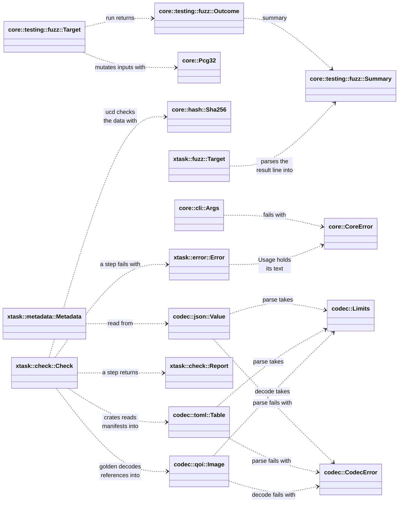

### 1.2 text

The main types of `tidepool-text`, whose library uses no other crate's
types:

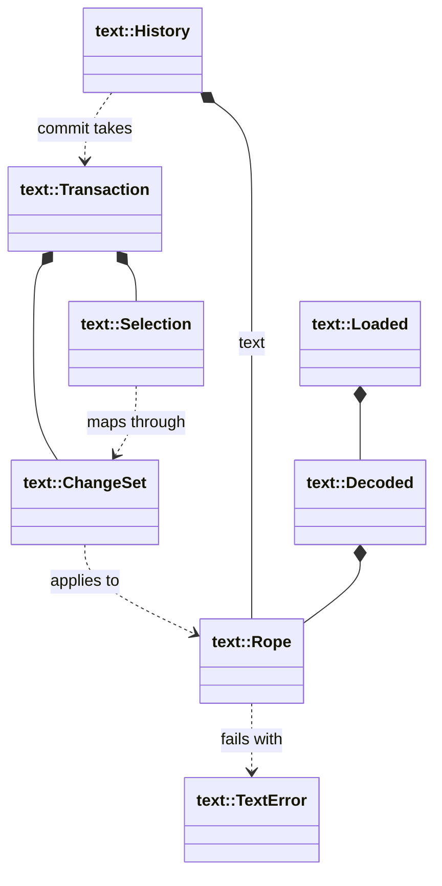

## 2. core: errors, the command line, cancellation and paths

`CoreError` shows the pattern every crate follows: one error enum that
implements `Display` and `std::error::Error`. `ErrorContext` adds
`context` and `with_context` to every `Result`, wrapping the error in a
`WithContext`; `Args` takes a command line apart piece by piece, and an
error about an argument carries its 1-based position (too many arguments
carries the limit).

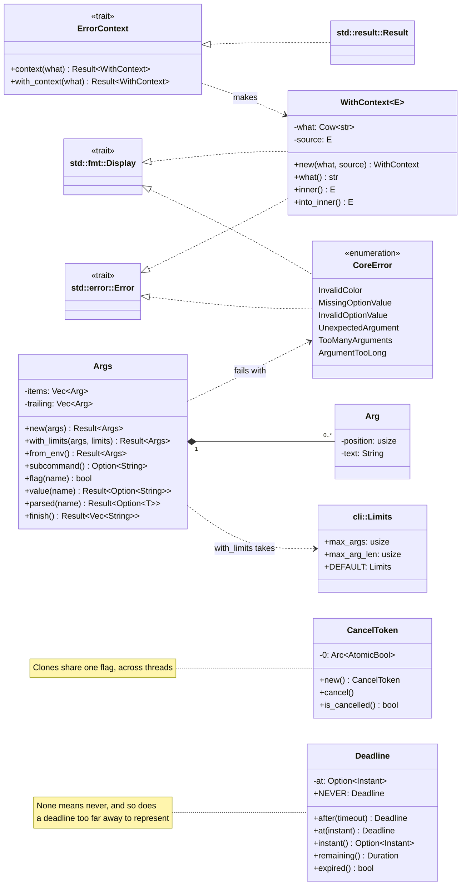

`core::path` (M1.8) shows a path to people and logs without hiding a byte
or letting a name drive a terminal (ADR-0032, ADR-0033), gives a path as
text, and canonicalizes it. `resolve` does so for a path whose end does not
exist yet, and `under` checks containment component by component. Its
error keeps the `std::io::Error` that caused it.

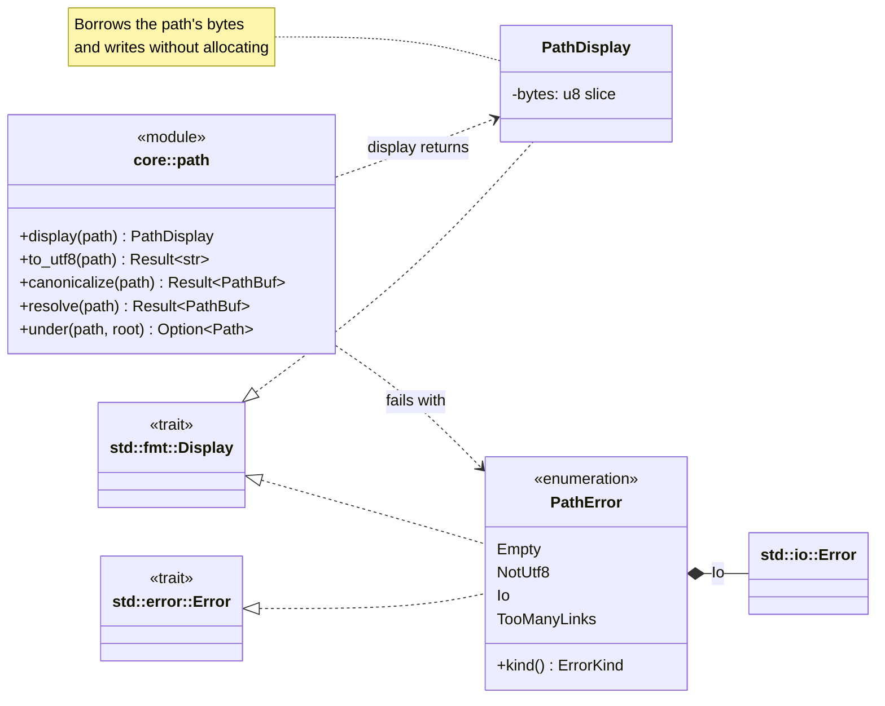

## 3. core: random numbers, hashes and time

`Pcg32` is the one random number generator; it is not `Copy`, so a
generator cannot be copied by accident and replay its numbers. `hash` has
FNV-1a (stable, for files on disk), CRC-32, SHA-256 for downloads, and a
fast hasher for in-memory maps that is not HashDoS-resistant.

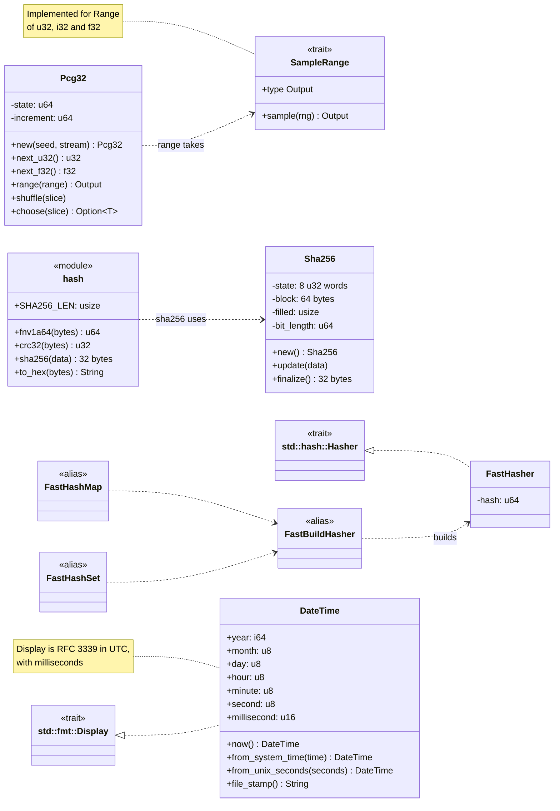

## 4. core: geometry and color

Logical units are `f32` and device pixels `i32`; `Scale` converts between
them through the `ToDevice` and `ToLogical` traits. `Color` is straight
alpha and `PremultipliedColor` premultiplied, which is what blending uses.

### 4.1 Geometry

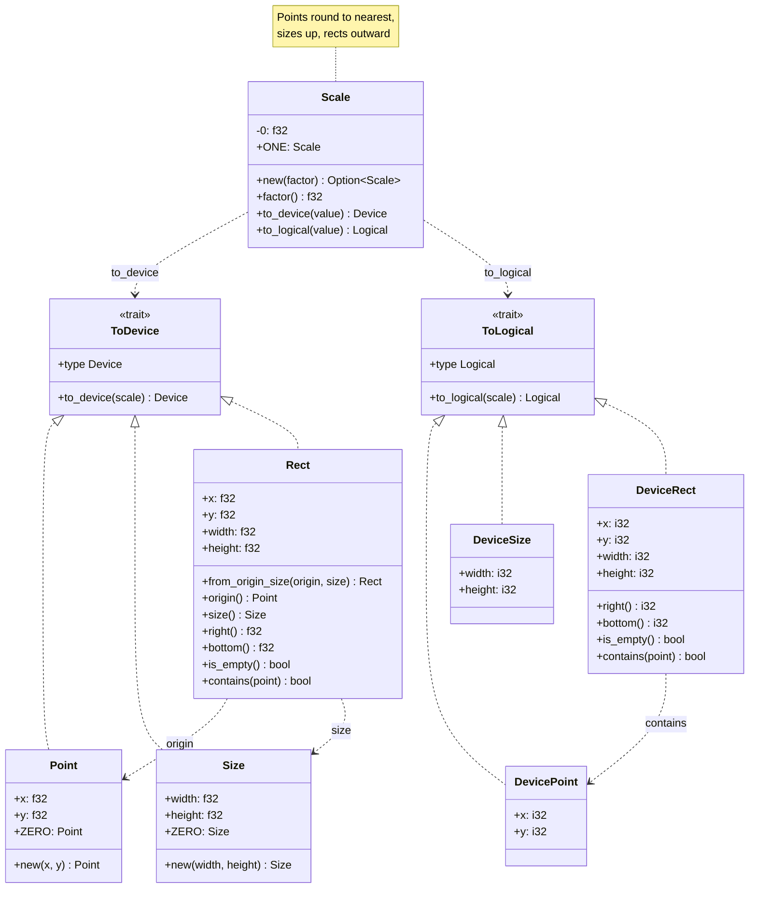

### 4.2 Color

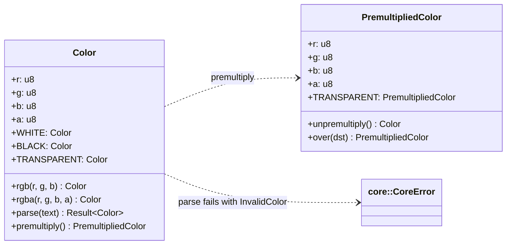

## 5. core: input

`InputEvent` is the one input type every frontend will produce. `Key`
names keys by their USB HID usage ids, and `Modifiers` is a small bit set.
`InputEvent`'s `Debug` shows a typed text as its length, through
`TextLength`, never the text (ADR-0043).

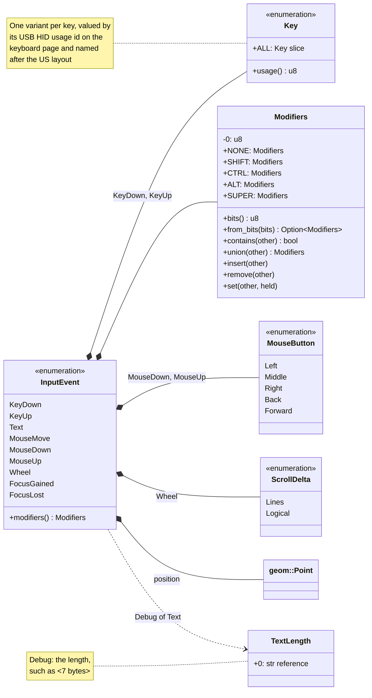

## 6. core: logging

The `log` functions and macros (`error`, `warn`, `info`, `debug`, `trace`)
filter a record, render it with every registered secret redacted, keep it
in the ring buffer, and queue it for the `tidepool-log` thread, which
writes stderr and the rotating file. The `Logger` lives in the static
`LOGGER`, and the `Queue` in the static `SHARED`; a full queue drops lines
and counts them, and never makes a caller wait.

### 6.1 The log functions and the Logger

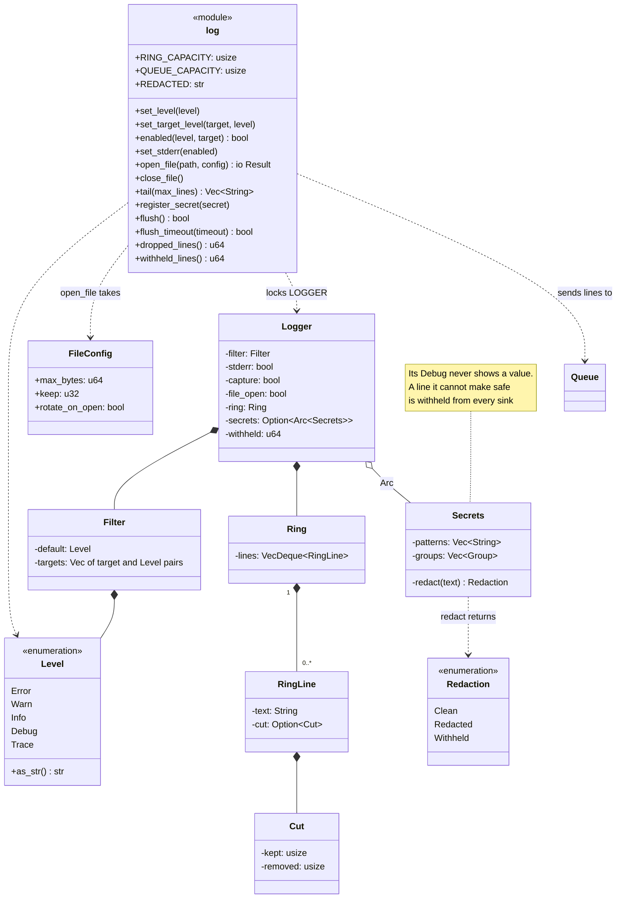

### 6.2 The queue and the log thread

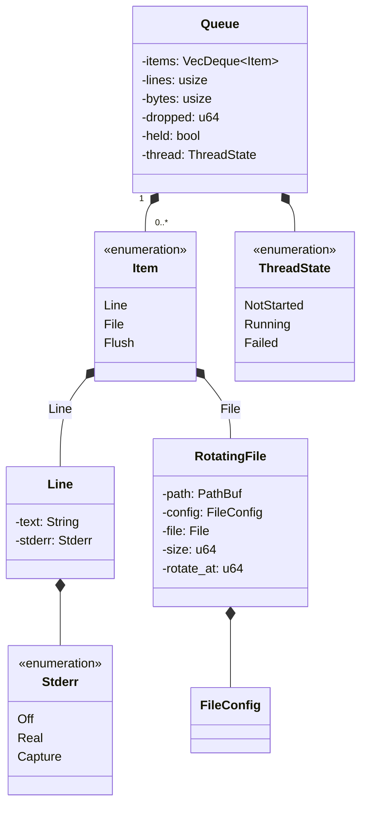

## 7. core: property tests

`check` and `check_sized` run a property on generated cases, from the seed
in `TIDEPOOL_SEED` or the default one. A failure report names the case's
input and ends with the command that reproduces it.

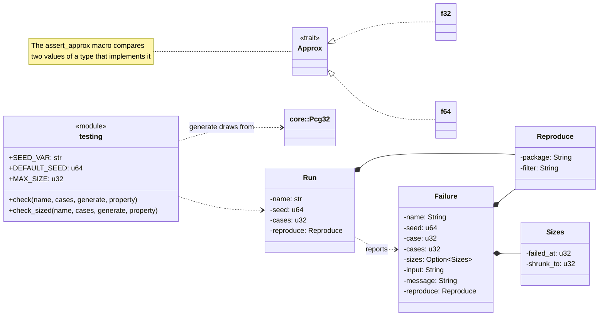

## 8. core: the fuzz engine's API

`testing::fuzz` is the engine behind each parser crate's `tests/fuzz.rs`
(ADR-0027). A `Target` names the function to fuzz and where its seeds and
saved crashes are; `run` replays them on every `cargo test`, and mutates
them when `cargo xtask fuzz-smoke` sets `TIDEPOOL_FUZZ_SECS`. The
`Outcome` it returns prints a report, and its `Summary` is the
`fuzz-result:` line that `fuzz-smoke` reads back.

### 8.1 Targets, runs and findings

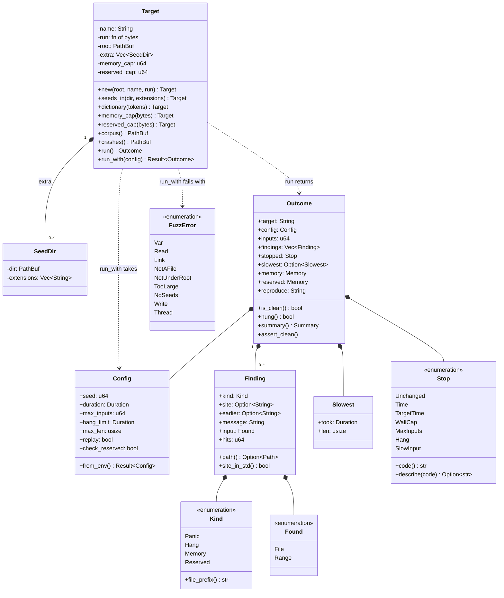

### 8.2 Memory, the result line and kept inputs

What an `Outcome` measured of memory, its `Summary`, written as the
`fuzz-result:` line, and `Kept`:

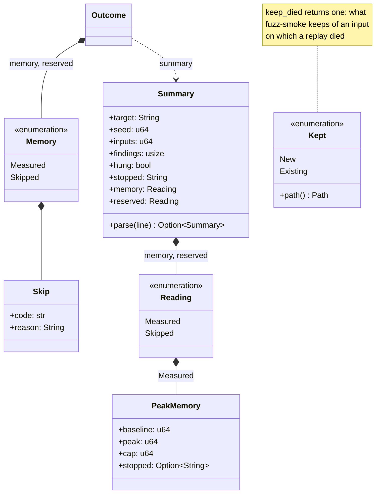

## 9. core: inside the fuzz engine

`Target::run_with` reads the saved crashes and the seeds into a `Plan`,
and `engine::run` runs it. The target runs on a thread of its own, and the
calling thread is the watchdog: the two share a `Shared`, so a hang is
noticed and its input saved. Saved crashes and seeds run unchanged; only
seeds are mutated, each mutated input from its own random stream.


## 10. codec: limits, errors, JSON and QOI

Every parser takes a `Limits` and returns a `CodecError` with an offset,
and for JSON and TOML a line and a column; no parser panics on input.
`json::parse` reads
strict JSON or, with `Dialect::Jsonc`, comments and one trailing comma. An
object keeps its members in document order, duplicates included.

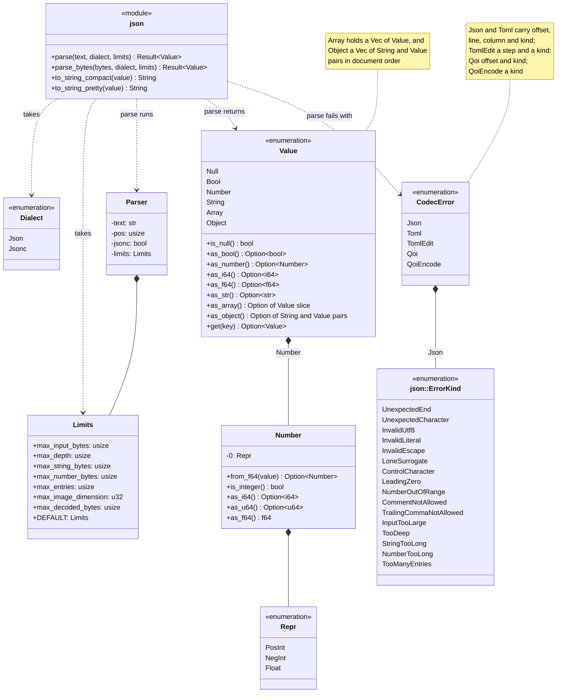

`qoi::decode` reads a QOI 1.0 file into an `Image`, whose pixels are
always RGBA8, rows from the top, whatever its header's `Channels`. The
header's width and height are checked against `max_image_dimension`, and
the pixels' size against `max_decoded_bytes`, before the pixels are
allocated. `qoi::encode` writes an image byte for byte as the reference
encoder does. A file it cannot read is `CodecError::Qoi`, with the byte
offset and a `qoi::ErrorKind`; an image it cannot write is
`CodecError::QoiEncode`, with an `EncodeErrorKind`. `xtask`'s `golden`
keeps its references in QOI (section 20).

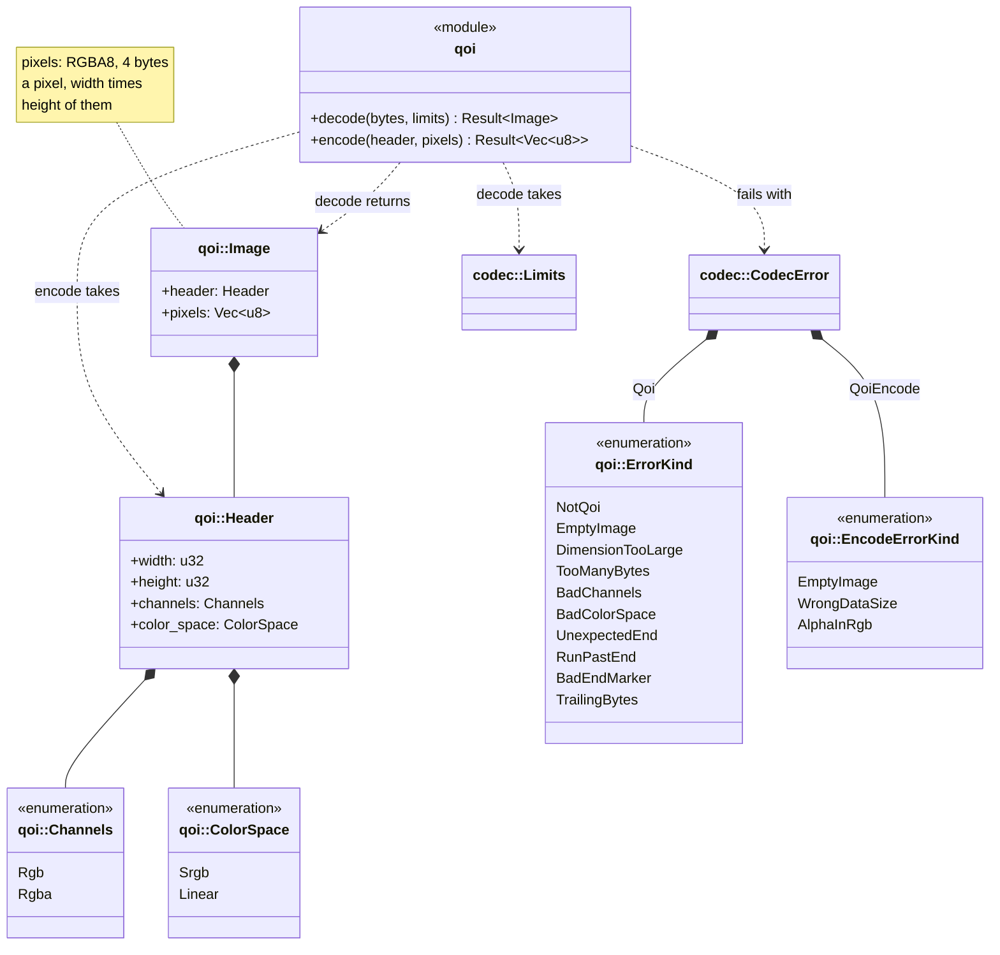

## 11. codec: TOML

`toml::parse` reads TOML 1.1 into a tree whose keys and values carry their
byte spans in the source. A `Table` keeps its entries in order and builds a
hash index only once it has many. `Document` (M1.5, drawn below) keeps a
document's text beside its tree and writes edits back into that text.

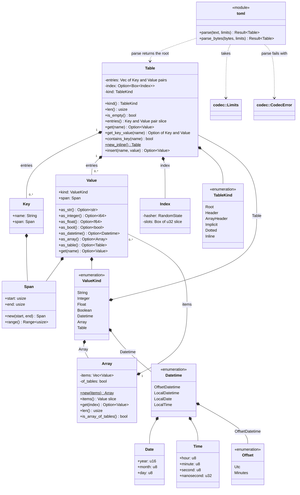

The errors of `toml::parse` are `CodecError::Toml`, with a
`toml::ErrorKind`:

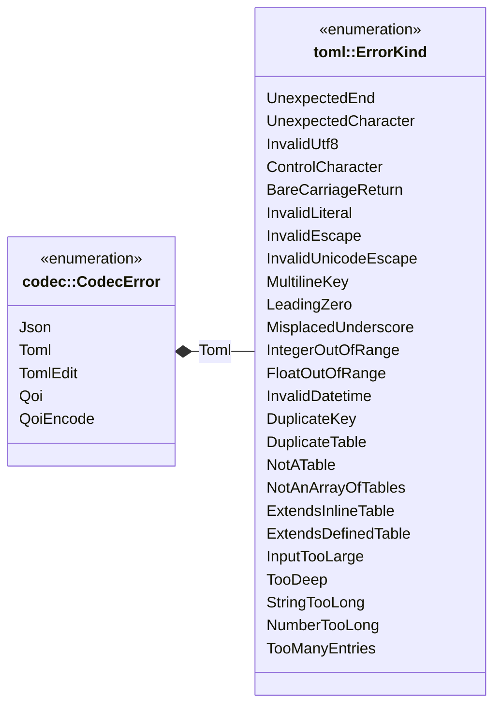

`Document` keeps the text it parsed, its root `Table` and its `Limits`.
`set` plans one splice, parses the new text again and checks it against
the old tree along the path before keeping either; a refused edit is
`CodecError::TomlEdit`, with the step of the path it concerns and an
`EditErrorKind`, and leaves the document as it was. What `set` writes is
TOML 1.0 (ADR-0031).

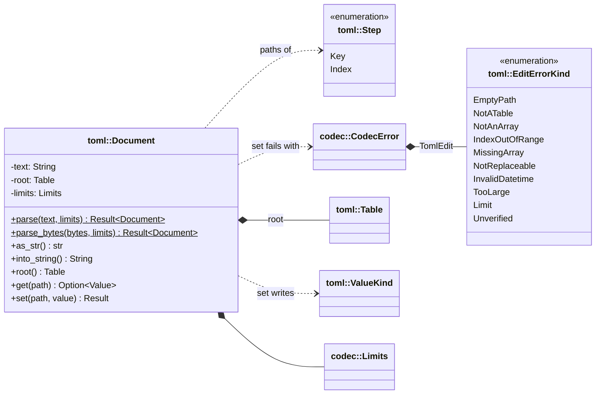

## 12. text: the rope

A `Rope` is a persistent B-tree of UTF-8 leaves of 1 to 4 KiB. Each child
carries a `Summary` of its bytes, chars, UTF-16 units and line breaks, so
edits and position lookups are O(log n), and a clone shares every node.

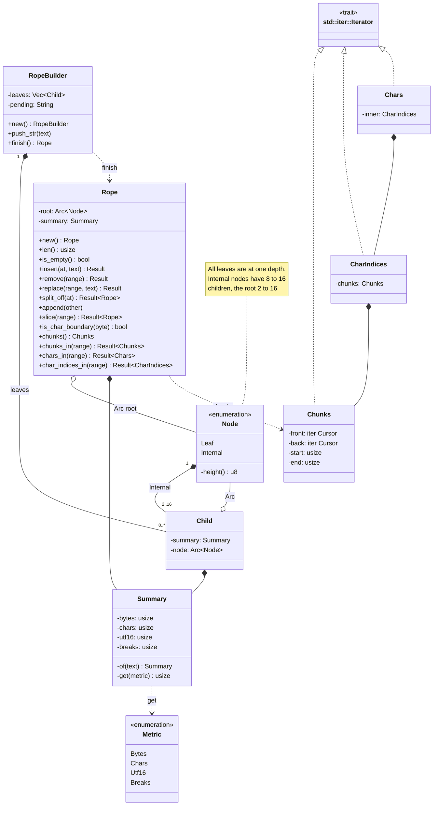

## 13. text: positions and graphemes

Positions are byte offsets (ADR-0019). The `pos` module adds conversions to
`Rope` between bytes, chars, UTF-16 units, lines and line/column pairs in
any `Unit`, and `pos::grapheme` adds extended grapheme cluster boundaries
(UAX #29) from tables `cargo xtask ucd` generates. A bad position is a
`TextError`, never a panic.

```mermaid
classDiagram
    direction LR
    class Rope {
        +len_in(unit) usize
        +len_lines() usize
        +byte_to_offset(byte, unit) Result~usize~
        +offset_to_byte(offset, unit) Result~usize~
        +byte_to_line(byte) Result~usize~
        +line_to_byte(line) Result~usize~
        +line_span(line) Result~LineSpan~
        +byte_to_line_col(byte, unit) Result~LineCol~
        +line_col_to_byte(pos, unit) Result~usize~
        +is_grapheme_boundary(byte) bool
        +next_grapheme_boundary(byte) Option~usize~
        +prev_grapheme_boundary(byte) Option~usize~
        +graphemes_in(range) Result~Graphemes~
    }
    class Unit {
        <<enumeration>>
        Byte
        Utf16
        Char
    }
    class LineCol {
        +line: usize
        +col: usize
        +new(line, col) LineCol
    }
    class LineBreak {
        <<enumeration>>
        Lf
        CrLf
        Cr
        +byte_len() usize
        +as_str() str
    }
    class LineSpan {
        +start: usize
        +content_end: usize
        +line_break: Option~LineBreak~
        +end() usize
        +content() Range~usize~
        +full() Range~usize~
    }
    class GraphemeFns["pos::grapheme"] {
        <<module>>
        +UNICODE_VERSION: u8 triple
        +is_boundary(text, byte) bool
        +next_boundary(text, byte) Option~usize~
        +prev_boundary(text, byte) Option~usize~
        +graphemes(text) StrGraphemes
    }
    class Graphemes {
        -rope: Rope
        -inner: Segmenter~CharIndices~
    }
    class StrGraphemes {
        -text: str
        -inner: Segmenter
    }
    class Segmenter~I~ {
        -chars: I
        -end: usize
    }
    class TextError["text::TextError"]
    Rope ..> Unit : conversions take
    Rope ..> LineCol : byte_to_line_col
    Rope ..> LineSpan : line_span
    LineSpan *-- LineBreak
    Rope ..> Graphemes : graphemes_in
    GraphemeFns ..> StrGraphemes : graphemes
    Graphemes *-- Segmenter
    StrGraphemes *-- Segmenter
    Rope ..> TextError : a bad position fails with
    note for Rope "Only the methods pos and<br/>pos::grapheme add are shown"
```

## 14. text: selections and transactions

A `Selection` is one or more `Cursor`s, sorted and merged by one rule, with
a primary. A `ChangeSet` is a list of byte-range replacements in the old
text, each holding its new text as a `Rope`; it applies, maps positions,
composes and inverts. A `Transaction` is a change set and the selection
after it.

```mermaid
classDiagram
    direction TB
    class Cursor {
        +anchor: usize
        +head: usize
        +new(anchor, head) Cursor
        +caret(at) Cursor
        +start() usize
        +end() usize
        +range() Range~usize~
        +is_caret() bool
        +is_backward() bool
    }
    class Selection {
        -cursors: Vec~Cursor~
        -primary: usize
        +caret(at) Selection
        +single(cursor) Selection
        +new(primary, others) Selection
        +cursors() Cursor slice
        +primary() Cursor
        +primary_index() usize
        +transform(f) Selection
        +validate(text) Result
        +map(changes, caret) Result~Selection~
    }
    class Assoc {
        <<enumeration>>
        Before
        After
    }
    class ChangeSet {
        -replacements: Arc of Replacement slice
        -len_before: usize
        -len_after: usize
        +identity(len) ChangeSet
        +new(text, edits) Result~ChangeSet~
        +len_before() usize
        +len_after() usize
        +is_identity() bool
        +changes() Changes
        +apply(text) Result
        +invert(before) Result~ChangeSet~
        +compose(next) Result~ChangeSet~
        +map(pos, assoc) Result~usize~
    }
    class Replacement {
        -start: usize
        -end: usize
        -new_start: usize
        -text: Option~Rope~
    }
    class Changes {
        -inner: slice Iter of Replacement
    }
    class Change {
        +old: Range~usize~
        +new: Range~usize~
        +text: Option~Rope~
    }
    class Transaction {
        -changes: ChangeSet
        -selection: Selection
        +new(changes, selection) Transaction
        +changes() ChangeSet
        +selection() Selection
        +into_parts() ChangeSet and Selection
        +change_each(text, selection, edit) Result~Transaction~
    }
    class Place {
        <<enumeration>>
        Map
        Start
        End
        Select
    }
    class Rope["text::Rope"]
    Selection "1" *-- "1..*" Cursor
    Selection ..> ChangeSet : map through
    Selection ..> Assoc : map takes
    Selection ..> Rope : validate against
    ChangeSet "1" o-- "0..*" Replacement : Arc
    Replacement *-- Rope : text
    ChangeSet ..> Changes : changes
    Changes ..> Change : yields
    ChangeSet ..> Rope : apply, invert
    ChangeSet ..> Assoc : map takes
    Transaction *-- ChangeSet
    Transaction *-- Selection
    Transaction ..> Place : change_each edit returns
    note for Place "Where the cursor goes after<br/>change_each edits it: mapped,<br/>at the start or end of the<br/>new text, or selecting it"
```

## 15. text: history, the undo tree

`History` applies every step to the buffer's rope (ADR-0020). It keeps a
tree of revisions: undo moves to the parent, redo to the child created or
visited last, and `jump_to` to any revision, so no branch is lost. Commits group by command
(`GroupId`) or coalesce by time, and checkpoints mark the saved revision.

```mermaid
classDiagram
    direction LR
    class History {
        -revisions: Vec~Revision~
        -current: usize
        -pending: Vec~Piece~
        -saved: Option~usize~
        -open: bool
        -text: Rope
        +new(text) History
        +text() Rope
        +commit(text, transaction, selection_before, now, group) Result~Step~
        +undo(text) Result~Option~Step~~
        +redo(text) Result~Option~Step~~
        +jump_to(text, target) Result~Option~Step~~
        +seal()
        +checkpoint() Checkpoint
        +mark_saved(checkpoint) Result
        +is_modified() bool
        +current() RevisionId
        +root() RevisionId
        +can_undo() bool
        +can_redo() bool
    }
    class Revision {
        -parent: usize
        -last_child: Option~usize~
        -changes: ChangeSet
        -inverse: ChangeSet
        -selection_before: Selection
        -selection_after: Selection
        -time: Option~Instant~
        -tag: Tag
    }
    class Piece {
        -changes: ChangeSet
        -inverse: ChangeSet
    }
    class Tag {
        <<enumeration>>
        Root
        New
        Command
        Coalesce
    }
    class Group {
        <<enumeration>>
        New
        Command
        Coalesce
    }
    class GroupId {
        -0: u64
        +fresh() GroupId
    }
    class RevisionId {
        -0: u64
        +seq() u64
    }
    class Step {
        +revision: RevisionId
        +before: Rope
        +changes: Vec~ChangeSet~
        +selection: Selection
    }
    class Checkpoint {
        -revision: RevisionId
        -text: Rope
        +revision() RevisionId
        +text() Rope
    }
    class Transaction["text::Transaction"]
    class ChangeSet["text::ChangeSet"]
    class Selection["text::Selection"]
    class Rope["text::Rope"]
    History "1" *-- "1..*" Revision : revisions
    History "1" *-- "0..*" Piece : pending
    History *-- Rope : text
    History ..> Transaction : commit takes
    History ..> Group : commit takes
    History ..> Step : commit, undo, redo return
    History ..> Checkpoint : checkpoint
    History ..> RevisionId : current, root
    Revision *-- ChangeSet : changes, inverse
    Revision *-- Selection : before, after
    Revision *-- Tag
    Piece *-- ChangeSet : changes, inverse
    Tag --> GroupId : Command
    Group --> GroupId : Command
    Step *-- RevisionId
    Checkpoint *-- RevisionId
    note for Revision "parent and last_child are indexes<br/>into the revisions of its History:<br/>the undo tree"
```

## 16. text: encodings

`Decoder` detects UTF-8 or UTF-16 by the byte-order mark only, and decodes
bytes pushed in pieces. Invalid input decodes losslessly: each invalid
sequence becomes one U+FFFD in the text, the replaced bytes are kept in
runs, and the result is read-only; `write_original` gives back the input
byte for byte.

```mermaid
classDiagram
    direction TB
    class EncodingFns["encoding"] {
        <<module>>
        +decode(bytes) Decoded
        +encode(text, format, out) io Result
    }
    class Encoding {
        <<enumeration>>
        Utf8
        Utf16Le
        Utf16Be
        +bom() u8 slice
        +name() str
    }
    class Format {
        +encoding: Encoding
        +bom: bool
        +UTF8: Format
        +new(encoding, bom) Format
    }
    class Decoder {
        -mode: Mode
        -format: Format
        -text: Sink
        -runs: Runs
        +new() Decoder
        +push(bytes)
        +finish() Decoded
    }
    class Mode {
        <<enumeration>>
        Detecting
        Utf8
        Utf16
    }
    class Decoded {
        -text: Rope
        -detected: Format
        -runs: Runs
        +text() Rope
        +into_text() Rope
        +detected() Format
        +format() Option~Format~
        +read_only() bool
        +replaced() ReplacedRuns
        +write_original(out) io Result
        +original_bytes() Vec~u8~
    }
    class Runs {
        -heads: Vec~u8~
        -bytes: Vec~u8~
        -count: usize
        -end: usize
        -open: Option~OpenRun~
    }
    class ReplacedRuns {
        -heads: u8 slice
        -bytes: u8 slice
        -end: usize
    }
    class Replaced {
        +range: Range~usize~
        +bytes: u8 slice
    }
    class Rope["text::Rope"]
    EncodingFns ..> Decoder : decode runs
    EncodingFns ..> Format : encode takes
    Format *-- Encoding
    Decoder *-- Mode
    Decoder *-- Format
    Decoder ..> Decoded : finish
    Decoded *-- Rope : text
    Decoded *-- Format : detected
    Decoded *-- Runs
    Decoded ..> ReplacedRuns : replaced
    ReplacedRuns ..> Replaced : yields
    note for Decoded "format is None when the input<br/>was invalid: then it is read-only"
```

## 17. text: files

`file::load` reads a file and decodes it, and records its line endings and
whether its last line ends with a break. `file::save` writes the text in
the given `Format` through a temp file in the same directory, syncs it and
renames it over the file, keeping its permissions and following symbolic
links. Each I/O error names the `FileStep` that failed.

```mermaid
classDiagram
    direction LR
    class FileFns["file"] {
        <<module>>
        +LARGE_FILE_BYTES: u64
        +TEMP_PREFIX: str
        +load(path) Result~Loaded~
        +save(path, text, format) Result
    }
    class Loaded {
        -decoded: Decoded
        -line_endings: LineEndings
        -trailing_break: Option~LineBreak~
        -file_len: u64
        +text() Rope
        +decoded() Decoded
        +format() Option~Format~
        +read_only() bool
        +line_endings() LineEndings
        +trailing_break() Option~LineBreak~
        +file_len() u64
        +is_large() bool
    }
    class LineEndings {
        +lf: usize
        +crlf: usize
        +cr: usize
        +of(text) LineEndings
        +total() usize
        +is_mixed() bool
        +dominant() LineBreak
    }
    class Temp {
        -file: File
        -removal: Removal
        -target: PathBuf
        -dir: PathBuf
        -permissions: Option~Permissions~
        -create(path) Result~Temp~
        -write(write) Result~Temp~
        -commit() Result
    }
    class Removal {
        -path: PathBuf
        -armed: bool
    }
    class Drop["std::ops::Drop"] {
        <<trait>>
    }
    class FileStep {
        <<enumeration>>
        Metadata
        Open
        Read
        ReadLink
        CheckWritable
        CreateTemp
        Write
        SetPermissions
        Sync
        Rename
        SyncDirectory
    }
    class Decoded["encoding::Decoded"]
    class Format["encoding::Format"]
    class LineBreak["pos::LineBreak"]
    class TextError["text::TextError"]
    FileFns ..> Loaded : load returns
    FileFns ..> Format : save takes
    FileFns ..> Temp : save writes through
    FileFns ..> TextError : fails with
    Loaded *-- Decoded
    Loaded *-- LineEndings
    Loaded *-- LineBreak : trailing_break
    LineEndings ..> LineBreak : dominant
    Temp *-- Removal
    Drop <|.. Removal
    TextError *-- FileStep : Io
    note for Removal "Removes the temp file on drop<br/>unless the rename disarmed it"
    note for Loaded "is_large is true above<br/>LARGE_FILE_BYTES, 16 MiB,<br/>for the large-file mode"
```

## 18. text: the error enum

`TextError` is the one error type of `tidepool-text`: bad positions and
ranges, edits that do not fit their text, revisions that are not in a
history, and the file errors.

```mermaid
classDiagram
    direction LR
    class TextError {
        <<enumeration>>
        ByteOutOfBounds
        NotCharBoundary
        InvertedRange
        OffsetOutOfBounds
        OffsetInsideChar
        LineOutOfBounds
        ColumnOutOfBounds
        ColumnInsideChar
        LengthMismatch
        OverlappingEdits
        TooLong
        RevisionNotFound
        HistoryMismatch
        Io
        NotRegularFile
        NotWritable
        TooManyLinks
    }
    class Unit["pos::Unit"]
    class LineCol["pos::LineCol"]
    class FileStep["file::FileStep"]
    class IoError["std::io::Error"]
    class Display["std::fmt::Display"] {
        <<trait>>
    }
    class StdError["std::error::Error"] {
        <<trait>>
    }
    TextError *-- Unit : Offset and Column variants
    TextError *-- LineCol : Column variants
    TextError *-- FileStep : Io
    TextError *-- IoError : Io, NotWritable
    Display <|.. TextError
    StdError <|.. TextError
```

## 19. xtask: checks and reports

Each `cargo xtask` check is a `Check`: a name, a step and a role. A step
runs cargo with fixed arguments (`Cargo` and `Tests`), or one of `xtask`'s
own checks (`Own`: `deps::run`, `layers::run`, `crates::run`,
`features::run`, `unsafe_audit::run`, `headers::run`, `workflows::run`,
`golden::check`, `ucd::check` or `ucd::write`), which returns a `Report`.
A `Compiles` step does not run once a `Gate` step has failed; `deps` is
the gate, and `clippy`, `test` and `golden` compile. `GOLDEN` is a step of
`CI` but not in `COMMANDS`: `main` runs `golden` itself, for its
`--bless`, and `print` prints what it found as `ci` prints a step. `ci`
runs the checks in order and ends with a summary table that also lists
the `Later` commands it will run once they exist (those with `in_ci`:
`tools` and `theme`).
Every `Later` command exits 1 with "not yet implemented" until its task
lands. `run_gate` runs them and returns a `Gate`, each step's outcome and
the tests counted; `run_ci` is its `passed`, and `site` keeps the rest
(ADR-0030).

```mermaid
classDiagram
    direction TB
    class CheckFns["check"] {
        <<module>>
        +COMMANDS: Check slice
        +CI: Check slice
        +GOLDEN: Check
        +LATER: Later slice
        +run_one(check, root, out) io Result~bool~
        +run_ci(checks, later, root, out) io Result~bool~
        +run_gate(checks, later, root, out) io Result~Gate~
        +print(name, result, out) io Result~bool~
    }
    class Gate {
        -outcomes: Vec~Outcome~
        -tests: TestCounts
        +passed() bool
        +steps() usize, usize
        +skipped() usize
        +tests() TestCounts
    }
    class TestCounts["cargo::TestCounts"] {
        +results: usize
        +unreadable: usize
        +passed: usize
        +failed: usize
        +ignored: usize
    }
    class Check {
        +name: str
        +about: str
        +step: Step
        +role: Role
    }
    class Step {
        <<enumeration>>
        Cargo
        Tests
        Own
    }
    class Role {
        <<enumeration>>
        Independent
        Gate
        Compiles
    }
    class Report {
        +notes: Vec~String~
        +violations: Vec~String~
        +stale_lockfiles: usize
        +skips: Skips
        +tests: TestCounts
        +push_stale_lockfile(violation)
    }
    class Skips["cargo::Skips"] {
        +reasons: Vec~String~
        +count: usize
    }
    class Later {
        +name: str
        +task: str
        +in_ci: bool
    }
    class CiOutcome["check::Outcome"] {
        -name: str
        -status: Status
        -elapsed: Duration
        -skipped: usize
    }
    class Status {
        <<enumeration>>
        Passed
        Failed
        NotRun
    }
    class XtaskError["error::Error"] {
        <<enumeration>>
        Usage
        NotImplemented
        Read
        Spawn
        CommandFailed
        UnexpectedOutput
        Doc
        Output
        Write
        Env
    }
    CheckFns "1" o-- "0..*" Check : COMMANDS, CI, GOLDEN
    CheckFns "1" o-- "0..*" Later : LATER
    Check *-- Step
    Check *-- Role
    Step ..> Report : Own returns
    Step ..> XtaskError : Own fails with
    Report *-- Skips
    Report *-- TestCounts
    CheckFns ..> Gate : run_gate returns
    Gate o-- CiOutcome : one per step
    Gate *-- TestCounts
    CheckFns ..> CiOutcome : one per ci step
    CiOutcome *-- Status
    note for Skips "Tests that printed SKIPPED:<br/>did not run, and are never<br/>counted as passes"
```

## 20. xtask: fuzz-smoke's and golden's tables

`cargo xtask fuzz-smoke` runs each fuzz target in `TARGETS` as a
`cargo test` of its crate's `tests/fuzz.rs` in the `fuzz` profile, and
reads the `fuzz-result:` line the test prints back into a
`core::testing::fuzz::Summary`. It turns each run into a `Verdict`.

```mermaid
classDiagram
    direction TB
    class SmokeFns["fuzz"] {
        <<module>>
        +TARGETS: Target slice
        +DEFAULT_SECS: u64
        +PROFILE: str
        +clock_seed() u64
        +run(options, table, root, out) Result~bool~
    }
    class SmokeTarget["fuzz::Target"] {
        +name: str
        +package: str
    }
    class Options {
        +targets: Vec~Target~
        +secs: u64
        +seed: u64
        +seed_from_clock: bool
        +replay: bool
        +parse(args, table, clock) Result~Options~
    }
    class Verdict {
        <<enumeration>>
        Clean
        Found
        Failed
        NotRun
        NotBuilt
        CargoFailed
        Died
        ExitedWithoutResult
    }
    class Args["core::cli::Args"]
    class Summary["core::testing::fuzz::Summary"]
    class Reading["core::testing::fuzz::Reading"]
    class Kept["core::testing::fuzz::Kept"]
    class XtaskError["error::Error"]
    SmokeFns "1" o-- "5" SmokeTarget : TARGETS
    Options "1" o-- "1..*" SmokeTarget : borrows
    Options ..> Args : parse reads
    Options ..> XtaskError : parse fails with Usage
    SmokeFns ..> Options : run takes
    SmokeFns ..> Verdict : one per target
    Verdict *-- Summary : Clean, Found, Failed
    Summary *-- Reading : memory, reserved
    SmokeFns ..> Kept : keep_died
    note for SmokeTarget "TARGETS holds json, toml<br/>and qoi in tidepool-codec,<br/>encoding in tidepool-text,<br/>and ttf in tidepool-font"
```

`cargo xtask golden` asks `cargo metadata` which members have a test
target named `golden`, and runs each one's scenes as a `cargo test
--package <crate> --test golden`, with `TIDEPOOL_GOLDEN_DIR` naming that
crate's directory in `target/golden/rendered/`. A member with that test
needs a row in `SCENES`, which gives its tolerance. It reads each PAM file
a scene wrote into a `Rendered`, and judges it against its reference,
`tests/golden/<scene>.qoi`, decoded with `codec::qoi`, into a `Verdict`
(ADR-0044). `parse` reads `--bless` and the scene names after it;
`check`, the step of `ci`, blesses nothing.

```mermaid
classDiagram
    direction TB
    class GoldenFns["golden"] {
        <<module>>
        +NAME: str
        +DIR_VAR: str
        +SCENES: Scenes slice
        +check(root) Result~Report~
        +parse(args) Result~BTreeSet~String~~
        +command(bless, root, out) Result~bool~
    }
    class Scenes {
        +package: str
        +tolerance: u8
    }
    class Rendered {
        -width: u32
        -height: u32
        -pixels: Vec~u8~
        -tolerance: u8
    }
    class Verdict {
        <<enumeration>>
        Same
        Differs
        OtherSize
        BadReference
        NoReference
        NotRendered
    }
    class Args["core::cli::Args"]
    class QoiImage["codec::qoi::Image"]
    class Metadata["metadata::Metadata"]
    class Report["check::Report"]
    class XtaskError["error::Error"]
    GoldenFns "1" o-- "1..*" Scenes : SCENES
    GoldenFns ..> Metadata : finds the crates<br/>with scenes in
    GoldenFns ..> Args : parse reads
    GoldenFns ..> XtaskError : parse fails with Usage
    GoldenFns ..> Rendered : one per scene drawn
    GoldenFns ..> Verdict : one per scene
    GoldenFns ..> QoiImage : decodes references,<br/>encodes images
    GoldenFns ..> Report : check returns
    note for Scenes "SCENES holds tidepool-gfx,<br/>with a tolerance of 0:<br/>every pixel exact; and<br/>tidepool-font, with 1"
```

## 21. xtask: cargo metadata, the dependency matrix and the crates check

`metadata::load` runs `cargo metadata` and reads its JSON with
`codec::json` into a `Metadata`. The `layers` check reads the dependency
matrix from `docs/01-architecture.md` into a `Matrix` and checks every
member's dependencies against its row; `deps` checks each package against
the `Pin`s of its allowlist.

### 21.1 cargo metadata

```mermaid
classDiagram
    direction TB
    class MetadataFns["metadata"] {
        <<module>>
        +load(root, manifest, resolve) Result~Metadata~
        +parse(text, command) Result~Metadata~
        +workspaces(root, manifests, resolve) Vec~Workspace~
    }
    class Metadata {
        +workspace_root: PathBuf
        +packages: Vec~Package~
    }
    class Package {
        +name: String
        +version: String
        +source: Option~String~
        +manifest_path: PathBuf
        +is_member: bool
        +dependencies: Vec~Dependency~
        +targets: Vec~Target~
    }
    class Target {
        +name: String
        +kind: String
        +src_path: PathBuf
    }
    class Dependency {
        +name: String
        +source: Option~String~
        +req: String
        +path: Option~PathBuf~
        +kind: Kind
    }
    class Kind {
        <<enumeration>>
        Normal
        Dev
        Build
        +describe() str
    }
    class Resolve {
        <<enumeration>>
        Yes
        No
    }
    class Workspace {
        +shown: String
        +graph: Result~Metadata~
        +declared: Option~Metadata~
    }
    class JsonValue["codec::json::Value"]
    MetadataFns ..> Metadata : load, parse
    MetadataFns ..> Workspace : workspaces
    MetadataFns ..> Resolve : takes
    MetadataFns ..> JsonValue : parses the<br/>output into
    Workspace *-- Metadata : graph, declared
    Metadata "1" *-- "0..*" Package
    Package "1" *-- "0..*" Dependency
    Package "1" *-- "0..*" Target
    Dependency *-- Kind
```

### 21.2 The dependency matrix, the allowlist and `crates`

`crates::run` loads the workspace's `Metadata` without resolving it, and
reads the root manifest and each member's into a `codec::toml::Table`. A
member's README must start with `# <name>`, name only the roadmap's
tasks, and have each of `SECTIONS` once and in that order, and `FEATURES`
at most once, between Usage and Documentation. `crates` finds those lines
as `layers` reads its document, with `matrix::classify`, so a heading in a
fenced code block, an HTML block or an HTML comment does not count. It
also checks that each member keeps byte-for-byte copies of the root's
`LICENSE_FILES`, `LICENSE` and `NOTICE`.

```mermaid
classDiagram
    direction TB
    class MatrixFns["matrix"] {
        <<module>>
        +DOC: str
        +parse(text) Result~Matrix~
        +classify(lines) Vec of Kind and String pairs
    }
    class Matrix {
        +rows: Vec~Row~
        +row(name) Option~Row~
    }
    class Row {
        +name: String
        +line: usize
        +allowed: Allowed
        +written: String
        +dev_only: bool
        +allows(name) bool
    }
    class Allowed {
        <<enumeration>>
        Only
        AnyWorkspaceCrate
    }
    class LineKind["matrix::Kind"] {
        <<enumeration>>
        Shown
        Fenced
        Comment
        Html
    }
    class Pin["deps::Pin"] {
        +name: String
        +version: String
    }
    class CratesFns["crates"] {
        <<module>>
        -SECTIONS: 6 str
        -FEATURES: str
        -LICENSE_FILES: 2 str
        +run(root) Result~Report~
    }
    class Metadata["metadata::Metadata"]
    class TomlTable["codec::toml::Table"]
    class Report["check::Report"]
    MatrixFns ..> Matrix : parse
    Matrix "1" *-- "1..*" Row
    Row *-- Allowed
    MatrixFns ..> LineKind : classify
    CratesFns ..> Metadata : takes the<br/>members from
    CratesFns ..> TomlTable : reads<br/>manifests into
    CratesFns ..> MatrixFns : finds README<br/>sections with classify
    CratesFns ..> Report : run returns
    note for MatrixFns "DOC is docs/01-architecture.md"
    note for Pin "deps reads one per line<br/>of xtask/deps-allowlist.txt"
```

## 22. bench: the harness and the baseline

`tidepool-bench` is a library and a binary (ADR-0035). A `Suite` is a
name and a function that measures one routine through the `Bencher` it is
given; `run_suite` makes the `Bencher` from `Settings` and returns the
`Summary` it recorded. `cli::run` runs the suites `Options` select,
compares each `Summary` with the `Entry` of the same name in a `Baseline`
recorded on a `Machine` with the same `Facts`, and with `--save` writes the
merged `Baseline` back. `suites::all` lists the 18 text suites, which use
`tidepool-text`'s `Rope` and `History`.

```mermaid
classDiagram
    direction LR
    class HarnessFns["harness"] {
        <<module>>
        +MAX_BATCH: usize
        +PRIME_BYTES: usize
        +run_suite(suite, settings) Result~Summary~
        +prime_allocator()
        +median(sorted) Option~f64~
        +p95(sorted) Option~f64~
    }
    class Suite {
        +name: str
        +run: fn(Bencher) Result
    }
    class Bencher {
        -settings: Settings
        -summary: Option~Summary~
        +new(settings) Bencher
        +iter(routine)
        +iter_batched(setup, routine)
    }
    class Settings {
        +warm_up: Duration
        +sample_target: Duration
        +budget: Duration
        +min_samples: usize
        +max_samples: usize
        +DEFAULT: Settings
    }
    class Summary {
        +median_ns: u64
        +p95_ns: u64
        +samples: usize
        +batch: usize
        +of(per_iteration_ns, batch) Option~Summary~
    }
    class CliFns["cli"] {
        <<module>>
        +SLOWER_PERCENT: u64
        +run(options, suites, settings, path, facts, out) Result
        +select(suites, filter) Result~Vec~Suite~~
        +is_slower(baseline_ns, now_ns) bool
    }
    class Options {
        +filter: Option~String~
        +save: bool
        +machine: Option~String~
        +help: bool
        +parse(args) Result~Options~
    }
    class Args["core::cli::Args"]
    class SuitesFns["suites"] {
        <<module>>
        +all() Vec~Suite~
    }
    class Baseline {
        +machine: Machine
        +suites: BTreeMap~String, Entry~
        +read(path) Result~Option~Baseline~~
        +parse(bytes) Result~Baseline~
        +to_json() String
        +write(path) Result
        +merge(existing, machine, measured, known) Result~Baseline~
        +check_machine(machine) Result
    }
    class Machine {
        +name: String
        +facts: Facts
    }
    class Facts {
        +os: String
        +arch: String
        +threads: u64
        +cpu: String
        +detect() Facts
        +describe() String
    }
    class Entry {
        +median_ns: u64
        +p95_ns: u64
        +samples: u64
    }
    class Json["codec::json"]
    class Save["text::file::save"]

    HarnessFns ..> Bencher : makes
    HarnessFns ..> Summary : returns
    Suite ..> Bencher : runs through
    Bencher *-- Settings
    Bencher *-- "0..1" Summary
    SuitesFns ..> Suite : makes
    CliFns ..> Options
    CliFns ..> HarnessFns : run_suite
    CliFns ..> Baseline : reads, merges, writes
    Options ..> Args : parses
    Baseline *-- Machine
    Baseline *-- "0..*" Entry
    Machine *-- Facts
    Entry ..> Summary : from
    Baseline ..> Json : parses, writes
    Baseline ..> Save : write
```

- `iter_batched` makes a batch's inputs with `setup` before the timing
  starts and drops the outputs after it stops, so neither is timed.
- `prime_allocator` runs once, before the first suite (`docs/04-quality.md`
  → "Benchmarks").
- `BenchError` is in section 27.

## 23. sys: symbol tables and the Linux declarations

`tidepool-sys` declares and does nothing else (ADR-0001). `dynlib!`, a
macro private to the crate, makes a table: a struct with one function
pointer for each C function, under its C name, and `load`, which looks
each one up through a `Library` and names every one it cannot find in a
`MissingSymbols`; a function C declares with `...` takes the same `...`
(M2.2). `linux::x11::Xlib` is the only table so far: the 50 functions of
`libX11.so.6` that `platform`'s window, its events, typed text, present
and clipboard call, loaded with `dlopen` (M2.1, M2.2, M2.7, ADR-0010).
`linux::libc` links what it declares from the C library: the dynamic
loader, `poll`, `pipe2`, `write(2)`, and `setlocale` (M2.1, M2.2).
`linux::evdev` gives the kernel's key codes that `platform`'s key map
reads (M2.2, ADR-0039). Each struct has every field of its header,
and `XEvent` the members Tidepool reads and the header's `pad`, each
with its layout asserted; `Display`, `Visual`, `XGCValues` and the
graphics context behind `GC` are opaque, and have no fields. The boxes show
only some fields, and four of `Xlib`'s functions.

```mermaid
classDiagram
    direction TB
    class Library {
        <<trait>>
        +symbol(name) address
    }
    class MissingSymbols {
        +names: Vec~str~
    }
    class Xlib["linux::x11::Xlib"] {
        +XOpenDisplay: fn
        +XNextEvent: fn
        +XPutImage: fn
        +XGetImage: fn
        +XCreateIC: variadic fn
        +load(library) Result~Xlib~
    }
    class LibcFns["linux::libc"] {
        <<module>>
        +dlopen(filename, flags) handle
        +dlsym(handle, symbol) address
        +dlerror() message
        +poll(fds, nfds, timeout) c_int
        +pipe2(pipefd, flags) c_int
        +write(fd, buf, count) ssize_t
        +setlocale(category, locale) name
    }
    class Evdev["linux::evdev"] {
        <<module>>
        +KEY_A: u16
        +KEY_ENTER: u16
    }
    class XIM["linux::x11::XIM"]
    class XIC["linux::x11::XIC"]
    class pollfd {
        +fd: c_int
        +events: c_short
        +revents: c_short
    }
    class Display["linux::x11::Display"]
    class XEvent {
        <<union>>
        +type_: c_int
        +pad: 24 longs
    }
    class XKeyEvent {
        +state: c_uint
        +keycode: c_uint
    }
    class XButtonEvent {
        +x: c_int
        +y: c_int
        +button: c_uint
    }
    class XMotionEvent {
        +x: c_int
        +y: c_int
    }
    class XFocusChangeEvent {
        +mode: c_int
    }
    class XExposeEvent {
        +x: c_int
        +width: c_int
        +count: c_int
    }
    class XConfigureEvent {
        +width: c_int
        +height: c_int
    }
    class XClientMessageEvent {
        +message_type: Atom
        +format: c_int
        +data: XClientMessageData
    }
    class XClientMessageData {
        <<union>>
        +l: 5 longs
    }
    class XImage {
        +width: c_int
        +data: char pointer
        +bytes_per_line: c_int
        +f: XImageFuncs
    }
    class XImageFuncs {
        +destroy_image: Option~fn~
    }
    class XSetWindowAttributes {
        +background_pixel: c_ulong
        +colormap: Colormap
    }
    class XVisualInfo {
        +visual: Visual pointer
        +depth: c_int
    }
    class XErrorHandler {
        <<alias>>
        Option~fn~
    }
    class XErrorEvent {
        +error_code: c_uchar
        +request_code: c_uchar
    }

    Xlib ..> Library : load looks up through
    Xlib ..> MissingSymbols : load fails with
    Xlib ..> Display : XOpenDisplay makes
    Xlib ..> XEvent : XNextEvent fills
    Xlib ..> XImage : XInitImage, XPutImage,<br/>XGetImage
    Xlib ..> XSetWindowAttributes : XCreateWindow
    Xlib ..> XVisualInfo : XMatchVisualInfo fills
    Xlib ..> XErrorHandler : XSetErrorHandler
    Xlib ..> XIM : XOpenIM makes
    Xlib ..> XIC : XCreateIC makes
    LibcFns ..> pollfd : poll
    XEvent *-- XKeyEvent : xkey
    XEvent *-- XButtonEvent : xbutton
    XEvent *-- XMotionEvent : xmotion
    XEvent *-- XFocusChangeEvent : xfocus
    XEvent *-- XExposeEvent : xexpose
    XEvent *-- XConfigureEvent : xconfigure
    XEvent *-- XClientMessageEvent : xclient
    XClientMessageEvent *-- XClientMessageData
    XImage *-- XImageFuncs : f
    XErrorHandler ..> XErrorEvent : takes
```

- An image that `XGetImage` returns is Xlib's, with its pixels, and is
  freed through its own `f.destroy_image`, which is what C's
  `XDestroyImage` macro calls; an `XImage` that Tidepool fills in over a
  frame and passes to `XInitImage` is Tidepool's, and is never freed
  through it.
- A table's function pointers stay valid because no library is ever
  closed: `dlclose` is not declared.
- `MissingSymbols` is in section 27.

## 24. platform: the window, its events, present, the clipboard and folders

`tidepool-platform` has one public API on every system (M2.2): a
`window::Window` opened from a `WindowConfig`, with its `CursorShape`;
`events::Event`, which `wait_events` appends, and the `Waker` that ends a
wait from any thread; `surface::Pixels`, the checked view of a frame that
`present` takes with its damage in device pixels (ADR-0040); and the
crate's `Error`. M2.7 adds the clipboard's `Selection`, which
`set_selection` and `request_selection` take and `Event::Pasted` answers
(ADR-0042), and the folders: `paths::UserDirs`, which `paths::user_dirs`
finds, and `dirs::android_sdk` and `dirs::rustup_home`, which fail with
`Error::Unsupported` off Linux. A `Window` holds its system's backend: X11 on Linux
(24.2), and on every other system one whose `open` fails with
`Error::Unsupported`. A `Window` is neither `Send` nor `Sync`; a `Waker`
is both. Input events are `core::input::InputEvent`, in logical units.

### 24.1 The public API

```mermaid
classDiagram
    direction LR
    class Window["window::Window"] {
        +open(config) Result~Window~
        +set_title(title)
        +size() DeviceSize
        +logical_size() Size
        +scale() Scale
        +set_cursor(shape)
        +is_focused() bool
        +wait_events(deadline, events) Result
        +waker() Waker
        +present(pixels, damage) Result
        +set_selection(selection, text)
        +request_selection(selection)
    }
    class WindowConfig["window::WindowConfig"] {
        +title: String
        +size: Size
    }
    class CursorShape["window::CursorShape"] {
        <<enumeration>>
        Arrow
        Text
        Hand
        ColumnResize
        RowResize
    }
    class Event["events::Event"] {
        <<enumeration>>
        Input
        Resized
        Exposed
        CloseRequested
        Woken
        Pasted
    }
    class Selection["clipboard::Selection"] {
        <<enumeration>>
        Clipboard
        Primary
    }
    class UserDirs["paths::UserDirs"] {
        +config: PathBuf
        +data: PathBuf
        +cache: PathBuf
        +logs: PathBuf
    }
    class Folders["paths, dirs"] {
        <<module>>
        +user_dirs() Result~UserDirs~
        +android_sdk() Result~PathBuf~
        +rustup_home() Result~PathBuf~
    }
    class Waker["events::Waker"] {
        +wake()
    }
    class Pixels["surface::Pixels"] {
        -bytes: byte slice
        -size: DeviceSize
        -stride: usize
        +new(bytes, size, stride) Result~Pixels~
    }
    class PixelsError["surface::PixelsError"] {
        <<enumeration>>
        NegativeSize
        StrideTooSmall
        StrideTooLarge
        TooFewBytes
    }
    class PlatformError["platform::Error"]
    class Backend["linux::window::Window"]
    class InputEvent["core::input::InputEvent"]
    class DeviceRect["core::geom::DeviceRect"]
    Window *-- Backend : backend
    Window ..> WindowConfig : open takes
    Window ..> CursorShape : set_cursor
    Window ..> Event : wait_events appends
    Window ..> Waker : waker makes
    Window ..> Pixels : present takes
    Window ..> DeviceRect : present's damage
    Window ..> PlatformError : fails with
    Window ..> Selection : set_selection, request_selection
    Event *-- InputEvent : Input
    Event *-- DeviceRect : Exposed
    Event *-- Selection : Pasted
    Folders ..> UserDirs : user_dirs finds
    Folders ..> PlatformError : fails with
    Pixels ..> PixelsError : new fails with
```

- `wait_events` returns when it has appended events, was woken, or the
  deadline passed; `None` waits for ever.
- `Pixels::new` checks that the stride covers a row and the bytes every
  row, so `present` reads nothing outside the view.

### 24.2 The Linux backend

The backend's types are private to the crate. One `Connection` per
window owns the `Display`, its graphics context and the input method; it
holds the thread's `Claim`, so every Xlib call in the process comes from
one thread while any window is open, and it is closed last. `display`
turns `DISPLAY` into the `unix:N` name `XOpenDisplay` gets, and refuses
any other (ADR-0039). `library::xlib` loads `libX11.so.6` once, and the
table is never unloaded.

```mermaid
classDiagram
    direction TB
    class LinuxWindow["linux::window::Window"] {
        -connection: Connection
        -translator: Translator
        -clipboard: Clipboard
        -cursors: 5 Cursors
        -pipe: Arc~SelfPipe~
        -lookup: Vec~u8~
        -backlog: Vec~Event~
        -open(config) Result~Window~
    }
    class Clipboard["linux::selection::Clipboard"] {
        -owned: 2 Option~Owned~
        -claiming: 2 texts to claim
        -pastes: 2 Paste
        -transfers: Vec~Transfer~
        -set(selection, text)
        -request(selection)
        -handle(event)
        -expire(now)
    }
    class SelectionEvent["linux::selection::SelectionEvent"] {
        <<enumeration>>
        Property
        Clear
        Request
        Notify
    }
    class Transfer["linux::selection::Transfer"] {
        -requestor: Window
        -property: Atom
        -text: Arc~str~
        -sent: usize
    }
    class Property["linux::connection::Property"] {
        -type_: Atom
        -format: int
        -bytes: Vec~u8~
        -longs: Vec~long~
    }
    class Connection["linux::connection::Connection"] {
        -xlib: static Xlib
        -display: Display pointer
        -gc: Option~GC~
        -text: Option~TextInput~
    }
    class TextInput["linux::connection::TextInput"] {
        -im: XIM
        -ic: XIC
    }
    class Claim["linux::claim::Claim"] {
        -take() Result~Claim~
    }
    class XErrors["linux::claim::XErrors"] {
        -count: u64
        -error_code: u8
        -request_code: u8
    }
    class Translator["linux::input::Translator"] {
        -scale: Scale
        -size: DeviceSize
        -focused: bool
        -held: 256 bools
    }
    class Incoming["linux::input::Incoming"] {
        <<enumeration>>
        Key
        Button
        Motion
        Focus
        Expose
        Configure
        ClientMessage
        Selection
        Other
    }
    class SelfPipe["linux::waker::SelfPipe"] {
        -read: File
        -write: OwnedFd
    }
    class LinuxWaker["linux::waker::Waker"] {
        -pipe: Arc~SelfPipe~
        -wake()
    }
    class Modules["linux::display, keymap, xresources, library, xdg"] {
        <<module>>
        -display_name(DISPLAY) Result~unix_N~
        -from_x_keycode(keycode) Option~Key~
        -scale(resources) Scale
        -xlib() Result~Xlib~
        -user_dirs() Result~UserDirs~
    }
    class Xlib["sys::linux::x11::Xlib"]
    class Key["core::input::Key"]
    LinuxWindow *-- Connection : connection
    LinuxWindow *-- Translator : translator
    LinuxWindow *-- Clipboard : clipboard
    Clipboard *-- Transfer : transfers
    Clipboard ..> SelectionEvent : handles
    Clipboard ..> Property : reads pastes as
    Incoming *-- SelectionEvent : Selection
    LinuxWindow o-- SelfPipe : Arc
    LinuxWaker o-- SelfPipe : Arc
    Connection *-- TextInput : text
    Connection *-- Claim : _claim
    Connection o-- Xlib : static
    Connection ..> Incoming : next_event decodes
    Translator ..> Incoming : turns into Events
    Translator ..> Key : keys from key codes
    Claim ..> XErrors : the error handler records
    Modules ..> Xlib : xlib loads
```

- The error handler records each refused request in atomics, and
  `wait_events` logs what it recorded; a lost connection stays Xlib's to
  handle, which ends the process.
- `Incoming::decode` reads only the fields Xlib wrote for the event's
  type: a client message's data only when its format is 32.
- `Connection::get_property` reads no more than it asked for, and no
  more than 64 items of format 32, and frees what `XGetWindowProperty`
  returns with `XFree` on every path. Events
  that another client sent never make the clipboard claim, give up or
  answer for a selection (ADR-0042).
- The `Image` that `XGetImage` returns, for the read-back test, exists only
  in `#[cfg(test)]` code, and is freed through its own `f.destroy_image`.

## 25. gfx: the framebuffer, drawing, damage and the backdrop

`tidepool-gfx` (M2.3) draws in device pixels into a `Framebuffer` of
premultiplied BGRA8 bytes, which covers any rect of device space (its
bounds), so a layer can cover part of a window. Drawing is free functions
in `raster`, `blend`, `image` and `glyph`, each taking the framebuffer, a
clip rect (a `ClipStack`'s `current()`, or a damage rect) and
`core::color::PremultipliedColor`s; none returns an error or panics, and
what is invalid draws nothing. `View` and `glyph::Mask` are checked,
borrowed views of pixels and of 8-bit coverage, with regions. `Damage`
merges changed rects, and `damage::diff` finds the rects that differ
between two frames. The backdrop is in 25.2.

### 25.1 Frames, views, drawing and damage

```mermaid
classDiagram
    direction LR
    class Framebuffer["framebuffer::Framebuffer"] {
        -bytes: Vec~u8~
        -bounds: DeviceRect
        +new(size) Result~Framebuffer~
        +new_at(bounds) Result~Framebuffer~
        +try_clone() Result~Framebuffer~
        +bounds() DeviceRect
        +stride() usize
        +bytes() byte slice
        +view() View
        +pixel(at) Option~PremultipliedColor~
        +clear(color)
    }
    class View["framebuffer::View"] {
        -bytes: byte slice
        -size: DeviceSize
        -stride: usize
        +new(bytes, size, stride) Result~View~
        +region(rect) Result~View~
        +pixel(at) Option~PremultipliedColor~
    }
    class Mask["glyph::Mask"] {
        -bytes: byte slice
        -size: DeviceSize
        -stride: usize
        +new(bytes, size, stride) Result~Mask~
        +region(rect) Result~Mask~
        +coverage(at) Option~u8~
    }
    class Drawing["raster, blend, image, glyph"] {
        <<module>>
        +fill_rect(fb, clip, rect, color)
        +hairline(fb, clip, start, length, orientation, color)
        +border(fb, clip, rect, width, color)
        +brackets(fb, clip, rect, arm, thickness, corners, color)
        +polygon(fb, clip, points, color)
        +line(fb, clip, from, to, width, color)
        +cut_corner_rect(fb, clip, rect, cut, corners, color)
        +pill(fb, clip, rect, color)
        +over(src, dst) PremultipliedColor
        +scale(color, amount) PremultipliedColor
        +composite(dst, clip, layer, opacity)
        +copy(fb, clip, src, at)
        +blit(fb, clip, src, at)
        +blit_scaled(fb, clip, src, dst, filter)
        +draw(fb, clip, mask, at, color)
    }
    class Vertex["raster::Vertex"] {
        +x: f32
        +y: f32
    }
    class Corners["raster::Corners"] {
        +top_left: bool
        +top_right: bool
        +bottom_right: bool
        +bottom_left: bool
    }
    class Orientation["raster::Orientation"] {
        <<enumeration>>
        Horizontal
        Vertical
    }
    class Filter["image::Filter"] {
        <<enumeration>>
        Nearest
        Bilinear
    }
    class ClipStack["clip::ClipStack"] {
        -stack: Vec~DeviceRect~
        +new(base) ClipStack
        +push(rect)
        +pop() bool
        +current() DeviceRect
    }
    class Damage["damage::Damage"] {
        -slots: 9 DeviceRect
        -len: usize
        +add(rect)
        +rects() DeviceRect slice
        +clip_to(bounds)
        +bounds() DeviceRect
    }
    class DamageFns["damage, clip"] {
        <<module>>
        +MAX_RECTS: usize = 8
        +TILE: i32 = 16
        +SPACE: DeviceRect
        +diff(before, after) Damage
        +intersect(a, b) DeviceRect
    }
    class Pixels["platform::surface::Pixels"]

    Framebuffer ..> View : view()
    Drawing ..> Framebuffer : draws into
    Drawing ..> View : reads
    Drawing ..> Mask : reads
    Drawing ..> Vertex
    Drawing ..> Corners
    Drawing ..> Orientation
    Drawing ..> Filter
    DamageFns ..> Framebuffer : compares two
    DamageFns ..> Damage : diff makes
```

- `gfx` does not use `platform`: `gui` (M2.6) builds a
  `platform::surface::Pixels` from a framebuffer's `bytes`, `size` and
  `stride` (ADR-0040), so no line joins them.
- `Framebuffer`'s equality compares the bounds and the bytes; `Damage`'s
  compares its rects. `Debug` of a framebuffer, view or mask leaves out
  the bytes.

### 25.2 The backdrop and its style

`BackdropStyle` holds jabbott.dev's `.space` layers as data, and
`BackdropStyle::jabbott_dev()` the site's values. `Backdrop` is the cache:
`ensure` renders the backdrop and its box-blurred copy when the size, the
scale or the style differs from its `Key`, and says whether it did.

```mermaid
classDiagram
    direction LR
    class Backdrop["backdrop::Backdrop"] {
        -key: Option~Key~
        -base: Framebuffer
        -blurred: Framebuffer
        +new() Backdrop
        +ensure(size, scale, style) Result~bool~
        +base() Framebuffer
        +blurred() Framebuffer
    }
    class Key["backdrop::Key"] {
        -size: DeviceSize
        -scale: Scale
        -style: BackdropStyle
    }
    class BackdropStyle["backdrop::BackdropStyle"] {
        +bg: Color
        +glows: Vec~Glow~
        +planet: Planet
        +stars: Vec~Star~
        +star_inset: f32
        +near_stars: StarTile
        +far_stars: StarTile
        +grid: Grid
        +blur_radius: f32
        +jabbott_dev() BackdropStyle
        +validate() Result
    }
    class Glow["backdrop::Glow"] {
        +color: Color
        +radius_x: f32
        +radius_y: f32
        +center_x: f32
        +center_y: f32
        +fade_stop: f32
    }
    class Planet["backdrop::Planet"] {
        +diameter: f32
        +right: f32
        +top: f32
        +core_color: Color
        +mid_color: Color
        +ring_color: Color
        +glow: Shadow
        +inner_glow: Shadow
        +opacity: f32
    }
    class Shadow["backdrop::Shadow"] {
        +offset_x: f32
        +offset_y: f32
        +blur: f32
        +color: Color
    }
    class Star["backdrop::Star"] {
        +x: f32
        +y: f32
        +radius: f32
        +color: Color
        +fade_stop: f32
    }
    class StarTile["backdrop::StarTile"] {
        +width: f32
        +height: f32
        +opacity: f32
    }
    class Grid["backdrop::Grid"] {
        +cell: f32
        +line_width: f32
        +color: Color
        +mask_fade_stop: f32
    }
    class Framebuffer["framebuffer::Framebuffer"]

    Backdrop *-- "0..1" Key
    Backdrop *-- "2" Framebuffer : base, blurred
    Key *-- BackdropStyle
    BackdropStyle *-- "0..*" Glow : glows
    BackdropStyle *-- Planet
    Planet *-- "2" Shadow : glow, inner_glow
    BackdropStyle *-- "0..*" Star : stars
    BackdropStyle *-- "2" StarTile : near_stars, far_stars
    BackdropStyle *-- Grid
```

- The same `stars` are drawn in both tiles, each tile cutting off what
  falls outside it, as the site's two `.space__stars` layers do.
- `ensure` fails with `GfxError::InvalidStyle`, naming the field, for a
  value that is not finite or is out of range, and keeps the cache it had.

## 26. font: TrueType fonts, outlines, faces, layout and the atlas

### 26.1 Fonts, outlines and their rasterizer

`tidepool-font` (M2.8) reads TrueType files and rasterizes glyphs, with no
dependency: its tests alone use `tidepool-core`. `ttf::Font::parse` takes
a file's bytes, owned or borrowed for the program's life, and checks them
against `Limits`; a `Font` then gives glyph ids, metrics, names, the
`OS/2` style, kerning and outlines. `outline::rasterize` turns an
`Outline`, in font units with y up, into a `Bitmap` of 8-bit coverage in
device pixels, placed from the pen on the baseline with y down: the layout
of `gfx::glyph::Mask`, which `gui` will hand it to (M2.6). The faces,
layout and the atlas built on them are in 26.2 (M2.5).

```mermaid
classDiagram
    direction LR
    class Font["ttf::Font"] {
        -data: Cow~static byte slice~
        -limits: Limits
        -glyph_count: u16
        +parse(data, limits) Result~Font~
        +data() byte slice
        +limits() Limits
        +units_per_em() u16
        +glyph_count() u16
        +bounding_box() BoundingBox
        +line_metrics() LineMetrics
        +os2() Option~Os2~
        +h_metrics(glyph) Option~HMetrics~
        +glyph_index(c) Option~GlyphId~
        +name(id) Option~String~
        +kerning(left, right) i32
        +outline(glyph) Result~Outline~
    }
    class Limits["Limits"] {
        +max_file_bytes: usize
        +max_glyph_points: usize
        +max_component_depth: usize
        +max_components: usize
        +max_bitmap_dimension: u32
        +max_raster_work: u64
        +max_kerning_subtables: usize
        +DEFAULT: Limits
    }
    class Tag["ttf::Tag"] {
        +0: 4 bytes
        +HEAD, HHEA, MAXP, HMTX, CMAP, LOCA, GLYF, KERN, GPOS, OS2, NAME
    }
    class GlyphId["ttf::GlyphId"] {
        +0: u16
        +NOTDEF: GlyphId
    }
    class NameId["ttf::NameId"] {
        +0: u16
        +FAMILY, SUBFAMILY, FULL_NAME, VERSION, TYPOGRAPHIC_FAMILY, and more
    }
    class HMetrics["ttf::HMetrics"] {
        +advance: u16
        +left_side_bearing: i16
    }
    class LineMetrics["ttf::LineMetrics"] {
        +ascender: i16
        +descender: i16
        +line_gap: i16
        +advance_width_max: u16
    }
    class BoundingBox["ttf::BoundingBox"] {
        +x_min, y_min, x_max, y_max: i16
    }
    class Os2["ttf::Os2"] {
        +version: u16
        +weight_class: u16
        +italic: bool
        +bold: bool
        +use_typo_metrics: bool
        +line_metrics: Option~Os2LineMetrics~
        +x_height: Option~i16~
        +cap_height: Option~i16~
    }
    class Os2LineMetrics["ttf::Os2LineMetrics"] {
        +typo_ascender, typo_descender, typo_line_gap: i16
        +win_ascent, win_descent: u16
    }
    class Outline["outline::Outline"] {
        -points: Vec~OutlinePoint~
        -ends: Vec~usize~
        +new(points, contour_ends) Result~Outline~
        +is_empty() bool
        +points() OutlinePoint slice
        +point_count() usize
        +contour_ends() usize slice
        +contour_count() usize
        +contours() iterator of OutlinePoint slices
        +control_box() Option~Bounds~
    }
    class OutlinePoint["outline::OutlinePoint"] {
        +x: f32
        +y: f32
        +on_curve: bool
    }
    class Bounds["outline::Bounds"] {
        +x_min, y_min, x_max, y_max: f32
    }
    class Bitmap["outline::Bitmap"] {
        +left: i32
        +top: i32
        +width: u32
        +height: u32
        +pixels: Vec~u8~
        +get(column, row) Option~u8~
    }
    class Rasterize["outline"] {
        <<module>>
        +TOLERANCE: f64 = 1/32
        +MAX_SEGMENTS: u32 = 512
        +MAX_CELLS: usize = 2^20
        +EDGE_WORK: u64 = 4
        +rasterize(outline, scale, shift_x, limits) Result~Bitmap~
    }

    Font *-- Limits
    Font ..> GlyphId
    Font ..> NameId
    Font ..> HMetrics : h_metrics
    Font ..> LineMetrics : line_metrics
    Font ..> BoundingBox : bounding_box
    Font ..> Os2 : os2
    Os2 *-- Os2LineMetrics
    Font ..> Outline : outline makes
    Outline *-- OutlinePoint
    Outline ..> Bounds : control_box
    Rasterize ..> Outline : reads
    Rasterize ..> Limits : checks
    Rasterize ..> Bitmap : makes
```

- A `Font` keeps its bytes and the ranges and headers of the tables it
  checked; a glyph's data is read, and checked, only when its outline is
  asked for. `FontError` names the `Tag` of a table or the `GlyphId` of a
  glyph; it is in section 27.
- `Limits` and every type above but `Font`, `Outline` and `Bitmap` are
  `Copy`. `Outline::new` checks its contour ends and that every point is
  finite.

### 26.2 Faces, fallback, layout and the atlas

`bundled::load` (M2.5) parses the seven faces compiled into the binary
into a `fallback::Faces`, each at its `bundled::Face`'s id, with the
fallback chain JetBrains Mono; a caller may add a system face and put it
in the chain. `Faces::resolve` finds the face and glyph that draw a
character. `layout` sets text in a `Style` into `Line`s of `Glyph`s, in
device pixels. `atlas::Atlas` caches each glyph's coverage, rasterized by
`atlas::rasterize` with `outline::rasterize`, under a `GlyphKey`, and
returns an `AtlasGlyph` that borrows its image.

```mermaid
classDiagram
    direction LR
    class Faces["fallback::Faces"] {
        -id: u64
        -entries: Vec~Entry~
        -chain: Vec~FaceId~
        +new() Faces
        +add(font) Result~FaceId~
        +font(face) Option~Font~
        +fallback() FaceId slice
        +set_fallback(chain) Result
        +resolve(primary, c) Result~Resolved~
        +draws_own_notdef(face) bool
    }
    class FaceId["fallback::FaceId"] {
        +0: u16
    }
    class Resolved["fallback::Resolved"] {
        +face: FaceId
        +glyph: GlyphId
        +is_notdef() bool
    }
    class FallbackFns["fallback"] {
        <<module>>
        +MAX_FACES: usize = 64
        +NOTDEF_ADVANCE: f32 = 0.6
    }
    class BundledFace["bundled::Face"] {
        <<enumeration>>
        SairaRegular
        SairaMedium
        SairaSemiBold
        SairaBold
        MonoRegular
        MonoItalic
        MonoSemiBold
        +ALL: 7 faces
        +id() FaceId
        +bytes() static byte slice
        +parse() Result~Font~
    }
    class BundledFns["bundled"] {
        <<module>>
        +load() Result~Faces~
    }
    class PxSize["layout::PxSize"] {
        -0: u32
        +new(px) Option~PxSize~
        +px() f32
        +units() u32
    }
    class Style["layout::Style"] {
        +face: FaceId
        +size: PxSize
        +letter_spacing: f32
        +tab_size: u32
        +new(face, size) Style
    }
    class Glyph["layout::Glyph"] {
        +face: FaceId
        +glyph: Option~GlyphId~
        +x: f32
        +advance: f32
        +cluster: usize
    }
    class Line["layout::Line"] {
        +glyphs: Vec~Glyph~
        +width: f32
        +pen: f32
        +range: Range~usize~
        +truncated: bool
    }
    class VMetrics["layout::VMetrics"] {
        +ascent, descent, line_gap: f32
        +height() f32
        +baseline(line_height) f32
    }
    class LayoutFns["layout"] {
        <<module>>
        +MAX_LETTER_SPACING: f32 = 64
        +line(faces, text, style) Result~Line~
        +truncate(faces, text, style, max_width) Result~Line~
        +wrap(faces, text, style, max_width) Result~Vec~Line~~
        +metrics(faces, style) Result~VMetrics~
    }
    class Subpixel["atlas::Subpixel"] {
        -0: u8
        +split(x) pixel and Subpixel
        +shift() f32
    }
    class GlyphKey["atlas::GlyphKey"] {
        +face: FaceId
        +glyph: GlyphId
        +size: PxSize
        +subpixel: Subpixel
    }
    class Atlas["atlas::Atlas"] {
        -pixels: Vec~u8~
        -entries: HashMap~GlyphKey, Entry~
        -shelves: Vec~Shelf~
        -faces: Option~u64~
        -failures: HashMap~GlyphKey, FontError~
        +new(width, height) Result~Atlas~
        +glyph(faces, key) Result~AtlasGlyph~
        +pixels() byte slice
        +glyph_limit() u32
        +contains(key) bool
        +evictions() u64
        +failures() usize
        +clear()
    }
    class AtlasGlyph["atlas::AtlasGlyph"] {
        -atlas: byte slice
        +x, y, width, height: u32
        +left, top: i32
        +pixels() byte slice
        +row(row) Option~byte slice~
    }
    class AtlasFns["atlas"] {
        <<module>>
        +MAX_SIDE: u32 = 4096
        +MAX_GLYPHS: usize = 16384
        +MAX_FAILURES: usize = 1024
        +MAX_PIXEL: i32 = 2^30
        +rasterize(faces, key) Result~Bitmap~
    }
    class Font["ttf::Font"]
    class GlyphId["ttf::GlyphId"]
    class Bitmap["outline::Bitmap"]

    Faces "1" *-- "0..*" Font : entries
    Faces --> "0..*" FaceId : chain
    Faces ..> Resolved : resolve
    Resolved --> FaceId
    Resolved --> GlyphId
    BundledFns ..> Faces : load makes
    BundledFns ..> BundledFace : parses each
    BundledFace ..> FaceId : id
    Style --> FaceId
    Style *-- PxSize
    LayoutFns ..> Faces : resolves through
    LayoutFns ..> Style : reads
    LayoutFns ..> Line : makes
    LayoutFns ..> VMetrics : metrics
    Line *-- "0..*" Glyph
    Glyph --> FaceId
    Glyph --> GlyphId
    GlyphKey --> FaceId
    GlyphKey --> GlyphId
    GlyphKey *-- PxSize
    GlyphKey *-- Subpixel
    Atlas "1" *-- "0..*" GlyphKey : entries
    Atlas ..> Faces : checks its identity
    Atlas ..> AtlasGlyph : glyph returns
    AtlasGlyph o-- Atlas : borrows the image
    Atlas ..> AtlasFns : rasterize
    AtlasFns ..> Bitmap : makes
```

- A `Faces` is not `Clone`: its identity, from a counter, tells an `Atlas`
  that it was handed another set, whose ids may name other faces, and the
  atlas then drops every glyph. `FaceId`, `Resolved`, `PxSize`, `Style`,
  `Glyph`, `VMetrics`, `Subpixel`, `GlyphKey` and `AtlasGlyph` are `Copy`.
- An `AtlasGlyph` borrows the atlas's image, so the borrow checker keeps it
  from outliving the next call to `Atlas::glyph`, which may move glyphs
  when it evicts. A glyph is at most `glyph_limit()` a side, and a key
  that fails is remembered with its error until `clear`. `FontError` gains
  `Faces` and `Atlas` (section 27).

## 27. Error enums across crates

Each crate has its own error enum that implements `Display` and
`std::error::Error`, except `tidepool-sys`, whose one error is a struct,
`MissingSymbols`; `tidepool-platform` has a second, `PixelsError`, for a
view of pixels that does not fit its bytes. `GfxError` covers frames,
views and backdrop styles, and wraps no other error. `FontError` holds
the kind of a font's, a glyph's, an outline's, a set of faces' or an
atlas's problem, `ttf::ErrorKind`, `outline::ErrorKind`,
`fallback::ErrorKind` or `atlas::ErrorKind`, and wraps no other error. Those of code that does I/O keep the `std::io::Error`
that caused the failure, except `BenchError::Write`, which keeps the
failed save's message as text. Only `BenchError` wraps another crate's: its
`Text` holds the `TextError` of a text operation a suite runs. `xtask`
turns a `CoreError` into the text of `Error::Usage`. The boxes list only
some variants.

```mermaid
classDiagram
    direction LR
    class Display["std::fmt::Display"] {
        <<trait>>
    }
    class StdError["std::error::Error"] {
        <<trait>>
    }
    class IoError["std::io::Error"]
    class CoreError["core::CoreError"] {
        <<enumeration>>
        InvalidColor
        UnexpectedArgument
    }
    class WithContext["core::error::WithContext"]
    class PathError["core::path::PathError"] {
        <<enumeration>>
        Empty
        NotUtf8
        Io
        TooManyLinks
    }
    class FuzzError["core::testing::fuzz::FuzzError"] {
        <<enumeration>>
        Var
        Read
        Write
        Thread
    }
    class CodecError["codec::CodecError"] {
        <<enumeration>>
        Json
        Toml
    }
    class JsonErrorKind["codec::json::ErrorKind"]
    class TomlErrorKind["codec::toml::ErrorKind"]
    class TextError["text::TextError"] {
        <<enumeration>>
        ByteOutOfBounds
        OverlappingEdits
        Io
        NotWritable
    }
    class XtaskError["xtask::error::Error"] {
        <<enumeration>>
        Usage
        Read
        Spawn
        Output
    }
    class MissingSymbols["sys::dynlib::MissingSymbols"]
    class PlatformError["platform::Error"] {
        <<enumeration>>
        Unsupported
        Display
        LibraryNotFound
        ConnectionFailed
        WrongThread
        Refused
        Io
    }
    class PixelsError["platform::surface::PixelsError"] {
        <<enumeration>>
        StrideTooSmall
        TooFewBytes
    }
    class GfxError["gfx::GfxError"] {
        <<enumeration>>
        NegativeSize
        TooLarge
        OutsideView
        OutOfMemory
        InvalidStyle
    }
    class FontError["font::FontError"] {
        <<enumeration>>
        Ttf
        Glyph
        Outline
        Faces
        Atlas
    }
    class TtfErrorKind["font::ttf::ErrorKind"]
    class OutlineErrorKind["font::outline::ErrorKind"]
    class FacesErrorKind["font::fallback::ErrorKind"]
    class AtlasErrorKind["font::atlas::ErrorKind"]
    class BenchError["bench::BenchError"] {
        <<enumeration>>
        Usage
        Text
        Suite
        Read
        OtherMachine
        Output
    }
    Display <|.. CoreError
    StdError <|.. CoreError
    Display <|.. WithContext
    StdError <|.. WithContext
    Display <|.. PathError
    StdError <|.. PathError
    Display <|.. FuzzError
    StdError <|.. FuzzError
    Display <|.. CodecError
    StdError <|.. CodecError
    Display <|.. TextError
    StdError <|.. TextError
    Display <|.. XtaskError
    StdError <|.. XtaskError
    Display <|.. BenchError
    StdError <|.. BenchError
    Display <|.. MissingSymbols
    StdError <|.. MissingSymbols
    Display <|.. PlatformError
    StdError <|.. PlatformError
    Display <|.. PixelsError
    StdError <|.. PixelsError
    Display <|.. GfxError
    StdError <|.. GfxError
    Display <|.. FontError
    StdError <|.. FontError
    FontError *-- TtfErrorKind : Ttf, Glyph
    FontError *-- OutlineErrorKind : Outline
    FontError *-- FacesErrorKind : Faces
    FontError *-- AtlasErrorKind : Atlas
    CodecError *-- JsonErrorKind : Json
    CodecError *-- TomlErrorKind : Toml
    PathError *-- IoError : Io
    FuzzError *-- IoError : Read, Write
    TextError *-- IoError : Io, NotWritable
    XtaskError *-- IoError : Read, Spawn, Output, Write
    BenchError *-- TextError : Text
    BenchError *-- IoError : Read, Output
    PlatformError *-- IoError : Io
```

## 28. Planned types

The other 17 members are empty crates, so they have no class diagram yet.
Their specs name these types, which the tasks in `docs/roadmap.md` build;
the other files of `diagrams/` draw them dashed. A spec that gives no name
is described in words here.

- `tidepool-platform`, besides its window, events and present (section
  24): `Pty` (`Pty::spawn(argv, env, cwd, size)`), planned (M5.9); the
  terminal's raw mode guard, planned (M7.1).
- `tidepool-ui`: the widget tree's `NodeId`, the `TextMetrics` trait and
  the `DrawList`, planned (M3.1); the theme's token set, planned (M3.2).
- `tidepool-gui` and `tidepool-tui`: the `Frontend` trait in
  `docs/subsystems/frontends.md` (`wait_events`, `waker`, `metrics`,
  `present`, `clipboard`). No task names the trait itself; the GUI's first
  frame is planned (M2.6) and the TUI's renderer and input decoder
  (M7.1).
- `tidepool-toolchain`: the registry's tool states `Missing`, `Found`,
  `Outdated`, `Installing` and `Broken`, planned (M5.1); the `Spawn`
  builder and the `SecretArg` and `SecretEnv` types that redact
  themselves, planned (M5.2).
- `tidepool-editor`: the modal keymap engine, planned (M4.6); vim mode's
  modes `Normal`, `Insert`, `Replace` and `OperatorPending`, planned
  (M7.2); `Visual`, `VisualLine` and `VisualBlock`, planned (M7.3);
  `CommandLine` and `Search`, planned (M7.4).

## Sources

The main files these diagrams were drawn from:

- `crates/core/src/lib.rs`, `error.rs`, `cli.rs`, `cancel.rs`, `rng.rs`,
  `hash.rs`, `hash/sha256.rs`, `civil.rs`, `geom.rs`, `color.rs`,
  `input.rs`, `log.rs`, `log/file.rs`, `log/redact.rs`, `log/writer.rs`,
  `testing.rs`, `testing/fuzz.rs`, `testing/fuzz/engine.rs`,
  `testing/fuzz/mutate.rs`, `testing/fuzz/paths.rs`, `path.rs`
- `crates/codec/src/lib.rs`, `limits.rs`, `error.rs`, `json.rs`,
  `json/number.rs`, `json/parse.rs`, `json/write.rs`, `toml.rs`,
  `toml/table.rs`, `toml/datetime.rs`, `toml/parse.rs`,
  `toml/document.rs`, `toml/write.rs`, `qoi.rs`
- `crates/codec/tests/fuzz.rs`, `crates/text/tests/fuzz.rs`
- `crates/text/src/lib.rs`, `rope.rs`, `rope/node.rs`, `rope/iter.rs`,
  `pos.rs`, `pos/grapheme.rs`, `selection.rs`, `transaction.rs`,
  `history.rs`, `encoding.rs`, `file.rs`, `error.rs`
- `xtask/src/main.rs`, `check.rs`, `cargo.rs`, `error.rs`, `fuzz.rs`,
  `golden.rs`, `metadata.rs`, `matrix.rs`, `layers.rs`, `deps.rs`,
  `crates.rs`, `ucd.rs`, `Cargo.toml`
- `bench/src/lib.rs`, `harness.rs`, `baseline.rs`, `cli.rs`, `error.rs`,
  `suites.rs`, `suites/text.rs`
- `crates/sys/src/lib.rs`, `dynlib.rs`, `linux.rs`, `linux/libc.rs`,
  `linux/x11.rs`, `linux/evdev.rs`
- `crates/platform/src/lib.rs`, `error.rs`, `window.rs`, `events.rs`,
  `surface.rs`, `clipboard.rs`, `paths.rs`, `dirs.rs`, `unsupported.rs`,
  `linux.rs`, and `linux/` (`claim.rs`, `connection.rs`, `display.rs`,
  `input.rs`, `keymap.rs`, `library.rs`, `selection.rs`, `waker.rs`,
  `window.rs`, `xdg.rs`, `xresources.rs`)
- `crates/gfx/src/lib.rs`, `error.rs`, `framebuffer.rs`, `clip.rs`,
  `blend.rs`, `raster.rs`, `image.rs`, `glyph.rs`, `damage.rs`,
  `backdrop.rs`
- `crates/font/src/lib.rs`, `error.rs`, `limits.rs`, `ttf.rs`,
  `ttf/tables.rs`, `outline.rs`, `bundled.rs`, `fallback.rs`, `layout.rs`,
  `atlas.rs`
- `crates/codec/Cargo.toml`, `crates/text/Cargo.toml`,
  `crates/platform/Cargo.toml`, `crates/gfx/Cargo.toml`,
  `crates/font/Cargo.toml`,
  `bench/Cargo.toml`
- `docs/01-architecture.md` (the dependency matrix), `docs/roadmap.md`,
  `docs/decisions.md` (ADR-0001, ADR-0010, ADR-0011, ADR-0013, ADR-0019,
  ADR-0020, ADR-0027, ADR-0029, ADR-0035, ADR-0039, ADR-0040, ADR-0042,
  ADR-0044)
- `docs/subsystems/core.md`, `text-and-formats.md`,
  `sys-and-platform.md`, `rendering.md`, `ui-and-theme.md`,
  `frontends.md`, `toolchains.md`, `vim-mode.md`
- The `README.md` of `crates/core`, `crates/codec`, `crates/text`,
  `crates/sys`, `crates/platform`, `crates/gfx`, `crates/font` and
  `bench`
