# UML class diagrams

These diagrams show the types the built crates have: `tidepool-core`,
`tidepool-codec`, `tidepool-text`, `xtask`, `tidepool-bench`,
`tidepool-sys`, `tidepool-platform`, `tidepool-gfx`, `tidepool-font`,
`tidepool-gui` and `tidepool-ui`.
Each shows what a type owns,
what it refers to, which traits it implements, and the few fields and
methods the design rests on, under their names in the code. An overview of
how the crates' types connect comes first, then one or more diagrams per
area, then a list in prose of the types the specs name for crates that are
still empty.

Drawn from the code and docs as of roadmap task M3.4 (2026-11-22, version 0.1), after M2.5, M2.8, M2.4, M2.7, ADR-0043, M2.6, M3.1, M3.2, M3.5, M3.6, ADR-0050, M3.7, ADR-0057, ADR-0058, M3.3 and M3.8. What the code has is drawn solid; what the roadmap plans is dashed and labelled with the task that builds it (ADR-0029).

## Legend

A class diagram here shows only types that exist in the code (ADR-0029).
None of its boxes or lines is planned work. The dashed lines below are
UML's own: realization and dependency. Planned types are listed in prose in
section 31, and drawn in the other files of `diagrams/` under the names
their specs give.

| Notation | Means |
| :- | :- |
| `A <\|.. B`, a dashed line with a hollow triangle | B implements the trait A |
| `A *-- B`, a filled diamond | A owns B: as a field, a `Vec`, an `Option`, a `Box` or an enum variant's value |
| `A o-- B`, a hollow diamond | A holds B without being its only owner: an `Arc`, a borrow or a `static` slice |
| `A --> B`, a solid arrow | A refers to B by an id or an index |
| `A ..> B`, a dashed arrow | A uses B in a method, or makes or returns one |
| `"1"`, `"0..*"`, `"1..*"` at a line's ends | How many of each side there are |
| `+` | Public. In `xtask`, a binary, `+` marks `pub(crate)`: what its other modules use |
| `-` | Private, `pub(crate)` or `pub(super)` (outside `xtask`) |
| `<<enumeration>>` | An enum; the box lists its variants, and some of its methods |
| `<<trait>>` | A trait |
| `<<alias>>` | A type alias |
| `<<union>>` | A C union, `#[repr(C)] union` |
| `<<module>>` | A module's free functions and constants, in one box |
| A name such as `core::cli::Args` | A type from another crate or module, shown for context |

Generic parameters show as `Vec~T~`, which GitHub draws as `Vec<T>`.
References, lifetimes and the error type of a `Result` are left out; a
bare `Result` returns nothing on success. A fixed-size array shows as, for
example, `32 bytes`. Each box shows only some of its fields and methods.

## 1. Overview: types across crates

`tidepool-codec`, `tidepool-text` and `tidepool-font` use nothing from
`tidepool-core` in their libraries; their `tests/fuzz.rs` use
`core::testing::fuzz` as a dev-dependency, and make one
`core::testing::fuzz::Target` per fuzz target (section 26 for `font`).
`xtask` uses `core` and `codec`, as the dependency matrix allows: it reads
`cargo metadata` with `codec::json`, manifests and themes with
`codec::toml`, the golden references with `codec::qoi`, the themes' colors
with `core::color::Color`, and the fuzz targets' result lines with
`core::testing::fuzz::Summary`.
`tidepool-bench` uses `core::cli::Args`, `codec::json`, the types of
`text`, `font`'s `Atlas` and `FontError` (sections 22 and 30), and
`ui`'s `Palette` and `Row` with `gui`'s `FontMetrics` (M3.3), and
`editor`'s `EditorView`, which `gui`'s `Painter` paints into `gfx`'s
`Framebuffer`s (M4.1, section 29.2), and `tidepool-sys` no workspace
crate (section 23). `tidepool-editor` reads keymaps with `codec::toml`
within its own `keymap::Limits`, wrapping a `codec::CodecError` in its
`EditorError` (M4.6, section 29.3).
`tidepool-platform` uses `core`'s geometry and input types and `sys`'s
Linux declarations (section 24), `tidepool-gfx` `core`'s geometry and
colors (section 25), and `tidepool-gui` `platform`'s window, `gfx`'s
framebuffer, primitives, layers and backdrop, `font`'s faces, layout,
atlas and outline rasterizer, `ui`'s `Theme`, draw lists and
`TextMetrics`, and `core`'s geometry and colors (section 27). `tidepool-ui` uses
`core`'s geometry, colors and input events, and `TextLength` to keep a
value out of `Debug`, reads theme files with `codec::toml` within a
`codec::Limits`, wrapping a `codec::CodecError` in its `UiError`, and
moves and deletes in its fields, cuts what its tabs, rows, cells and
code blocks show, and widens the ranges a row's search matched, by
`text::pos::grapheme`'s cluster boundaries (section 28).

### 1.1 core and codec, and what xtask uses of them

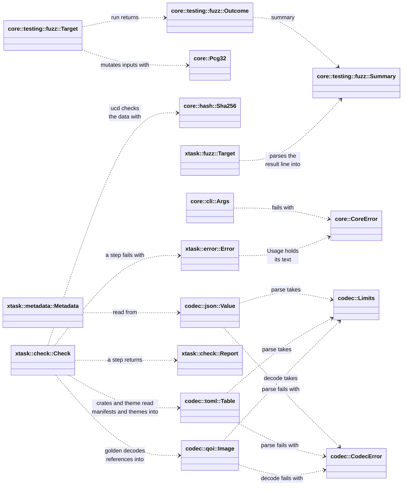

### 1.2 text

The main types of `tidepool-text`, whose library uses no other crate's
types:

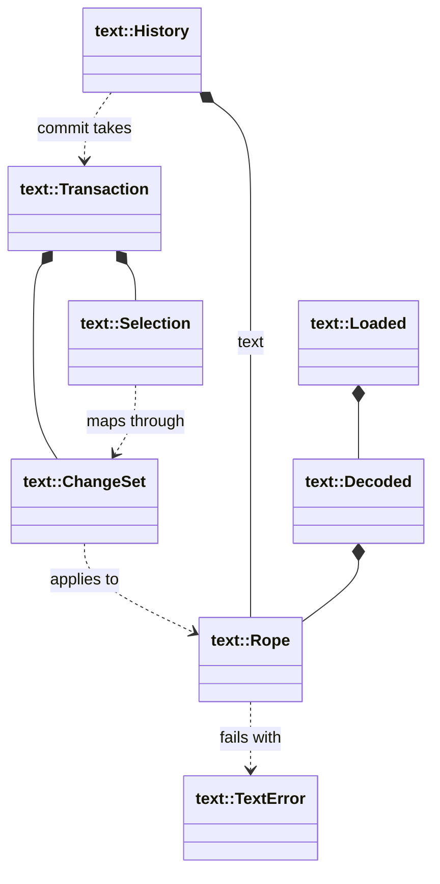

## 2. core: errors, the command line, cancellation and paths

`CoreError` shows the pattern every crate follows: one error enum that
implements `Display` and `std::error::Error`. `ErrorContext` adds
`context` and `with_context` to every `Result`, wrapping the error in a
`WithContext`; `Args` takes a command line apart piece by piece, and an
error about an argument carries its 1-based position (too many arguments
carries the limit).

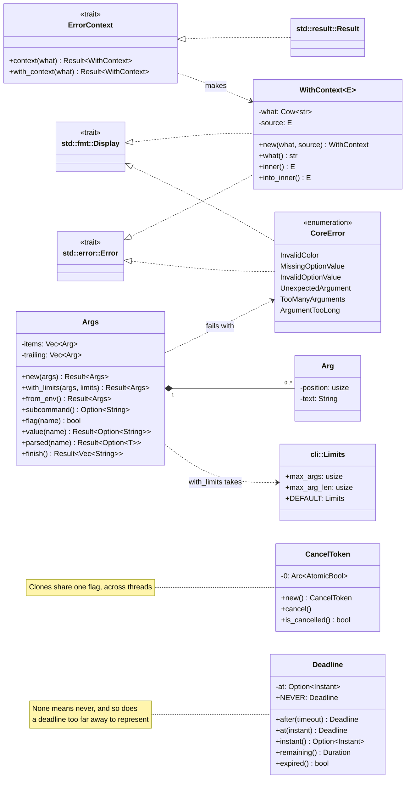

`core::path` (M1.8) shows a path to people and logs without hiding a byte
or letting a name drive a terminal (ADR-0032, ADR-0033), gives a path as
text, and canonicalizes it. `resolve` does so for a path whose end does not
exist yet, and `under` checks containment component by component. Its
error keeps the `std::io::Error` that caused it.

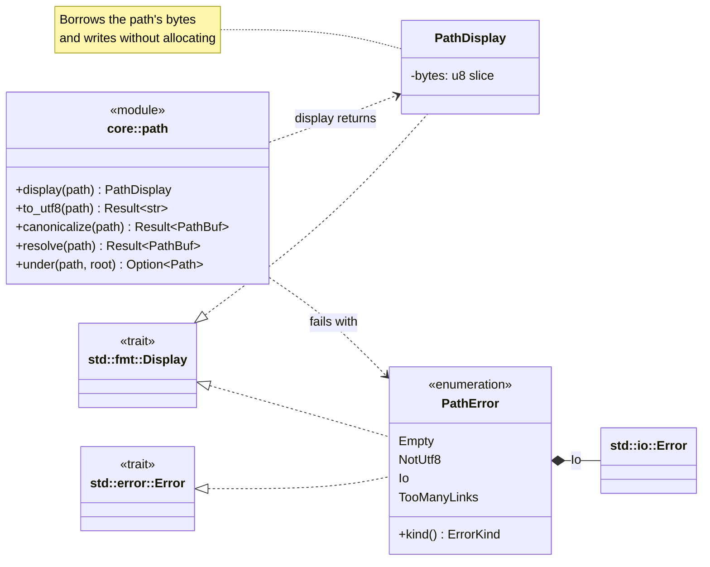

## 3. core: random numbers, hashes and time

`Pcg32` is the one random number generator; it is not `Copy`, so a
generator cannot be copied by accident and replay its numbers. `hash` has
FNV-1a (stable, for files on disk), CRC-32, SHA-256 for downloads, and a
fast hasher for in-memory maps that is not HashDoS-resistant.

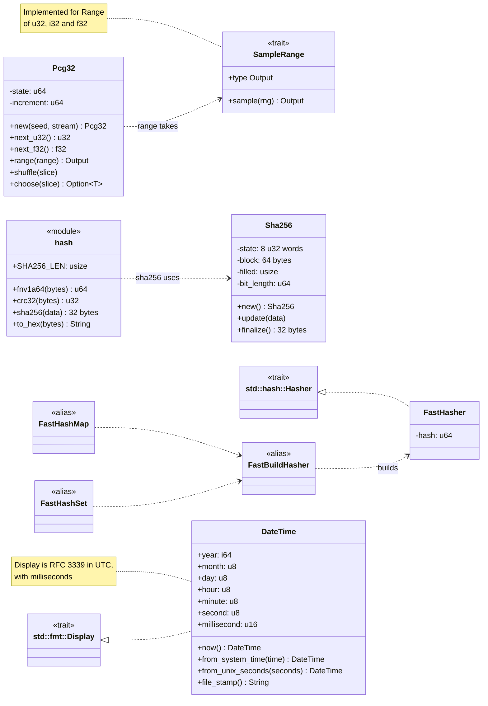

## 4. core: geometry and color

Logical units are `f32` and device pixels `i32`; `Scale` converts between
them through the `ToDevice` and `ToLogical` traits. `Color` is straight
alpha and `PremultipliedColor` premultiplied, which is what blending uses.

### 4.1 Geometry

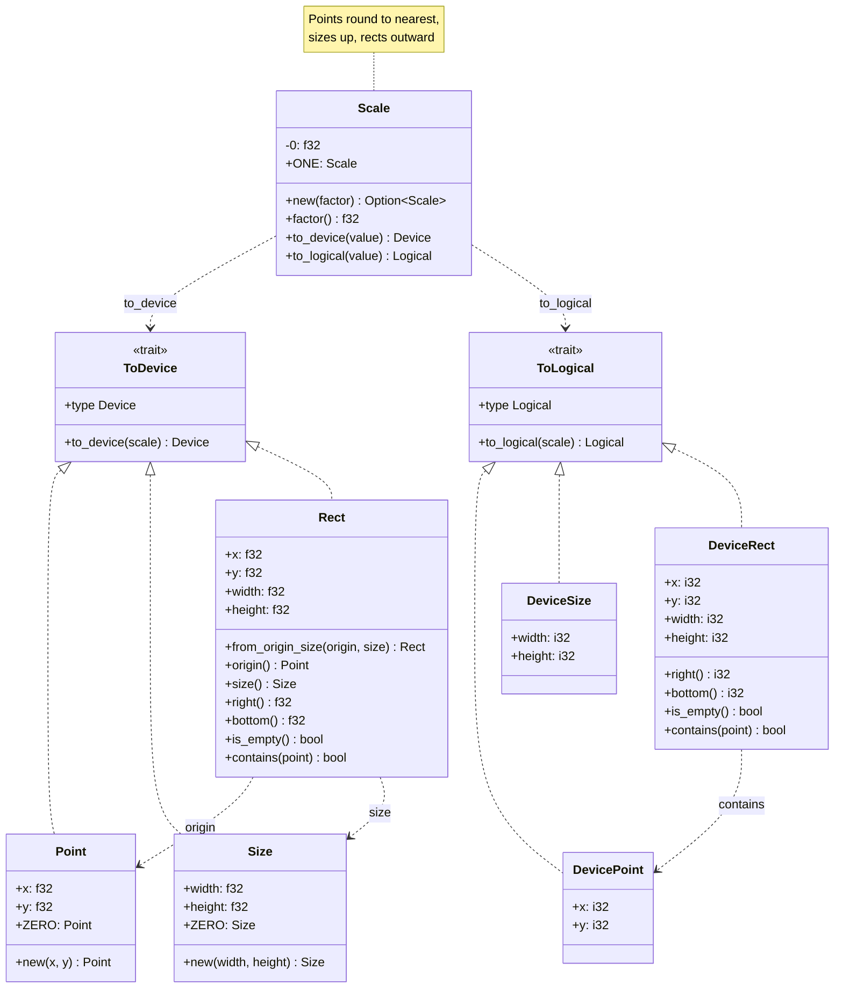

### 4.2 Color

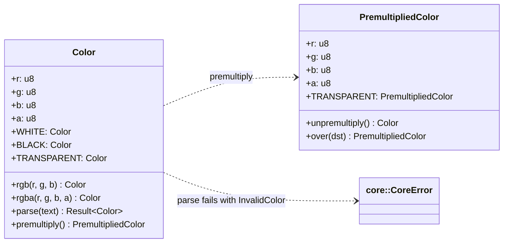

## 5. core: input

`InputEvent` is the one input type every frontend will produce. `Key`
names keys by their USB HID usage ids, and `Modifiers` is a small bit set.
`InputEvent`'s `Debug` shows a typed text as its length, through
`TextLength`, never the text (ADR-0043).

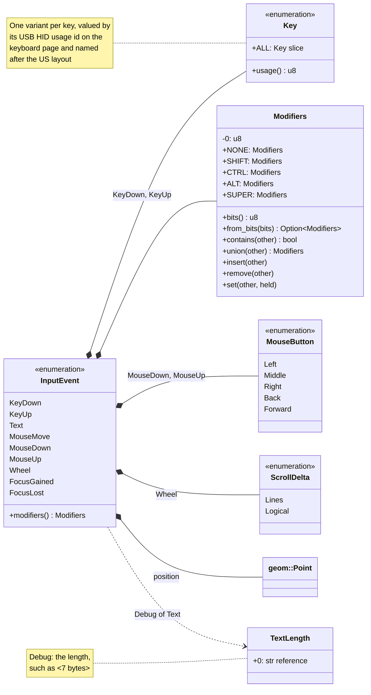

## 6. core: logging

The `log` functions and macros (`error`, `warn`, `info`, `debug`, `trace`)
filter a record, render it with every registered secret redacted, keep it
in the ring buffer, and queue it for the `tidepool-log` thread, which
writes stderr and the rotating file. The `Logger` lives in the static
`LOGGER`, and the `Queue` in the static `SHARED`; a full queue drops lines
and counts them, and never makes a caller wait.

### 6.1 The log functions and the Logger

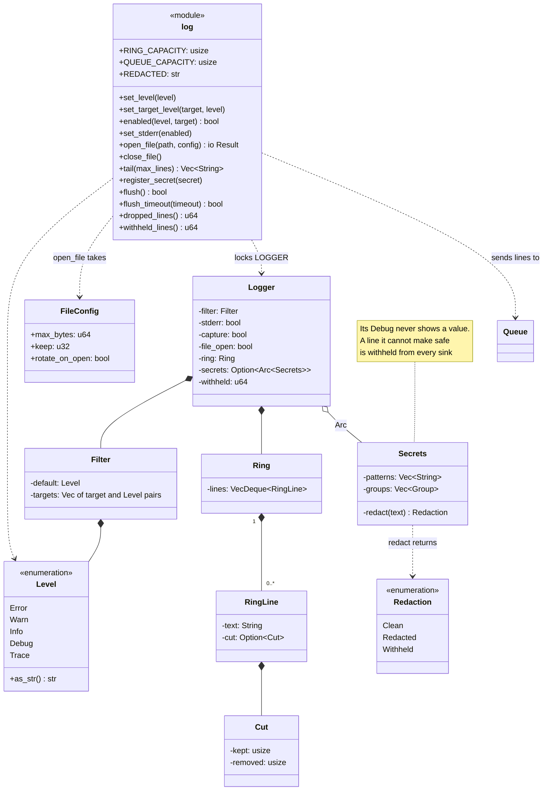

### 6.2 The queue and the log thread

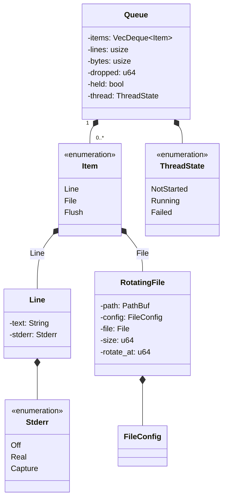

## 7. core: property tests

`check` and `check_sized` run a property on generated cases, from the seed
in `TIDEPOOL_SEED` or the default one. A failure report names the case's
input and ends with the command that reproduces it.

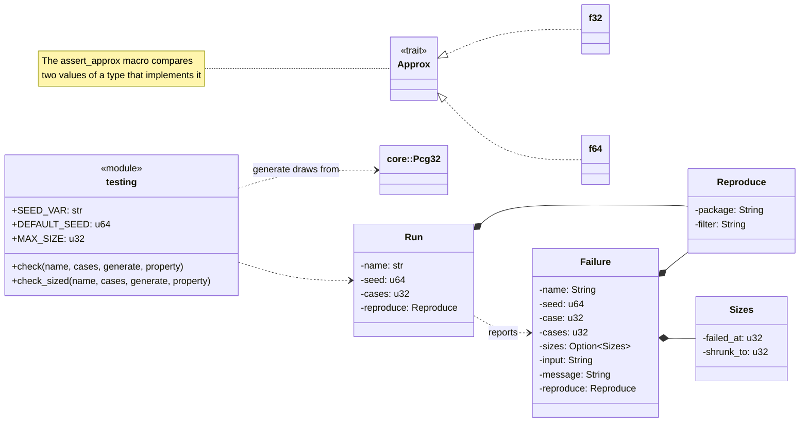

## 8. core: the fuzz engine's API

`testing::fuzz` is the engine behind each parser crate's `tests/fuzz.rs`
(ADR-0027). A `Target` names the function to fuzz and where its seeds and
saved crashes are; `run` replays them on every `cargo test`, and mutates
them when `cargo xtask fuzz-smoke` sets `TIDEPOOL_FUZZ_SECS`. The
`Outcome` it returns prints a report, and its `Summary` is the
`fuzz-result:` line that `fuzz-smoke` reads back.

### 8.1 Targets, runs and findings

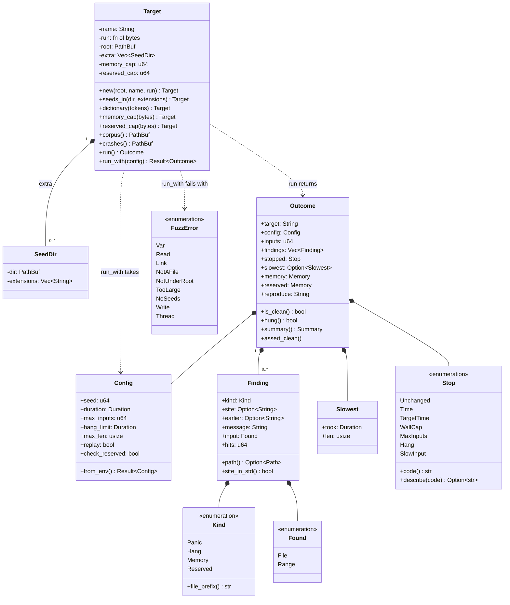

### 8.2 Memory, the result line and kept inputs

What an `Outcome` measured of memory, its `Summary`, written as the
`fuzz-result:` line, and `Kept`:

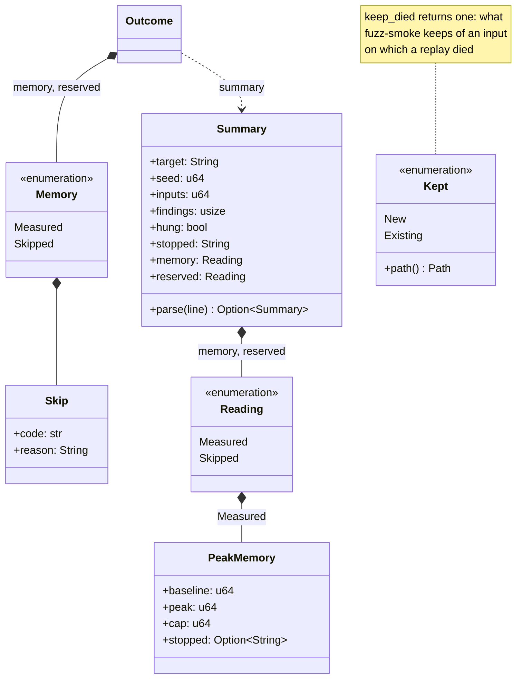

## 9. core: inside the fuzz engine

`Target::run_with` reads the saved crashes and the seeds into a `Plan`,
and `engine::run` runs it. The target runs on a thread of its own, and the
calling thread is the watchdog: the two share a `Shared`, so a hang is
noticed and its input saved. Saved crashes and seeds run unchanged; only
seeds are mutated, each mutated input from its own random stream.

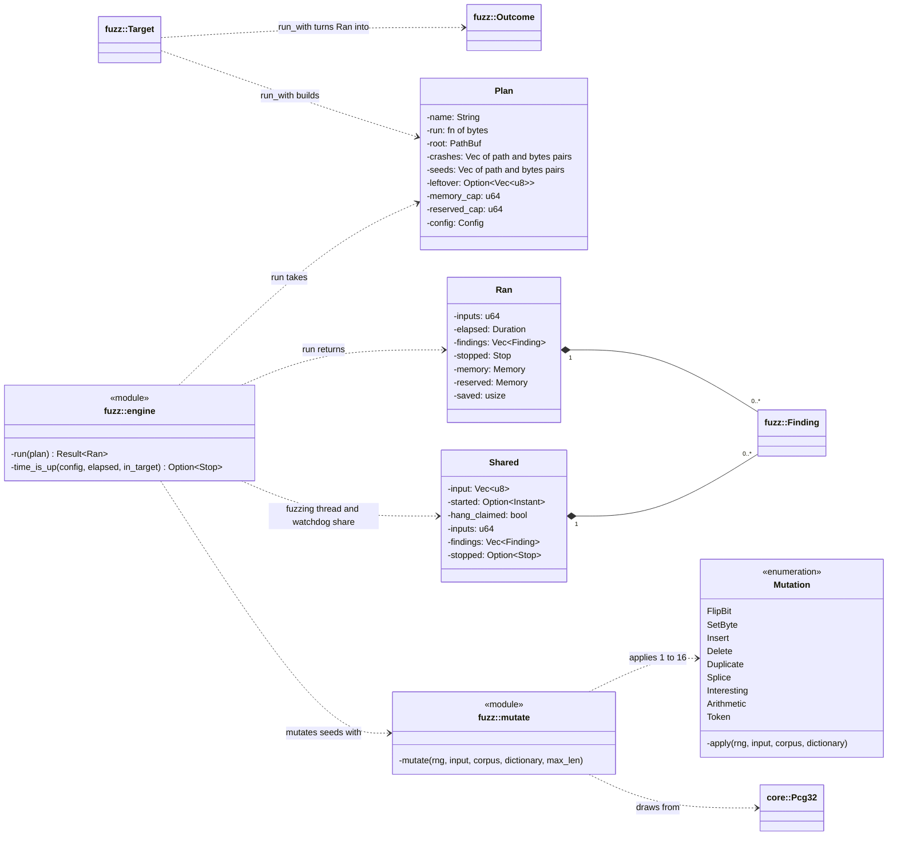

## 10. codec: limits, errors, JSON and QOI

Every parser takes a `Limits` and returns a `CodecError` with an offset,
and for JSON and TOML a line and a column; no parser panics on input.
`json::parse` reads
strict JSON or, with `Dialect::Jsonc`, comments and one trailing comma. An
object keeps its members in document order, duplicates included.

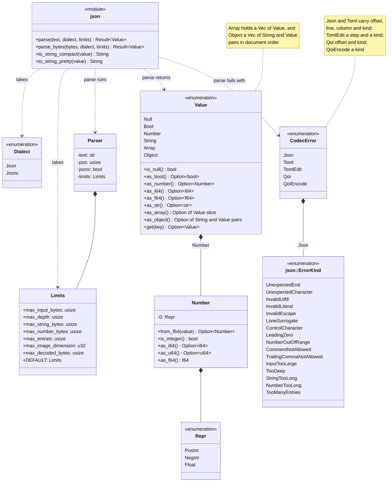

`qoi::decode` reads a QOI 1.0 file into an `Image`, whose pixels are
always RGBA8, rows from the top, whatever its header's `Channels`. The
header's width and height are checked against `max_image_dimension`, and
the pixels' size against `max_decoded_bytes`, before the pixels are
allocated. `qoi::encode` writes an image byte for byte as the reference
encoder does. A file it cannot read is `CodecError::Qoi`, with the byte
offset and a `qoi::ErrorKind`; an image it cannot write is
`CodecError::QoiEncode`, with an `EncodeErrorKind`. `xtask`'s `golden`
keeps its references in QOI (section 20).

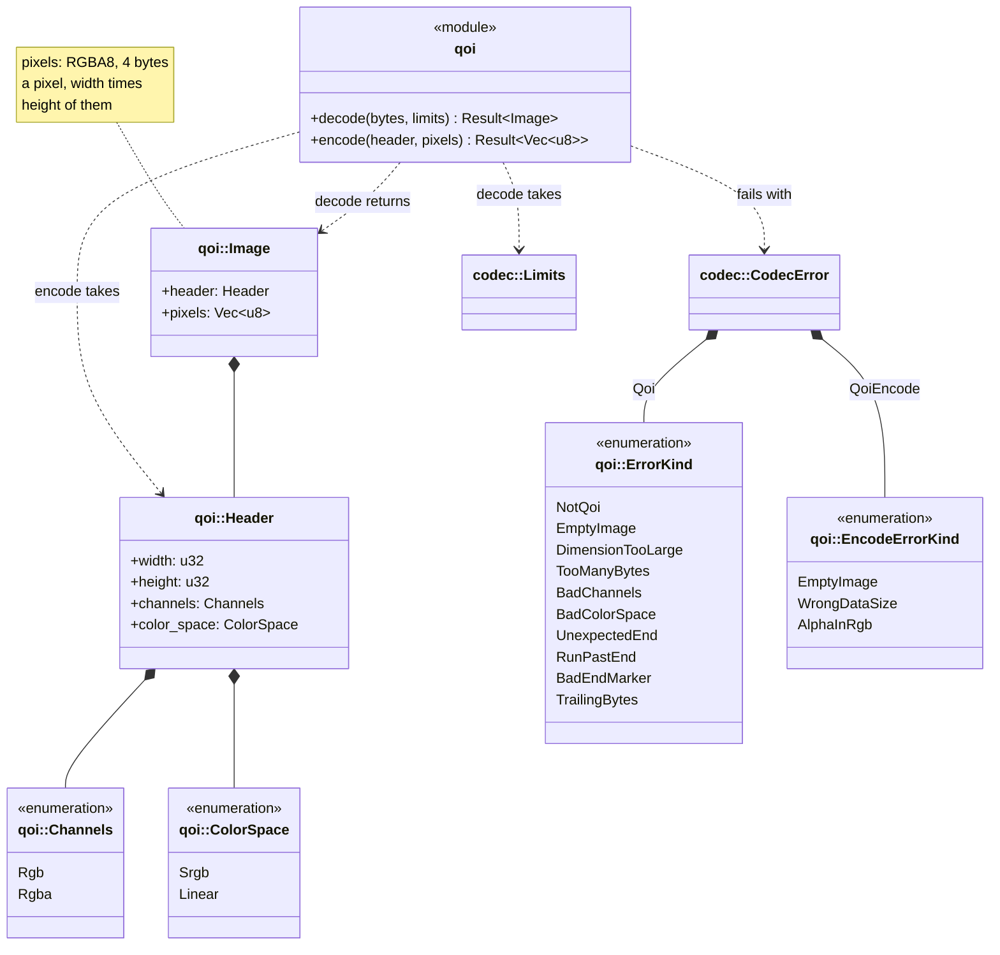

## 11. codec: TOML

`toml::parse` reads TOML 1.1 into a tree whose keys and values carry their
byte spans in the source. A `Table` keeps its entries in order and builds a
hash index only once it has many. `Document` (M1.5, drawn below) keeps a
document's text beside its tree and writes edits back into that text.

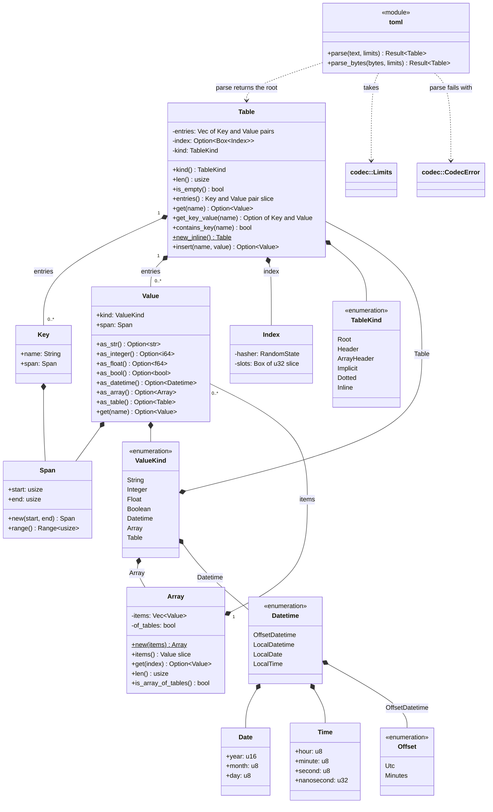

The errors of `toml::parse` are `CodecError::Toml`, with a
`toml::ErrorKind`:

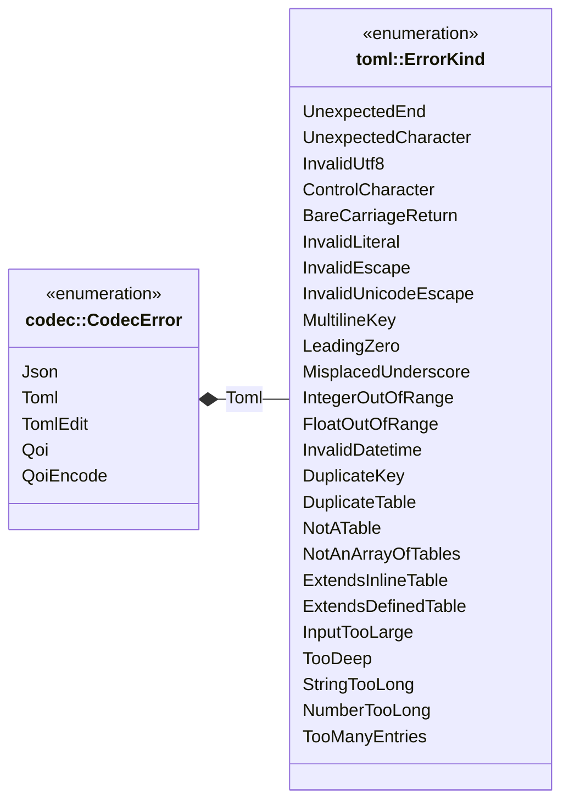

`Document` keeps the text it parsed, its root `Table` and its `Limits`.
`set` plans one splice, parses the new text again and checks it against
the old tree along the path before keeping either; a refused edit is
`CodecError::TomlEdit`, with the step of the path it concerns and an
`EditErrorKind`, and leaves the document as it was. What `set` writes is
TOML 1.0 (ADR-0031).

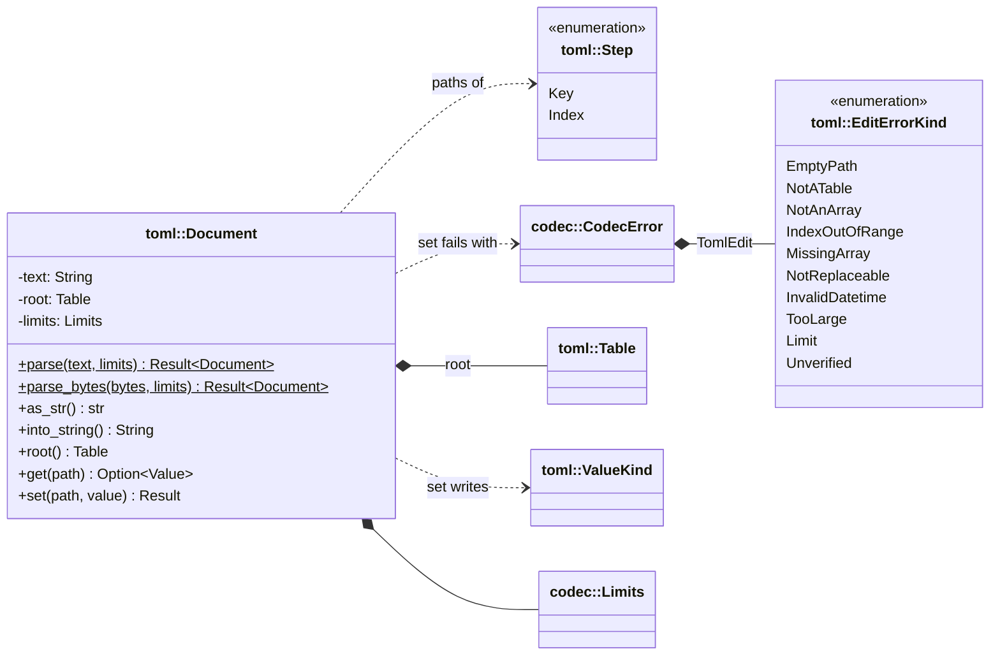

## 12. text: the rope

A `Rope` is a persistent B-tree of UTF-8 leaves of 1 to 4 KiB. Each child
carries a `Summary` of its bytes, chars, UTF-16 units and line breaks, so
edits and position lookups are O(log n), and a clone shares every node.

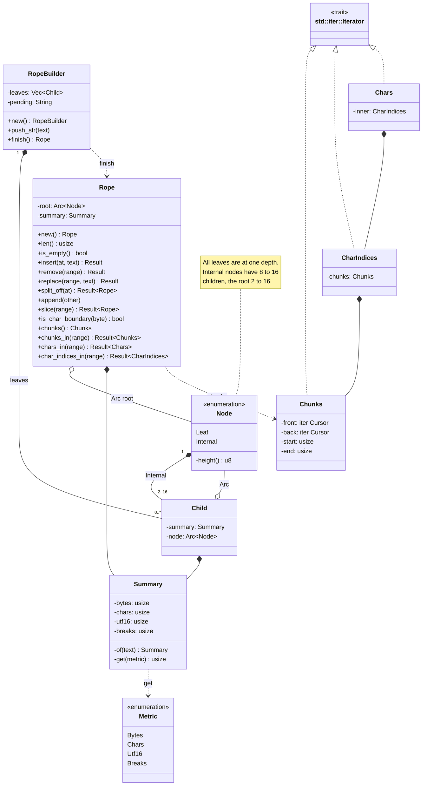

## 13. text: positions and graphemes

Positions are byte offsets (ADR-0019). The `pos` module adds conversions to
`Rope` between bytes, chars, UTF-16 units, lines and line/column pairs in
any `Unit`, and `pos::grapheme` adds extended grapheme cluster boundaries
(UAX #29) from tables `cargo xtask ucd` generates. A bad position is a
`TextError`, never a panic.

```mermaid
classDiagram
    direction LR
    class Rope {
        +len_in(unit) usize
        +len_lines() usize
        +byte_to_offset(byte, unit) Result~usize~
        +offset_to_byte(offset, unit) Result~usize~
        +byte_to_line(byte) Result~usize~
        +line_to_byte(line) Result~usize~
        +line_span(line) Result~LineSpan~
        +byte_to_line_col(byte, unit) Result~LineCol~
        +line_col_to_byte(pos, unit) Result~usize~
        +is_grapheme_boundary(byte) bool
        +next_grapheme_boundary(byte) Option~usize~
        +prev_grapheme_boundary(byte) Option~usize~
        +graphemes_in(range) Result~Graphemes~
    }
    class Unit {
        <<enumeration>>
        Byte
        Utf16
        Char
    }
    class LineCol {
        +line: usize
        +col: usize
        +new(line, col) LineCol
    }
    class LineBreak {
        <<enumeration>>
        Lf
        CrLf
        Cr
        +byte_len() usize
        +as_str() str
    }
    class LineSpan {
        +start: usize
        +content_end: usize
        +line_break: Option~LineBreak~
        +end() usize
        +content() Range~usize~
        +full() Range~usize~
    }
    class GraphemeFns["pos::grapheme"] {
        <<module>>
        +UNICODE_VERSION: u8 triple
        +is_boundary(text, byte) bool
        +next_boundary(text, byte) Option~usize~
        +prev_boundary(text, byte) Option~usize~
        +graphemes(text) StrGraphemes
    }
    class Graphemes {
        -rope: Rope
        -inner: Segmenter~CharIndices~
    }
    class StrGraphemes {
        -text: str
        -inner: Segmenter
    }
    class Segmenter~I~ {
        -chars: I
        -end: usize
    }
    class TextError["text::TextError"]
    Rope ..> Unit : conversions take
    Rope ..> LineCol : byte_to_line_col
    Rope ..> LineSpan : line_span
    LineSpan *-- LineBreak
    Rope ..> Graphemes : graphemes_in
    GraphemeFns ..> StrGraphemes : graphemes
    Graphemes *-- Segmenter
    StrGraphemes *-- Segmenter
    Rope ..> TextError : a bad position fails with
    note for Rope "Only the methods pos and<br/>pos::grapheme add are shown"
```

## 14. text: selections and transactions

A `Selection` is one or more `Cursor`s, sorted and merged by one rule, with
a primary. A `ChangeSet` is a list of byte-range replacements in the old
text, each holding its new text as a `Rope`; it applies, maps positions,
composes and inverts. A `Transaction` is a change set and the selection
after it.

```mermaid
classDiagram
    direction TB
    class Cursor {
        +anchor: usize
        +head: usize
        +new(anchor, head) Cursor
        +caret(at) Cursor
        +start() usize
        +end() usize
        +range() Range~usize~
        +is_caret() bool
        +is_backward() bool
    }
    class Selection {
        -cursors: Vec~Cursor~
        -primary: usize
        +caret(at) Selection
        +single(cursor) Selection
        +new(primary, others) Selection
        +cursors() Cursor slice
        +primary() Cursor
        +primary_index() usize
        +transform(f) Selection
        +validate(text) Result
        +map(changes, caret) Result~Selection~
    }
    class Assoc {
        <<enumeration>>
        Before
        After
    }
    class ChangeSet {
        -replacements: Arc of Replacement slice
        -len_before: usize
        -len_after: usize
        +identity(len) ChangeSet
        +new(text, edits) Result~ChangeSet~
        +len_before() usize
        +len_after() usize
        +is_identity() bool
        +changes() Changes
        +apply(text) Result
        +invert(before) Result~ChangeSet~
        +compose(next) Result~ChangeSet~
        +map(pos, assoc) Result~usize~
    }
    class Replacement {
        -start: usize
        -end: usize
        -new_start: usize
        -text: Option~Rope~
    }
    class Changes {
        -inner: slice Iter of Replacement
    }
    class Change {
        +old: Range~usize~
        +new: Range~usize~
        +text: Option~Rope~
    }
    class Transaction {
        -changes: ChangeSet
        -selection: Selection
        +new(changes, selection) Transaction
        +changes() ChangeSet
        +selection() Selection
        +into_parts() ChangeSet and Selection
        +change_each(text, selection, edit) Result~Transaction~
    }
    class Place {
        <<enumeration>>
        Map
        Start
        End
        Select
    }
    class Rope["text::Rope"]
    Selection "1" *-- "1..*" Cursor
    Selection ..> ChangeSet : map through
    Selection ..> Assoc : map takes
    Selection ..> Rope : validate against
    ChangeSet "1" o-- "0..*" Replacement : Arc
    Replacement *-- Rope : text
    ChangeSet ..> Changes : changes
    Changes ..> Change : yields
    ChangeSet ..> Rope : apply, invert
    ChangeSet ..> Assoc : map takes
    Transaction *-- ChangeSet
    Transaction *-- Selection
    Transaction ..> Place : change_each edit returns
    note for Place "Where the cursor goes after<br/>change_each edits it: mapped,<br/>at the start or end of the<br/>new text, or selecting it"
```

## 15. text: history, the undo tree

`History` applies every step to the buffer's rope (ADR-0020). It keeps a
tree of revisions: undo moves to the parent, redo to the child created or
visited last, and `jump_to` to any revision, so no branch is lost. Commits group by command
(`GroupId`) or coalesce by time, and checkpoints mark the saved revision.

```mermaid
classDiagram
    direction LR
    class History {
        -revisions: Vec~Revision~
        -current: usize
        -pending: Vec~Piece~
        -saved: Option~usize~
        -open: bool
        -text: Rope
        +new(text) History
        +text() Rope
        +commit(text, transaction, selection_before, now, group) Result~Step~
        +undo(text) Result~Option~Step~~
        +redo(text) Result~Option~Step~~
        +jump_to(text, target) Result~Option~Step~~
        +seal()
        +checkpoint() Checkpoint
        +mark_saved(checkpoint) Result
        +is_modified() bool
        +current() RevisionId
        +root() RevisionId
        +can_undo() bool
        +can_redo() bool
    }
    class Revision {
        -parent: usize
        -last_child: Option~usize~
        -changes: ChangeSet
        -inverse: ChangeSet
        -selection_before: Selection
        -selection_after: Selection
        -time: Option~Instant~
        -tag: Tag
    }
    class Piece {
        -changes: ChangeSet
        -inverse: ChangeSet
    }
    class Tag {
        <<enumeration>>
        Root
        New
        Command
        Coalesce
    }
    class Group {
        <<enumeration>>
        New
        Command
        Coalesce
    }
    class GroupId {
        -0: u64
        +fresh() GroupId
    }
    class RevisionId {
        -0: u64
        +seq() u64
    }
    class Step {
        +revision: RevisionId
        +before: Rope
        +changes: Vec~ChangeSet~
        +selection: Selection
    }
    class Checkpoint {
        -revision: RevisionId
        -text: Rope
        +revision() RevisionId
        +text() Rope
    }
    class Transaction["text::Transaction"]
    class ChangeSet["text::ChangeSet"]
    class Selection["text::Selection"]
    class Rope["text::Rope"]
    History "1" *-- "1..*" Revision : revisions
    History "1" *-- "0..*" Piece : pending
    History *-- Rope : text
    History ..> Transaction : commit takes
    History ..> Group : commit takes
    History ..> Step : commit, undo, redo return
    History ..> Checkpoint : checkpoint
    History ..> RevisionId : current, root
    Revision *-- ChangeSet : changes, inverse
    Revision *-- Selection : before, after
    Revision *-- Tag
    Piece *-- ChangeSet : changes, inverse
    Tag --> GroupId : Command
    Group --> GroupId : Command
    Step *-- RevisionId
    Checkpoint *-- RevisionId
    note for Revision "parent and last_child are indexes<br/>into the revisions of its History:<br/>the undo tree"
```

## 16. text: encodings

`Decoder` detects UTF-8 or UTF-16 by the byte-order mark only, and decodes
bytes pushed in pieces. Invalid input decodes losslessly: each invalid
sequence becomes one U+FFFD in the text, the replaced bytes are kept in
runs, and the result is read-only; `write_original` gives back the input
byte for byte.

```mermaid
classDiagram
    direction TB
    class EncodingFns["encoding"] {
        <<module>>
        +decode(bytes) Decoded
        +encode(text, format, out) io Result
    }
    class Encoding {
        <<enumeration>>
        Utf8
        Utf16Le
        Utf16Be
        +bom() u8 slice
        +name() str
    }
    class Format {
        +encoding: Encoding
        +bom: bool
        +UTF8: Format
        +new(encoding, bom) Format
    }
    class Decoder {
        -mode: Mode
        -format: Format
        -text: Sink
        -runs: Runs
        +new() Decoder
        +push(bytes)
        +finish() Decoded
    }
    class Mode {
        <<enumeration>>
        Detecting
        Utf8
        Utf16
    }
    class Decoded {
        -text: Rope
        -detected: Format
        -runs: Runs
        +text() Rope
        +into_text() Rope
        +detected() Format
        +format() Option~Format~
        +read_only() bool
        +replaced() ReplacedRuns
        +write_original(out) io Result
        +original_bytes() Vec~u8~
    }
    class Runs {
        -heads: Vec~u8~
        -bytes: Vec~u8~
        -count: usize
        -end: usize
        -open: Option~OpenRun~
    }
    class ReplacedRuns {
        -heads: u8 slice
        -bytes: u8 slice
        -end: usize
    }
    class Replaced {
        +range: Range~usize~
        +bytes: u8 slice
    }
    class Rope["text::Rope"]
    EncodingFns ..> Decoder : decode runs
    EncodingFns ..> Format : encode takes
    Format *-- Encoding
    Decoder *-- Mode
    Decoder *-- Format
    Decoder ..> Decoded : finish
    Decoded *-- Rope : text
    Decoded *-- Format : detected
    Decoded *-- Runs
    Decoded ..> ReplacedRuns : replaced
    ReplacedRuns ..> Replaced : yields
    note for Decoded "format is None when the input<br/>was invalid: then it is read-only"
```

## 17. text: files

`file::load` reads a file and decodes it, and records its line endings and
whether its last line ends with a break. `file::save` writes the text in
the given `Format` through a temp file in the same directory, syncs it and
renames it over the file, keeping its permissions and following symbolic
links. Each I/O error names the `FileStep` that failed.

```mermaid
classDiagram
    direction LR
    class FileFns["file"] {
        <<module>>
        +LARGE_FILE_BYTES: u64
        +TEMP_PREFIX: str
        +load(path) Result~Loaded~
        +save(path, text, format) Result
    }
    class Loaded {
        -decoded: Decoded
        -line_endings: LineEndings
        -trailing_break: Option~LineBreak~
        -file_len: u64
        +text() Rope
        +decoded() Decoded
        +format() Option~Format~
        +read_only() bool
        +line_endings() LineEndings
        +trailing_break() Option~LineBreak~
        +file_len() u64
        +is_large() bool
    }
    class LineEndings {
        +lf: usize
        +crlf: usize
        +cr: usize
        +of(text) LineEndings
        +total() usize
        +is_mixed() bool
        +dominant() LineBreak
    }
    class Temp {
        -file: File
        -removal: Removal
        -target: PathBuf
        -dir: PathBuf
        -permissions: Option~Permissions~
        -create(path) Result~Temp~
        -write(write) Result~Temp~
        -commit() Result
    }
    class Removal {
        -path: PathBuf
        -armed: bool
    }
    class Drop["std::ops::Drop"] {
        <<trait>>
    }
    class FileStep {
        <<enumeration>>
        Metadata
        Open
        Read
        ReadLink
        CheckWritable
        CreateTemp
        Write
        SetPermissions
        Sync
        Rename
        SyncDirectory
    }
    class Decoded["encoding::Decoded"]
    class Format["encoding::Format"]
    class LineBreak["pos::LineBreak"]
    class TextError["text::TextError"]
    FileFns ..> Loaded : load returns
    FileFns ..> Format : save takes
    FileFns ..> Temp : save writes through
    FileFns ..> TextError : fails with
    Loaded *-- Decoded
    Loaded *-- LineEndings
    Loaded *-- LineBreak : trailing_break
    LineEndings ..> LineBreak : dominant
    Temp *-- Removal
    Drop <|.. Removal
    TextError *-- FileStep : Io
    note for Removal "Removes the temp file on drop<br/>unless the rename disarmed it"
    note for Loaded "is_large is true above<br/>LARGE_FILE_BYTES, 16 MiB,<br/>for the large-file mode"
```

## 18. text: the error enum

`TextError` is the one error type of `tidepool-text`: bad positions and
ranges, edits that do not fit their text, revisions that are not in a
history, and the file errors.

```mermaid
classDiagram
    direction LR
    class TextError {
        <<enumeration>>
        ByteOutOfBounds
        NotCharBoundary
        InvertedRange
        OffsetOutOfBounds
        OffsetInsideChar
        LineOutOfBounds
        ColumnOutOfBounds
        ColumnInsideChar
        LengthMismatch
        OverlappingEdits
        TooLong
        RevisionNotFound
        HistoryMismatch
        Io
        NotRegularFile
        NotWritable
        TooManyLinks
    }
    class Unit["pos::Unit"]
    class LineCol["pos::LineCol"]
    class FileStep["file::FileStep"]
    class IoError["std::io::Error"]
    class Display["std::fmt::Display"] {
        <<trait>>
    }
    class StdError["std::error::Error"] {
        <<trait>>
    }
    TextError *-- Unit : Offset and Column variants
    TextError *-- LineCol : Column variants
    TextError *-- FileStep : Io
    TextError *-- IoError : Io, NotWritable
    Display <|.. TextError
    StdError <|.. TextError
```

## 19. xtask: checks and reports

Each `cargo xtask` check is a `Check`: a name, a step and a role. A step
runs cargo with fixed arguments (`Cargo` and `Tests`), or one of `xtask`'s
own checks (`Own`: `deps::run`, `layers::run`, `crates::run`,
`features::run`, `unsafe_audit::run`, `headers::run`, `workflows::run`,
`golden::check`, `ucd::check`, `ucd::write` or `theme::run`), which
returns a `Report`.
A `Compiles` step does not run once a `Gate` step has failed; `deps` is
the gate, and `clippy`, `test` and `golden` compile. `GOLDEN` is a step of
`CI` but not in `COMMANDS`: `main` runs `golden` itself, for its
`--bless`, and `print` prints what it found as `ci` prints a step. `ci`
runs the checks in order and ends with a summary table that also lists
the `Later` commands it will run once they exist (those with `in_ci`:
`tools`).
Every `Later` command exits 1 with "not yet implemented" until its task
lands. `run_gate` runs them and returns a `Gate`, each step's outcome and
the tests counted; `run_ci` is its `passed`, and `site` keeps the rest
(ADR-0030).

```mermaid
classDiagram
    direction TB
    class CheckFns["check"] {
        <<module>>
        +COMMANDS: Check slice
        +CI: Check slice
        +GOLDEN: Check
        +LATER: Later slice
        +run_one(check, root, out) io Result~bool~
        +run_ci(checks, later, root, out) io Result~bool~
        +run_gate(checks, later, root, out) io Result~Gate~
        +print(name, result, out) io Result~bool~
    }
    class Gate {
        -outcomes: Vec~Outcome~
        -tests: TestCounts
        +passed() bool
        +steps() usize, usize
        +skipped() usize
        +tests() TestCounts
    }
    class TestCounts["cargo::TestCounts"] {
        +results: usize
        +unreadable: usize
        +passed: usize
        +failed: usize
        +ignored: usize
    }
    class Check {
        +name: str
        +about: str
        +step: Step
        +role: Role
    }
    class Step {
        <<enumeration>>
        Cargo
        Tests
        Own
    }
    class Role {
        <<enumeration>>
        Independent
        Gate
        Compiles
    }
    class Report {
        +notes: Vec~String~
        +violations: Vec~String~
        +stale_lockfiles: usize
        +skips: Skips
        +tests: TestCounts
        +push_stale_lockfile(violation)
    }
    class Skips["cargo::Skips"] {
        +reasons: Vec~String~
        +count: usize
    }
    class Later {
        +name: str
        +task: str
        +in_ci: bool
    }
    class CiOutcome["check::Outcome"] {
        -name: str
        -status: Status
        -elapsed: Duration
        -skipped: usize
    }
    class Status {
        <<enumeration>>
        Passed
        Failed
        NotRun
    }
    class XtaskError["error::Error"] {
        <<enumeration>>
        Usage
        NotImplemented
        Read
        Spawn
        CommandFailed
        UnexpectedOutput
        Doc
        Output
        Write
        Env
    }
    CheckFns "1" o-- "0..*" Check : COMMANDS, CI, GOLDEN
    CheckFns "1" o-- "0..*" Later : LATER
    Check *-- Step
    Check *-- Role
    Step ..> Report : Own returns
    Step ..> XtaskError : Own fails with
    Report *-- Skips
    Report *-- TestCounts
    CheckFns ..> Gate : run_gate returns
    Gate o-- CiOutcome : one per step
    Gate *-- TestCounts
    CheckFns ..> CiOutcome : one per ci step
    CiOutcome *-- Status
    note for Skips "Tests that printed SKIPPED:<br/>did not run, and are never<br/>counted as passes"
```

## 20. xtask: fuzz-smoke's and golden's tables, and the theme check

`cargo xtask fuzz-smoke` runs each fuzz target in `TARGETS` as a
`cargo test` of its crate's `tests/fuzz.rs` in the `fuzz` profile, and
reads the `fuzz-result:` line the test prints back into a
`core::testing::fuzz::Summary`. It turns each run into a `Verdict`.

```mermaid
classDiagram
    direction TB
    class SmokeFns["fuzz"] {
        <<module>>
        +TARGETS: Target slice
        +DEFAULT_SECS: u64
        +PROFILE: str
        +clock_seed() u64
        +run(options, table, root, out) Result~bool~
    }
    class SmokeTarget["fuzz::Target"] {
        +name: str
        +package: str
    }
    class Options {
        +targets: Vec~Target~
        +secs: u64
        +seed: u64
        +seed_from_clock: bool
        +replay: bool
        +parse(args, table, clock) Result~Options~
    }
    class Verdict {
        <<enumeration>>
        Clean
        Found
        Failed
        NotRun
        NotBuilt
        CargoFailed
        Died
        ExitedWithoutResult
    }
    class Args["core::cli::Args"]
    class Summary["core::testing::fuzz::Summary"]
    class Reading["core::testing::fuzz::Reading"]
    class Kept["core::testing::fuzz::Kept"]
    class XtaskError["error::Error"]
    SmokeFns "1" o-- "7" SmokeTarget : TARGETS
    Options "1" o-- "1..*" SmokeTarget : borrows
    Options ..> Args : parse reads
    Options ..> XtaskError : parse fails with Usage
    SmokeFns ..> Options : run takes
    SmokeFns ..> Verdict : one per target
    Verdict *-- Summary : Clean, Found, Failed
    Summary *-- Reading : memory, reserved
    SmokeFns ..> Kept : keep_died
    note for SmokeTarget "TARGETS holds json, toml<br/>and qoi in tidepool-codec,<br/>encoding in tidepool-text,<br/>ttf in tidepool-font,<br/>theme in tidepool-ui<br/>and keymap in tidepool-editor"
```

`cargo xtask golden` asks `cargo metadata` which members have a test
target named `golden`, and runs each one's scenes as a `cargo test
--package <crate> --test golden`, with `TIDEPOOL_GOLDEN_DIR` naming that
crate's directory in `target/golden/rendered/`. A member with that test
needs a row in `SCENES`, which gives its tolerance. It reads each PAM file
a scene wrote into a `Rendered`, and judges it against its reference,
`tests/golden/<scene>.qoi`, decoded with `codec::qoi`, into a `Verdict`
(ADR-0044). `parse` reads `--bless` and the scene names after it;
`check`, the step of `ci`, blesses nothing.

```mermaid
classDiagram
    direction TB
    class GoldenFns["golden"] {
        <<module>>
        +NAME: str
        +DIR_VAR: str
        +SCENES: Scenes slice
        +check(root) Result~Report~
        +parse(args) Result~BTreeSet~String~~
        +command(bless, root, out) Result~bool~
    }
    class Scenes {
        +package: str
        +tolerance: u8
    }
    class Rendered {
        -width: u32
        -height: u32
        -pixels: Vec~u8~
        -tolerance: u8
    }
    class Verdict {
        <<enumeration>>
        Same
        Differs
        OtherSize
        BadReference
        NoReference
        NotRendered
    }
    class Args["core::cli::Args"]
    class QoiImage["codec::qoi::Image"]
    class Metadata["metadata::Metadata"]
    class Report["check::Report"]
    class XtaskError["error::Error"]
    GoldenFns "1" o-- "1..*" Scenes : SCENES
    GoldenFns ..> Metadata : finds the crates<br/>with scenes in
    GoldenFns ..> Args : parse reads
    GoldenFns ..> XtaskError : parse fails with Usage
    GoldenFns ..> Rendered : one per scene drawn
    GoldenFns ..> Verdict : one per scene
    GoldenFns ..> QoiImage : decodes references,<br/>encodes images
    GoldenFns ..> Report : check returns
    note for Scenes "SCENES holds tidepool-gfx,<br/>with a tolerance of 0:<br/>every pixel exact;<br/>tidepool-font, with 1;<br/>and tidepool-gui, with 0"
```

`cargo xtask theme` (M3.2, ADR-0047) lists the regular `.toml` files
directly in `themes/` into a `Found`, never following a link, and parses
each with `codec::toml`. It reads each color's `value` and `solid` into an
`Entry`, and each surface of each `[[contrast.use]]` into a `Use`, whose
`min` is `NORMAL` or `LARGE`; `contrast` is WCAG 2.x's ratio of two
colors. `run` puts each theme's table in the `Report`'s notes and each
pair below its minimum in its violations. It does not use `tidepool-ui`,
which the matrix does not let `xtask` use.

```mermaid
classDiagram
    direction TB
    class ThemeFns["theme"] {
        <<module>>
        +DIR: str
        +NORMAL: f64
        +LARGE: f64
        +run(root) Result~Report~
        +contrast(a, b) f64
    }
    class Found {
        -themes: Vec~String~
        -links: Vec~PathBuf~
        -others: Vec~PathBuf~
    }
    class Entry {
        -value: Color
        -solid: Option~Color~
        -over(below_name, below) Color
    }
    class Use {
        -text: String
        -on: String
        -over: String
        -min: f64
        -size: str
        -line: usize
    }
    class Color["core::color::Color"]
    class TomlTable["codec::toml::Table"]
    class Report["check::Report"]
    ThemeFns ..> Found : lists themes/ into
    ThemeFns ..> TomlTable : parses each file into
    ThemeFns ..> Entry : one per color
    ThemeFns ..> Use : one per surface<br/>of each contrast.use
    Entry *-- Color : value, solid
    ThemeFns ..> Color : contrast of two
    ThemeFns ..> Report : run returns
    note for Use "min is NORMAL, 4.5:1, or LARGE, 3:1<br/>over is bg when the file names none"
```

## 21. xtask: cargo metadata, the dependency matrix and the crates check

`metadata::load` runs `cargo metadata` and reads its JSON with
`codec::json` into a `Metadata`. The `layers` check reads the dependency
matrix from `docs/01-architecture.md` into a `Matrix` and checks every
member's dependencies against its row; `deps` checks each package against
the `Pin`s of its allowlist.

### 21.1 cargo metadata

```mermaid
classDiagram
    direction TB
    class MetadataFns["metadata"] {
        <<module>>
        +load(root, manifest, resolve) Result~Metadata~
        +parse(text, command) Result~Metadata~
        +workspaces(root, manifests, resolve) Vec~Workspace~
    }
    class Metadata {
        +workspace_root: PathBuf
        +packages: Vec~Package~
    }
    class Package {
        +name: String
        +version: String
        +source: Option~String~
        +manifest_path: PathBuf
        +is_member: bool
        +dependencies: Vec~Dependency~
        +targets: Vec~Target~
    }
    class Target {
        +name: String
        +kind: String
        +src_path: PathBuf
    }
    class Dependency {
        +name: String
        +source: Option~String~
        +req: String
        +path: Option~PathBuf~
        +kind: Kind
    }
    class Kind {
        <<enumeration>>
        Normal
        Dev
        Build
        +describe() str
    }
    class Resolve {
        <<enumeration>>
        Yes
        No
    }
    class Workspace {
        +shown: String
        +graph: Result~Metadata~
        +declared: Option~Metadata~
    }
    class JsonValue["codec::json::Value"]
    MetadataFns ..> Metadata : load, parse
    MetadataFns ..> Workspace : workspaces
    MetadataFns ..> Resolve : takes
    MetadataFns ..> JsonValue : parses the<br/>output into
    Workspace *-- Metadata : graph, declared
    Metadata "1" *-- "0..*" Package
    Package "1" *-- "0..*" Dependency
    Package "1" *-- "0..*" Target
    Dependency *-- Kind
```

### 21.2 The dependency matrix, the allowlist and `crates`

`crates::run` loads the workspace's `Metadata` without resolving it, and
reads the root manifest and each member's into a `codec::toml::Table`. A
member's README must start with `# <name>`, name only the roadmap's
tasks, and have each of `SECTIONS` once and in that order, and `FEATURES`
at most once, between Usage and Documentation. `crates` finds those lines
as `layers` reads its document, with `matrix::classify`, so a heading in a
fenced code block, an HTML block or an HTML comment does not count. It
also checks that each member keeps byte-for-byte copies of the root's
`LICENSE_FILES`, `LICENSE` and `NOTICE`.

```mermaid
classDiagram
    direction TB
    class MatrixFns["matrix"] {
        <<module>>
        +DOC: str
        +parse(text) Result~Matrix~
        +classify(lines) Vec of Kind and String pairs
    }
    class Matrix {
        +rows: Vec~Row~
        +row(name) Option~Row~
    }
    class Row {
        +name: String
        +line: usize
        +allowed: Allowed
        +written: String
        +dev_only: bool
        +allows(name) bool
    }
    class Allowed {
        <<enumeration>>
        Only
        AnyWorkspaceCrate
    }
    class LineKind["matrix::Kind"] {
        <<enumeration>>
        Shown
        Fenced
        Comment
        Html
    }
    class Pin["deps::Pin"] {
        +name: String
        +version: String
    }
    class CratesFns["crates"] {
        <<module>>
        -SECTIONS: 6 str
        -FEATURES: str
        -LICENSE_FILES: 2 str
        +run(root) Result~Report~
    }
    class Metadata["metadata::Metadata"]
    class TomlTable["codec::toml::Table"]
    class Report["check::Report"]
    MatrixFns ..> Matrix : parse
    Matrix "1" *-- "1..*" Row
    Row *-- Allowed
    MatrixFns ..> LineKind : classify
    CratesFns ..> Metadata : takes the<br/>members from
    CratesFns ..> TomlTable : reads<br/>manifests into
    CratesFns ..> MatrixFns : finds README<br/>sections with classify
    CratesFns ..> Report : run returns
    note for MatrixFns "DOC is docs/01-architecture.md"
    note for Pin "deps reads one per line<br/>of xtask/deps-allowlist.txt"
```

## 22. bench: the harness and the baseline

`tidepool-bench` is a library and a binary (ADR-0035). A `Suite` is a
name and a function that measures one routine through the `Bencher` it is
given; `run_suite` makes the `Bencher` from `Settings` and returns the
`Summary` it recorded. `cli::run` runs the suites `Options` select,
compares each `Summary` with the `Entry` of the same name in a `Baseline`
recorded on a `Machine` with the same `Facts`, and with `--save` writes the
merged `Baseline` back. `suites::all` lists the 18 text suites, which use
`tidepool-text`'s `Rope` and `History`, then the font suite, which fills
`tidepool-font`'s `Atlas` (M2.5), then the ui suite, which repaints a
`tidepool-ui` `Palette`, its text measured with `tidepool-gui`'s
`FontMetrics` (M3.3, 28.7), then the three editor suites, which scroll
a `tidepool-editor` `EditorView` and paint it with `tidepool-gui`'s
`Painter` (M4.1, 29.2).

```mermaid
classDiagram
    direction LR
    class HarnessFns["harness"] {
        <<module>>
        +MAX_BATCH: usize
        +PRIME_BYTES: usize
        +run_suite(suite, settings) Result~Summary~
        +prime_allocator()
        +median(sorted) Option~f64~
        +p95(sorted) Option~f64~
    }
    class Suite {
        +name: str
        +run: fn(Bencher) Result
    }
    class Bencher {
        -settings: Settings
        -summary: Option~Summary~
        +new(settings) Bencher
        +iter(routine)
        +iter_batched(setup, routine)
    }
    class Settings {
        +warm_up: Duration
        +sample_target: Duration
        +budget: Duration
        +min_samples: usize
        +max_samples: usize
        +DEFAULT: Settings
    }
    class Summary {
        +median_ns: u64
        +p95_ns: u64
        +samples: usize
        +batch: usize
        +of(per_iteration_ns, batch) Option~Summary~
    }
    class CliFns["cli"] {
        <<module>>
        +SLOWER_PERCENT: u64
        +run(options, suites, settings, path, facts, out) Result
        +select(suites, filter) Result~Vec~Suite~~
        +is_slower(baseline_ns, now_ns) bool
    }
    class Options {
        +filter: Option~String~
        +save: bool
        +machine: Option~String~
        +help: bool
        +parse(args) Result~Options~
    }
    class Args["core::cli::Args"]
    class SuitesFns["suites"] {
        <<module>>
        +all() Vec~Suite~
    }
    class Baseline {
        +machine: Machine
        +suites: BTreeMap~String, Entry~
        +read(path) Result~Option~Baseline~~
        +parse(bytes) Result~Baseline~
        +to_json() String
        +write(path) Result
        +merge(existing, machine, measured, known) Result~Baseline~
        +check_machine(machine) Result
    }
    class Machine {
        +name: String
        +facts: Facts
    }
    class Facts {
        +os: String
        +arch: String
        +threads: u64
        +cpu: String
        +detect() Facts
        +describe() String
    }
    class Entry {
        +median_ns: u64
        +p95_ns: u64
        +samples: u64
    }
    class Json["codec::json"]
    class Save["text::file::save"]

    HarnessFns ..> Bencher : makes
    HarnessFns ..> Summary : returns
    Suite ..> Bencher : runs through
    Bencher *-- Settings
    Bencher *-- "0..1" Summary
    SuitesFns ..> Suite : makes
    CliFns ..> Options
    CliFns ..> HarnessFns : run_suite
    CliFns ..> Baseline : reads, merges, writes
    Options ..> Args : parses
    Baseline *-- Machine
    Baseline *-- "0..*" Entry
    Machine *-- Facts
    Entry ..> Summary : from
    Baseline ..> Json : parses, writes
    Baseline ..> Save : write
```

- `iter_batched` makes a batch's inputs with `setup` before the timing
  starts and drops the outputs after it stops, so neither is timed.
- `prime_allocator` runs once, before the first suite (`docs/04-quality.md`
  → "Benchmarks").
- `BenchError` is in section 30.

## 23. sys: symbol tables and the Linux declarations

`tidepool-sys` declares and does nothing else (ADR-0001). `dynlib!`, a
macro private to the crate, makes a table: a struct with one function
pointer for each C function, under its C name, and `load`, which looks
each one up through a `Library` and names every one it cannot find in a
`MissingSymbols`; a function C declares with `...` takes the same `...`
(M2.2). `linux::x11::Xlib` is the only table so far: the 50 functions of
`libX11.so.6` that `platform`'s window, its events, typed text, present
and clipboard call, loaded with `dlopen` (M2.1, M2.2, M2.7, ADR-0010).
`linux::libc` links what it declares from the C library: the dynamic
loader, `poll`, `pipe2`, `write(2)`, and `setlocale` (M2.1, M2.2).
`linux::evdev` gives the kernel's key codes that `platform`'s key map
reads (M2.2, ADR-0039). Each struct has every field of its header,
and `XEvent` the members Tidepool reads and the header's `pad`, each
with its layout asserted; `Display`, `Visual`, `XGCValues` and the
graphics context behind `GC` are opaque, and have no fields. The boxes show
only some fields, and four of `Xlib`'s functions.

```mermaid
classDiagram
    direction TB
    class Library {
        <<trait>>
        +symbol(name) address
    }
    class MissingSymbols {
        +names: Vec~str~
    }
    class Xlib["linux::x11::Xlib"] {
        +XOpenDisplay: fn
        +XNextEvent: fn
        +XPutImage: fn
        +XGetImage: fn
        +XCreateIC: variadic fn
        +load(library) Result~Xlib~
    }
    class LibcFns["linux::libc"] {
        <<module>>
        +dlopen(filename, flags) handle
        +dlsym(handle, symbol) address
        +dlerror() message
        +poll(fds, nfds, timeout) c_int
        +pipe2(pipefd, flags) c_int
        +write(fd, buf, count) ssize_t
        +setlocale(category, locale) name
    }
    class Evdev["linux::evdev"] {
        <<module>>
        +KEY_A: u16
        +KEY_ENTER: u16
    }
    class XIM["linux::x11::XIM"]
    class XIC["linux::x11::XIC"]
    class pollfd {
        +fd: c_int
        +events: c_short
        +revents: c_short
    }
    class Display["linux::x11::Display"]
    class XEvent {
        <<union>>
        +type_: c_int
        +pad: 24 longs
    }
    class XKeyEvent {
        +state: c_uint
        +keycode: c_uint
    }
    class XButtonEvent {
        +x: c_int
        +y: c_int
        +button: c_uint
    }
    class XMotionEvent {
        +x: c_int
        +y: c_int
    }
    class XFocusChangeEvent {
        +mode: c_int
    }
    class XExposeEvent {
        +x: c_int
        +width: c_int
        +count: c_int
    }
    class XConfigureEvent {
        +width: c_int
        +height: c_int
    }
    class XClientMessageEvent {
        +message_type: Atom
        +format: c_int
        +data: XClientMessageData
    }
    class XClientMessageData {
        <<union>>
        +l: 5 longs
    }
    class XImage {
        +width: c_int
        +data: char pointer
        +bytes_per_line: c_int
        +f: XImageFuncs
    }
    class XImageFuncs {
        +destroy_image: Option~fn~
    }
    class XSetWindowAttributes {
        +background_pixel: c_ulong
        +colormap: Colormap
    }
    class XVisualInfo {
        +visual: Visual pointer
        +depth: c_int
    }
    class XErrorHandler {
        <<alias>>
        Option~fn~
    }
    class XErrorEvent {
        +error_code: c_uchar
        +request_code: c_uchar
    }

    Xlib ..> Library : load looks up through
    Xlib ..> MissingSymbols : load fails with
    Xlib ..> Display : XOpenDisplay makes
    Xlib ..> XEvent : XNextEvent fills
    Xlib ..> XImage : XInitImage, XPutImage,<br/>XGetImage
    Xlib ..> XSetWindowAttributes : XCreateWindow
    Xlib ..> XVisualInfo : XMatchVisualInfo fills
    Xlib ..> XErrorHandler : XSetErrorHandler
    Xlib ..> XIM : XOpenIM makes
    Xlib ..> XIC : XCreateIC makes
    LibcFns ..> pollfd : poll
    XEvent *-- XKeyEvent : xkey
    XEvent *-- XButtonEvent : xbutton
    XEvent *-- XMotionEvent : xmotion
    XEvent *-- XFocusChangeEvent : xfocus
    XEvent *-- XExposeEvent : xexpose
    XEvent *-- XConfigureEvent : xconfigure
    XEvent *-- XClientMessageEvent : xclient
    XClientMessageEvent *-- XClientMessageData
    XImage *-- XImageFuncs : f
    XErrorHandler ..> XErrorEvent : takes
```

- An image that `XGetImage` returns is Xlib's, with its pixels, and is
  freed through its own `f.destroy_image`, which is what C's
  `XDestroyImage` macro calls; an `XImage` that Tidepool fills in over a
  frame and passes to `XInitImage` is Tidepool's, and is never freed
  through it.
- A table's function pointers stay valid because no library is ever
  closed: `dlclose` is not declared.
- `MissingSymbols` is in section 30.

## 24. platform: the window, its events, present, the clipboard and folders

`tidepool-platform` has one public API on every system (M2.2): a
`window::Window` opened from a `WindowConfig`, with its `CursorShape`;
`events::Event`, which `wait_events` appends, and the `Waker` that ends a
wait from any thread; `surface::Pixels`, the checked view of a frame that
`present` takes with its damage in device pixels (ADR-0040); and the
crate's `Error`. M2.7 adds the clipboard's `Selection`, which
`set_selection` and `request_selection` take and `Event::Pasted` answers
(ADR-0042), and the folders: `paths::UserDirs`, which `paths::user_dirs`
finds, and `dirs::android_sdk` and `dirs::rustup_home`, which fail with
`Error::Unsupported` off Linux. A `Window` holds its system's backend: X11 on Linux
(24.2), and on every other system one whose `open` fails with
`Error::Unsupported`. A `Window` is neither `Send` nor `Sync`; a `Waker`
is both. Input events are `core::input::InputEvent`, in logical units.

### 24.1 The public API

```mermaid
classDiagram
    direction LR
    class Window["window::Window"] {
        +open(config) Result~Window~
        +set_title(title)
        +size() DeviceSize
        +logical_size() Size
        +scale() Scale
        +set_cursor(shape)
        +is_focused() bool
        +wait_events(deadline, events) Result
        +waker() Waker
        +present(pixels, damage) Result
        +set_selection(selection, text)
        +request_selection(selection)
    }
    class WindowConfig["window::WindowConfig"] {
        +title: String
        +size: Size
    }
    class CursorShape["window::CursorShape"] {
        <<enumeration>>
        Arrow
        Text
        Hand
        ColumnResize
        RowResize
    }
    class Event["events::Event"] {
        <<enumeration>>
        Input
        Resized
        Exposed
        CloseRequested
        Woken
        Pasted
    }
    class Selection["clipboard::Selection"] {
        <<enumeration>>
        Clipboard
        Primary
    }
    class UserDirs["paths::UserDirs"] {
        +config: PathBuf
        +data: PathBuf
        +cache: PathBuf
        +logs: PathBuf
    }
    class Folders["paths, dirs"] {
        <<module>>
        +user_dirs() Result~UserDirs~
        +android_sdk() Result~PathBuf~
        +rustup_home() Result~PathBuf~
    }
    class Waker["events::Waker"] {
        +wake()
    }
    class Pixels["surface::Pixels"] {
        -bytes: byte slice
        -size: DeviceSize
        -stride: usize
        +new(bytes, size, stride) Result~Pixels~
    }
    class PixelsError["surface::PixelsError"] {
        <<enumeration>>
        NegativeSize
        StrideTooSmall
        StrideTooLarge
        TooFewBytes
    }
    class PlatformError["platform::Error"]
    class Backend["linux::window::Window"]
    class InputEvent["core::input::InputEvent"]
    class DeviceRect["core::geom::DeviceRect"]
    Window *-- Backend : backend
    Window ..> WindowConfig : open takes
    Window ..> CursorShape : set_cursor
    Window ..> Event : wait_events appends
    Window ..> Waker : waker makes
    Window ..> Pixels : present takes
    Window ..> DeviceRect : present's damage
    Window ..> PlatformError : fails with
    Window ..> Selection : set_selection, request_selection
    Event *-- InputEvent : Input
    Event *-- DeviceRect : Exposed
    Event *-- Selection : Pasted
    Folders ..> UserDirs : user_dirs finds
    Folders ..> PlatformError : fails with
    Pixels ..> PixelsError : new fails with
```

- `wait_events` returns when it has appended events, was woken, or the
  deadline passed; `None` waits for ever.
- `Pixels::new` checks that the stride covers a row and the bytes every
  row, so `present` reads nothing outside the view.

### 24.2 The Linux backend

The backend's types are private to the crate. One `Connection` per
window owns the `Display`, its graphics context and the input method; it
holds the thread's `Claim`, so every Xlib call in the process comes from
one thread while any window is open, and it is closed last. `display`
turns `DISPLAY` into the `unix/:N` name `XOpenDisplay` gets, and refuses
any other (ADR-0039, ADR-0050). `library::xlib` loads `libX11.so.6` once, and the
table is never unloaded.

```mermaid
classDiagram
    direction TB
    class LinuxWindow["linux::window::Window"] {
        -connection: Connection
        -translator: Translator
        -clipboard: Clipboard
        -cursors: 5 Cursors
        -pipe: Arc~SelfPipe~
        -lookup: Vec~u8~
        -backlog: Vec~Event~
        -open(config) Result~Window~
    }
    class Clipboard["linux::selection::Clipboard"] {
        -owned: 2 Option~Owned~
        -claiming: 2 texts to claim
        -pastes: 2 Paste
        -transfers: Vec~Transfer~
        -set(selection, text)
        -request(selection)
        -handle(event)
        -expire(now)
    }
    class SelectionEvent["linux::selection::SelectionEvent"] {
        <<enumeration>>
        Property
        Clear
        Request
        Notify
    }
    class Transfer["linux::selection::Transfer"] {
        -requestor: Window
        -property: Atom
        -text: Arc~str~
        -sent: usize
    }
    class Property["linux::connection::Property"] {
        -type_: Atom
        -format: int
        -bytes: Vec~u8~
        -longs: Vec~long~
    }
    class Connection["linux::connection::Connection"] {
        -xlib: static Xlib
        -display: Display pointer
        -gc: Option~GC~
        -text: Option~TextInput~
    }
    class TextInput["linux::connection::TextInput"] {
        -im: XIM
        -ic: XIC
    }
    class Claim["linux::claim::Claim"] {
        -take() Result~Claim~
    }
    class XErrors["linux::claim::XErrors"] {
        -count: u64
        -error_code: u8
        -request_code: u8
    }
    class Translator["linux::input::Translator"] {
        -scale: Scale
        -size: DeviceSize
        -focused: bool
        -held: 256 bools
    }
    class Incoming["linux::input::Incoming"] {
        <<enumeration>>
        Key
        Button
        Motion
        Focus
        Expose
        Configure
        ClientMessage
        Selection
        Other
    }
    class SelfPipe["linux::waker::SelfPipe"] {
        -read: File
        -write: OwnedFd
    }
    class LinuxWaker["linux::waker::Waker"] {
        -pipe: Arc~SelfPipe~
        -wake()
    }
    class Modules["linux::display, keymap, xresources, library, xdg"] {
        <<module>>
        -display_name(DISPLAY) Result~unix_N~
        -from_x_keycode(keycode) Option~Key~
        -scale(resources) Scale
        -xlib() Result~Xlib~
        -user_dirs() Result~UserDirs~
    }
    class Xlib["sys::linux::x11::Xlib"]
    class Key["core::input::Key"]
    LinuxWindow *-- Connection : connection
    LinuxWindow *-- Translator : translator
    LinuxWindow *-- Clipboard : clipboard
    Clipboard *-- Transfer : transfers
    Clipboard ..> SelectionEvent : handles
    Clipboard ..> Property : reads pastes as
    Incoming *-- SelectionEvent : Selection
    LinuxWindow o-- SelfPipe : Arc
    LinuxWaker o-- SelfPipe : Arc
    Connection *-- TextInput : text
    Connection *-- Claim : _claim
    Connection o-- Xlib : static
    Connection ..> Incoming : next_event decodes
    Translator ..> Incoming : turns into Events
    Translator ..> Key : keys from key codes
    Claim ..> XErrors : the error handler records
    Modules ..> Xlib : xlib loads
```

- The error handler records each refused request in atomics, and
  `wait_events` logs what it recorded; a lost connection stays Xlib's to
  handle, which ends the process.
- `Incoming::decode` reads only the fields Xlib wrote for the event's
  type: a client message's data only when its format is 32.
- `Connection::get_property` reads no more than it asked for, and no
  more than 64 items of format 32, and frees what `XGetWindowProperty`
  returns with `XFree` on every path. Events
  that another client sent never make the clipboard claim, give up or
  answer for a selection (ADR-0042).
- The `Image` that `XGetImage` returns, for the read-back test, exists only
  in `#[cfg(test)]` code, and is freed through its own `f.destroy_image`.

## 25. gfx: the framebuffer, drawing, damage and the backdrop

`tidepool-gfx` (M2.3) draws in device pixels into a `Framebuffer` of
premultiplied BGRA8 bytes, which covers any rect of device space (its
bounds), so a layer can cover part of a window. Drawing is free functions
in `raster`, `blend`, `image` and `glyph`, each taking the framebuffer, a
clip rect (a `ClipStack`'s `current()`, or a damage rect) and
`core::color::PremultipliedColor`s; none returns an error or panics, and
what is invalid draws nothing. `View` and `glyph::Mask` are checked,
borrowed views of pixels and of 8-bit coverage, with regions. `Damage`
merges changed rects, and `damage::diff` finds the rects that differ
between two frames. The backdrop is in 25.2.

### 25.1 Frames, views, drawing and damage

```mermaid
classDiagram
    direction LR
    class Framebuffer["framebuffer::Framebuffer"] {
        -bytes: Vec~u8~
        -bounds: DeviceRect
        +new(size) Result~Framebuffer~
        +new_at(bounds) Result~Framebuffer~
        +try_clone() Result~Framebuffer~
        +bounds() DeviceRect
        +stride() usize
        +bytes() byte slice
        +view() View
        +pixel(at) Option~PremultipliedColor~
        +clear(color)
    }
    class View["framebuffer::View"] {
        -bytes: byte slice
        -size: DeviceSize
        -stride: usize
        +new(bytes, size, stride) Result~View~
        +region(rect) Result~View~
        +pixel(at) Option~PremultipliedColor~
    }
    class Mask["glyph::Mask"] {
        -bytes: byte slice
        -size: DeviceSize
        -stride: usize
        +new(bytes, size, stride) Result~Mask~
        +region(rect) Result~Mask~
        +coverage(at) Option~u8~
    }
    class Drawing["raster, blend, image, glyph"] {
        <<module>>
        +fill_rect(fb, clip, rect, color)
        +hairline(fb, clip, start, length, orientation, color)
        +border(fb, clip, rect, width, color)
        +brackets(fb, clip, rect, arm, thickness, corners, color)
        +polygon(fb, clip, points, color)
        +line(fb, clip, from, to, width, color)
        +cut_corner_rect(fb, clip, rect, cut, corners, color)
        +pill(fb, clip, rect, color)
        +over(src, dst) PremultipliedColor
        +scale(color, amount) PremultipliedColor
        +composite(dst, clip, layer, opacity)
        +copy(fb, clip, src, at)
        +blit(fb, clip, src, at)
        +blit_scaled(fb, clip, src, dst, filter)
        +draw(fb, clip, mask, at, color)
    }
    class Vertex["raster::Vertex"] {
        +x: f32
        +y: f32
    }
    class Corners["raster::Corners"] {
        +top_left: bool
        +top_right: bool
        +bottom_right: bool
        +bottom_left: bool
    }
    class Orientation["raster::Orientation"] {
        <<enumeration>>
        Horizontal
        Vertical
    }
    class Filter["image::Filter"] {
        <<enumeration>>
        Nearest
        Bilinear
    }
    class ClipStack["clip::ClipStack"] {
        -stack: Vec~DeviceRect~
        +new(base) ClipStack
        +push(rect)
        +pop() bool
        +current() DeviceRect
    }
    class Damage["damage::Damage"] {
        -slots: 9 DeviceRect
        -len: usize
        +add(rect)
        +rects() DeviceRect slice
        +clip_to(bounds)
        +bounds() DeviceRect
    }
    class DamageFns["damage, clip"] {
        <<module>>
        +MAX_RECTS: usize = 8
        +TILE: i32 = 16
        +SPACE: DeviceRect
        +diff(before, after) Damage
        +intersect(a, b) DeviceRect
    }
    class Pixels["platform::surface::Pixels"]

    Framebuffer ..> View : view()
    Drawing ..> Framebuffer : draws into
    Drawing ..> View : reads
    Drawing ..> Mask : reads
    Drawing ..> Vertex
    Drawing ..> Corners
    Drawing ..> Orientation
    Drawing ..> Filter
    DamageFns ..> Framebuffer : compares two
    DamageFns ..> Damage : diff makes
```

- `gfx` does not use `platform`: `gui` (M2.6, section 27) builds a
  `platform::surface::Pixels` from a framebuffer's `bytes`, `size` and
  `stride` (ADR-0040), so no line joins them.
- `Framebuffer`'s equality compares the bounds and the bytes; `Damage`'s
  compares its rects. `Debug` of a framebuffer, view or mask leaves out
  the bytes.

### 25.2 The backdrop and its style

`BackdropStyle` holds jabbott.dev's `.space` layers as data, and
`BackdropStyle::jabbott_dev()` the site's values (ADR-0057). Over the
background, its radial gradients, its two star tiles, and its grid, the
backdrop paints two still drawings, each a `Drawing`: the circuits
(bronze traces, pads, and a chip, at the left) and the synapses (a purple
network of nerve cells, at the right). A drawing is shapes in one color,
in a box as tall as the window against one of its sides, faded toward the
middle by a mask; each `Shape` is a path, a circle, or a rounded rect,
filled and then stroked as SVG paints it. In a window at most
`narrow_width` logical px wide both drawings are at `narrow_opacity`.
`Backdrop` is the cache: `ensure` renders the backdrop and its box-blurred
copy when the size, the scale or the style differs from its `Key`, and
says whether it did.

```mermaid
classDiagram
    direction LR
    class Backdrop["backdrop::Backdrop"] {
        -key: Option~Key~
        -base: Framebuffer
        -blurred: Framebuffer
        +new() Backdrop
        +ensure(size, scale, style) Result~bool~
        +base() Framebuffer
        +blurred() Framebuffer
    }
    class Key["backdrop::Key"] {
        -size: DeviceSize
        -scale: Scale
        -style: BackdropStyle
    }
    class BackdropStyle["backdrop::BackdropStyle"] {
        +bg: Color
        +glows: Vec~Glow~
        +stars: Vec~Star~
        +star_inset: f32
        +near_stars: StarTile
        +far_stars: StarTile
        +grid: Grid
        +circuits: Drawing
        +synapses: Drawing
        +narrow_width: f32
        +narrow_opacity: f32
        +blur_radius: f32
        +jabbott_dev() BackdropStyle
        +validate() Result
    }
    class Glow["backdrop::Glow"] {
        +color: Color
        +radius_x: f32
        +radius_y: f32
        +center_x: f32
        +center_y: f32
        +fade_stop: f32
    }
    class Star["backdrop::Star"] {
        +x: f32
        +y: f32
        +radius: f32
        +color: Color
        +fade_stop: f32
    }
    class StarTile["backdrop::StarTile"] {
        +width: f32
        +height: f32
        +opacity: f32
    }
    class Grid["backdrop::Grid"] {
        +cell: f32
        +line_width: f32
        +color: Color
        +mask_fade_stop: f32
    }
    class Drawing["backdrop::Drawing"] {
        +color: Color
        +side: Side
        +view_box: ViewBox
        +max_width: f32
        +mask_solid: f32
        +shapes: Vec~Shape~
    }
    class Side["backdrop::Side"] {
        <<enumeration>>
        Left
        Right
    }
    class ViewBox["backdrop::ViewBox"] {
        +x: f32
        +y: f32
        +width: f32
        +height: f32
    }
    class Shape["backdrop::Shape"] {
        +geometry: Geometry
        +fill: Fill
        +stroke: Option~Stroke~
    }
    class Geometry["backdrop::Geometry"] {
        <<enumeration>>
        Path
        Circle
        Rect
    }
    class PathCommand["backdrop::PathCommand"] {
        <<enumeration>>
        Move
        Line
        Quad
        Cubic
    }
    class Fill["backdrop::Fill"] {
        <<enumeration>>
        None
        Solid
        Radial
    }
    class Stroke["backdrop::Stroke"] {
        +width: f32
        +opacity: f32
        +cap: Cap
    }
    class Cap["backdrop::Cap"] {
        <<enumeration>>
        Butt
        Round
    }
    class BackdropFns["backdrop"] {
        <<module>>
        +MAX_SHAPES: usize
        +MAX_PATH_COMMANDS: usize
        +MAX_DRAWING_COMMANDS: usize
        +MAX_PIECES: usize
        +MAX_TESTS_PER_PIXEL: u64
        +MIN_TESTS: u64
    }
    class ArtPaint["backdrop::drawing::ArtPaint"] {
        -color: Rgba
        -side: Side
        -opacity: f64
    }
    class Framebuffer["framebuffer::Framebuffer"]
    class GfxError["gfx::GfxError"] {
        <<enumeration>>
        InvalidStyle
        OutOfMemory
    }

    Backdrop *-- "0..1" Key
    Backdrop *-- "2" Framebuffer : base, blurred
    Key *-- BackdropStyle
    BackdropStyle *-- "0..*" Glow : glows
    BackdropStyle *-- "0..*" Star : stars
    BackdropStyle *-- "2" StarTile : near_stars, far_stars
    BackdropStyle *-- Grid
    BackdropStyle *-- "2" Drawing : circuits, synapses
    Drawing *-- Side
    Drawing *-- ViewBox : view_box
    Drawing "1" *-- "0..*" Shape : shapes, at most MAX_SHAPES
    Shape *-- Geometry
    Shape *-- Fill
    Shape *-- "0..1" Stroke
    Geometry "1" *-- "0..*" PathCommand : Path, at most<br/>MAX_PATH_COMMANDS
    Stroke *-- Cap
    Backdrop ..> ArtPaint : ensure prepares one<br/>a drawing at the size
    ArtPaint *-- Side
    BackdropStyle ..> BackdropFns : validate holds a drawing<br/>to the shape and command limits
    ArtPaint ..> BackdropFns : preparing stops past<br/>MAX_PIECES or the test budget
    BackdropStyle ..> GfxError : validate fails with<br/>InvalidStyle
    ArtPaint ..> GfxError : InvalidStyle naming the shape,<br/>or OutOfMemory
```

- The same `stars` are drawn in both tiles, each tile cutting off what
  falls outside it, as the site's two `.space__stars` layers do.
- A drawing's box is as tall as the window and as wide as its
  `view_box`'s shape (400 × 1000 user units for both of the site's), up
  to `max_width` of the window's width; its user units are scaled to
  cover the box, so it scales with the window's height. Its mask keeps
  `mask_solid` of the box whole from its `side` and fades it to
  transparent at the other edge.
- A `Geometry::Path` is only stroked, its commands absolute; corners
  are always joined round. `Fill::Solid` and `Fill::Radial` (a gradient
  across the shape's bounding box) give opacities of the drawing's
  color, as `Stroke` does. Nothing in the backdrop moves: the site's
  sparks are motion, which waits for ambient motion (ADR-0057).
- A drawing is the caller's data, so its work is bounded twice.
  `validate` refuses more than `MAX_SHAPES` (1,024) shapes, a path of
  more than `MAX_PATH_COMMANDS` (256) commands, more than
  `MAX_DRAWING_COMMANDS` (4,096) in all, and a stroke wider than the
  longer side of its view box. Preparing it at a size (the private
  `ArtPaint`) stops with an error past `MAX_PIECES` (65,536) pieces, or
  past `MAX_TESTS_PER_PIXEL` (64) coverage tests a pixel of its box,
  with at least `MIN_TESTS` (2^20) allowed in a small box. The site's
  drawings have 62 and 106 shapes.
- `ensure` fails with `GfxError::InvalidStyle`, naming the field, and for
  a drawing's shape its index, for a value that is not finite, is out of
  range, or is over a limit, and keeps the cache it had.

## 26. font: TrueType fonts, outlines, faces, layout and the atlas

### 26.1 Fonts, outlines and their rasterizer

`tidepool-font` (M2.8) reads TrueType files and rasterizes glyphs, with no
dependency: its tests alone use `tidepool-core`. `ttf::Font::parse` takes
a file's bytes, owned or borrowed for the program's life, and checks them
against `Limits`; a `Font` then gives glyph ids, metrics, names, the
`OS/2` style, kerning and outlines. `outline::rasterize` turns an
`Outline`, in font units with y up, into a `Bitmap` of 8-bit coverage in
device pixels, placed from the pen on the baseline with y down: the layout
of `gfx::glyph::Mask`, which `gui` builds over the atlas's copy of it,
a region of the `AtlasGlyph`'s pixels (M2.6). The faces,
layout and the atlas built on them are in 26.2 (M2.5).

```mermaid
classDiagram
    direction LR
    class Font["ttf::Font"] {
        -data: Cow~static byte slice~
        -limits: Limits
        -glyph_count: u16
        +parse(data, limits) Result~Font~
        +data() byte slice
        +limits() Limits
        +units_per_em() u16
        +glyph_count() u16
        +bounding_box() BoundingBox
        +line_metrics() LineMetrics
        +os2() Option~Os2~
        +h_metrics(glyph) Option~HMetrics~
        +glyph_index(c) Option~GlyphId~
        +name(id) Option~String~
        +kerning(left, right) i32
        +outline(glyph) Result~Outline~
    }
    class Limits["Limits"] {
        +max_file_bytes: usize
        +max_glyph_points: usize
        +max_component_depth: usize
        +max_components: usize
        +max_bitmap_dimension: u32
        +max_raster_work: u64
        +max_kerning_subtables: usize
        +DEFAULT: Limits
    }
    class Tag["ttf::Tag"] {
        +0: 4 bytes
        +HEAD, HHEA, MAXP, HMTX, CMAP, LOCA, GLYF, KERN, GPOS, OS2, NAME
    }
    class GlyphId["ttf::GlyphId"] {
        +0: u16
        +NOTDEF: GlyphId
    }
    class NameId["ttf::NameId"] {
        +0: u16
        +FAMILY, SUBFAMILY, FULL_NAME, VERSION, TYPOGRAPHIC_FAMILY, and more
    }
    class HMetrics["ttf::HMetrics"] {
        +advance: u16
        +left_side_bearing: i16
    }
    class LineMetrics["ttf::LineMetrics"] {
        +ascender: i16
        +descender: i16
        +line_gap: i16
        +advance_width_max: u16
    }
    class BoundingBox["ttf::BoundingBox"] {
        +x_min, y_min, x_max, y_max: i16
    }
    class Os2["ttf::Os2"] {
        +version: u16
        +weight_class: u16
        +italic: bool
        +bold: bool
        +use_typo_metrics: bool
        +line_metrics: Option~Os2LineMetrics~
        +x_height: Option~i16~
        +cap_height: Option~i16~
    }
    class Os2LineMetrics["ttf::Os2LineMetrics"] {
        +typo_ascender, typo_descender, typo_line_gap: i16
        +win_ascent, win_descent: u16
    }
    class Outline["outline::Outline"] {
        -points: Vec~OutlinePoint~
        -ends: Vec~usize~
        +new(points, contour_ends) Result~Outline~
        +is_empty() bool
        +points() OutlinePoint slice
        +point_count() usize
        +contour_ends() usize slice
        +contour_count() usize
        +contours() iterator of OutlinePoint slices
        +control_box() Option~Bounds~
    }
    class OutlinePoint["outline::OutlinePoint"] {
        +x: f32
        +y: f32
        +on_curve: bool
    }
    class Bounds["outline::Bounds"] {
        +x_min, y_min, x_max, y_max: f32
    }
    class Bitmap["outline::Bitmap"] {
        +left: i32
        +top: i32
        +width: u32
        +height: u32
        +pixels: Vec~u8~
        +get(column, row) Option~u8~
    }
    class Rasterize["outline"] {
        <<module>>
        +TOLERANCE: f64 = 1/32
        +MAX_SEGMENTS: u32 = 512
        +MAX_CELLS: usize = 2^20
        +EDGE_WORK: u64 = 4
        +rasterize(outline, scale, shift_x, limits) Result~Bitmap~
    }

    Font *-- Limits
    Font ..> GlyphId
    Font ..> NameId
    Font ..> HMetrics : h_metrics
    Font ..> LineMetrics : line_metrics
    Font ..> BoundingBox : bounding_box
    Font ..> Os2 : os2
    Os2 *-- Os2LineMetrics
    Font ..> Outline : outline makes
    Outline *-- OutlinePoint
    Outline ..> Bounds : control_box
    Rasterize ..> Outline : reads
    Rasterize ..> Limits : checks
    Rasterize ..> Bitmap : makes
```

- A `Font` keeps its bytes and the ranges and headers of the tables it
  checked; a glyph's data is read, and checked, only when its outline is
  asked for. `FontError` names the `Tag` of a table or the `GlyphId` of a
  glyph; it is in section 30.
- `Limits` and every type above but `Font`, `Outline` and `Bitmap` are
  `Copy`. `Outline::new` checks its contour ends and that every point is
  finite.

### 26.2 Faces, fallback, layout and the atlas

`bundled::load` (M2.5) parses the seven faces compiled into the binary
into a `fallback::Faces`, each at its `bundled::Face`'s id, with the
fallback chain JetBrains Mono; a caller may add a system face and put it
in the chain. `Faces::resolve` finds the face and glyph that draw a
character. `layout` sets text in a `Style` into `Line`s of `Glyph`s, in
device pixels. `atlas::Atlas` caches each glyph's coverage, rasterized by
`atlas::rasterize` with `outline::rasterize`, under a `GlyphKey`, and
returns an `AtlasGlyph` that borrows its image.

```mermaid
classDiagram
    direction LR
    class Faces["fallback::Faces"] {
        -id: u64
        -entries: Vec~Entry~
        -chain: Vec~FaceId~
        +new() Faces
        +add(font) Result~FaceId~
        +font(face) Option~Font~
        +fallback() FaceId slice
        +set_fallback(chain) Result
        +resolve(primary, c) Result~Resolved~
        +draws_own_notdef(face) bool
    }
    class FaceId["fallback::FaceId"] {
        +0: u16
    }
    class Resolved["fallback::Resolved"] {
        +face: FaceId
        +glyph: GlyphId
        +is_notdef() bool
    }
    class FallbackFns["fallback"] {
        <<module>>
        +MAX_FACES: usize = 64
        +NOTDEF_ADVANCE: f32 = 0.6
    }
    class BundledFace["bundled::Face"] {
        <<enumeration>>
        SairaRegular
        SairaMedium
        SairaSemiBold
        SairaBold
        MonoRegular
        MonoItalic
        MonoSemiBold
        +ALL: 7 faces
        +id() FaceId
        +bytes() static byte slice
        +parse() Result~Font~
    }
    class BundledFns["bundled"] {
        <<module>>
        +load() Result~Faces~
    }
    class PxSize["layout::PxSize"] {
        -0: u32
        +new(px) Option~PxSize~
        +px() f32
        +units() u32
    }
    class Style["layout::Style"] {
        +face: FaceId
        +size: PxSize
        +letter_spacing: f32
        +tab_size: u32
        +new(face, size) Style
    }
    class Glyph["layout::Glyph"] {
        +face: FaceId
        +glyph: Option~GlyphId~
        +x: f32
        +advance: f32
        +cluster: usize
    }
    class Line["layout::Line"] {
        +glyphs: Vec~Glyph~
        +width: f32
        +pen: f32
        +range: Range~usize~
        +truncated: bool
    }
    class VMetrics["layout::VMetrics"] {
        +ascent, descent, line_gap: f32
        +height() f32
        +baseline(line_height) f32
    }
    class LayoutFns["layout"] {
        <<module>>
        +MAX_LETTER_SPACING: f32 = 64
        +line(faces, text, style) Result~Line~
        +truncate(faces, text, style, max_width) Result~Line~
        +wrap(faces, text, style, max_width) Result~Vec~Line~~
        +metrics(faces, style) Result~VMetrics~
    }
    class Subpixel["atlas::Subpixel"] {
        -0: u8
        +split(x) pixel and Subpixel
        +shift() f32
    }
    class GlyphKey["atlas::GlyphKey"] {
        +face: FaceId
        +glyph: GlyphId
        +size: PxSize
        +subpixel: Subpixel
    }
    class Atlas["atlas::Atlas"] {
        -pixels: Vec~u8~
        -entries: HashMap~GlyphKey, Entry~
        -shelves: Vec~Shelf~
        -faces: Option~u64~
        -failures: HashMap~GlyphKey, FontError~
        +new(width, height) Result~Atlas~
        +glyph(faces, key) Result~AtlasGlyph~
        +pixels() byte slice
        +glyph_limit() u32
        +contains(key) bool
        +evictions() u64
        +failures() usize
        +clear()
    }
    class AtlasGlyph["atlas::AtlasGlyph"] {
        -atlas: byte slice
        +x, y, width, height: u32
        +left, top: i32
        +pixels() byte slice
        +row(row) Option~byte slice~
    }
    class AtlasFns["atlas"] {
        <<module>>
        +MAX_SIDE: u32 = 4096
        +MAX_GLYPHS: usize = 16384
        +MAX_FAILURES: usize = 1024
        +MAX_PIXEL: i32 = 2^30
        +rasterize(faces, key) Result~Bitmap~
    }
    class Font["ttf::Font"]
    class GlyphId["ttf::GlyphId"]
    class Bitmap["outline::Bitmap"]

    Faces "1" *-- "0..*" Font : entries
    Faces --> "0..*" FaceId : chain
    Faces ..> Resolved : resolve
    Resolved --> FaceId
    Resolved --> GlyphId
    BundledFns ..> Faces : load makes
    BundledFns ..> BundledFace : parses each
    BundledFace ..> FaceId : id
    Style --> FaceId
    Style *-- PxSize
    LayoutFns ..> Faces : resolves through
    LayoutFns ..> Style : reads
    LayoutFns ..> Line : makes
    LayoutFns ..> VMetrics : metrics
    Line *-- "0..*" Glyph
    Glyph --> FaceId
    Glyph --> GlyphId
    GlyphKey --> FaceId
    GlyphKey --> GlyphId
    GlyphKey *-- PxSize
    GlyphKey *-- Subpixel
    Atlas "1" *-- "0..*" GlyphKey : entries
    Atlas ..> Faces : checks its identity
    Atlas ..> AtlasGlyph : glyph returns
    AtlasGlyph o-- Atlas : borrows the image
    Atlas ..> AtlasFns : rasterize
    AtlasFns ..> Bitmap : makes
```

- A `Faces` is not `Clone`: its identity, from a counter, tells an `Atlas`
  that it was handed another set, whose ids may name other faces, and the
  atlas then drops every glyph. `FaceId`, `Resolved`, `PxSize`, `Style`,
  `Glyph`, `VMetrics`, `Subpixel`, `GlyphKey` and `AtlasGlyph` are `Copy`.
- An `AtlasGlyph` borrows the atlas's image, so the borrow checker keeps it
  from outliving the next call to `Atlas::glyph`, which may move glyphs
  when it evicts. A glyph is at most `glyph_limit()` a side, and a key
  that fails is remembered with its error until `clear`. `FontError` gains
  `Faces` and `Atlas` (section 30).

## 27. gui: the window, the first frame and the painter

`tidepool-gui` (M2.6, ADR-0045) opens a `platform` window, and since M3.8
(ADR-0059) shows `ui` frames in it for the main loop. A `Gui` owns the
window, a `Screen`, the part that needs no window, and the backdrop's
`Builds`. Each turn the loop calls `wait_events`, which notes the
window's exposes and resizes and takes the builds that finished, then
`render`, in which the `Screen` lays the tree out at the frame's size
over the scale, paints its damage with its `Painter` over the `Base` (the
flat `bg`, then the `Backdrop` once it arrives) into its framebuffer, and
hands what changed to `present`, as a `platform::surface::Pixels` view of
its bytes (ADR-0040). `Builds` starts each build through a `Builder`:
`Threads`, one thread per build, at most two at once, each sending its
`Backdrop` back over a channel and waking the window. `Gui::set_icon`
registers an `Icon` with the screen's painter, and `gui::icons` makes the
activity bar's six (M3.4, ADR-0060). `first_frame::tree`
gives the `ui` tree of the first frame's lines, a line in each bundled
face, the labels in `text-3` and the samples in `text` from the tree's
theme (M3.2, ADR-0047).

```mermaid
classDiagram
    direction LR
    class Gui["gui::Gui"] {
        -window: Window
        -screen: Screen
        -builds: Builds of Threads
        +open(config) Result~Gui~
        +size() DeviceSize
        +scale() Scale
        +next_deadline() Option~Instant~
        +wait_events(deadline, events) Result
        +render(tree) Result~bool~
        +backdrop_ready() bool
        +set_icon(id, icon) Option~Icon~
    }
    class IconsFns["gui::icons"] {
        <<module>>
        +SIDE: f32
        +ALL: name and MakeIcon, 6
        +files() Icon
        +search() Icon
        +branch() Icon
        +wrench() Icon
        +device() Icon
        +spark() Icon
    }
    class Screen["gui::screen::Screen"] {
        -painter: Painter
        -size: DeviceSize
        -scale: Scale
        -target: Option~Framebuffer~
        -base: Base
        -base_changed: bool
        -exposes: Damage
        -wait_until: Option~Instant~
        resize(size) bool
        expose(rect)
        set_backdrop(backdrop)
        render(tree, now, present) Result~bool~
    }
    class Base["gui::screen::Base"] {
        <<enumeration>>
        None
        Flat
        Backdrop
    }
    class Builds["gui::builds::Builds"] {
        -builder: B
        -current: Option~Want~
        -running: Vec~Want~
        -waiting: Option~Want~
        request(want)
        poll() Option~Built~
    }
    class Builder["gui::builds::Builder"] {
        <<interface>>
        start(want) io Result
        take() Option of Want and Result
    }
    class Threads["gui::builds::Threads"] {
        -style: Arc~BackdropStyle~
        -wake: Wake
        -sender: Sender~Done~
        -receiver: Receiver~Done~
    }
    class Want["gui::builds::Want"] {
        size: DeviceSize
        scale: Scale
    }
    class Failure["gui::builds::Failure"] {
        <<enumeration>>
        Gfx
        Spawn
        Lost
    }
    class FirstFrameFns["gui::first_frame"] {
        <<module>>
        +tree() Tree
    }
    class GuiError["gui::GuiError"] {
        <<enumeration>>
        Platform
        Gfx
        Font
        Pixels
        Icon
    }
    class Window["platform::window::Window"]
    class Event["platform::events::Event"]
    class Pixels["platform::surface::Pixels"]
    class Framebuffer["gfx::framebuffer::Framebuffer"]
    class Damage["gfx::damage::Damage"]
    class Backdrop["gfx::backdrop::Backdrop"]
    class BackdropStyle["gfx::backdrop::BackdropStyle"]
    class Painter["gui::Painter"]
    class Tree["ui::Tree"]
    class Icon["gui::icon::Icon"]

    Gui "1" *-- "1" Window
    Gui "1" *-- "1" Screen
    Gui "1" *-- "1" Builds
    Gui ..> Event : wait_events appends,<br/>notes exposes, resizes
    Gui ..> Pixels : presents
    Gui ..> Tree : render lays out, paints
    Gui ..> GuiError
    Screen *-- Painter
    Screen "1" *-- "0..1" Framebuffer : the target
    Screen *-- Base
    Screen *-- Damage : exposes
    Base "1" *-- "0..1" Framebuffer : flat bg
    Base "1" *-- "0..1" Backdrop
    Builds "1" *-- "1" Threads : B
    Builds "1" *-- "0..2" Want : running
    Threads ..|> Builder
    Threads *-- BackdropStyle
    Threads ..> Backdrop : each thread builds
    Threads ..> Failure
    FirstFrameFns ..> Tree : tree makes
    IconsFns ..> Icon : each makes one
    Gui ..> Icon : set_icon registers<br/>with the painter
```

- `Gui` and `Window` are neither `Send` nor `Sync`: the window stays on
  the thread that opened it. Each build's thread holds only what it is
  sent: the `Want`, the style and the channel's sender, and the window's
  `Waker` in `Wake`, a function its `Report` calls after sending, even as
  a panic unwinds it. `Want` is `Copy`. `GuiError` wraps the error of the
  crate that failed (section 30); a build that fails is a `Failure` that
  is logged, not an error.

The painter (M3.5, ADR-0048) paints `ui`'s frames, which the window shows
(M3.8). A `Painter` owns the bundled faces, an `Atlas`,
and the `Icon`s and images (premultiplied `gfx` framebuffers) registered
for `ui`'s `IconId`s and `ImageId`s. `paint` takes a target framebuffer,
a base view, a `ui::draw::Frame` and the scale, paints the frame's damage
only, and returns it as a `gfx` `Damage`; while it walks the list a layer
is a framebuffer made where something inks. `metrics` lends a
`FontMetrics`, which implements `ui`'s `TextMetrics` with `font::layout`
at that scale, to give `Tree::frame`; `metrics::face` picks the bundled
face for a `TextStyle`. An `Icon` keeps its contours as a `font` `Outline`,
y negated, which `font::outline::rasterize` fills; `Icon::new` refuses
with an `IconError` in `GuiError::Icon`.

```mermaid
classDiagram
    direction LR
    class Painter["gui::paint::Painter"] {
        -faces: Faces
        -atlas: Atlas
        -icons: BTreeMap of IconId and Icon
        -images: BTreeMap of ImageId and Framebuffer
        +new() Result~Painter~
        +metrics(scale) FontMetrics
        +set_icon(id, icon) Option~Icon~
        +set_image(id, image) Option~Framebuffer~
        +paint(target, base, frame, scale) Result~Damage~
    }
    class FontMetrics["gui::metrics::FontMetrics"] {
        -faces: borrowed Faces
        -scale: Scale
        +new(faces, scale) FontMetrics
        +line(style) LineMetrics
        +width(text, style) f32
    }
    class TextMetrics["ui::metrics::TextMetrics"] {
        <<trait>>
    }
    class Icon["gui::icon::Icon"] {
        -side: f32
        -outline: Outline
        +new(side, points, contour_ends) Result~Icon~
        +side() f32
    }
    class IconError["gui::icon::IconError"] {
        <<enumeration>>
        Side
        TooManyPoints
        Point
        ContourEnds
    }
    class Frame["ui::draw::Frame"]
    class View["gfx::framebuffer::View"]
    class Framebuffer["gfx::framebuffer::Framebuffer"]
    class Damage["gfx::damage::Damage"]
    class Faces["font::fallback::Faces"]
    class Atlas["font::atlas::Atlas"]
    class Outline["font::outline::Outline"]

    Painter *-- Faces
    Painter *-- Atlas
    Painter "1" *-- "0..*" Icon : by IconId
    Painter "1" *-- "0..*" Framebuffer : images by ImageId
    Painter ..> FontMetrics : metrics lends
    Painter ..> Frame : paints
    Painter ..> View : the base
    Painter ..> Damage : paint returns
    FontMetrics ..|> TextMetrics
    FontMetrics o-- Faces : borrows the painter's
    Icon *-- Outline
    Icon ..> IconError : new refuses with
```

- A `Painter` holds no window: `gui`'s `Screen` gives it the window's
  framebuffer and the base, the flat `bg` or the backdrop (M3.8). `FontMetrics` borrows the painter's
  faces, so `Tree::frame` measures with the faces the painter draws.

## 28. ui: the tree, layout, events, frames, the accessibility tree, the theme, the controls, the collections, and the overlays

`tidepool-ui` (M3.1, ADR-0046) keeps a retained `Tree`: an arena of
`Slot`s, each with a generation and at most one node's `NodeData`, so a
`NodeId` (an index and a generation) of a removed node names nothing. An
owner hands `insert` a `Node`, its `Style`, `Semantics`, flags and at most
one boxed `Widget`; the tree keeps the style as given and a sanitized copy
that layout uses, and records what the last layout gave each node in a
`Placement`, its last paint as a fragment of `Command`s, and a few
measured sizes in its `Memo`. The tree itself holds the focus, the hover
path from the pointer's last position, the node a press captured, the
node the next layout scrolls into view, the nodes and damage waiting
for the next frame, the `Theme` its widgets paint with, an `Arc` of
the bundled one by default (ADR-0049), and the nodes of the widgets each
layout binds, the collections, tab strips and splitters, with the rows
they ask to be scrolled into view (ADR-0052, 28.5 and 28.6), and the
dialogs, palettes, and toasts among the overlays it keeps over its main
root (M3.3, 28.7).

### 28.1 The tree, its nodes and their widgets

```mermaid
classDiagram
    direction LR
    class Tree["ui::tree::Tree"] {
        -slots: Vec~Slot~
        -free: Vec~u32~
        -root: NodeId
        -focus: Option~NodeId~
        -hover: Vec~NodeId~
        -pointer: Option~Point~
        -capture: Option~NodeId~
        -reveal: Option~NodeId~
        -paint_queue: Vec~NodeId~
        -damage: Vec~Rect~
        -theme: Arc~Theme~
        -bound: Vec~NodeId~
        +new() Tree
        +insert(parent, node) Result~NodeId~
        +remove(id) Result
        +set_style(id, style) Result
        +widget_mut~T~(id) Option
        +state(id) Option~NodeState~
        +layout(size, metrics)
        +scroll_into_view(id) Result
        +focus_next() Option~NodeId~
        +theme() Arc~Theme~
        +set_theme(theme)
    }
    class Slot["ui::tree::Slot"] {
        -generation: u32
        -node: Option~NodeData~
    }
    class NodeData["ui::tree::NodeData"] {
        -style: Style
        -sane: Style
        -parent: Option~NodeId~
        -children: Vec~NodeId~
        -depth: usize
        -scroll: Point
        -fragment: Vec~Command~
        -painted: Option~Rect~
    }
    class NodeId["ui::tree::NodeId"] {
        -index: u32
        -generation: u32
    }
    class Node["ui::tree::Node"] {
        +style: Style
        +semantics: Semantics
        +focusable: bool
        +enabled: bool
        +widget: Option of Box dyn Widget
    }
    class Widget["ui::tree::Widget"] {
        <<trait>>
        +measure(available, metrics) Size
        +paint(cx, list)
        +event(cx, event) Handled
    }
    class NodeState["ui::tree::NodeState"] {
        +hovered: bool
        +pressed: bool
        +focused: bool
        +focus_within: bool
        +focus_visible: bool
        +disabled: bool
    }
    class Style["ui::layout::Style"] {
        +layout: Layout
        +width: Length
        +height: Length
        +padding: Insets
        +gap: f32
        +scroll_x: bool
        +scroll_y: bool
        +opacity: f32
        +hidden: bool
    }
    class Layout["ui::layout::Layout"] {
        <<enumeration>>
        Column
        Row
        Stack
        Grid
        Split
    }
    class Length["ui::layout::Length"] {
        <<enumeration>>
        Fixed
        Fill
        Content
    }
    class Placement["ui::layout::arrange::Placement"] {
        -rect: Rect
        -viewport: Rect
        -content_size: Size
        -clip: Rect
    }
    class Memo["ui::layout::arrange::Memo"] {
        -entries: 4 hints and sizes
    }
    class Semantics["ui::a11y::Semantics"] {
        +role: Role
        +name: String
        +value: Option~String~
        +is_named() bool
    }
    class Role["ui::a11y::Role"] {
        <<enumeration>>
        None
        Window
        Button
        TextInput
        List
        Dialog
    }
    class TextMetrics["ui::metrics::TextMetrics"] {
        <<trait>>
        +line(style) LineMetrics
        +width(text, style) f32
    }
    class FixedMetrics["ui::metrics::FixedMetrics"] {
        +advance: f32
        +ascent: f32
        +descent: f32
    }
    class Theme["ui::theme::Theme"]

    Tree "1" *-- "1..*" Slot
    Tree o-- Theme : an Arc, the bundled<br/>theme by default
    Slot "1" *-- "0..1" NodeData
    NodeData *-- Style : style, sane
    NodeData *-- Semantics
    NodeData "1" *-- "0..1" Widget
    NodeData *-- Placement
    NodeData *-- Memo
    NodeData --> NodeId : parent, children
    Tree --> NodeId : root, focus, capture,<br/>reveal, bound
    Tree ..> Node : insert takes
    Tree ..> NodeState : state returns
    Node *-- Style
    Node *-- Semantics
    Node "1" *-- "0..1" Widget
    Style *-- Layout
    Style *-- Length : width, height
    Semantics *-- Role
    Widget ..> TextMetrics : measure
    TextMetrics <|.. FixedMetrics
```

- `Tree` and its widgets are neither `Send` nor `Sync`: only the main
  thread touches the tree (`docs/01-architecture.md` → "Threading
  model"). `Widget: Any`, so `widget` and `widget_mut` downcast to the
  owner's own type.
- `set_theme` with a theme unlike the one held lays the tree out again
  and repaints every node, damaging the whole window; widgets never hold
  a theme (ADR-0049).
- The `Role` box lists some of its variants.

### 28.2 Events, frames and the accessibility tree

`Tree::handle` gives each widget on the event's path an `EventContext`,
which records what the handler asks for in `Requests`, new semantics for
its node among them (M3.6); the tree applies them once the handler
returns and gathers the `Response`. `Tree::frame` repaints the nodes in
its queue, each widget painting into a `DrawList` through a
`PaintContext`, which lends it the metrics and the tree's theme
(ADR-0049), and returns a `Frame`: the whole tree's commands and the
damage. `Tree::accessibility` returns a `Snapshot`.

```mermaid
classDiagram
    direction LR
    class Tree["ui::tree::Tree"] {
        +handle(event) Response
        +hit_test(point) Option~NodeId~
        +frame(size, metrics) Option~Frame~
        +accessibility() Snapshot
    }
    class Widget["ui::tree::Widget"] {
        <<trait>>
    }
    class InputEvent["core::input::InputEvent"]
    class EventContext["ui::input::EventContext"] {
        -node: NodeId
        -bounds: Rect
        -state: NodeState
        -focus_moves: u64
        +focus_moves() u64
        +emit(kind)
        +request_focus()
        +request_paint()
        +request_layout()
        +set_semantics(semantics)
    }
    class Requests["ui::input::Requests"] {
        -actions: Vec~ActionKind~
        -focus: bool
        -paint: bool
        -layout: bool
        -semantics: Option~Semantics~
    }
    class Handled["ui::input::Handled"] {
        <<enumeration>>
        Yes
        No
    }
    class Response["ui::input::Response"] {
        +actions: Vec~Action~
        +handled: bool
    }
    class Action["ui::input::Action"] {
        +node: NodeId
        +kind: ActionKind
    }
    class ActionKind["ui::input::ActionKind"] {
        <<enumeration>>
        Activate
        Change
        Submit
        Dismiss
        Select
        Expand
        Collapse
    }
    class PaintContext["ui::draw::PaintContext"] {
        +node() NodeId
        +bounds() Rect
        +state() NodeState
        +metrics() TextMetrics
        +theme() Theme
    }
    class DrawList["ui::draw::DrawList"] {
        -commands: Vec~Command~
        +rect(rect, color)
        +text(origin, text, style, color)
        +push_clip(rect)
    }
    class Command["ui::draw::Command"] {
        <<enumeration>>
        Rect
        CutCornerRect
        Pill
        Border
        Brackets
        Line
        Text
        Icon
        Image
        PushClip
        PopClip
        PushLayer
        PopLayer
        +bounds(metrics) Option~Rect~
    }
    class Frame["ui::draw::Frame"] {
        +list: DrawList
        +damage: Vec~Rect~
    }
    class Color["core::color::Color"]
    class TextStyle["ui::metrics::TextStyle"]
    class Snapshot["ui::a11y::Snapshot"] {
        -nodes: Vec~AccessNode~
        +nodes() AccessNode slice
        +get(id) Option~AccessNode~
    }
    class AccessNode["ui::a11y::AccessNode"] {
        +id: NodeId
        +depth: usize
        +role: Role
        +name: String
        +value: Option~String~
        +focusable: bool
        +focused: bool
    }
    class Display["std::fmt::Display"] {
        <<trait>>
    }
    class TextLength["core::input::TextLength"]
    class Theme["ui::theme::Theme"]

    Tree ..> InputEvent : handle takes
    Tree ..> EventContext : makes one per handler
    EventContext o-- Requests
    Widget ..> EventContext : event
    Widget ..> Handled : event returns
    Widget ..> PaintContext : paint
    PaintContext o-- Theme : the tree's
    Widget ..> DrawList : paint fills
    Tree ..> Response : handle returns
    Response "1" *-- "0..*" Action
    Action *-- ActionKind
    DrawList "1" *-- "0..*" Command
    Command *-- Color
    Command *-- TextStyle : Text
    Command ..> TextLength : Debug shows Text so
    Frame *-- DrawList
    Tree ..> Frame : frame returns
    Tree ..> Snapshot : accessibility returns
    Snapshot "1" *-- "0..*" AccessNode
    AccessNode ..> TextLength : Debug shows value so
    Display <|.. Snapshot
```

- `Command` and `AccessNode` write `Debug` by hand, so a painted text or a
  value shows as its length only (ADR-0043); `Snapshot`'s `Display`
  writes names and values as they are, and a secret is never a value.
- `UiError`, which only the calls that change the tree's nodes, focus or
  scrolling, and reading a theme (28.3), return (layout, input and frames
  never fail), is in section 30.

### 28.3 The theme

`Theme::parse` (M3.2, ADR-0047) parses a theme file with `codec::toml`
within the `Limits` it is given, and reads its tables into a `Theme`: a
name, a `TokenColor` for each of the 52 `Token`s, in the order of
`Token::ALL`, the cut-corner size and the fonts of `metrics::Family`'s
two families. `Theme::tidepool_dark` parses `TIDEPOOL_DARK_TOML`, the text
of `themes/tidepool-dark.toml` compiled in, within `LIMITS`, at each
call; `Theme::bundled` parses it once for the process and shares it as
an `Arc`, which a new `Tree` paints with (ADR-0049). A file that
is not TOML, or breaks the limits, fails with `UiError::ThemeSyntax`,
holding the `CodecError`; one that is TOML but not a theme, with
`UiError::Theme`, holding a `ThemeError`: the key, its line and a
`ThemeErrorKind`. `solid` is a token's value when that is opaque, and
otherwise the theme's solid color, or the value composited over `bg`.

```mermaid
classDiagram
    direction LR
    class ThemeFns["ui::theme"] {
        <<module>>
        +VERSION: i64
        +MAX_CUT: f32
        +MAX_TEXT_BYTES: usize
        +LIMITS: Limits
        +TIDEPOOL_DARK_TOML: str
    }
    class Theme["ui::theme::Theme"] {
        -name: String
        -colors: 52 TokenColor
        -cut: f32
        -font_ui: String
        -font_mono: String
        +parse(text, limits) Result~Theme~
        +tidepool_dark() Theme
        +bundled() Arc~Theme~
        +name() str
        +token(token) TokenColor
        +color(token) Color
        +solid(token) Color
        +ansi(token) Option~u8~
        +cut() f32
        +font(family) str
    }
    class Token["ui::theme::Token"] {
        <<enumeration>>
        Bg
        Panel
        Text
        Text3
        Teal
        TealGlow
        Bronze
        Purple
        EditorBg
        Comment
        TealLine
        GreenHalo
        TealLabel
        AmberHaze
        CurrentLine
        +COUNT: usize
        +ALL: 52 Token
        +name() str
        +from_name(name) Option~Token~
    }
    class TokenColor["ui::theme::TokenColor"] {
        +value: Color
        +solid: Option~Color~
        +ansi: Option~u8~
    }
    class ThemeError["ui::theme::ThemeError"] {
        +key: String
        +line: Option~usize~
        +kind: ThemeErrorKind
    }
    class ThemeErrorKind["ui::theme::ThemeErrorKind"] {
        <<enumeration>>
        Missing
        Unknown
        WrongType
        Version
        Color
        SolidForOpaque
        TranslucentSolid
        TranslucentBg
        Ansi
        Cut
        Text
    }
    class UiError["ui::UiError"] {
        <<enumeration>>
        ThemeSyntax
        Theme
    }
    class Family["ui::metrics::Family"]
    class Color["core::color::Color"]
    class Limits["codec::Limits"]
    class CodecError["codec::CodecError"]
    class TomlTable["codec::toml::Table"]
    class Display["std::fmt::Display"] {
        <<trait>>
    }

    Theme "1" *-- "52" TokenColor : colors, one per Token
    TokenColor *-- Color : value, solid
    Theme ..> Token : token, color,<br/>solid, ansi take
    Theme ..> Family : font takes
    Theme ..> Limits : parse takes
    Theme ..> TomlTable : parse reads
    Theme ..> UiError : parse fails with
    ThemeFns ..> Theme : tidepool_dark and bundled<br/>parse TIDEPOOL_DARK_TOML
    UiError *-- CodecError : ThemeSyntax
    UiError *-- ThemeError : Theme
    ThemeError *-- ThemeErrorKind
    Display <|.. Token
    Display <|.. ThemeError
```

- The `Token` box lists 15 of its 52 variants, the rows of the spec's
  token table, three of which ADR-0047 added: `on-amber`, `on-teal` and
  `comment`, eight ADR-0049 added for the controls' component colors,
  from `ghost` to `error-halo`, such as `teal-line` and `green-halo`,
  five ADR-0052 added for the collections, the card's tab and the code
  block's bar, from `table-head` to `code-bar`, and four ADR-0057 added
  after `violet` from the site's new tokens: `bronze`, `bronze-hi`,
  `purple`, and `purple-hi`, which no widget uses yet. ADR-0058 added
  eight after `code-bar` for the buttons' tiles, their lit labels, lit
  borders, and corner glows: `neutral-label`, `teal-label`,
  `amber-label`, `neutral-line`, `amber-line`, `neutral-haze`,
  `teal-haze`, and `amber-haze` (a teal tile's lit border is the
  existing `teal-line`). ADR-0063 added `current-line` last, the
  editor's current-line wash, with `row-hover`'s value (M4.1).
  `Token::name` gives a token's name in the spec and the file, such as
  `bg-raise`.
- `UiError`'s box lists only its two theme variants; section 30 has the
  rest. `ThemeError` implements `Display` but not `std::error::Error`:
  `UiError` is the error a caller gets, and its `source` is the
  `CodecError` of `ThemeSyntax`.
- `ui` reads only that the file's `[contrast]` is a table; `cargo xtask
  theme` reads the rest (section 20).

### 28.4 The controls

`ui::widgets` (M3.6, ADR-0049) has the controls of the spec's Components
table, the collections and other components of M3.7 (28.5, 28.6), and
the overlays of M3.3 (28.7).
Each control is a plain struct that implements `Widget` and `Control`:
`Control` says the control's `Semantics`, its `Style` and whether it
takes focus, and `node` makes the `Node` that holds it, so that every
control has its role and the name its owner gives it, focusable or not;
the tree refuses a focusable one a blank name. `widgets::update`
changes the control of a type at a node and gives the node its semantics
again, failing with `UiError::WrongWidget` when the node holds another
type. A control paints its node's `NodeState` (rest, hover, pressed,
focus, disabled) in the tokens of the theme `PaintContext::theme` gives
it, at the module's size constants and in its text styles;
`focus_outline` paints the `teal` outline outside a control's bounds.
`TextInput` is a text input, or, of `FieldKind::Search`, the search
field: one line of at most `MAX_INPUT_BYTES`, whose caret and selection
move and delete by extended grapheme cluster with `text::pos::grapheme`,
and which keeps where its last paint put the clusters, since a handler
gets no metrics. `Breadcrumbs` is a builder: `insert` adds a navigation
row with a `Crumb` and a separator for each segment.

```mermaid
classDiagram
    direction LR
    class WidgetsFns["ui::widgets"] {
        <<module>>
        +BUTTON_HEIGHT: f32
        +BUTTON_HEIGHT_SMALL: f32
        +BUTTON_PADDING: f32
        +BUTTON_PADDING_SMALL: f32
        +BUTTON_ARM: f32
        +BUTTON_ARM_SMALL: f32
        +BUTTON_REACH_AT_REST: f32
        +BUTTON_LIFT: f32
        +BUTTON_LIFT_SMALL: f32
        +CHIP_HEIGHT: f32
        +FIELD_HEIGHT: f32
        +FOCUS_WIDTH: f32
        +DISABLED_OPACITY: f32
        +BUTTON_LABEL: TextStyle
        +update~W~(tree, id, change) Result
        +focus_outline(list, bounds, theme)
        +is_hidden(c) bool
        +flag_at(text) Option~str~
    }
    class Control["ui::widgets::Control"] {
        <<trait>>
        +semantics() Semantics
        +style() Style
        +focusable() bool
        +node() Node
    }
    class Widget["ui::tree::Widget"] {
        <<trait>>
    }
    class Button["ui::widgets::Button"] {
        -label: String
        -shown: String
        -kind: ButtonKind
        -size: ButtonSize
        +new(label, kind) Button
        +size(size) Button
        +label() str
        +set_label(label)
        +kind() ButtonKind
        +set_kind(kind)
        +button_size() ButtonSize
    }
    class ButtonKind["ui::widgets::ButtonKind"] {
        <<enumeration>>
        Ghost
        Teal
        Amber
        Slate
    }
    class ButtonSize["ui::widgets::ButtonSize"] {
        <<enumeration>>
        Regular
        Small
    }
    class Chip["ui::widgets::Chip"] {
        -label: String
        -selected: bool
        +new(label) Chip
        +selected(selected) Chip
        +set_selected(selected)
    }
    class TextInput["ui::widgets::TextInput"] {
        -kind: FieldKind
        -name: String
        -text: String
        -caret: usize
        -anchor: usize
        -secret: bool
        +new(name) TextInput
        +search(name) TextInput
        +secret() TextInput
        +set_text(text)
        +selection() Range~usize~
        +selected_text() Option~str~
        +replace_selection(text) bool
    }
    class FieldKind["ui::widgets::FieldKind"] {
        <<enumeration>>
        Text
        Search
    }
    class ScrollBar["ui::widgets::ScrollBar"] {
        -axis: Axis
        -content: f32
        -viewport: f32
        -offset: f32
        +new(axis, name) ScrollBar
        +set_range(content, viewport)
        +set_offset(offset)
        +max_offset() f32
    }
    class StatusDot["ui::widgets::StatusDot"] {
        -name: String
        -status: Status
        +new(name, status) StatusDot
        +set_status(status)
    }
    class Status["ui::widgets::Status"] {
        <<enumeration>>
        Ready
        Busy
        Failed
        Off
        +name() str
    }
    class Line["ui::widgets::labels::Line"] {
        -text: String
        -shown: String
    }
    class SectionTitle["ui::widgets::SectionTitle"]
    class Eyebrow["ui::widgets::Eyebrow"]
    class Kicker["ui::widgets::Kicker"]
    class Breadcrumbs["ui::widgets::Breadcrumbs"] {
        -name: String
        -segments: Vec~String~
        +new(name, segments) Breadcrumbs
        +insert(tree, parent) Result~NodeId~
        +set_segments(tree, nav, segments) Result
    }
    class Crumb["ui::widgets::Crumb"] {
        -text: String
        -current: bool
        +new(text, current) Crumb
        +is_current() bool
    }
    class Grapheme["text::pos::grapheme"] {
        <<module>>
        +is_boundary(text, byte) bool
        +next_boundary(text, byte) Option~usize~
        +prev_boundary(text, byte) Option~usize~
        +graphemes(text) StrGraphemes
    }
    class Tree["ui::tree::Tree"]
    class Node["ui::tree::Node"]
    class Semantics["ui::a11y::Semantics"]
    class Theme["ui::theme::Theme"]
    class Axis["ui::layout::Axis"]
    class UiError["ui::UiError"]

    Control ..> Widget : its supertrait
    Control <|.. Button
    Control <|.. Chip
    Control <|.. TextInput
    Control <|.. ScrollBar
    Control <|.. StatusDot
    Control <|.. SectionTitle
    Control <|.. Eyebrow
    Control <|.. Kicker
    Control <|.. Crumb
    Control ..> Node : node makes
    Control ..> Semantics : semantics says
    Button *-- ButtonKind
    Button *-- ButtonSize
    TextInput *-- FieldKind
    TextInput ..> Grapheme : moves and deletes<br/>by cluster
    ScrollBar *-- Axis
    StatusDot *-- Status
    SectionTitle *-- Line
    Eyebrow *-- Line
    Kicker *-- Line
    Breadcrumbs ..> Crumb : insert makes one<br/>a segment
    Breadcrumbs ..> Tree : insert adds<br/>a navigation row to
    WidgetsFns ..> Tree : update changes<br/>a control in
    WidgetsFns ..> UiError : update fails with<br/>WrongWidget
    WidgetsFns ..> Theme : focus_outline<br/>takes teal from
    Button ..> Theme : its accent's tokens,<br/>and panel, line-2
    Button ..> WidgetsFns : its tile's arms, lift<br/>and padding by size
```

- `Control` is `Widget + Sized`, so each control implements both; only
  its realizations of `Control` are drawn. A control that takes no
  focus (the status dot, the titles, the current page's crumb, the
  scrollbar) still has its role, and the name its owner gives it.
- The module box lists some of its size constants and text styles.
  `SectionTitle`, `Eyebrow` and `Kicker` each wrap a private `Line`,
  which paints its text uppercase, as chrome is; a field's text and a
  crumb are painted as written, and every accessible name is as written.
  A `TextInput` drops the characters the overlays' cleaner leaves out
  from what is typed or pasted (M3.3, 28.7).
- Every `Button` is a tile of jabbott.dev's header (`.nav-tile`,
  ADR-0058), in the accent of its `ButtonKind`: `panel` inside a 1 unit
  `line-2` border, bracket corners in its accent at the top-left and
  bottom-right, and a glow of its accent in the top-right corner, stood
  in for by pills of its `-haze` token, as many as the token's alpha
  needs to reach about 16% (nine of the bundled theme's 2%), as the draw
  list has no gradient; the slate kind, the quiet one, has no glow. Ghost's accent
  is `text-2`, teal's `teal`, and amber's `amber`; the amber kind is
  still the primary, but no longer cuts its corners. At rest the
  brackets reach `BUTTON_REACH_AT_REST` (0.5) of `BUTTON_ARM` (12;
  `BUTTON_ARM_SMALL`, 10). Lit, while hovered, pressed, or showing focus,
  they reach their whole length, and the border and label take the
  accent's `-line` and `-label` tokens; hovered, the tile also rises
  `BUTTON_LIFT` (2; `BUTTON_LIFT_SMALL`, 1), while its node's bounds,
  where the pointer hits it, stay. Keyboard focus does not raise it, so
  it never covers a neighbor where a click reaches that neighbor
  (ADR-0058). Showing focus, it
  paints the focus outline in its accent. Its label is cut to its tile,
  so a label wider than the space it is given paints nothing outside
  it. The sizes stay `BUTTON_HEIGHT` (30) and `BUTTON_HEIGHT_SMALL`
  (24), with `BUTTON_PADDING` (12) and `BUTTON_PADDING_SMALL` (10) either
  side of the label. A private `Activator` takes its clicks, Enter, and
  Space, as it does a chip's, a crumb's, a column header's, COPY's, and
  a toast's close control's.
- A secret `TextInput` paints a bullet a cluster, never gives its text as
  its node's value, and its `Debug`, as every field's, shows its text's
  length only (ADR-0043). The separators between crumbs are a private
  widget that the accessibility tree leaves out.

### 28.5 The collections

`ui::widgets` (M3.7, ADR-0052) has the list, the tree view and the table
as one `Collection` of a `CollectionKind`, over a model of `Rows` its
owner provides, which it asks how many rows there are and, one `Row` at a
time, what a row on screen shows; a table's `Column`s give its headers
their titles and its cells their widths. Every row is `ROW_HEIGHT` high
and shows in a view of at most `MAX_VIEW_ROWS` rows, so which rows are on
screen is arithmetic. The tree keeps a collection's node among those each
layout binds (`bound`), and `bind_collection` binds the collection's row
nodes, private `RowView`s, to the rows on screen and `ROW_MARGIN` either
side within the view, from the collection's own offset, an `f64` in
units, so at most `MAX_VIEW_ROWS` and two however many rows the model
has. The collection keeps a selection of one row, which keys and presses
move, emitting `ActionKind::Select`, and which it scrolls into view
within itself; the tree then scrolls the selected row's node into view
by the scrollers around it (`reveal_rows`), before the node its owner
asked for. A tree view emits `Expand` and `Collapse`, which its owner
applies to its model. A table's column headers are private
`HeaderCell`s, which activate as a button does; `Collection::column_of`
gives an activated one's column.

```mermaid
classDiagram
    direction LR
    class CollectionFns["ui::widgets"] {
        <<module>>
        +ROW_HEIGHT: f32
        +ROW_MARGIN: usize
        +MAX_VIEW_ROWS: usize
        +MAX_CELL_BYTES: usize
        +MAX_COLUMNS: usize
        +ROW_TEXT: TextStyle
        +TABLE_HEADER: TextStyle
        -is_bound(widget) bool
    }
    class Rows["ui::widgets::Rows"] {
        <<trait>>
        +len() usize
        +is_empty() bool
        +row(index) Row
    }
    class Row["ui::widgets::Row"] {
        -cells: Vec~String~
        -depth: u16
        -expanded: Option~bool~
        -parent: Option~usize~
        +new(label) Row
        +cells(cells) Row
        +depth(depth) Row
        +expanded(expanded) Row
        +parent(parent) Row
        +label() str
        +cell(column) str
    }
    class Column["ui::widgets::Column"] {
        -title: String
        -width: f32
        +new(title, width) Column
        +title() str
        +width() f32
    }
    class CollectionKind["ui::widgets::CollectionKind"] {
        <<enumeration>>
        List
        TreeView
        Table
    }
    class Collection["ui::widgets::Collection"] {
        -kind: CollectionKind
        -name: String
        -columns: Vec~Column~
        -model: Box dyn Rows
        -selected: Option~usize~
        -offset: f64
        -revision: u64
        +list(name, model) Collection
        +tree_view(name, model) Collection
        +table(name, columns, model) Collection
        +model_as~M~() Option
        +model_mut~M~() Option
        +set_model(model)
        +rows_inserted(at, count)
        +rows_removed(rows)
        +selected() Option~usize~
        +select(row)
        +scroll_to(offset)
        +column_of(tree, node) Option~usize~
    }
    class RowView["ui::widgets::collection::window::RowView"] {
        -kind: CollectionKind
        -label: String
        -depth: u16
        -expansion: Option~bool~
        -selected: bool
        -cut: f32
    }
    class HeaderCell["ui::widgets::collection::window::HeaderCell"] {
        -column: usize
        -shown: String
    }
    class Tree["ui::tree::Tree"] {
        -bound: Vec~NodeId~
        -reveal_rows: Vec~NodeId~
        +layout(size, metrics)
        -bind_widgets(after_pass, reveal) bool
        -bind_collection(id, after_pass, reveal) bool
    }
    class Control["ui::widgets::Control"] {
        <<trait>>
    }
    class Widget["ui::tree::Widget"] {
        <<trait>>
    }
    class Any["std::any::Any"] {
        <<trait>>
    }
    class ActionKind["ui::input::ActionKind"] {
        <<enumeration>>
        Activate
        Select
        Expand
        Collapse
    }
    class Role["ui::a11y::Role"] {
        <<enumeration>>
        List
        ListItem
        TreeView
        TreeItem
        Table
        Row
        Cell
        ColumnHeader
    }

    Control <|.. Collection
    Widget <|.. RowView
    Widget <|.. HeaderCell
    Rows ..> Any : its supertrait,<br/>for model_as
    Collection *-- CollectionKind
    Collection "1" *-- "0..*" Column : columns, a table's
    Collection "1" *-- "1" Rows : model, the owner's
    Rows ..> Row : row makes one,<br/>for a row on screen
    Tree --> Collection : bound names<br/>its node
    Tree ..> RowView : bind_collection keeps one<br/>a row on screen and<br/>ROW_MARGIN either side
    Tree --> RowView : reveal_rows names<br/>a selected row's node
    Tree ..> HeaderCell : bind_collection builds<br/>one a column
    RowView *-- CollectionKind
    Collection ..> HeaderCell : column_of reads<br/>its column
    Collection ..> ActionKind : emits Select, Activate,<br/>Expand, Collapse
    Collection ..> Role : List, TreeView or Table,<br/>its rows ListItem,<br/>TreeItem or Row
    Tree ..> CollectionFns : insert asks is_bound<br/>which nodes to bind
```

- `Vec<Row>` and `Vec<String>` implement `Rows`; a model that makes its
  rows as they are asked for holds a million rows in the memory of one.
  The collection asks for rows on the main thread, as the tree is laid
  out or an event handled, so a model answers from memory (`AGENTS.md`
  rule 6).
- A collection's node holds a table's private `HeaderRow` of
  `HeaderCell`s, then a private `Body`, a column that clips, whose rows
  sit between two private `Gap`s of fixed heights where the offset puts
  them; a table's `RowView` holds a private `CellView` for each column.
  `Collection` also keeps a private `View`, where it bound its rows last,
  so that it binds them again only when that changes.
- A row on screen is named by what it shows, as written, at most
  `MAX_CELL_BYTES` a cell, cut at a cluster boundary; the collection's
  value is its row count and selection. `Row`'s, `RowView`'s and
  `CellView`'s `Debug` show their text's length only, and `Collection`'s
  none of its rows (ADR-0043). The `Role` box lists the variants the
  collections use.

### 28.6 The tab strip, the splitter, the card and the code block

The rest of M3.7's components (ADR-0052) are `Control`s too. A
`TabStrip` is one tab stop over its `Tab`s, of a `TabKind`: chrome,
painted uppercase, or content, as written. Keys and presses select a
tab or ask to close one, emitting `ActionKind::Select` or `Dismiss` about
the tab `target` names, which the owner removes with `remove`; the tree
binds its node as it does a collection's, and `bind_tabs` keeps a
private `TabView` a tab in a track that scrolls the selected tab into
view. `Splitter::insert` builds a node of `Layout::Split` holding the
first pane, the splitter and the second pane; `bind_splitter` gives the
split the ratio the splitter keeps, within the panes' minimums, and a
drag or a key moves it, emitting `Change`. The tree binds and lays out
again while that changes anything, at most eight times a layout, so
nested splits settle in one. A `Card` holds its owner's buttons below
its kicker, title and line of text, with a tab on its right edge. A
`CodeBlock` holds lines of `CodeSpan`s, each painted in a theme `Token`;
`insert` adds it with its private `CopyButton`, which `copy_button`
finds, and whose `Activate` the owner answers by copying its own
source. Labels, names, lines and the language are cut at a cluster
boundary to the module's limits.

```mermaid
classDiagram
    direction LR
    class ComponentFns["ui::widgets"] {
        <<module>>
        +TAB_HEIGHT: f32
        +MAX_TABS: usize
        +MAX_TAB_LABEL_BYTES: usize
        +SPLITTER_THICKNESS: f32
        +SPLITTER_STEP: f32
        +MAX_CODE_LINES: usize
        +MAX_CODE_LINE_BYTES: usize
        +MAX_CODE_SPANS: usize
        +MAX_LANGUAGE_BYTES: usize
        -cut_to(text, max) str
    }
    class Control["ui::widgets::Control"] {
        <<trait>>
    }
    class TabStrip["ui::widgets::TabStrip"] {
        -kind: TabKind
        -name: String
        -tabs: Vec~Tab~
        -selected: Option~usize~
        -target: Option~usize~
        +new(name, kind, tabs) TabStrip
        +tabs() Tab slice
        +selected() Option~usize~
        +target() Option~usize~
        +select(index)
        +insert(at, tab) bool
        +remove(index) Option~Tab~
        +set_label(index, label) bool
    }
    class Tab["ui::widgets::Tab"] {
        -label: String
        -closable: bool
        +new(label) Tab
        +closable() Tab
        +label() str
        +is_closable() bool
    }
    class TabKind["ui::widgets::TabKind"] {
        <<enumeration>>
        Chrome
        Content
    }
    class TabView["ui::widgets::tabs::TabView"] {
        -kind: TabKind
        -shown: String
        -closable: bool
        -selected: bool
    }
    class Splitter["ui::widgets::Splitter"] {
        -axis: Axis
        -name: String
        -ratio: f32
        -shown: f32
        -grab: Option~f32~
        +new(axis, name, ratio) Splitter
        +ratio() f32
        +set_ratio(ratio)
        +insert(tree, parent, first, second) Result~NodeId~
        +divider(tree, split) Option~NodeId~
    }
    class Card["ui::widgets::Card"] {
        -kicker: String
        -title: String
        -text: String
        -tab: String
        +new(title) Card
        +kicker(kicker) Card
        +text(text) Card
        +tab(label) Card
        +set_title(title)
        +set_text(text)
        +set_tab(label)
    }
    class CodeBlock["ui::widgets::CodeBlock"] {
        -language: String
        -lines: Vec~Vec~CodeSpan~~
        -cut: bool
        +new(language, lines) CodeBlock
        +plain(language, text) CodeBlock
        +language() str
        +is_cut() bool
        +text() String
        +insert(tree, parent) Result~NodeId~
        +copy_button(tree, block) Option~NodeId~
    }
    class CodeSpan["ui::widgets::CodeSpan"] {
        -text: String
        -token: Token
        +new(text, token) CodeSpan
        +text() str
        +token() Token
    }
    class CopyButton["ui::widgets::code::CopyButton"]
    class Tree["ui::tree::Tree"] {
        -bind_tabs(id, after_pass) bool
        -bind_splitter(id) bool
    }
    class Layout["ui::layout::Layout"] {
        <<enumeration>>
        Split
    }
    class Axis["ui::layout::Axis"]
    class Token["ui::theme::Token"]
    class ActionKind["ui::input::ActionKind"] {
        <<enumeration>>
        Activate
        Change
        Dismiss
        Select
    }

    Control <|.. TabStrip
    Control <|.. Splitter
    Control <|.. Card
    Control <|.. CodeBlock
    Control <|.. CopyButton
    TabStrip *-- TabKind
    TabStrip "1" *-- "0..*" Tab : tabs, at most MAX_TABS
    TabView *-- TabKind
    Tree ..> TabStrip : bind_tabs scrolls its<br/>track to the selected tab
    Tree ..> TabView : bind_tabs keeps<br/>one a tab
    Tree ..> Splitter : bind_splitter gives its<br/>split the ratio it keeps
    Splitter *-- Axis
    Splitter ..> Layout : insert builds a Split<br/>of two panes and it
    CodeBlock "1" *-- "0..*" CodeSpan : lines
    CodeSpan *-- Token
    CodeBlock ..> CopyButton : insert adds one,<br/>copy_button finds it
    TabStrip ..> ActionKind : emits Select, Dismiss
    Splitter ..> ActionKind : emits Change
    CopyButton ..> ActionKind : emits Activate
    Tab ..> ComponentFns : new cuts its label<br/>with cut_to
```

- The tab strip's track and close controls are private widgets too
  (`TabTrack`, `TabClose`); a closable tab holds a button named "Close"
  and its label. A press finds a tab only where the last frame showed it,
  so never one the owner moved since.
- A splitter binds only as the middle of its split's three children, as
  `insert` places it, and keeps the ratio it was given or moved to while
  the split shows it within the panes' minimums (`shown`).
- `Card` and `CodeBlock` take no focus themselves: the card's buttons
  and the block's COPY do. Each is a group in the accessibility tree,
  named by its title or its language. The `Debug` of `Tab`, `TabView`,
  `Card`, `CodeSpan` and `CodeBlock` shows their text's length only
  (ADR-0043).

### 28.7 The overlay layer, the dialog, the tooltip, the toast and the palette

`ui::overlay` (M3.3, ADR-0052) keeps the tree's overlays: roots with no
parent, painted over the main root, each a private `Layer` in
`Tree::overlays`, from the bottom up, with its `OverlayKind`, its `Anchor`,
and what the focus rules need (ADR-0053). `Tree::modal` names the active
modal, the topmost modal overlay that is shown; the layers below it are
inert (no hover, presses, events, focus, tab stops, or accessibility
nodes), and `Tree::inert` says whether a node is. Whenever the active
modal changes, to none too, `settle_layers` arms `press_guard`, a
private `PressGuard` that keeps where the pointer rested. Until the
pointer has moved more than `input::PRESS_SLOP` (4) device pixels from
there, a press counts as on the active modal's root, or on nothing, and
comes back blocked (ADR-0055, ADR-0056). The slop is in device pixels:
each `Tree::layout` records in `scale` what its metrics'
`TextMetrics::scale` says a logical unit is (1 by default; `gui`'s
`FontMetrics` gives its scale), and the guard ends past `PRESS_SLOP /
scale` units. What nothing handles while a modal is active comes back
with `Response::blocked` too, and the accessibility snapshot holds only
the live layers, the modal's root marked `modal`.

```mermaid
classDiagram
    direction LR
    class OverlayFns["ui::overlay"] {
        <<module>>
        +MAX_OVERLAYS: usize
    }
    class Tree["ui::tree::Tree"] {
        -overlays: Vec~Layer~
        -settled_modal: Option~NodeId~
        -press_guard: Option~PressGuard~
        -overlay_seq: u64
        -toast_pin: Option~Point~
        -scale: f32
        -focus_last: bool
        -dismissed: Option~NodeId~
        +layout(size, metrics)
        +open_overlay(node, kind, anchor) Result~NodeId~
        +close_overlay(id) Result~Option~NodeId~~
        +overlays() Vec~NodeId~
        +overlay_kind(id) Option~OverlayKind~
        +overlay_anchor(id) Option~Anchor~
        +set_overlay_anchor(id, anchor) Result
        +overlay_of(id) Option~NodeId~
        +modal() Option~NodeId~
        +inert(id) Option~bool~
        -settle_layers()
    }
    class Layer["ui::overlay::Layer"] {
        -root: NodeId
        -kind: OverlayKind
        -anchor: Anchor
        -anchor_bounds: Rect
        -restore: Option~NodeId~
        -host: Option~NodeId~
        -default: Option~NodeId~
        -lift: f32
        -seq: u64
    }
    class OverlayKind["ui::overlay::OverlayKind"] {
        <<enumeration>>
        Modal
        Modeless
        PassThrough
    }
    class Anchor["ui::overlay::Anchor"] {
        <<enumeration>>
        Window
        Node
        +window(x, y, margin) Anchor
        +node(node, side, align, gap) Anchor
    }
    class Side["ui::overlay::Side"] {
        <<enumeration>>
        Above
        Below
        Left
        Right
    }
    class Align["ui::layout::Align"]
    class PressGuard["ui::input::PressGuard"] {
        -at: Option~Point~
    }
    class InputFns["ui::input"] {
        <<module>>
        +PRESS_SLOP: f32
    }
    class TextMetrics["ui::metrics::TextMetrics"] {
        <<trait>>
        +scale() f32
    }
    class FontMetrics["gui::metrics::FontMetrics"]
    class NodeId["ui::tree::NodeId"]
    class NodeData["ui::tree::NodeData"] {
        -tooltip: Option~String~
        -active_in: Option~NodeId~
        -actions_to: Option~NodeId~
        -squeezed: bool
        -parked: bool
    }
    class Response["ui::input::Response"] {
        +actions: Vec~Action~
        +handled: bool
        +blocked: bool
    }
    class AccessNode["ui::a11y::AccessNode"] {
        +modal: bool
        +description: Option~String~
        +active: Option~NodeId~
    }
    class UiError["ui::UiError"] {
        <<enumeration>>
        NotOverlay
        TooManyOverlays
        BadAnchor
        FixedAnchor
        NoTooltip
        TooManyToasts
    }

    Tree "1" *-- "0..*" Layer : overlays, from the bottom<br/>up, at most MAX_OVERLAYS
    Tree "1" *-- "0..1" PressGuard : press_guard, after the<br/>active modal changed
    Tree "1" *-- "1..*" NodeData : each node's, in its slots
    Layer *-- OverlayKind
    Layer *-- Anchor
    Layer --> NodeId : root, restore,<br/>host, default
    Anchor *-- Side : Node
    Anchor *-- Align : Window's x and y,<br/>Node's align
    Anchor --> NodeId : Node's node
    NodeData --> NodeId : active_in, actions_to
    Tree ..> Response : handle returns, blocked<br/>while a modal is active<br/>or the guard holds
    Tree ..> AccessNode : accessibility lists<br/>the live layers' nodes
    Tree ..> UiError : open_overlay, close_overlay<br/>and set_overlay_anchor fail with,<br/>FixedAnchor for a toast's
    Tree ..> OverlayFns : open_overlay refuses<br/>past MAX_OVERLAYS
    Tree ..> TextMetrics : layout records<br/>its scale
    TextMetrics <|.. FontMetrics : scale, its own
    Tree ..> InputFns : the guard ends past<br/>PRESS_SLOP / scale
```

- The main root's layer is not a `Layer`. `restore` is the node a modal
  remembered when it opened, which gets focus back when it closes;
  `host` is the root of the layer an overlay that is not modal and is
  anchored to a node sits right above, live or inert with it; `default`
  is the node a modal gives focus to in place of its root, the palette's
  field; `lift` is how far a toast is lifted into the column of toasts;
  `anchor_bounds` is where its anchor node was, where the overlay stays
  once that node is removed; and `seq` is its place in the order the
  overlays opened in, from the tree's `overlay_seq`, which moving it in
  the order does not change and from which the toasts' places are worked
  out (below).
- `settle_layers` runs after each change to the layers: it works the
  toasts' places in the order out anew (`order_toasts`, below), drops
  focus and a press from a node that became inert, arms `press_guard`
  whenever the active modal changes, to none too (`settled_modal`), and
  gives focus to the active modal's default, or its root, when no node
  has it. If no pointer event had placed the pointer, the guard's `at`
  is `None`, and the first pointer event places it; a position that is
  not finite is never stored. `focus_last` and `dismissed` keep what
  `Tree::tooltip_target` needs, and `toast_pin` where the pointer was
  when a toast under it closed (below).
- `NodeData`'s fields here are those M3.3 adds: a node's tooltip text;
  `active_in`, the list whose selected item is its active option (the
  palette's field's); `actions_to`, the node its actions are reported
  from (the palette's list's are the palette's); `squeezed`, set on a
  dialog's body and row while a short window squeezes them, apart from
  their own enabled flag; and `parked`, set on a toast kept out of view
  for want of room in the column, which hides it apart from its style's
  `hidden`, which stays its owner's. The `UiError` box lists only the
  variants M3.3 adds; section 30 has the rest. `set_overlay_anchor`
  refuses a toast's overlay with `FixedAnchor`: a toast keeps the anchor
  `Toast` gives it.

`Modal`, `Toast`, and `Palette` are builders whose `open` or `show` opens
an overlay and returns its root; `Tooltip` has only functions. Each root
holds a private widget: `Dialog`, `TooltipView`, `ToastView`, or
`PaletteView`. The tree binds the nodes of `Dialog`, `PaletteView`, and
`ToastView` at each layout, as it binds the collections (28.5): a dialog
disables its body and row while a short window squeezes them, a palette
keeps its list's selection in step with its keys, and the toasts stand in
one column, kept clear of the active modal (ADR-0055). `ui` has no
clock, so a tooltip's delay and a toast's timeout are the owner's timers:
`Tree::tooltip_target` names the node whose tooltip should show now, and
`Toast::held` says when a toast's timeout waits (section 14 of
[`sequence-diagrams.md`](sequence-diagrams.md), and sections 13 and 14
of [`data-flow-and-state.md`](data-flow-and-state.md)).

```mermaid
classDiagram
    direction LR
    class OverlayWidgetsFns["ui::widgets"] {
        <<module>>
        +MODAL_WIDTH: f32
        +MODAL_MARGIN: f32
        +MAX_MODAL_LINES: usize
        +TOOLTIP_MAX_WIDTH: f32
        +MAX_TOOLTIP_LINES: usize
        +TOAST_WIDTH: f32
        +MAX_TOASTS: usize
        +MAX_TOAST_LINES: usize
        +PALETTE_WIDTH: f32
        +PALETTE_ROWS: usize
        +MAX_MATCHES: usize
        +MATCH_TEXT: TextStyle
        -is_bound(widget) bool
    }
    class Modal["ui::widgets::Modal"] {
        -title: String
        -lines: Vec~String~
        +new(title) Modal
        +text(text) Modal
        +title() str
        +lines() String slice
        +open(tree) Result~NodeId~
        +body(tree, dialog) Result~NodeId~
        +actions(tree, dialog) Option~NodeId~
    }
    class Dialog["ui::widgets::modal::Dialog"] {
        -cut: bool
    }
    class Tooltip["ui::widgets::Tooltip"] {
        +open(tree, anchor) Result~NodeId~
        +anchor(tree, tooltip) Option~NodeId~
    }
    class TooltipView["ui::widgets::tooltip::TooltipView"] {
        -anchor: NodeId
        -lines: Vec~String~
    }
    class TooltipTarget["ui::widgets::TooltipTarget"] {
        +node: NodeId
        +cause: TooltipCause
    }
    class TooltipCause["ui::widgets::TooltipCause"] {
        <<enumeration>>
        Pointer
        Focus
    }
    class Toast["ui::widgets::Toast"] {
        -kind: ToastKind
        -lines: Vec~String~
        -action: Option~String~
        +new(text) Toast
        +kind(kind) Toast
        +action(label) Toast
        +show(tree) Result~NodeId~
        +close(tree, toast) Result
        +toasts(tree) Vec~NodeId~
        +of(tree, node) Option~NodeId~
        +held(tree, toast) Option~bool~
        +waiting(tree, toast) Option~bool~
        +action_button(tree, toast) Option~NodeId~
        +close_button(tree, toast) Option~NodeId~
    }
    class ToastKind["ui::widgets::ToastKind"] {
        <<enumeration>>
        Info
        Warning
        Error
    }
    class ToastView["ui::widgets::toast::ToastView"] {
        -stripe: Token
        -placed: bool
        -waiting: bool
        -seen: bool pair
        -room: f32
    }
    class ToastClose["ui::widgets::toast::ToastClose"]
    class Palette["ui::widgets::Palette"] {
        -name: String
        -placeholder: String
        -empty: String
        +new(name) Palette
        +placeholder(placeholder) Palette
        +empty_text(text) Palette
        +open(tree) Result~NodeId~
        +set_items(tree, palette, items) Result
        +field(tree, palette) Option~NodeId~
        +list(tree, palette) Option~NodeId~
        +query(tree, palette) Option~str~
        +selected(tree, palette) Option~usize~
    }
    class PaletteView["ui::widgets::palette::PaletteView"] {
        -field: NodeId
        -list: NodeId
        -len: usize
        -selected: Option~usize~
    }
    class PaletteField["ui::widgets::palette::PaletteField"] {
        -input: TextInput
        -name: String
    }
    class Row["ui::widgets::Row"] {
        -matched: Vec~Range~usize~~
        +matched(ranges) Row
        +matched_ranges() Range slice
    }
    class Rows["ui::widgets::Rows"] {
        <<trait>>
    }
    class Collection["ui::widgets::Collection"]
    class TextInput["ui::widgets::TextInput"]
    class Widget["ui::tree::Widget"] {
        <<trait>>
    }
    class Control["ui::widgets::Control"] {
        <<trait>>
    }
    class Tree["ui::tree::Tree"] {
        +set_tooltip(id, text) Result
        +tooltip(id) Option~str~
        +tooltip_target() Option~TooltipTarget~
        -bind_dialog(id, metrics) bool
        -bind_palette(id) bool
        -bind_toasts(after_pass, metrics) bool
        -order_toasts() bool
    }
    class NodeId["ui::tree::NodeId"]
    class ActionKind["ui::input::ActionKind"] {
        <<enumeration>>
        Activate
        Change
        Dismiss
        Select
    }
    class Role["ui::a11y::Role"] {
        <<enumeration>>
        Dialog
        Tooltip
        Status
        Alert
        ComboBox
    }

    Widget <|.. Dialog
    Widget <|.. TooltipView
    Widget <|.. ToastView
    Widget <|.. PaletteView
    Widget <|.. PaletteField
    Control <|.. ToastClose
    Modal ..> Dialog : open makes the<br/>overlay's root
    Modal ..> Tree : open opens a Modal<br/>overlay, centered, in
    Tooltip ..> TooltipView : open makes the<br/>overlay's root
    Tooltip ..> Tree : open opens a Modeless<br/>overlay below the node in
    TooltipView --> NodeId : anchor
    Tree ..> TooltipTarget : tooltip_target returns
    TooltipTarget --> NodeId : node
    TooltipTarget *-- TooltipCause
    Toast *-- ToastKind
    Toast ..> ToastView : show makes the<br/>overlay's root
    Toast ..> ToastClose : show adds one
    Toast ..> Tree : show opens a Modeless<br/>overlay at the corner in
    Palette ..> PaletteView : open makes the<br/>overlay's root
    Palette ..> PaletteField : open adds one
    Palette ..> Collection : open adds its list,<br/>set_items gives its Rows
    Palette ..> Tree : open opens a Modal<br/>overlay at the top in
    PaletteView --> NodeId : field, list
    PaletteField *-- TextInput
    Collection "1" *-- "1" Rows : the owner's<br/>ranked items
    Rows ..> Row : row makes one
    Row ..> OverlayWidgetsFns : matched drawn<br/>in MATCH_TEXT
    Tree ..> Dialog : bind_dialog disables a<br/>squeezed body and row
    Tree ..> PaletteView : bind_palette keeps the<br/>list's selection in step
    Tree ..> ToastView : bind_toasts lifts each into<br/>the column, order_toasts<br/>gives each its place<br/>in the overlays' order
    Dialog ..> ActionKind : Escape emits Dismiss
    TooltipView ..> ActionKind : Escape emits Dismiss
    ToastView ..> ActionKind : Escape emits Dismiss
    ToastClose ..> ActionKind : emits Dismiss
    PaletteView ..> ActionKind : emits Select,<br/>Activate, Dismiss
    PaletteField ..> ActionKind : its TextInput<br/>emits Change
    Modal ..> Role : a Dialog
    Tooltip ..> Role : a Tooltip
    ToastKind ..> Role : a Status, or an<br/>Alert for Error
    PaletteField ..> Role : a ComboBox
```

- `Modal::open` is the only way to put a dialog in a tree: `Dialog` is
  private, and a doc test shows that a `Modal` cannot be put in a node by
  hand. Its private `Heading` paints its title and text, and the private
  `Body` and `Actions` mark the nodes that hold its owner's content
  (`Modal::body`) and buttons (`Modal::actions`). Focus lands on the
  dialog itself (ADR-0053).
- A tooltip is a modeless overlay, not a pass-through one, so that the
  pointer can rest on it (WCAG 1.4.13); it holds nothing that takes
  focus. Its text is also its node's accessible description
  (`AccessNode::description`).
- Each toast is a modeless overlay of its own, anchored to the window's
  bottom-right, which it keeps (`UiError::FixedAnchor`); its root clips
  what it holds, so a long action's label paints nothing outside it.
  `bind_toasts` lifts each into the column (`Layer::lift`), no two
  overlapping, and parks one with no room out of view (`NodeData`'s
  `parked`). While a toast is held, or the pointer is over a toast, or
  `Tree::toast_pin` holds (a toast closed under the pointer, until it
  moves past the slop), the column keeps still; `placed`, `seen`, and
  `room` are what `bind_toasts` needs for that.
- After the last layout pass, and at each change of the layers,
  `order_toasts` works out each toast's place in the overlays' order
  anew from the `Layer::seq`s: just above the last modal opened before it
  was shown, hidden or not, and just under the active modal while its
  block (it and the overlays its nodes host) overlaps the modal's block,
  which sets `ToastView::waiting` (ADR-0055). `Toast::waiting` is that or
  `parked`, and `Toast::held` is true while the user holds the toast, it
  waits, or it is inert under a modal. A toast's private `ToastText`
  paints its lines, and its action is a `Button`.
- The text of a dialog, a tooltip, a toast, and the palette's names is
  cleaned by one private cleaner, whose tests for a character and a
  flag, `widgets::is_hidden` and `widgets::flag_at`, are public since
  M4.1, for the editor view (ADR-0063): control characters, the line and
  paragraph separators, the interlinear annotation characters, and
  Unicode 17.0.0's `Default_Ignorable_Code_Point` less U+200C, U+200D,
  and U+FE0F, which a unit test checks against the pinned data. It keeps
  tag characters only in the three RGI emoji tag sequences, the flags of
  England, Scotland, and Wales (UTS #51). A
  collection shows and names the same characters as U+FFFD, and a
  `TextInput` drops them from what is typed or pasted.
- The palette's root holds its `PaletteField`, a search field whose role
  is a combo box with the selected item as its `active` option, and a
  `Collection` list of the owner's `Rows`, which never takes focus; focus
  is in the field (ADR-0054). A `Row`'s `matched` byte ranges, at most
  `MAX_MATCHES`, are drawn in `MATCH_TEXT`, Saira Bold, in `teal-hi`;
  `ui` matches nothing (ADR-0052).
- The `Debug` of `Modal`, `Toast`, and `Palette` shows their text's length
  only (ADR-0043). The `Role` and `ActionKind` boxes list the variants
  the overlays use.

## 29. editor: the shell, the editor view, commands and keymaps

### 29.1 The shell

`tidepool-editor`'s first module, `shell` (M3.4, ADR-0060), builds the
window's frame around the editor in a `ui::Tree`: the title strip, the
activity bar, the side and bottom panels beside `ui`'s splitters, the
editor area and the status bar, of `ui`'s controls and four widgets of its
own, in `shell::parts`. `Shell::handle` gives each event to the tree and
acts on the actions that come back: an `ActivityButton`'s `Activate`
shows its `View`, the `TabStrip`'s `Select` a `PanelTab`, and the
palette's `Change` and `Activate` rank and run the `Command`s, which
`shell::commands::rank` matches as subsequences of their titles, best
first, in `Ranked`s, over the shell's `command::Registry` of 14 (M4.6,
29.3). A key no widget handled and no modal blocked goes to the shell's
keymap `Engine`, and a command it resolves to runs by its id, but not on
an auto-repeat. `Shell::update` follows the tree's tooltip target and
opens a `Tooltip` when its timer fires; `next_deadline` gives the main
loop that timer. The `tidepool` binary reads the two `Panels` settings
and registers each `View`'s icon with `gui`.

```mermaid
classDiagram
    direction LR
    class Shell["editor::shell::Shell"] {
        -ids: Ids
        -view: View
        -tab: PanelTab
        -panels: Panels
        -palette: Option of OpenPalette
        -tooltip: Option~NodeId~
        -seen: Option~TooltipTarget~
        -due: Option~Instant~
        +new(tree, panels) Result~Shell~
        +handle(tree, event, now) Result~Flow~
        +update(tree, now) Result~bool~
        +run(tree, command) Result~Flow~
        +open_palette(tree) Result
        +next_deadline() Option~Instant~
        +view() View
        +tab() PanelTab
        +panels() Panels
        +palette() Option~NodeId~
        +tooltip() Option~NodeId~
        +button(view) NodeId
        +area(area) NodeId
        +registry() Registry
        +keymap_engine() Engine
        +set_keymap(keymap)
    }
    class Panels["editor::shell::Panels"] {
        +side: bool
        +bottom: bool
    }
    class Flow["editor::shell::Flow"] {
        <<enumeration>>
        Continue
        Quit
    }
    class Area["editor::shell::Area"] {
        <<enumeration>>
        ActivityBar
        SidePanel
        Editor
        BottomPanel
        StatusBar
    }
    class View["editor::shell::View"] {
        <<enumeration>>
        Explorer
        Search
        SourceControl
        Toolchains
        Devices
        Agents
        +name() str
        +title() str
        +empty_text() str
        +icon() IconId
    }
    class PanelTab["editor::shell::PanelTab"] {
        <<enumeration>>
        Problems
        Terminal
        Output
        Devices
        +label() str
        +empty_text() str
    }
    class Command["editor::shell::Command"] {
        <<enumeration>>
        Show: View
        ShowTab: PanelTab
        ToggleSidePanel
        ToggleBottomPanel
        CloseWindow
        OpenPalette
        +id() str
        +from_id(id) Option~Command~
        +title() str
    }
    class Ranked["editor::shell::commands::Ranked"] {
        +command: Command
        +score: u32
        +matched: Vec of byte ranges
    }
    class CommandsFns["editor::shell::commands"] {
        <<module>>
        +rank(query) Vec~Ranked~
        +registry() Registry
    }
    class TitleStrip["editor::shell::parts::TitleStrip"] {
        -workspace: String
    }
    class ActivityButton["editor::shell::parts::ActivityButton"] {
        -view: View
        -active: bool
        -space: Option~u64~
    }
    class Surface["editor::shell::parts::Surface"] {
        +fill: Option~Token~
        +edges: Edges
    }
    class Label["editor::shell::parts::Label"] {
        -text: String
        -style: TextStyle
        -token: Token
    }
    class Tree["ui::Tree"]
    class Widget["ui::Widget"] {
        <<interface>>
    }
    class Control["ui::widgets::Control"] {
        <<interface>>
    }
    class Palette["ui::widgets::Palette"]
    class Tooltip["ui::widgets::Tooltip"]
    class Splitter["ui::widgets::Splitter"]
    class TabStrip["ui::widgets::TabStrip"]

    Shell ..> Tree : builds its nodes in,<br/>handles events through
    Shell *-- Panels
    Shell ..> Flow : handle and run return
    Shell ..> Area : area takes
    Shell ..> Command : run takes
    Shell ..> CommandsFns : ranks the palette with
    CommandsFns ..> Ranked : rank returns
    Ranked *-- Command
    Command ..> View
    Command ..> PanelTab
    Shell ..> Palette : opens, gives rows
    Shell ..> Tooltip : opens when the timer fires
    Shell ..> Splitter : the side and bottom splits
    Shell ..> TabStrip : the bottom panel's tabs
    Shell ..> ActivityButton : one per view
    TitleStrip ..|> Widget
    ActivityButton ..|> Control
    Control --|> Widget
    Surface ..|> Widget
    Label ..|> Widget
    ActivityButton --> View
```

- `Shell` holds `NodeId`s, never the nodes: the tree owns them, and the
  shell changes them through it. A hidden panel's split becomes a plain
  row or column, so `Shell` keeps the splitter's ratio for when it shows
  again.
- `ActivityButton` activates as `ui`'s buttons do, by a click, Enter, or
  Space released, which `ui` keeps private, so the shell keeps a copy of
  that rule (`space`).

### 29.2 The editor view

`view` (M4.1, ADR-0063) shows a `text::Rope` and its `text::Selection` in
a `ui::Tree`: line numbers in a gutter, the text in JetBrains Mono
(`EDITOR_TEXT`), the selections, the cursors while it has focus, the
current line's wash, and two `ui` scrollbars. `EditorView::insert` builds
its nodes under a parent and returns their ids; the text node's widget,
the private `Area`, keeps the rope, the selection, soft wrap and where
the text is scrolled to, which `position` gives as a `ScrollPosition`,
and lays out only the lines on screen, each cut at
`MAX_LINE_BYTES`. `handle` gives an event to the tree and `update`s the
view with the actions that come back, so a scrollbar's drag or a wheel
notch scrolls the text. `point_to_byte`, `byte_to_point` and
`scroll_into_view` are what editing (M4.2) moves carets with.

```mermaid
classDiagram
    direction LR
    class EditorView["editor::view::EditorView"] {
        -root: NodeId
        -text: NodeId
        -vertical: NodeId
        -horizontal: NodeId
        +insert(tree, parent, name, text) Result~EditorView~
        +node() NodeId
        +text_node() NodeId
        +scroll_bar(axis) NodeId
        +text(tree) Result~Rope~
        +selection(tree) Result~Selection~
        +wrap(tree) Result~bool~
        +position(tree) Result~ScrollPosition~
        +set_text(tree, text) Result
        +set_selection(tree, selection) Result
        +set_wrap(tree, wrap) Result
        +handle(tree, event, metrics) Result~Response~
        +update(tree, actions, metrics) Result~bool~
        +point_to_byte(tree, point, metrics) Result~usize~
        +byte_to_point(tree, byte, metrics) Result~Option of Point~
        +scroll_into_view(tree, byte, metrics) Result~bool~
    }
    class ScrollPosition["editor::view::ScrollPosition"] {
        +line: usize
        +row: usize
        +y: f32
        +x: f32
    }
    class ViewConsts["editor::view"] {
        <<module>>
        +EDITOR_TEXT: TextStyle
        +GUTTER_PADDING: f32
        +MIN_GUTTER_DIGITS: usize
        +CURSOR_WIDTH: f32
        +TAB_STOP_SPACES: usize
        +WHEEL_ROWS: f32
        +MAX_LINE_BYTES: usize
        +MARKER: char
        +CUT_MARKER: str
    }
    class EditorError["editor::EditorError"] {
        <<enumeration>>
        Ui
        Text
    }
    class Tree["ui::Tree"]
    class Widget["ui::Widget"] {
        <<interface>>
    }
    class ScrollBar["ui::widgets::ScrollBar"]
    class WidgetsFns["ui::widgets"] {
        <<module>>
        +is_hidden(c) bool
        +flag_at(text) Option~str~
    }
    class Rope["text::Rope"]
    class Selection["text::Selection"]

    EditorView ..> Tree : builds its nodes in,<br/>keeps its state in
    EditorView ..> ScrollPosition : position returns
    EditorView ..> EditorError : its methods return
    EditorView ..> ScrollBar : one for each axis
    EditorView ..> Rope : shows
    EditorView ..> Selection : shows
    EditorView ..> WidgetsFns : finds hidden characters<br/>and flags with
```

- The private `Area` widget holds the `Rope`, the `Selection`, the soft
  wrap flag and the scroll offsets, and `Ground`, the view's root,
  paints `editor-bg`; both implement `ui::Widget`. `EditorView` itself
  holds only ids, so it is `Copy`, and every method takes the tree.
- A character `ui::widgets::is_hidden` names (a control character other
  than the tab and line breaks the view handles first, a
  default-ignorable one such as a bidirectional override, a line or
  paragraph separator, or an interlinear annotation character) shows as
  `MARKER` in `error`, except within the flag of England, Scotland, or
  Wales, which `ui::widgets::flag_at` finds and the view keeps whole. M4.1
  made the two public for the view (ADR-0063).

### 29.3 Commands and keymaps

`command` (M4.6, ADR-0064) is a `Registry` of named commands, each an
`Entry` of an id and its palette title, which runs nothing itself: its
owner runs a command by its id. `rank` matches a query against the
titles as subsequences, best first, in `Match`es. `keymap` reads a
`Keymap` from TOML: the default keymap, `DEFAULT_TOML`, compiled in from
`keymaps/default.toml`, and the user's layer over it, each mode's
`Binding`s of a `Sequence` of `Step`s to a command id, within `Limits`,
with the `Problem`s found (a conflict, an override, or an error, by
`ProblemKind`), each at a `Place`. An `Engine` holds a keymap, a stack of
its modes and the steps of a pending sequence, and resolves each key going
down to a `Resolution`.

```mermaid
classDiagram
    direction LR
    class Registry["editor::command::Registry"] {
        -entries: Vec~Entry~
        +new() Registry
        +register(id, title) Result
        +get(id) Option~Entry~
        +contains(id) bool
        +entries() slice of Entry
        +len() usize
        +is_empty() bool
        +rank(query) Vec~Match~
    }
    class Entry["editor::command::Entry"] {
        +id() str
        +title() str
    }
    class Match["editor::command::Match"] {
        +entry: Entry
        +score: u32
        +matched: Vec of byte ranges
    }
    class CommandFns["editor::command"] {
        <<module>>
        +is_valid_id(id) bool
        +MAX_ID_BYTES: usize
    }
    class Keymap["editor::keymap::Keymap"] {
        +read(text, user, registry, limits) Result~Keymap~
        +bundled(registry, user) Keymap
        +start() str
        +modes() iterator of str
        +has_mode(mode) bool
        +bindings(mode) slice of Binding
        +problems() slice of Problem
    }
    class Binding["editor::keymap::Binding"] {
        +keys() Sequence
        +command() str
        +layer() Layer
    }
    class Layer["editor::keymap::Layer"] {
        <<enumeration>>
        Default
        User
    }
    class Limits["editor::keymap::Limits"] {
        +toml: codec Limits
        +max_bindings: usize
        +max_steps: usize
        +max_modes: usize
        +DEFAULT: Limits
    }
    class Sequence["editor::keymap::Sequence"] {
        +parse(text, limits) Result~Sequence~
        +steps() slice of Step
        +is_extension_of(other) bool
    }
    class Step["editor::keymap::Step"] {
        +new(modifiers, key) Option~Step~
        +parse(text) Result~Step~
        +modifiers() Modifiers
        +key() Key
    }
    class NotationError["editor::keymap::NotationError"] {
        +offset: usize
        +kind: NotationErrorKind
    }
    class Problem["editor::keymap::Problem"] {
        <<enumeration>>
        Duplicate
        Prefix
        Override
        NotAString
        BadKeys
        UnknownCommand
        UnknownMode
        BadModeName
        ModeNotATable
        TooManyModes
        TooManyBindings
        +kind() ProblemKind
    }
    class ProblemKind["editor::keymap::ProblemKind"] {
        <<enumeration>>
        Conflict
        Override
        Error
    }
    class Place["editor::keymap::Place"]
    class Engine["editor::keymap::Engine"] {
        +new(keymap) Engine
        +handle(event) Resolution
        +press(step, repeat) Resolution
        +enter(mode) bool
        +leave() bool
        +cancel()
        +mode() str
        +stack() iterator of str
        +pending() slice of Step
        +keymap() Keymap
    }
    class Resolution["editor::keymap::Resolution"] {
        <<enumeration>>
        Ignored
        Unbound
        Pending
        Canceled
        Command: id, repeat
        Mode: changed, repeat
    }
    class FileError["editor::keymap::FileError"] {
        <<enumeration>>
        MissingVersion
        UnsupportedVersion
        BadStart
        UnknownStart
        MissingModes
        UnknownKey
    }
    class Table["codec::toml::Table"]

    Registry *-- Entry
    Registry ..> Match : rank returns
    Match --> Entry
    Registry ..> CommandFns : checks ids with
    Keymap ..> Registry : bindings name its commands
    Keymap ..> Table : the user's layer
    Keymap ..> Limits : read within
    Keymap *-- Binding
    Keymap *-- Problem
    Binding *-- Sequence
    Binding --> Layer
    Sequence *-- Step
    Sequence ..> NotationError : parse fails with
    Problem *-- Place
    Problem ..> ProblemKind : kind
    Engine *-- Keymap
    Engine ..> Resolution : handle and press return
    Keymap ..> FileError : read fails with
```

- The registry refuses an id whose first segment is `mode`: those are the
  engine's two commands, `mode.enter.<mode>` and `mode.leave`, which a
  binding may name and the engine runs itself.
- `Shell::new` takes the default keymap (`Keymap::bundled` with no user
  layer); the binary builds one with `settings.toml`'s `[keymap]` as the
  user's layer over the shell's `registry()`, and passes it to
  `set_keymap` (29.1).

## 30. Error enums across crates

Each crate has its own error enum that implements `Display` and
`std::error::Error`, except `tidepool-sys`, whose one error is a struct,
`MissingSymbols`; `tidepool-platform` has a second, `PixelsError`, for a
view of pixels that does not fit its bytes. `GfxError` covers frames,
views and backdrop styles, and wraps no other error. `FontError` holds
the kind of a font's, a glyph's, an outline's, a set of faces' or an
atlas's problem, `ttf::ErrorKind`, `outline::ErrorKind`,
`fallback::ErrorKind` or `atlas::ErrorKind`, and wraps no other error. Those of code that does I/O keep the `std::io::Error`
that caused the failure, except `BenchError::Write`, which keeps the
failed save's message as text. `BenchError` and `GuiError` wrap other
crates': `BenchError`'s `Text` holds the `TextError` of a text operation a
suite runs, and its `Font` the `FontError` of a font operation; each of
`GuiError`'s variants but `Icon` holds the error of the crate it names,
`platform`'s two, `gfx`'s or `font`'s; `Icon` holds the
`gui::icon::IconError` that refused an icon. `UiError` names the node, role, index or limit a
call ran into, and wraps a theme file's errors: `codec`'s `CodecError` in
`ThemeSyntax`, and `ui::theme::ThemeError`, which implements only
`Display`, in `Theme` (28.3). `EditorError` wraps the `UiError` of a
tree that refused a change or lost the view's nodes, in `Ui`, and the
`TextError` of a byte offset or selection the text does not have, in
`Text` (29.2); since M4.6 it also names a bad or taken command id, wraps
the `CodecError` of a keymap file that is not TOML in `KeymapSyntax`,
and holds the `keymap::FileError` of one that is TOML but not a keymap
in `Keymap` (29.3). `xtask`
turns a `CoreError` into the text of `Error::Usage`. The boxes list only
some variants.

```mermaid
classDiagram
    direction LR
    class Display["std::fmt::Display"] {
        <<trait>>
    }
    class StdError["std::error::Error"] {
        <<trait>>
    }
    class IoError["std::io::Error"]
    class CoreError["core::CoreError"] {
        <<enumeration>>
        InvalidColor
        UnexpectedArgument
    }
    class WithContext["core::error::WithContext"]
    class PathError["core::path::PathError"] {
        <<enumeration>>
        Empty
        NotUtf8
        Io
        TooManyLinks
    }
    class FuzzError["core::testing::fuzz::FuzzError"] {
        <<enumeration>>
        Var
        Read
        Write
        Thread
    }
    class CodecError["codec::CodecError"] {
        <<enumeration>>
        Json
        Toml
    }
    class JsonErrorKind["codec::json::ErrorKind"]
    class TomlErrorKind["codec::toml::ErrorKind"]
    class TextError["text::TextError"] {
        <<enumeration>>
        ByteOutOfBounds
        OverlappingEdits
        Io
        NotWritable
    }
    class XtaskError["xtask::error::Error"] {
        <<enumeration>>
        Usage
        Read
        Spawn
        Output
    }
    class MissingSymbols["sys::dynlib::MissingSymbols"]
    class PlatformError["platform::Error"] {
        <<enumeration>>
        Unsupported
        Display
        LibraryNotFound
        ConnectionFailed
        WrongThread
        Refused
        Io
    }
    class PixelsError["platform::surface::PixelsError"] {
        <<enumeration>>
        StrideTooSmall
        TooFewBytes
    }
    class GfxError["gfx::GfxError"] {
        <<enumeration>>
        NegativeSize
        TooLarge
        OutsideView
        OutOfMemory
        InvalidStyle
    }
    class FontError["font::FontError"] {
        <<enumeration>>
        Ttf
        Glyph
        Outline
        Faces
        Atlas
    }
    class GuiError["gui::GuiError"] {
        <<enumeration>>
        Platform
        Gfx
        Font
        Pixels
        Icon
    }
    class UiError["ui::UiError"] {
        <<enumeration>>
        UnknownNode
        RootNode
        Unnamed
        NotFocusable
        WrongWidget
        TooDeep
        NotOverlay
        TooManyOverlays
        BadAnchor
        FixedAnchor
        NoTooltip
        TooManyToasts
        ThemeSyntax
        Theme
    }
    class ThemeError["ui::theme::ThemeError"]
    class EditorError["editor::EditorError"] {
        <<enumeration>>
        Ui
        Text
        BadCommandId
        TakenCommandId
        KeymapSyntax
        Keymap
    }
    class KeymapFileError["editor::keymap::FileError"]
    class IconError["gui::icon::IconError"]
    class TtfErrorKind["font::ttf::ErrorKind"]
    class OutlineErrorKind["font::outline::ErrorKind"]
    class FacesErrorKind["font::fallback::ErrorKind"]
    class AtlasErrorKind["font::atlas::ErrorKind"]
    class BenchError["bench::BenchError"] {
        <<enumeration>>
        Usage
        Text
        Font
        Suite
        Read
        OtherMachine
        Output
    }
    Display <|.. CoreError
    StdError <|.. CoreError
    Display <|.. WithContext
    StdError <|.. WithContext
    Display <|.. PathError
    StdError <|.. PathError
    Display <|.. FuzzError
    StdError <|.. FuzzError
    Display <|.. CodecError
    StdError <|.. CodecError
    Display <|.. TextError
    StdError <|.. TextError
    Display <|.. XtaskError
    StdError <|.. XtaskError
    Display <|.. BenchError
    StdError <|.. BenchError
    Display <|.. MissingSymbols
    StdError <|.. MissingSymbols
    Display <|.. PlatformError
    StdError <|.. PlatformError
    Display <|.. PixelsError
    StdError <|.. PixelsError
    Display <|.. GfxError
    StdError <|.. GfxError
    Display <|.. FontError
    StdError <|.. FontError
    FontError *-- TtfErrorKind : Ttf, Glyph
    FontError *-- OutlineErrorKind : Outline
    FontError *-- FacesErrorKind : Faces
    FontError *-- AtlasErrorKind : Atlas
    CodecError *-- JsonErrorKind : Json
    CodecError *-- TomlErrorKind : Toml
    PathError *-- IoError : Io
    FuzzError *-- IoError : Read, Write
    TextError *-- IoError : Io, NotWritable
    XtaskError *-- IoError : Read, Spawn, Output, Write
    BenchError *-- TextError : Text
    BenchError *-- FontError : Font
    BenchError *-- IoError : Read, Output
    PlatformError *-- IoError : Io
    Display <|.. GuiError
    StdError <|.. GuiError
    GuiError *-- PlatformError : Platform
    GuiError *-- PixelsError : Pixels
    GuiError *-- GfxError : Gfx
    GuiError *-- FontError : Font
    GuiError *-- IconError : Icon
    Display <|.. IconError
    StdError <|.. IconError
    Display <|.. UiError
    StdError <|.. UiError
    UiError *-- CodecError : ThemeSyntax
    UiError *-- ThemeError : Theme
    Display <|.. ThemeError
    Display <|.. EditorError
    StdError <|.. EditorError
    EditorError *-- UiError : Ui
    EditorError *-- TextError : Text
    EditorError *-- CodecError : KeymapSyntax
    EditorError *-- KeymapFileError : Keymap
    Display <|.. KeymapFileError
    StdError <|.. KeymapFileError
```

## 31. Planned types

The other 13 members are empty crates, so they have no class diagram yet;
the `tidepool` binary's few types are private to its `main.rs` and
`settings.rs`.
Their specs name these types, which the tasks in `docs/roadmap.md` build;
the other files of `diagrams/` draw them dashed. A spec that gives no name
is described in words here.

- `tidepool-platform`, besides its window, events and present (section
  24): `Pty` (`Pty::spawn(argv, env, cwd, size)`), planned (M5.9); the
  terminal's raw mode guard, planned (M7.1).
- `tidepool-gui` and `tidepool-tui`: the `Frontend` trait in
  `docs/subsystems/frontends.md` (`wait_events`, `waker`, `metrics`,
  `present`, `clipboard`). No task names the trait itself; the GUI's
  window, which shows `ui` frames for the main loop (M3.8), and its
  draw-list painter are built (section 27), and the
  TUI's renderer and input decoder are planned (M7.1).
- `tidepool-toolchain`: the registry's tool states `Missing`, `Found`,
  `Outdated`, `Installing` and `Broken`, planned (M5.1); the `Spawn`
  builder and the `SecretArg` and `SecretEnv` types that redact
  themselves, planned (M5.2).
- `tidepool-editor`: vim mode's
  modes `Normal`, `Insert`, `Replace` and `OperatorPending`, planned
  (M7.2); `Visual`, `VisualLine` and `VisualBlock`, planned (M7.3);
  `CommandLine` and `Search`, planned (M7.4).

## Sources

The main files these diagrams were drawn from:

- `crates/core/src/lib.rs`, `error.rs`, `cli.rs`, `cancel.rs`, `rng.rs`,
  `hash.rs`, `hash/sha256.rs`, `civil.rs`, `geom.rs`, `color.rs`,
  `input.rs`, `log.rs`, `log/file.rs`, `log/redact.rs`, `log/writer.rs`,
  `testing.rs`, `testing/fuzz.rs`, `testing/fuzz/engine.rs`,
  `testing/fuzz/mutate.rs`, `testing/fuzz/paths.rs`, `path.rs`
- `crates/codec/src/lib.rs`, `limits.rs`, `error.rs`, `json.rs`,
  `json/number.rs`, `json/parse.rs`, `json/write.rs`, `toml.rs`,
  `toml/table.rs`, `toml/datetime.rs`, `toml/parse.rs`,
  `toml/document.rs`, `toml/write.rs`, `qoi.rs`
- `crates/codec/tests/fuzz.rs`, `crates/text/tests/fuzz.rs`
- `crates/text/src/lib.rs`, `rope.rs`, `rope/node.rs`, `rope/iter.rs`,
  `pos.rs`, `pos/grapheme.rs`, `selection.rs`, `transaction.rs`,
  `history.rs`, `encoding.rs`, `file.rs`, `error.rs`
- `xtask/src/main.rs`, `check.rs`, `cargo.rs`, `error.rs`, `fuzz.rs`,
  `golden.rs`, `metadata.rs`, `matrix.rs`, `layers.rs`, `deps.rs`,
  `crates.rs`, `ucd.rs`, `theme.rs`, `Cargo.toml`
- `bench/src/lib.rs`, `harness.rs`, `baseline.rs`, `cli.rs`, `error.rs`,
  `suites.rs`, `suites/text.rs`, `suites/font.rs`, `suites/ui.rs`,
  `suites/editor.rs`
- `crates/sys/src/lib.rs`, `dynlib.rs`, `linux.rs`, `linux/libc.rs`,
  `linux/x11.rs`, `linux/evdev.rs`
- `crates/platform/src/lib.rs`, `error.rs`, `window.rs`, `events.rs`,
  `surface.rs`, `clipboard.rs`, `paths.rs`, `dirs.rs`, `unsupported.rs`,
  `linux.rs`, and `linux/` (`claim.rs`, `connection.rs`, `display.rs`,
  `input.rs`, `keymap.rs`, `library.rs`, `selection.rs`, `waker.rs`,
  `window.rs`, `xdg.rs`, `xresources.rs`)
- `crates/gfx/src/lib.rs`, `error.rs`, `framebuffer.rs`, `clip.rs`,
  `blend.rs`, `raster.rs`, `image.rs`, `glyph.rs`, `damage.rs`,
  `backdrop.rs`, `backdrop/drawing.rs`, `backdrop/jabbott_dev.rs`; and
  for the drawings' geometry, jabbott.dev's `_includes/backdrop.html` and
  `assets/css/style.css` at commit 849b36e of
  `jabbott-iii/jabbott-iii.github.io`
- `crates/font/src/lib.rs`, `error.rs`, `limits.rs`, `ttf.rs`,
  `ttf/tables.rs`, `outline.rs`, `bundled.rs`, `fallback.rs`, `layout.rs`,
  `atlas.rs`
- `crates/gui/src/lib.rs`, `error.rs`, `frontend.rs`, `first_frame.rs`,
  `paint.rs`, `metrics.rs`, `icon.rs`
- `crates/ui/src/lib.rs`, `error.rs`, `tree.rs`, `tree/arena.rs`,
  `layout.rs`, `layout/arrange.rs`, `focus.rs`, `input.rs`, `metrics.rs`,
  `draw.rs`, `a11y.rs`, `theme.rs`, `overlay.rs`, `widgets.rs`, and
  `widgets/` (`breadcrumbs.rs`, `button.rs`, `card.rs`, `chip.rs`,
  `code.rs`, `collection.rs`, `collection/window.rs`, `field.rs`,
  `labels.rs`, `modal.rs`, `palette.rs`, `scrollbar.rs`, `splitter.rs`,
  `tabs.rs`, `toast.rs`, `tooltip.rs`); `themes/tidepool-dark.toml`
- `crates/editor/src/lib.rs`, `error.rs`, `view.rs`, `view/area.rs`,
  `view/layout.rs`, `command.rs`, `keymap.rs`, `keymap/notation.rs`,
  `keymap/read.rs`, `keymap/engine.rs`, `shell.rs`, `shell/commands.rs`;
  `keymaps/default.toml`
- `crates/codec/Cargo.toml`, `crates/text/Cargo.toml`,
  `crates/platform/Cargo.toml`, `crates/gfx/Cargo.toml`,
  `crates/font/Cargo.toml`, `crates/gui/Cargo.toml`,
  `crates/ui/Cargo.toml`, `crates/editor/Cargo.toml`, `bench/Cargo.toml`
- `docs/01-architecture.md` (the dependency matrix), `docs/roadmap.md`,
  `docs/decisions.md` (ADR-0001, ADR-0010, ADR-0011, ADR-0013, ADR-0019,
  ADR-0020, ADR-0027, ADR-0029, ADR-0035, ADR-0039, ADR-0040, ADR-0042,
  ADR-0044, ADR-0045, ADR-0046, ADR-0047, ADR-0048, ADR-0049, ADR-0050,
  ADR-0052, ADR-0053, ADR-0054, ADR-0055, ADR-0056, ADR-0057, ADR-0058,
  ADR-0063, ADR-0064)
- `docs/subsystems/core.md`, `text-and-formats.md`,
  `sys-and-platform.md`, `rendering.md`, `ui-and-theme.md`,
  `frontends.md`, `toolchains.md`, `vim-mode.md`, `editor.md`
- The `README.md` of `crates/core`, `crates/codec`, `crates/text`,
  `crates/sys`, `crates/platform`, `crates/gfx`, `crates/font`,
  `crates/gui`, `crates/ui`, `crates/editor` and `bench`
