# UML class diagrams

These diagrams show the types the built crates have: `tidepool-core`,
`tidepool-codec`, `tidepool-text` and `xtask`. Each shows what a type owns,
what it refers to, which traits it implements, and the few fields and
methods the design rests on, under their names in the code. An overview of
how the crates' types connect comes first, then one or more diagrams per
area, then a list in prose of the types the specs name for crates that are
still empty.

Drawn from the code and docs as of roadmap task M1.8 (2026-11-09, version 0.1). What the code has is drawn solid; what the roadmap plans is dashed and labelled with the task that builds it (ADR-0029).

## Legend

A class diagram here shows only types that exist in the code (ADR-0029).
None of its boxes or lines is planned work. The dashed lines below are
UML's own: realization and dependency. Planned types are listed in prose in
section 23, and drawn in the other files of `diagrams/` under the names
their specs give.

| Notation | Means |
| :- | :- |
| `A <\|.. B`, a dashed line with a hollow triangle | B implements the trait A |
| `A *-- B`, a filled diamond | A owns B: as a field, a `Vec`, an `Option`, a `Box` or an enum variant's value |
| `A o-- B`, a hollow diamond | A holds B without being its only owner: an `Arc`, a borrow or a `static` slice |
| `A --> B`, a solid arrow | A refers to B by an id or an index |
| `A ..> B`, a dashed arrow | A uses B in a method, or makes or returns one |
| `"1"`, `"0..*"`, `"1..*"` at a line's ends | How many of each side there are |
| `+` | Public. In `xtask`, a binary, `+` marks `pub(crate)`: what its other modules use |
| `-` | Private, `pub(crate)` or `pub(super)` (outside `xtask`) |
| `<<enumeration>>` | An enum; the box lists its variants, and some of its methods |
| `<<trait>>` | A trait |
| `<<alias>>` | A type alias |
| `<<module>>` | A module's free functions and constants, in one box |
| A name such as `core::cli::Args` | A type from another crate or module, shown for context |

Generic parameters show as `Vec~T~`, which GitHub draws as `Vec<T>`.
References, lifetimes and the error type of a `Result` are left out; a
bare `Result` returns nothing on success. A fixed-size array shows as, for
example, `32 bytes`. Each box shows only some of its fields and methods.

## 1. Overview: types across crates

`tidepool-codec` and `tidepool-text` use nothing from `tidepool-core` in
their libraries; their `tests/fuzz.rs` use `core::testing::fuzz` as a
dev-dependency, and make one `core::testing::fuzz::Target` per fuzz target.
`xtask` uses `core` and `codec`, as the dependency matrix allows: it reads
`cargo metadata` with `codec::json`, manifests with `codec::toml`, and the
fuzz targets' result lines with `core::testing::fuzz::Summary`.

### 1.1 core and codec, and what xtask uses of them

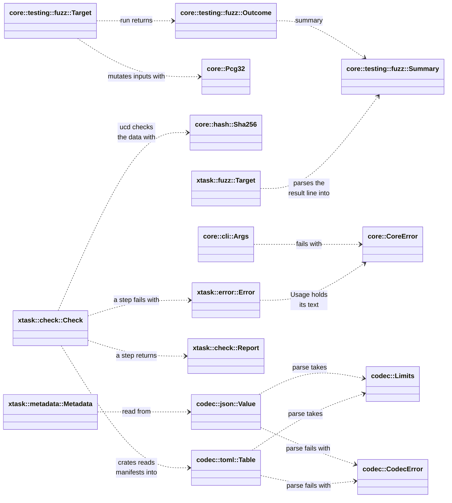

### 1.2 text

The main types of `tidepool-text`, whose library uses no other crate's
types:

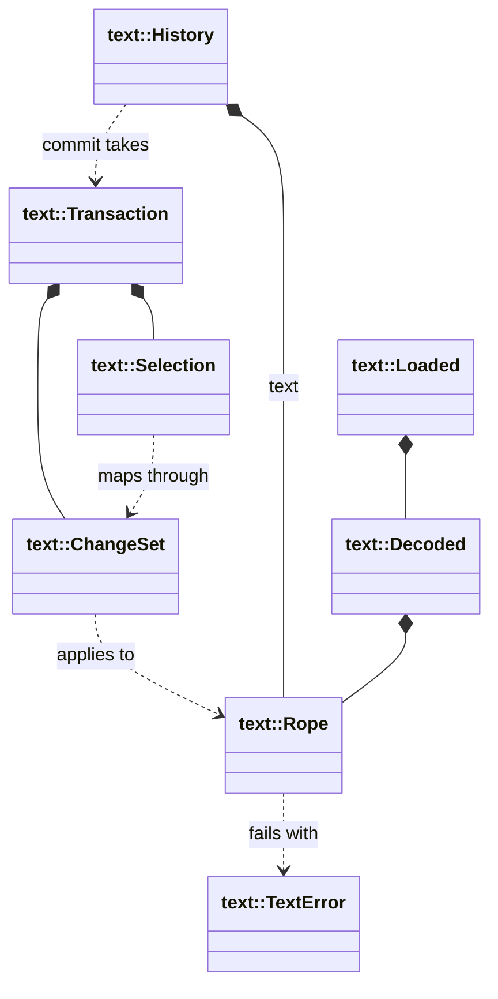

## 2. core: errors, the command line, cancellation and paths

`CoreError` shows the pattern every crate follows: one error enum that
implements `Display` and `std::error::Error`. `ErrorContext` adds
`context` and `with_context` to every `Result`, wrapping the error in a
`WithContext`; `Args` takes a command line apart piece by piece, and an
error about an argument carries its 1-based position (too many arguments
carries the limit).

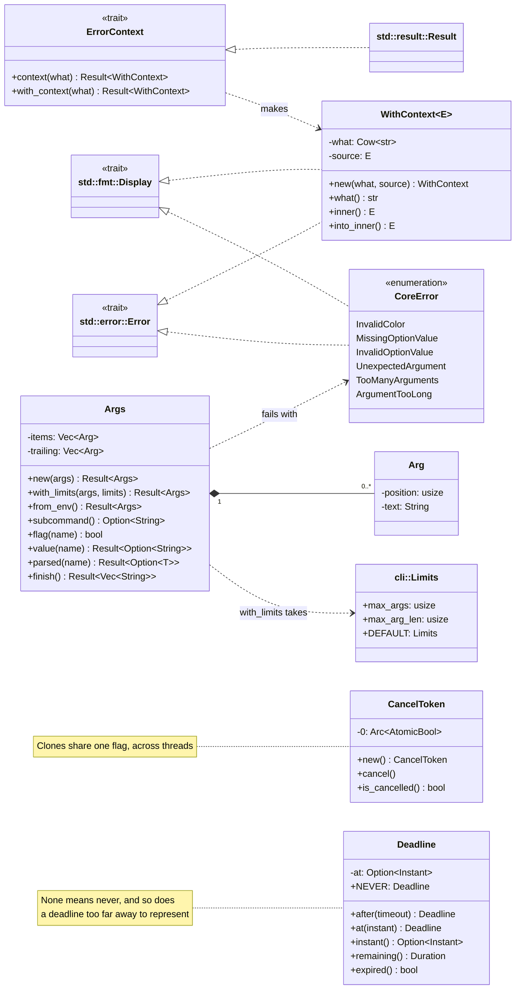

`core::path` (M1.8) shows a path to people and logs without hiding a byte
or letting a name drive a terminal (ADR-0032, ADR-0033), gives a path as
text, and canonicalizes it. `resolve` does so for a path whose end does not
exist yet, and `under` checks containment component by component. Its
error keeps the `std::io::Error` that caused it.

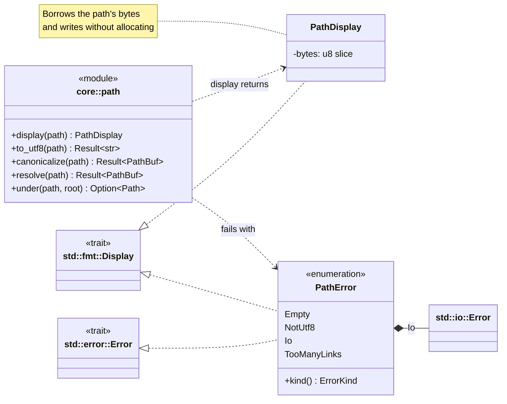

## 3. core: random numbers, hashes and time

`Pcg32` is the one random number generator; it is not `Copy`, so a
generator cannot be copied by accident and replay its numbers. `hash` has
FNV-1a (stable, for files on disk), CRC-32, SHA-256 for downloads, and a
fast hasher for in-memory maps that is not HashDoS-resistant.

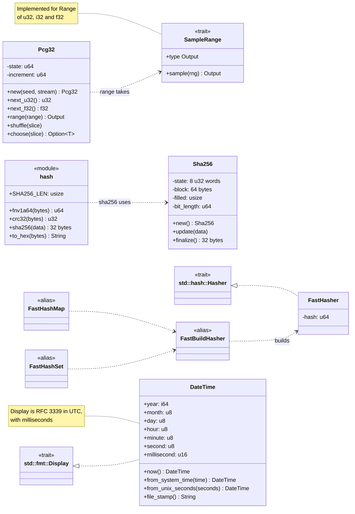

## 4. core: geometry and color

Logical units are `f32` and device pixels `i32`; `Scale` converts between
them through the `ToDevice` and `ToLogical` traits. `Color` is straight
alpha and `PremultipliedColor` premultiplied, which is what blending uses.

### 4.1 Geometry

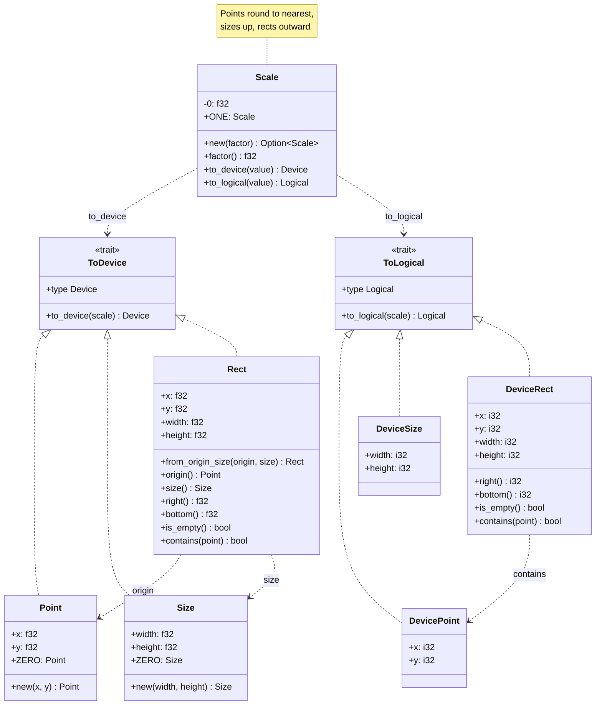

### 4.2 Color

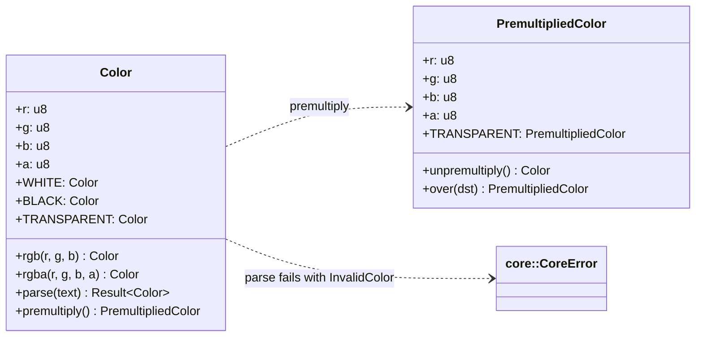

## 5. core: input

`InputEvent` is the one input type every frontend will produce. `Key`
names keys by their USB HID usage ids, and `Modifiers` is a small bit set.

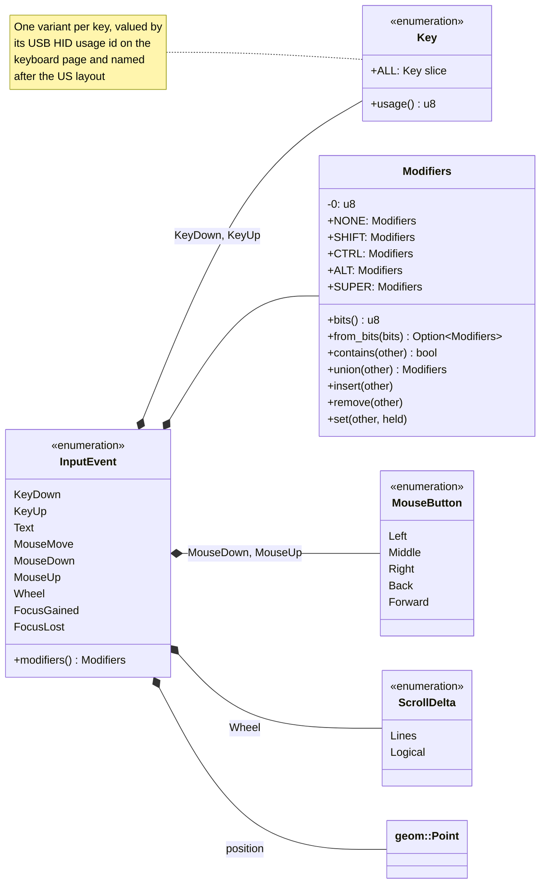

## 6. core: logging

The `log` functions and macros (`error`, `warn`, `info`, `debug`, `trace`)
filter a record, render it with every registered secret redacted, keep it
in the ring buffer, and queue it for the `tidepool-log` thread, which
writes stderr and the rotating file. The `Logger` lives in the static
`LOGGER`, and the `Queue` in the static `SHARED`; a full queue drops lines
and counts them, and never makes a caller wait.

### 6.1 The log functions and the Logger

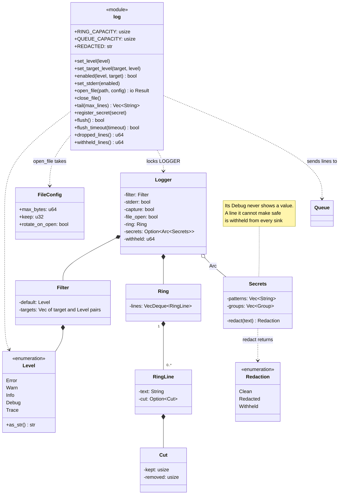

### 6.2 The queue and the log thread

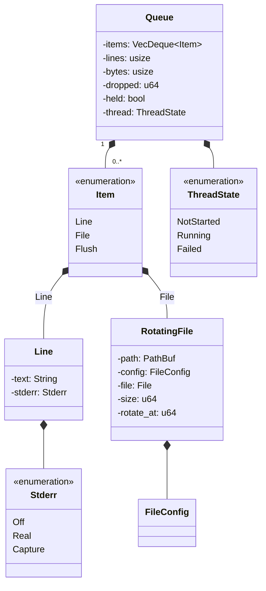

## 7. core: property tests

`check` and `check_sized` run a property on generated cases, from the seed
in `TIDEPOOL_SEED` or the default one. A failure report names the case's
input and ends with the command that reproduces it.

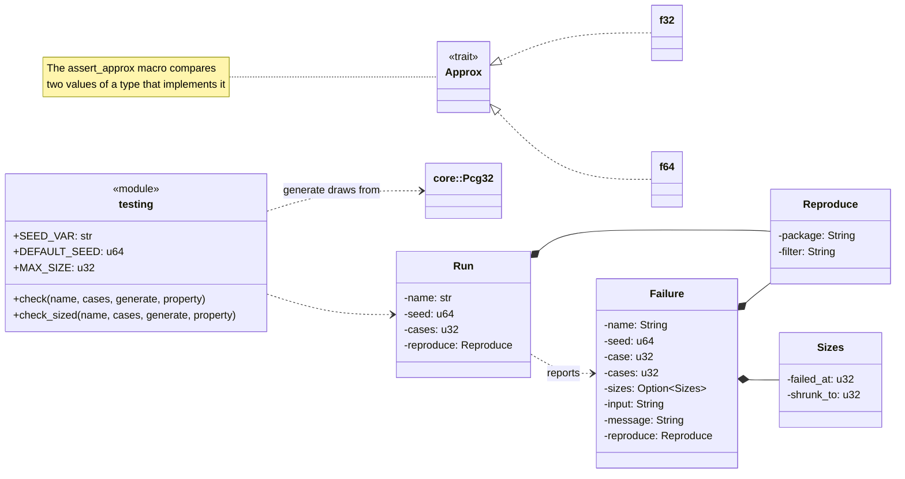

## 8. core: the fuzz engine's API

`testing::fuzz` is the engine behind each parser crate's `tests/fuzz.rs`
(ADR-0027). A `Target` names the function to fuzz and where its seeds and
saved crashes are; `run` replays them on every `cargo test`, and mutates
them when `cargo xtask fuzz-smoke` sets `TIDEPOOL_FUZZ_SECS`. The
`Outcome` it returns prints a report, and its `Summary` is the
`fuzz-result:` line that `fuzz-smoke` reads back.

### 8.1 Targets, runs and findings

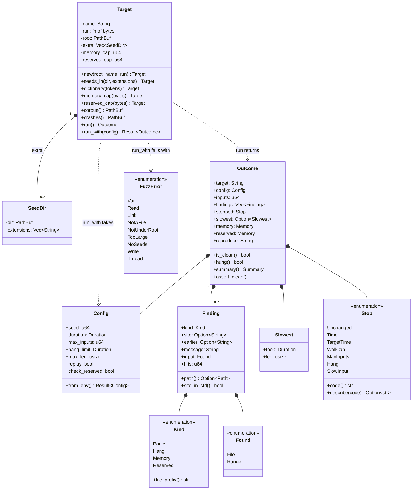

### 8.2 Memory, the result line and kept inputs

What an `Outcome` measured of memory, its `Summary`, written as the
`fuzz-result:` line, and `Kept`:

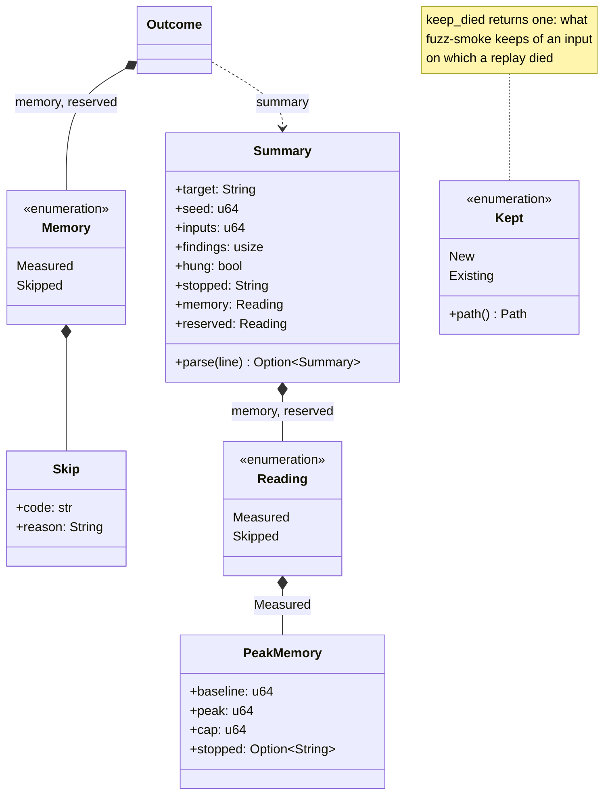

## 9. core: inside the fuzz engine

`Target::run_with` reads the saved crashes and the seeds into a `Plan`,
and `engine::run` runs it. The target runs on a thread of its own, and the
calling thread is the watchdog: the two share a `Shared`, so a hang is
noticed and its input saved. Saved crashes and seeds run unchanged; only
seeds are mutated, each mutated input from its own random stream.

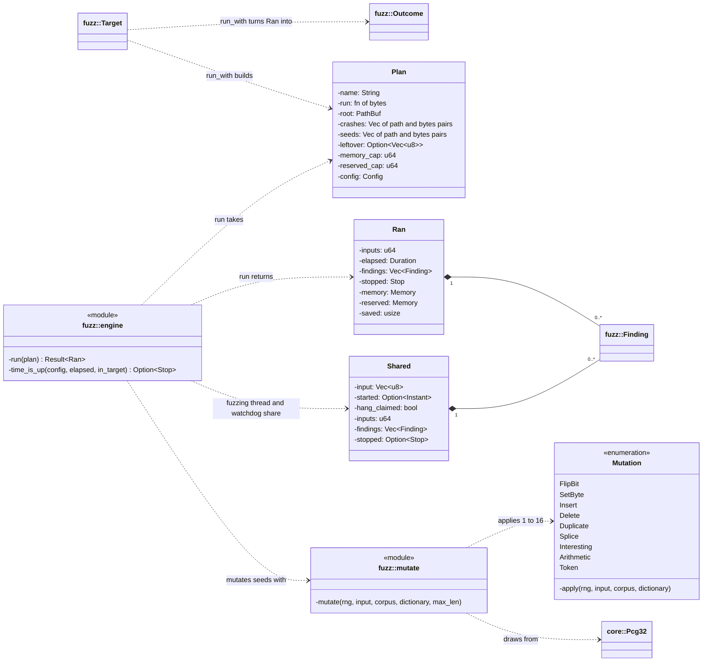

## 10. codec: limits, errors and JSON

Every parser takes a `Limits` and returns a `CodecError` with an offset, a
line and a column; neither parser panics on input. `json::parse` reads
strict JSON or, with `Dialect::Jsonc`, comments and one trailing comma. An
object keeps its members in document order, duplicates included.

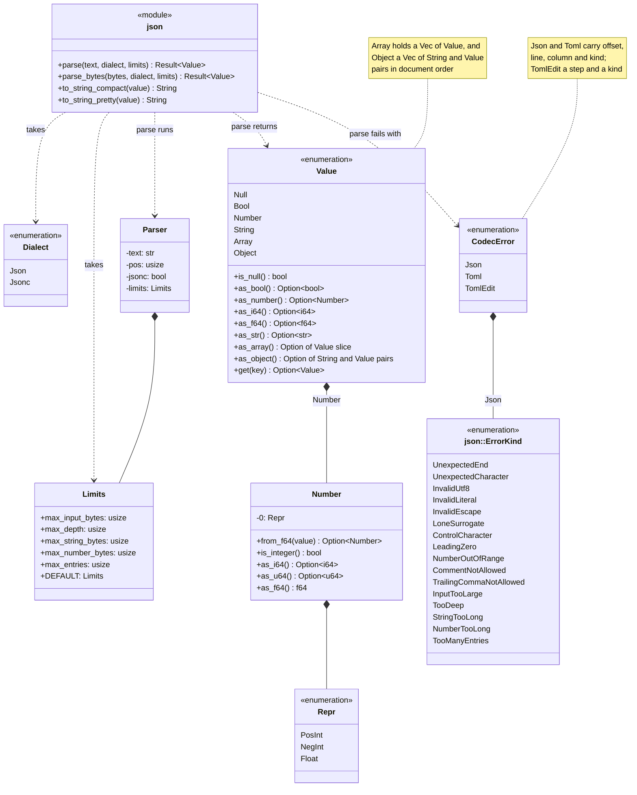

## 11. codec: TOML

`toml::parse` reads TOML 1.1 into a tree whose keys and values carry their
byte spans in the source. A `Table` keeps its entries in order and builds a
hash index only once it has many. `Document` (M1.5, drawn below) keeps a
document's text beside its tree and writes edits back into that text.

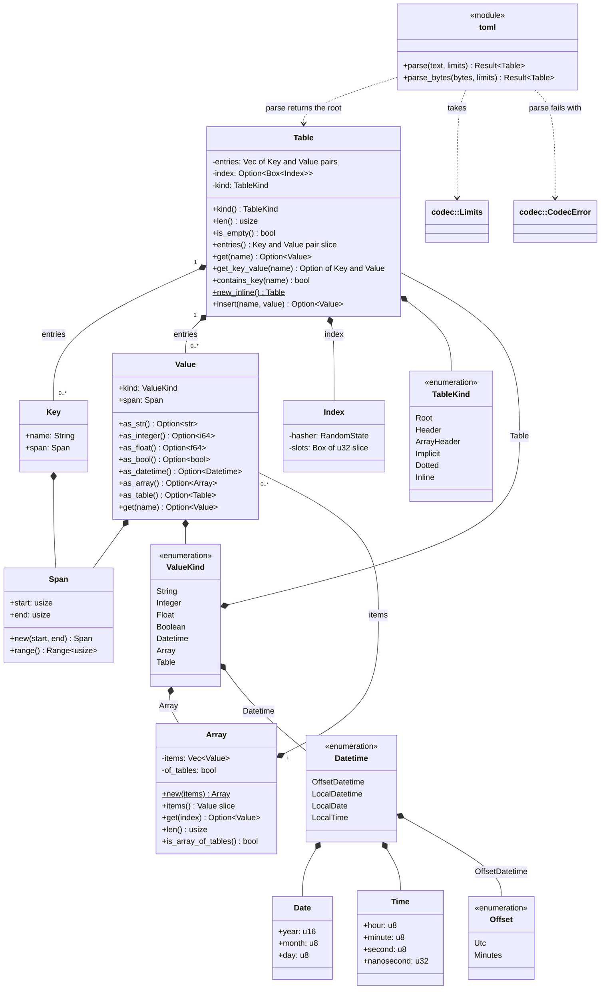

The errors of `toml::parse` are `CodecError::Toml`, with a
`toml::ErrorKind`:

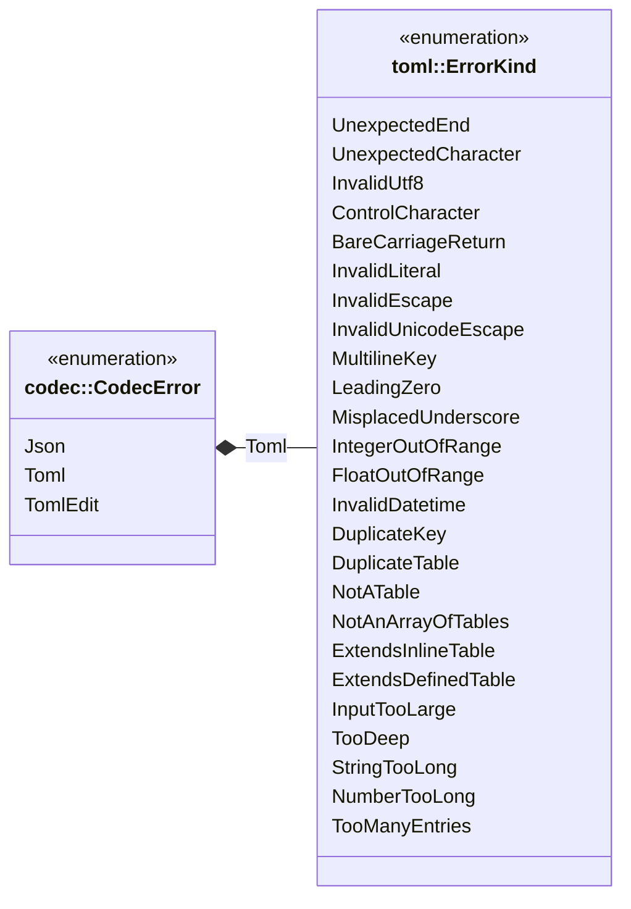

`Document` keeps the text it parsed, its root `Table` and its `Limits`.
`set` plans one splice, parses the new text again and checks it against
the old tree along the path before keeping either; a refused edit is
`CodecError::TomlEdit`, with the step of the path it concerns and an
`EditErrorKind`, and leaves the document as it was. What `set` writes is
TOML 1.0 (ADR-0031).

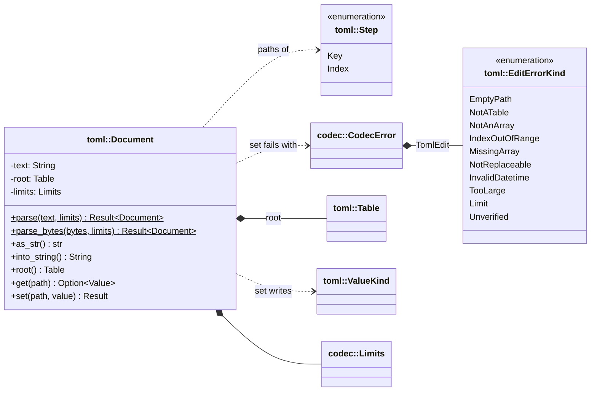

## 12. text: the rope

A `Rope` is a persistent B-tree of UTF-8 leaves of 1 to 4 KiB. Each child
carries a `Summary` of its bytes, chars, UTF-16 units and line breaks, so
edits and position lookups are O(log n), and a clone shares every node.

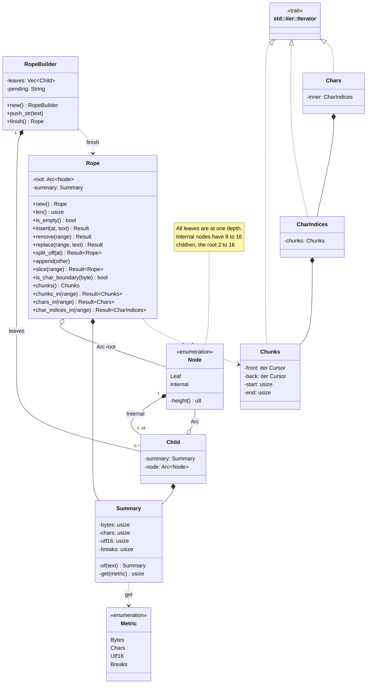

## 13. text: positions and graphemes

Positions are byte offsets (ADR-0019). The `pos` module adds conversions to
`Rope` between bytes, chars, UTF-16 units, lines and line/column pairs in
any `Unit`, and `pos::grapheme` adds extended grapheme cluster boundaries
(UAX #29) from tables `cargo xtask ucd` generates. A bad position is a
`TextError`, never a panic.

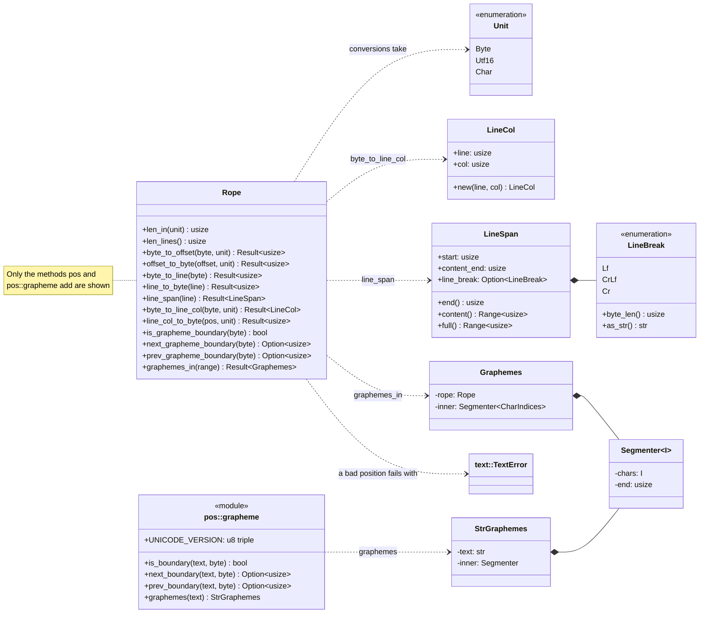

## 14. text: selections and transactions

A `Selection` is one or more `Cursor`s, sorted and merged by one rule, with
a primary. A `ChangeSet` is a list of byte-range replacements in the old
text, each holding its new text as a `Rope`; it applies, maps positions,
composes and inverts. A `Transaction` is a change set and the selection
after it.

```mermaid
classDiagram
    direction TB
    class Cursor {
        +anchor: usize
        +head: usize
        +new(anchor, head) Cursor
        +caret(at) Cursor
        +start() usize
        +end() usize
        +range() Range~usize~
        +is_caret() bool
        +is_backward() bool
    }
    class Selection {
        -cursors: Vec~Cursor~
        -primary: usize
        +caret(at) Selection
        +single(cursor) Selection
        +new(primary, others) Selection
        +cursors() Cursor slice
        +primary() Cursor
        +primary_index() usize
        +transform(f) Selection
        +validate(text) Result
        +map(changes, caret) Result~Selection~
    }
    class Assoc {
        <<enumeration>>
        Before
        After
    }
    class ChangeSet {
        -replacements: Arc of Replacement slice
        -len_before: usize
        -len_after: usize
        +identity(len) ChangeSet
        +new(text, edits) Result~ChangeSet~
        +len_before() usize
        +len_after() usize
        +is_identity() bool
        +changes() Changes
        +apply(text) Result
        +invert(before) Result~ChangeSet~
        +compose(next) Result~ChangeSet~
        +map(pos, assoc) Result~usize~
    }
    class Replacement {
        -start: usize
        -end: usize
        -new_start: usize
        -text: Option~Rope~
    }
    class Changes {
        -inner: slice Iter of Replacement
    }
    class Change {
        +old: Range~usize~
        +new: Range~usize~
        +text: Option~Rope~
    }
    class Transaction {
        -changes: ChangeSet
        -selection: Selection
        +new(changes, selection) Transaction
        +changes() ChangeSet
        +selection() Selection
        +into_parts() ChangeSet and Selection
        +change_each(text, selection, edit) Result~Transaction~
    }
    class Place {
        <<enumeration>>
        Map
        Start
        End
        Select
    }
    class Rope["text::Rope"]
    Selection "1" *-- "1..*" Cursor
    Selection ..> ChangeSet : map through
    Selection ..> Assoc : map takes
    Selection ..> Rope : validate against
    ChangeSet "1" o-- "0..*" Replacement : Arc
    Replacement *-- Rope : text
    ChangeSet ..> Changes : changes
    Changes ..> Change : yields
    ChangeSet ..> Rope : apply, invert
    ChangeSet ..> Assoc : map takes
    Transaction *-- ChangeSet
    Transaction *-- Selection
    Transaction ..> Place : change_each edit returns
    note for Place "Where the cursor goes after<br/>change_each edits it: mapped,<br/>at the start or end of the<br/>new text, or selecting it"
```

## 15. text: history, the undo tree

`History` applies every step to the buffer's rope (ADR-0020). It keeps a
tree of revisions: undo moves to the parent, redo to the child created or
visited last, and `jump_to` to any revision, so no branch is lost. Commits group by command
(`GroupId`) or coalesce by time, and checkpoints mark the saved revision.

```mermaid
classDiagram
    direction LR
    class History {
        -revisions: Vec~Revision~
        -current: usize
        -pending: Vec~Piece~
        -saved: Option~usize~
        -open: bool
        -text: Rope
        +new(text) History
        +text() Rope
        +commit(text, transaction, selection_before, now, group) Result~Step~
        +undo(text) Result~Option~Step~~
        +redo(text) Result~Option~Step~~
        +jump_to(text, target) Result~Option~Step~~
        +seal()
        +checkpoint() Checkpoint
        +mark_saved(checkpoint) Result
        +is_modified() bool
        +current() RevisionId
        +root() RevisionId
        +can_undo() bool
        +can_redo() bool
    }
    class Revision {
        -parent: usize
        -last_child: Option~usize~
        -changes: ChangeSet
        -inverse: ChangeSet
        -selection_before: Selection
        -selection_after: Selection
        -time: Option~Instant~
        -tag: Tag
    }
    class Piece {
        -changes: ChangeSet
        -inverse: ChangeSet
    }
    class Tag {
        <<enumeration>>
        Root
        New
        Command
        Coalesce
    }
    class Group {
        <<enumeration>>
        New
        Command
        Coalesce
    }
    class GroupId {
        -0: u64
        +fresh() GroupId
    }
    class RevisionId {
        -0: u64
        +seq() u64
    }
    class Step {
        +revision: RevisionId
        +before: Rope
        +changes: Vec~ChangeSet~
        +selection: Selection
    }
    class Checkpoint {
        -revision: RevisionId
        -text: Rope
        +revision() RevisionId
        +text() Rope
    }
    class Transaction["text::Transaction"]
    class ChangeSet["text::ChangeSet"]
    class Selection["text::Selection"]
    class Rope["text::Rope"]
    History "1" *-- "1..*" Revision : revisions
    History "1" *-- "0..*" Piece : pending
    History *-- Rope : text
    History ..> Transaction : commit takes
    History ..> Group : commit takes
    History ..> Step : commit, undo, redo return
    History ..> Checkpoint : checkpoint
    History ..> RevisionId : current, root
    Revision *-- ChangeSet : changes, inverse
    Revision *-- Selection : before, after
    Revision *-- Tag
    Piece *-- ChangeSet : changes, inverse
    Tag --> GroupId : Command
    Group --> GroupId : Command
    Step *-- RevisionId
    Checkpoint *-- RevisionId
    note for Revision "parent and last_child are indexes<br/>into the revisions of its History:<br/>the undo tree"
```

## 16. text: encodings

`Decoder` detects UTF-8 or UTF-16 by the byte-order mark only, and decodes
bytes pushed in pieces. Invalid input decodes losslessly: each invalid
sequence becomes one U+FFFD in the text, the replaced bytes are kept in
runs, and the result is read-only; `write_original` gives back the input
byte for byte.

```mermaid
classDiagram
    direction TB
    class EncodingFns["encoding"] {
        <<module>>
        +decode(bytes) Decoded
        +encode(text, format, out) io Result
    }
    class Encoding {
        <<enumeration>>
        Utf8
        Utf16Le
        Utf16Be
        +bom() u8 slice
        +name() str
    }
    class Format {
        +encoding: Encoding
        +bom: bool
        +UTF8: Format
        +new(encoding, bom) Format
    }
    class Decoder {
        -mode: Mode
        -format: Format
        -text: Sink
        -runs: Runs
        +new() Decoder
        +push(bytes)
        +finish() Decoded
    }
    class Mode {
        <<enumeration>>
        Detecting
        Utf8
        Utf16
    }
    class Decoded {
        -text: Rope
        -detected: Format
        -runs: Runs
        +text() Rope
        +into_text() Rope
        +detected() Format
        +format() Option~Format~
        +read_only() bool
        +replaced() ReplacedRuns
        +write_original(out) io Result
        +original_bytes() Vec~u8~
    }
    class Runs {
        -heads: Vec~u8~
        -bytes: Vec~u8~
        -count: usize
        -end: usize
        -open: Option~OpenRun~
    }
    class ReplacedRuns {
        -heads: u8 slice
        -bytes: u8 slice
        -end: usize
    }
    class Replaced {
        +range: Range~usize~
        +bytes: u8 slice
    }
    class Rope["text::Rope"]
    EncodingFns ..> Decoder : decode runs
    EncodingFns ..> Format : encode takes
    Format *-- Encoding
    Decoder *-- Mode
    Decoder *-- Format
    Decoder ..> Decoded : finish
    Decoded *-- Rope : text
    Decoded *-- Format : detected
    Decoded *-- Runs
    Decoded ..> ReplacedRuns : replaced
    ReplacedRuns ..> Replaced : yields
    note for Decoded "format is None when the input<br/>was invalid: then it is read-only"
```

## 17. text: files

`file::load` reads a file and decodes it, and records its line endings and
whether its last line ends with a break. `file::save` writes the text in
the given `Format` through a temp file in the same directory, syncs it and
renames it over the file, keeping its permissions and following symbolic
links. Each I/O error names the `FileStep` that failed.

```mermaid
classDiagram
    direction LR
    class FileFns["file"] {
        <<module>>
        +LARGE_FILE_BYTES: u64
        +TEMP_PREFIX: str
        +load(path) Result~Loaded~
        +save(path, text, format) Result
    }
    class Loaded {
        -decoded: Decoded
        -line_endings: LineEndings
        -trailing_break: Option~LineBreak~
        -file_len: u64
        +text() Rope
        +decoded() Decoded
        +format() Option~Format~
        +read_only() bool
        +line_endings() LineEndings
        +trailing_break() Option~LineBreak~
        +file_len() u64
        +is_large() bool
    }
    class LineEndings {
        +lf: usize
        +crlf: usize
        +cr: usize
        +of(text) LineEndings
        +total() usize
        +is_mixed() bool
        +dominant() LineBreak
    }
    class Temp {
        -file: File
        -removal: Removal
        -target: PathBuf
        -dir: PathBuf
        -permissions: Option~Permissions~
        -create(path) Result~Temp~
        -write(write) Result~Temp~
        -commit() Result
    }
    class Removal {
        -path: PathBuf
        -armed: bool
    }
    class Drop["std::ops::Drop"] {
        <<trait>>
    }
    class FileStep {
        <<enumeration>>
        Metadata
        Open
        Read
        ReadLink
        CheckWritable
        CreateTemp
        Write
        SetPermissions
        Sync
        Rename
        SyncDirectory
    }
    class Decoded["encoding::Decoded"]
    class Format["encoding::Format"]
    class LineBreak["pos::LineBreak"]
    class TextError["text::TextError"]
    FileFns ..> Loaded : load returns
    FileFns ..> Format : save takes
    FileFns ..> Temp : save writes through
    FileFns ..> TextError : fails with
    Loaded *-- Decoded
    Loaded *-- LineEndings
    Loaded *-- LineBreak : trailing_break
    LineEndings ..> LineBreak : dominant
    Temp *-- Removal
    Drop <|.. Removal
    TextError *-- FileStep : Io
    note for Removal "Removes the temp file on drop<br/>unless the rename disarmed it"
    note for Loaded "is_large is true above<br/>LARGE_FILE_BYTES, 16 MiB,<br/>for the large-file mode"
```

## 18. text: the error enum

`TextError` is the one error type of `tidepool-text`: bad positions and
ranges, edits that do not fit their text, revisions that are not in a
history, and the file errors.

```mermaid
classDiagram
    direction LR
    class TextError {
        <<enumeration>>
        ByteOutOfBounds
        NotCharBoundary
        InvertedRange
        OffsetOutOfBounds
        OffsetInsideChar
        LineOutOfBounds
        ColumnOutOfBounds
        ColumnInsideChar
        LengthMismatch
        OverlappingEdits
        TooLong
        RevisionNotFound
        HistoryMismatch
        Io
        NotRegularFile
        NotWritable
        TooManyLinks
    }
    class Unit["pos::Unit"]
    class LineCol["pos::LineCol"]
    class FileStep["file::FileStep"]
    class IoError["std::io::Error"]
    class Display["std::fmt::Display"] {
        <<trait>>
    }
    class StdError["std::error::Error"] {
        <<trait>>
    }
    TextError *-- Unit : Offset and Column variants
    TextError *-- LineCol : Column variants
    TextError *-- FileStep : Io
    TextError *-- IoError : Io, NotWritable
    Display <|.. TextError
    StdError <|.. TextError
```

## 19. xtask: checks and reports

Each `cargo xtask` check is a `Check`: a name, a step and a role. A step
runs cargo with fixed arguments (`Cargo` and `Tests`), or one of `xtask`'s
own checks (`Own`: `deps::run`, `layers::run`, `crates::run`,
`features::run`, `unsafe_audit::run`, `headers::run`, `workflows::run`,
`ucd::check` or `ucd::write`), which returns a `Report`. A `Compiles` step does not run
once a `Gate` step has failed; `deps` is the gate. `ci` runs the checks in
order and ends with a summary table that also lists the `Later` commands
it will run once they exist (those with `in_ci`: `tools` and `theme`).
Every `Later` command exits 1 with "not yet implemented" until its task
lands. `run_gate` runs them and returns a `Gate`, each step's outcome and
the tests counted; `run_ci` is its `passed`, and `site` keeps the rest
(ADR-0030).

```mermaid
classDiagram
    direction TB
    class CheckFns["check"] {
        <<module>>
        +COMMANDS: Check slice
        +CI: Check slice
        +LATER: Later slice
        +run_one(check, root, out) io Result~bool~
        +run_ci(checks, later, root, out) io Result~bool~
        +run_gate(checks, later, root, out) io Result~Gate~
    }
    class Gate {
        -outcomes: Vec~Outcome~
        -tests: TestCounts
        +passed() bool
        +steps() usize, usize
        +skipped() usize
        +tests() TestCounts
    }
    class TestCounts["cargo::TestCounts"] {
        +results: usize
        +unreadable: usize
        +passed: usize
        +failed: usize
        +ignored: usize
    }
    class Check {
        +name: str
        +about: str
        +step: Step
        +role: Role
    }
    class Step {
        <<enumeration>>
        Cargo
        Tests
        Own
    }
    class Role {
        <<enumeration>>
        Independent
        Gate
        Compiles
    }
    class Report {
        +notes: Vec~String~
        +violations: Vec~String~
        +stale_lockfiles: usize
        +skips: Skips
        +tests: TestCounts
        +push_stale_lockfile(violation)
    }
    class Skips["cargo::Skips"] {
        +reasons: Vec~String~
        +count: usize
    }
    class Later {
        +name: str
        +task: str
        +in_ci: bool
    }
    class CiOutcome["check::Outcome"] {
        -name: str
        -status: Status
        -elapsed: Duration
        -skipped: usize
    }
    class Status {
        <<enumeration>>
        Passed
        Failed
        NotRun
    }
    class XtaskError["error::Error"] {
        <<enumeration>>
        Usage
        NotImplemented
        Read
        Spawn
        CommandFailed
        UnexpectedOutput
        Doc
        Output
        Write
        Env
    }
    CheckFns "1" o-- "0..*" Check : COMMANDS, CI
    CheckFns "1" o-- "0..*" Later : LATER
    Check *-- Step
    Check *-- Role
    Step ..> Report : Own returns
    Step ..> XtaskError : Own fails with
    Report *-- Skips
    Report *-- TestCounts
    CheckFns ..> Gate : run_gate returns
    Gate o-- CiOutcome : one per step
    Gate *-- TestCounts
    CheckFns ..> CiOutcome : one per ci step
    CiOutcome *-- Status
    note for Skips "Tests that printed SKIPPED:<br/>did not run, and are never<br/>counted as passes"
```

## 20. xtask: fuzz-smoke's table

`cargo xtask fuzz-smoke` runs each fuzz target in `TARGETS` as a
`cargo test` of its crate's `tests/fuzz.rs` in the `fuzz` profile, and
reads the `fuzz-result:` line the test prints back into a
`core::testing::fuzz::Summary`. It turns each run into a `Verdict`.

```mermaid
classDiagram
    direction TB
    class SmokeFns["fuzz"] {
        <<module>>
        +TARGETS: Target slice
        +DEFAULT_SECS: u64
        +PROFILE: str
        +clock_seed() u64
        +run(options, table, root, out) Result~bool~
    }
    class SmokeTarget["fuzz::Target"] {
        +name: str
        +package: str
    }
    class Options {
        +targets: Vec~Target~
        +secs: u64
        +seed: u64
        +seed_from_clock: bool
        +replay: bool
        +parse(args, table, clock) Result~Options~
    }
    class Verdict {
        <<enumeration>>
        Clean
        Found
        Failed
        NotRun
        NotBuilt
        CargoFailed
        Died
        ExitedWithoutResult
    }
    class Args["core::cli::Args"]
    class Summary["core::testing::fuzz::Summary"]
    class Reading["core::testing::fuzz::Reading"]
    class Kept["core::testing::fuzz::Kept"]
    class XtaskError["error::Error"]
    SmokeFns "1" o-- "3" SmokeTarget : TARGETS
    Options "1" o-- "1..*" SmokeTarget : borrows
    Options ..> Args : parse reads
    Options ..> XtaskError : parse fails with Usage
    SmokeFns ..> Options : run takes
    SmokeFns ..> Verdict : one per target
    Verdict *-- Summary : Clean, Found, Failed
    Summary *-- Reading : memory, reserved
    SmokeFns ..> Kept : keep_died
    note for SmokeTarget "TARGETS holds json and toml<br/>in tidepool-codec, and<br/>encoding in tidepool-text"
```

## 21. xtask: cargo metadata, the dependency matrix and the crates check

`metadata::load` runs `cargo metadata` and reads its JSON with
`codec::json` into a `Metadata`. The `layers` check reads the dependency
matrix from `docs/01-architecture.md` into a `Matrix` and checks every
member's dependencies against its row; `deps` checks each package against
the `Pin`s of its allowlist.

### 21.1 cargo metadata

```mermaid
classDiagram
    direction TB
    class MetadataFns["metadata"] {
        <<module>>
        +load(root, manifest, resolve) Result~Metadata~
        +parse(text, command) Result~Metadata~
        +workspaces(root, manifests, resolve) Vec~Workspace~
    }
    class Metadata {
        +workspace_root: PathBuf
        +packages: Vec~Package~
    }
    class Package {
        +name: String
        +version: String
        +source: Option~String~
        +manifest_path: PathBuf
        +is_member: bool
        +dependencies: Vec~Dependency~
        +targets: Vec~Target~
    }
    class Target {
        +name: String
        +kind: String
        +src_path: PathBuf
    }
    class Dependency {
        +name: String
        +source: Option~String~
        +req: String
        +path: Option~PathBuf~
        +kind: Kind
    }
    class Kind {
        <<enumeration>>
        Normal
        Dev
        Build
        +describe() str
    }
    class Resolve {
        <<enumeration>>
        Yes
        No
    }
    class Workspace {
        +shown: String
        +graph: Result~Metadata~
        +declared: Option~Metadata~
    }
    class JsonValue["codec::json::Value"]
    MetadataFns ..> Metadata : load, parse
    MetadataFns ..> Workspace : workspaces
    MetadataFns ..> Resolve : takes
    MetadataFns ..> JsonValue : parses the<br/>output into
    Workspace *-- Metadata : graph, declared
    Metadata "1" *-- "0..*" Package
    Package "1" *-- "0..*" Dependency
    Package "1" *-- "0..*" Target
    Dependency *-- Kind
```

### 21.2 The dependency matrix, the allowlist and `crates`

`crates::run` loads the workspace's `Metadata` without resolving it, and
reads the root manifest and each member's into a `codec::toml::Table`. A
member's README must start with `# <name>`, name only the roadmap's
tasks, and have each of `SECTIONS` once and in that order, and `FEATURES`
at most once, between Usage and Documentation. `crates` finds those lines
as `layers` reads its document, with `matrix::classify`, so a heading in a
fenced code block, an HTML block or an HTML comment does not count. It
also checks that each member keeps byte-for-byte copies of the root's
`LICENSE_FILES`, `LICENSE` and `NOTICE`.

```mermaid
classDiagram
    direction TB
    class MatrixFns["matrix"] {
        <<module>>
        +DOC: str
        +parse(text) Result~Matrix~
        +classify(lines) Vec of Kind and String pairs
    }
    class Matrix {
        +rows: Vec~Row~
        +row(name) Option~Row~
    }
    class Row {
        +name: String
        +line: usize
        +allowed: Allowed
        +written: String
        +dev_only: bool
        +allows(name) bool
    }
    class Allowed {
        <<enumeration>>
        Only
        AnyWorkspaceCrate
    }
    class LineKind["matrix::Kind"] {
        <<enumeration>>
        Shown
        Fenced
        Comment
        Html
    }
    class Pin["deps::Pin"] {
        +name: String
        +version: String
    }
    class CratesFns["crates"] {
        <<module>>
        -SECTIONS: 6 str
        -FEATURES: str
        -LICENSE_FILES: 2 str
        +run(root) Result~Report~
    }
    class Metadata["metadata::Metadata"]
    class TomlTable["codec::toml::Table"]
    class Report["check::Report"]
    MatrixFns ..> Matrix : parse
    Matrix "1" *-- "1..*" Row
    Row *-- Allowed
    MatrixFns ..> LineKind : classify
    CratesFns ..> Metadata : takes the<br/>members from
    CratesFns ..> TomlTable : reads<br/>manifests into
    CratesFns ..> MatrixFns : finds README<br/>sections with classify
    CratesFns ..> Report : run returns
    note for MatrixFns "DOC is docs/01-architecture.md"
    note for Pin "deps reads one per line<br/>of xtask/deps-allowlist.txt"
```

## 22. Error enums across crates

Each crate has its own error enum that implements `Display` and
`std::error::Error`; those of code that does I/O keep the `std::io::Error`
that caused the failure. No error wraps another crate's: `xtask` turns a `CoreError` into the text
of `Error::Usage`. The boxes list only some variants.

```mermaid
classDiagram
    direction LR
    class Display["std::fmt::Display"] {
        <<trait>>
    }
    class StdError["std::error::Error"] {
        <<trait>>
    }
    class IoError["std::io::Error"]
    class CoreError["core::CoreError"] {
        <<enumeration>>
        InvalidColor
        UnexpectedArgument
    }
    class WithContext["core::error::WithContext"]
    class PathError["core::path::PathError"] {
        <<enumeration>>
        Empty
        NotUtf8
        Io
        TooManyLinks
    }
    class FuzzError["core::testing::fuzz::FuzzError"] {
        <<enumeration>>
        Var
        Read
        Write
        Thread
    }
    class CodecError["codec::CodecError"] {
        <<enumeration>>
        Json
        Toml
    }
    class JsonErrorKind["codec::json::ErrorKind"]
    class TomlErrorKind["codec::toml::ErrorKind"]
    class TextError["text::TextError"] {
        <<enumeration>>
        ByteOutOfBounds
        OverlappingEdits
        Io
        NotWritable
    }
    class XtaskError["xtask::error::Error"] {
        <<enumeration>>
        Usage
        Read
        Spawn
        Output
    }
    Display <|.. CoreError
    StdError <|.. CoreError
    Display <|.. WithContext
    StdError <|.. WithContext
    Display <|.. PathError
    StdError <|.. PathError
    Display <|.. FuzzError
    StdError <|.. FuzzError
    Display <|.. CodecError
    StdError <|.. CodecError
    Display <|.. TextError
    StdError <|.. TextError
    Display <|.. XtaskError
    StdError <|.. XtaskError
    CodecError *-- JsonErrorKind : Json
    CodecError *-- TomlErrorKind : Toml
    PathError *-- IoError : Io
    FuzzError *-- IoError : Read, Write
    TextError *-- IoError : Io, NotWritable
    XtaskError *-- IoError : Read, Spawn, Output, Write
```

## 23. Planned types

The other 22 members are empty crates, so they have no class diagram yet.
Their specs name these types, which the tasks in `docs/roadmap.md` build;
the other files of `diagrams/` draw them dashed. A spec that gives no name
is described in words here.

- `tidepool-platform`: `Window` (`Window::open(config)`), `wait_events`
  filling a `Vec<Event>`, the `Waker` that interrupts it from any thread,
  and `present(&Framebuffer, &[DamageRect])`, planned (M2.2); `Pty`
  (`Pty::spawn(argv, env, cwd, size)`), planned (M5.9); the terminal's raw
  mode guard, planned (M7.1).
- `tidepool-gfx`: the premultiplied BGRA8 framebuffer of the `framebuffer`
  module, which `docs/subsystems/frontends.md` calls `gfx::Framebuffer`,
  planned (M2.3).
- `tidepool-ui`: the widget tree's `NodeId`, the `TextMetrics` trait and
  the `DrawList`, planned (M3.1); the theme's token set, planned (M3.2).
- `tidepool-gui` and `tidepool-tui`: the `Frontend` trait in
  `docs/subsystems/frontends.md` (`wait_events`, `waker`, `metrics`,
  `present`, `clipboard`). No task names the trait itself; the GUI's first
  frame is planned (M2.6) and the TUI's renderer and input decoder
  (M7.1).
- `tidepool-toolchain`: the registry's tool states `Missing`, `Found`,
  `Outdated`, `Installing` and `Broken`, planned (M5.1); the `Spawn`
  builder and the `SecretArg` and `SecretEnv` types that redact
  themselves, planned (M5.2).
- `tidepool-editor`: the modal keymap engine, planned (M4.6); vim mode's
  modes `Normal`, `Insert`, `Replace` and `OperatorPending`, planned
  (M7.2); `Visual`, `VisualLine` and `VisualBlock`, planned (M7.3);
  `CommandLine` and `Search`, planned (M7.4).

## Sources

The main files these diagrams were drawn from:

- `crates/core/src/lib.rs`, `error.rs`, `cli.rs`, `cancel.rs`, `rng.rs`,
  `hash.rs`, `hash/sha256.rs`, `civil.rs`, `geom.rs`, `color.rs`,
  `input.rs`, `log.rs`, `log/file.rs`, `log/redact.rs`, `log/writer.rs`,
  `testing.rs`, `testing/fuzz.rs`, `testing/fuzz/engine.rs`,
  `testing/fuzz/mutate.rs`, `testing/fuzz/paths.rs`, `path.rs`
- `crates/codec/src/lib.rs`, `limits.rs`, `error.rs`, `json.rs`,
  `json/number.rs`, `json/parse.rs`, `json/write.rs`, `toml.rs`,
  `toml/table.rs`, `toml/datetime.rs`, `toml/parse.rs`,
  `toml/document.rs`, `toml/write.rs`
- `crates/codec/tests/fuzz.rs`, `crates/text/tests/fuzz.rs`
- `crates/text/src/lib.rs`, `rope.rs`, `rope/node.rs`, `rope/iter.rs`,
  `pos.rs`, `pos/grapheme.rs`, `selection.rs`, `transaction.rs`,
  `history.rs`, `encoding.rs`, `file.rs`, `error.rs`
- `xtask/src/main.rs`, `check.rs`, `cargo.rs`, `error.rs`, `fuzz.rs`,
  `metadata.rs`, `matrix.rs`, `layers.rs`, `deps.rs`, `crates.rs`,
  `ucd.rs`, `Cargo.toml`
- `crates/codec/Cargo.toml`, `crates/text/Cargo.toml`
- `docs/01-architecture.md` (the dependency matrix), `docs/roadmap.md`,
  `docs/decisions.md` (ADR-0013, ADR-0019, ADR-0020, ADR-0027, ADR-0029)
- `docs/subsystems/core.md`, `text-and-formats.md`,
  `sys-and-platform.md`, `rendering.md`, `ui-and-theme.md`,
  `frontends.md`, `toolchains.md`, `vim-mode.md`
- The `README.md` of `crates/core`, `crates/codec` and `crates/text`
