# UML component diagrams

These diagrams show Tidepool as UML components: the crates, and inside some
of them their modules, with the interfaces each one provides and the
interfaces it uses. Mermaid has no UML component notation, so they are
flowcharts (ADR-0029): a provided interface is a small circle joined to its
component, and a required interface is an arrow from the component that
uses it to the circle. The groups are the subsystems of `docs/subsystems/`,
and every arrow between two crates is an edge that the dependency matrix in
`docs/01-architecture.md` allows.

Drawn from the code and docs as of roadmap task M3.4 (2026-11-22, version 0.1), after M2.4, M2.7, M2.8, M2.5, M2.6, M3.1, M3.2, M3.5, M3.6, M3.7, M3.3 and M3.8. What the code has is drawn solid; what the roadmap plans is dashed and labelled with the task that builds it (ADR-0029).

## Legend

| Style | Means |
| :- | :- |
| Blue box | A component the code has: a crate, a module, or a file of tests |
| White box with a dashed border | Planned: a crate that is only its doc comment (and what every library carries, ADR-0028, ADR-0036), or a part not built yet; the label names the task that builds it |
| Blue circle | An interface the code provides, named by its public items |
| White circle with a dashed border | A planned interface, labelled with the task that adds it |
| Solid line between a box and a circle | The box provides the interface |
| Dotted line between a box and a circle | The box will provide the interface; the task is on the circle |
| Solid arrow into a circle | A required interface: the box uses it in the code now |
| Dotted arrow into a circle | A planned use, labelled with the task that adds it |
| Dark blue, rounded | A person |
| Grey box | A program outside Tidepool |
| Blue cylinder | Files in the repository |

- A circle names the code's public items where they exist (`json::parse`),
  the spec's names where the code has none yet (`Pty::spawn`), and words
  where the spec names none.
- An arrow between two crates is allowed by the using crate's row in the
  dependency matrix. Arrows inside one crate join its modules.
- A box that has code is drawn solid even where part of it is planned; its
  label says which part. A crate that is only its doc comment, and for a
  library what every library carries (ADR-0028, ADR-0036), is drawn
  planned, with the tasks that give it code.
- A subsystem too big for one readable diagram is drawn in several, so the
  same component can appear in more than one.
- `tidepool-core` is left out of sections 1 to 5: every crate but `sys` may
  use it. Section 6 shows what uses it today.

## 1. Overview: the subsystems

The subsystems and the main interfaces between them, from the top layer
down: 1.1 what the app, the frontends and the editor use, 1.2 what the
agents, languages and toolchains offer one another, and 1.3 what all of
them stand on. Only formats and text (`codec` and `text`), `xtask`,
`sys`'s Linux declarations (M2.1, M2.2, M2.7), `platform`'s Linux window
(M2.2, M2.7), `gfx`'s rasterizer (M2.3), `font`'s atlas and layout
(M2.5), `gui`'s first frame (M2.6), painter (M3.5) and rendering of `ui`
frames in its window (M3.8), and `ui`'s tree,
layout, input routing, draw lists and accessibility tree (M3.1), its
theme (M3.2), its controls (M3.6), its collections (M3.7) and its overlays (M3.3), and `editor`'s shell (M3.4) and editor view (M4.1), have code behind their interfaces; the app's main loop opens that window and hands the tree its input (M3.8). Each arrow names the crate in
its group that will use an interface and the task that adds that use.

### 1.1 The app, the frontends and the editor

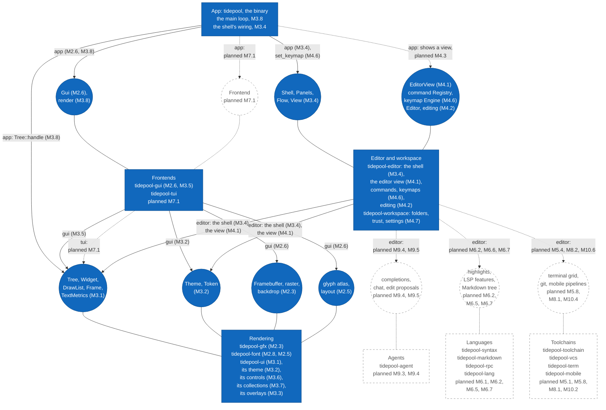

- The app's matrix row is "all crates above", so it may use every crate in
  the rows above its own (not `xtask`, `tidepool-bench` or
  `tidepool-testkit`); only its main uses are drawn.
- The editor never depends on `gui` or `tui`, and the frontends never
  depend on the editor: the app connects them (`docs/01-architecture.md`).
- `Frontend` is the common interface of `docs/subsystems/frontends.md`. The
  spec does not say which crate defines the trait; `gui` and `tui` cannot
  share one from the app, and the crates both may use are `core`,
  `platform` and `ui`.

### 1.2 Agents, languages and toolchains

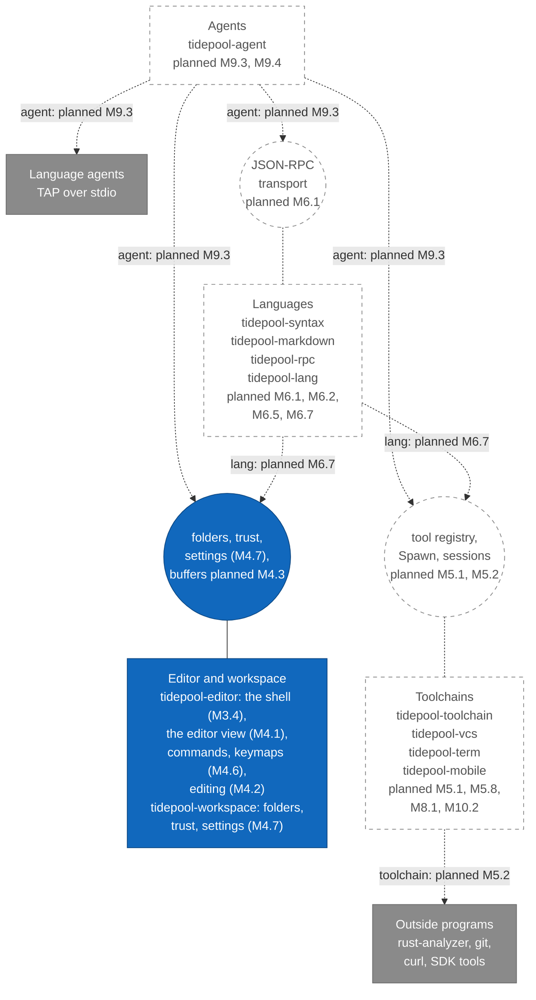

### 1.3 What they stand on: formats and text, and the OS layer

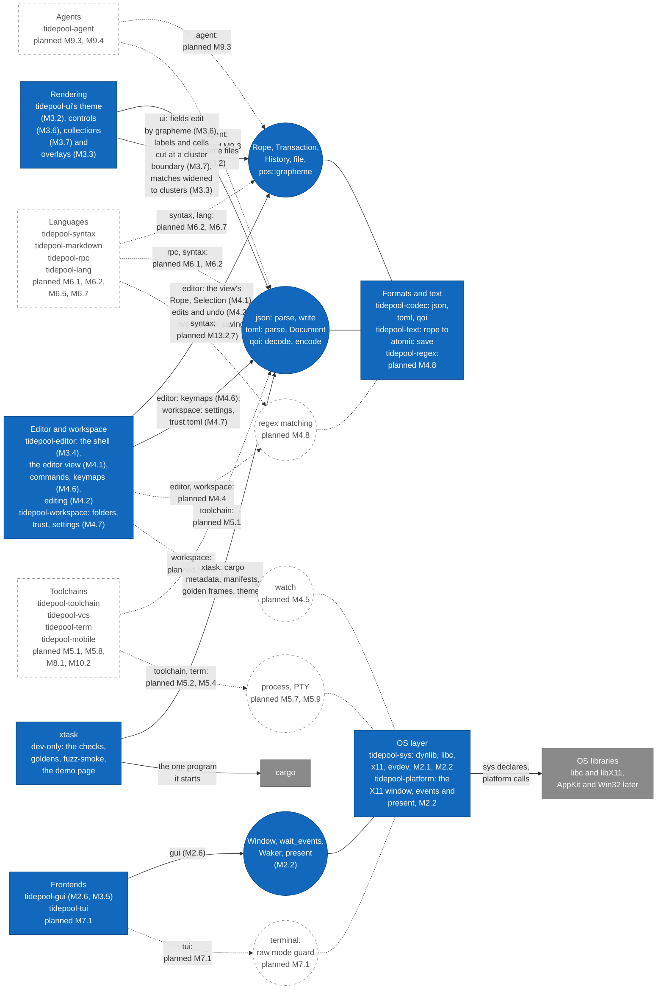

## 2. Text and formats

`tidepool-codec` and `tidepool-text` are built, and neither has a library
dependency: `tidepool-core` is a dev-dependency of each, for their tests
(6.5). `tidepool-regex` is an empty library until M4.8.

### 2.1 tidepool-codec

`json` (M1.4) and `toml` (M1.7) parse within `Limits` and fail with
`CodecError`, and `json` also writes. `toml::Document` (M1.5) edits a TOML
document and writes it back, changing only the edited bytes. `qoi` (M2.4)
decodes QOI images within `Limits` and encodes them. `xtask`,
`tidepool-bench` and `tidepool-ui` are its users today. In `xtask`,
`metadata.rs` reads `cargo metadata` with `json::parse_bytes`,
`features.rs` reads
`docs/features.jsonc` with `json::parse`, `crates.rs` reads the members'
manifests and `site.rs` reads `rust-toolchain.toml` with `toml::parse`,
`site/page.rs` writes the demo page's data with `json::to_string_pretty`,
`golden.rs` decodes the golden references with `qoi::decode` and
writes references and images with `qoi::encode` (ADR-0044), and
`theme.rs` reads `themes/*.toml` with `toml::parse` (ADR-0047).
`tidepool-bench` reads and writes `bench/baseline.json` with
`json::parse_bytes` and `json::to_string_pretty` (6.5). `ui`'s `theme`
reads a theme file with `toml::parse` within the `Limits` it is given,
and wraps a `CodecError` in `UiError::ThemeSyntax` (M3.2, ADR-0047).

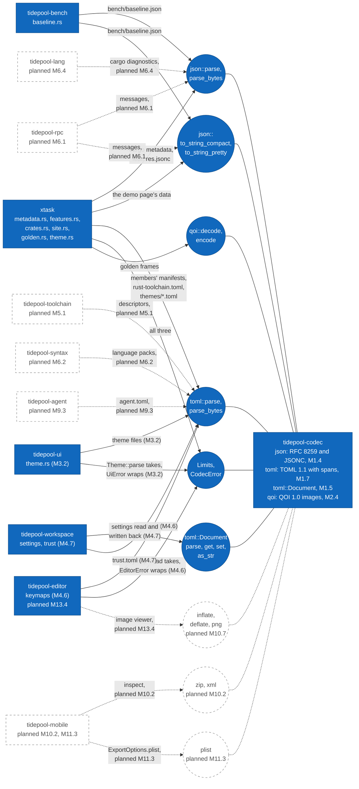

- The YAML subset, CSV and INI in the spec's table are in the backlog, with
  no task, so they are not drawn.
- `ui`'s row of the matrix is `core`, `codec` and `text` (ADR-0047,
  ADR-0049). With `codec` in it, `ui` reads theme files itself:
  `Theme::tidepool_dark` parses the copy of
  `themes/tidepool-dark.toml` compiled in with `include_str!`. `xtask`
  reads the same files for `cargo xtask theme` with its own reader, since
  its row has no `ui`.

### 2.2 tidepool-text and tidepool-regex

`tidepool-text` has every module its spec plans (M1.1, M1.2, M1.3); this
diagram draws who uses its interfaces, `ui`'s fields (M3.6, ADR-0049),
the cuts of what its M3.7 components show (ADR-0052), the matches its
rows draw, widened to whole clusters (M3.3), the editor view, which
shows a rope and its selection and cuts long lines at a cluster boundary
(M4.1), and the editing commands, which move by cluster and edit every
cursor through `change_each` and `History` (M4.2, ADR-0065), and
who will, and 2.3 how its modules use one another. Each module box names
the task that built it.

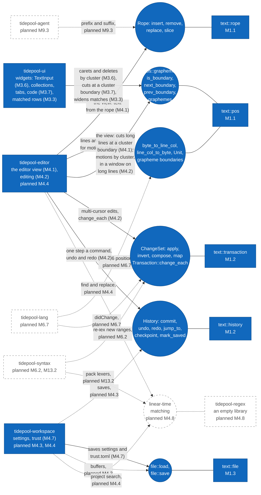

- `pos` adds its conversions and grapheme queries to `Rope` itself, so its
  first circle names `Rope` methods; `pos::grapheme` has the same queries
  on a `&str`, which `ui`'s fields edit their one line with.

### 2.3 Inside tidepool-text

`history` applies change sets and restores selections, a `Transaction`
holds the selection after its change, and `file` loads and saves through
`encoding`.

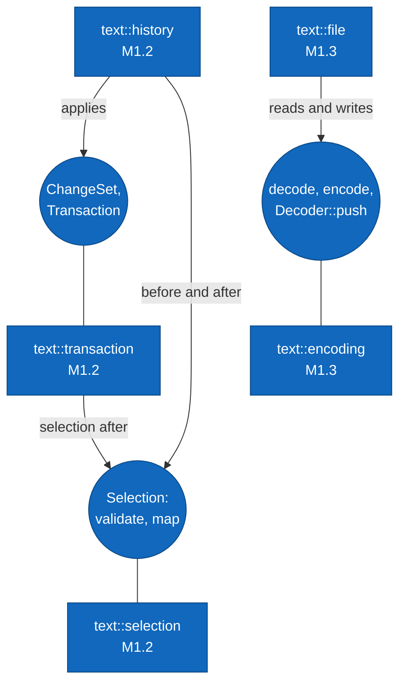

- Every module takes or returns a `Rope`, and `Selection::map` also maps
  through a `ChangeSet`; those arrows are left out to keep the view
  readable.

## 3. The OS layer and rendering

`sys` has its Linux declarations (M2.1, M2.2) and `platform` its Linux
window, events and present (M2.2), so both are drawn solid with their
planned modules in their labels. `gfx` has its rasterizer and the
backdrop (M2.3), and `font` its TrueType parser and glyph rasterizer
(M2.8) and its atlas, layout and fallback (M2.5), so both are drawn solid
too, as is `gui`, which drew the first frame with them (M2.6) and paints
`ui`'s frames with them (M3.5, M3.8). `ui` has
its tree, layout, focus, input routing, text metrics, draw lists and
accessibility tree (M3.1), its theme (M3.2), its controls (M3.6) and
its collections, tab strip, splitter, card and code block (M3.7), and
its overlays (M3.3), drawn solid.

### 3.1 tidepool-sys and tidepool-platform: windows and the terminal

`sys` declares the OS interfaces and `platform` wraps them safely; they are
the only crates that allow `unsafe_code`. The modules follow
`docs/subsystems/sys-and-platform.md`, on Linux first; macOS (M11.7, M11.8)
and Windows (M12.1, M12.2) follow. This diagram draws what the frontends
will use and the declarations under it, and 3.2 the rest of `platform`.

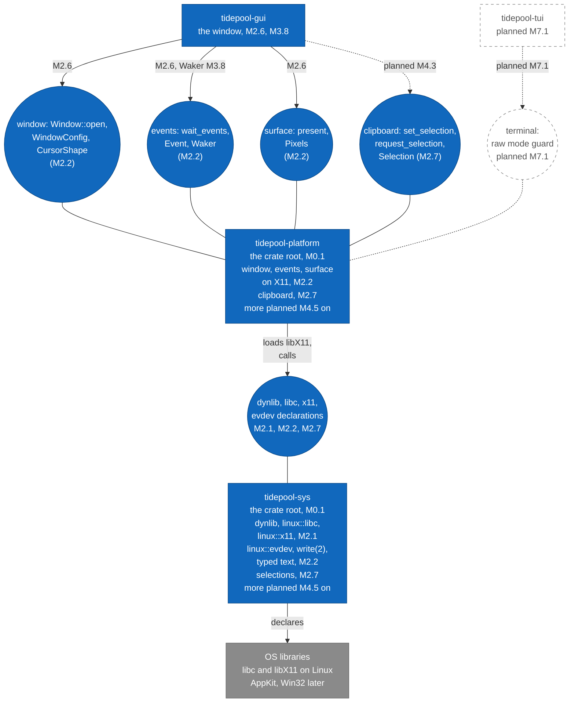

- `Waker::wake` may be called from any thread and interrupts
  `wait_events`; the main loop gets it from the frontend (`Frontend::waker`).
- A paste is asked for with `request_selection` and answered by a later
  `wait_events` as `Event::Pasted`, which also answers other programs for
  the selections the window set (ADR-0042).

### 3.2 tidepool-platform: paths, watching, processes and the PTY

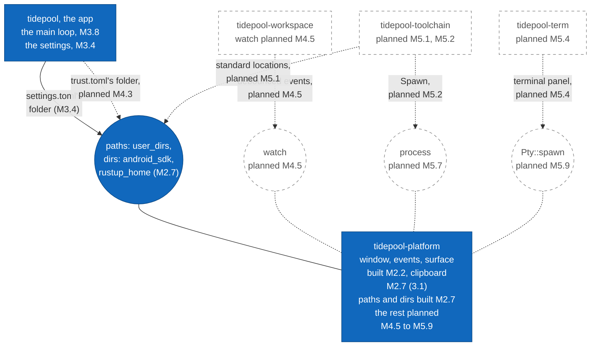

- Of the crates in the binary, only `toolchain`, `term`, `workspace`, `gui`,
  `tui` and the app may depend on `platform` (`tidepool-bench` may use any
  crate), so the editor's terminal panel (M5.4) reaches the PTY through
  `term`.

### 3.3 tidepool-ui

`gfx`, `font` and `ui` are pure: no `unsafe` and no OS calls. `ui` lays
out in logical units and emits draw lists in resolved colors (M3.1,
ADR-0046); `gui` paints them with `gfx` and `font`, their damage only
(M3.5, ADR-0048, 3.4), in its window since M3.8, which shows the shell
that `editor` builds of `ui`'s controls, collections and overlays (M3.4,
ADR-0060), and `tui` is to map them onto cells (M7.1). `TextMetrics` is a trait that `ui` defines, with `FixedMetrics`
for tests (M3.1); `gui` implements it as `FontMetrics` (M3.5), and `tui`
is to (M7.1).
Widgets live in the tree's nodes, and the tree routes each event to them
and up through their ancestors (ADR-0046). `theme` reads a theme file's
tokens into a `Theme`, and bundles `themes/tidepool-dark.toml`, from
which `gui`'s first frame takes `text` and `text-3` (M3.2, ADR-0047).
The tree holds the theme its widgets paint with, the bundled one read
once (`Theme::bundled`) by default, and gives it to each as it paints
(`PaintContext::theme`); `Tree::set_theme` repaints every node (ADR-0049).
`widgets` has the controls (M3.6, ADR-0049): each but `Breadcrumbs`,
which builds a row of `Crumb`s, and `focus_outline`, which the focusable
ones paint, is a `Control`, which gives its node its role and the name it
is given, and paints its node's state in the theme's tokens, the eight component tokens among them. `gui`'s golden
tests paint each in each state (6.1). The collections (M3.7, ADR-0052),
a list, tree view or table, keep nodes only for the rows on screen over
a model of `Rows` their owner provides, and the tree binds those nodes
to rows at each layout, as it binds a tab strip's tabs and gives each
splitter's split its ratio. With the card and the code block, they
paint in five more tokens, and `gui`'s golden tests paint each in each
state too. The overlays (M3.3, ADR-0052) are roots the tree keeps over
its main root, each anchored to a node or the window: a modal one makes
the layers below it inert and keeps Tab within itself (ADR-0053), and
what it keeps from the window comes back `Response::blocked` (ADR-0055).
The modal dialog, the tooltip, the toast, and the command palette are
overlays, and `gui`'s golden tests paint each in each state.

```mermaid
flowchart TB
    c_editor["tidepool-editor<br/>the shell, M3.4<br/>the editor view, M4.1<br/>planned M4.3"]
    c_gui["tidepool-gui<br/>the first frame, M2.6<br/>the painter, M3.5<br/>the window, M3.8"]
    c_guigold["tidepool-gui tests<br/>golden.rs with<br/>controls/mod.rs (M3.6),<br/>components/mod.rs (M3.7),<br/>overlays/mod.rs (M3.3)"]
    c_app["tidepool, the app<br/>the main loop, M3.8<br/>the shell's wiring and<br/>golden scenes, M3.4"]
    c_tui["tidepool-tui<br/>planned M7.1"]
    c_bridge["OS accessibility bridges<br/>AT-SPI, NSAccessibility,<br/>UI Automation<br/>planned M14.2"]

    i_controls(("widgets: Control,<br/>update, focus_outline;<br/>Button, Chip, TextInput,<br/>ScrollBar, StatusDot,<br/>SectionTitle, Eyebrow,<br/>Kicker, Breadcrumbs<br/>(M3.6); is_hidden,<br/>flag_at public (M4.1)"))
    i_collections(("widgets: Collection,<br/>Rows, Row, Column;<br/>TabStrip, Tab, Splitter,<br/>Card, CodeBlock,<br/>CodeSpan (M3.7)"))
    i_overlays(("overlay: open_overlay,<br/>close_overlay, Anchor,<br/>OverlayKind, modal, inert;<br/>Response::blocked;<br/>widgets: Modal, Tooltip,<br/>Toast, Palette (M3.3)"))
    i_tree(("Tree, Node, Widget,<br/>Style, handle,<br/>focus_next (M3.1)<br/>theme, set_theme (M3.6)"))
    i_theme(("Theme: parse,<br/>tidepool_dark, color,<br/>solid, ansi; Token,<br/>TokenColor (M3.2)<br/>bundled (M3.6)"))
    i_drawlist(("DrawList, Frame:<br/>Tree::frame and<br/>damage (M3.1)<br/>PaintContext::theme<br/>(M3.6)"))
    i_metrics(("TextMetrics,<br/>FixedMetrics (M3.1)<br/>scale (M3.3)"))
    i_a11y(("Snapshot: roles,<br/>names, states (M3.1)<br/>modal, description,<br/>active (M3.3)"))
    c_ui["tidepool-ui<br/>tree, layout, focus, input,<br/>metrics, draw, a11y (M3.1)<br/>theme (M3.2)<br/>widgets: the controls (M3.6),<br/>the collections (M3.7)<br/>overlay, and the modal,<br/>tooltip, toast and<br/>palette (M3.3)"]
    s_theme[("themes/tidepool-dark.toml<br/>the bundled theme (M3.2)")]

    c_editor -->|"the shell (M3.4),<br/>the view (M4.1)"| i_tree
    c_editor -->|"the view paints<br/>its text (M4.1)"| i_drawlist
    c_editor -->|"the view lays out<br/>its text (M4.1)"| i_metrics
    c_editor -->|"the shell's tab strip<br/>and splitters (M3.4),<br/>planned M4.3: explorer"| i_collections
    c_editor -->|"the shell's section title,<br/>kicker, status dots (M3.4);<br/>the view's scrollbars,<br/>is_hidden, flag_at (M4.1)"| i_controls
    c_editor -->|"the shell's palette<br/>and tooltips (M3.4)"| i_overlays
    c_app -->|"its golden scenes<br/>paint the shell (M3.4)<br/>and the view (M4.1)"| i_drawlist
    c_gui -->|"paints (M3.5)"| i_drawlist
    c_gui -->|"implements as<br/>FontMetrics (M3.5)"| i_metrics
    c_gui -->|"text, text-3 of<br/>tidepool_dark (M3.2)"| i_theme
    c_guigold -->|"paints each in<br/>each state (M3.6)"| i_controls
    c_guigold -->|"paints each in<br/>each state (M3.7)"| i_collections
    c_guigold -->|"paints each in<br/>each state (M3.3)"| i_overlays
    c_tui -.->|"maps onto cells,<br/>planned M7.1"| i_drawlist
    c_tui -.->|"implements,<br/>planned M7.1"| i_metrics
    c_tui -.->|"solid and ansi<br/>values, planned M7.1"| i_theme
    c_bridge -.->|"planned M14.2"| i_a11y

    i_controls --- c_ui
    i_collections --- c_ui
    i_overlays --- c_ui
    i_tree --- c_ui
    i_theme --- c_ui
    i_drawlist --- c_ui
    i_metrics --- c_ui
    i_a11y --- c_ui
    c_ui -->|"compiles it in;<br/>reads it with<br/>codec toml"| s_theme

    classDef built fill:#1168bd,stroke:#0b4884,color:#ffffff
    classDef planned fill:#ffffff,stroke:#888888,stroke-dasharray: 5 5,color:#555555
    classDef store fill:#1168bd,stroke:#0b4884,color:#ffffff
    class c_gui,c_guigold,c_app,c_editor,c_ui,i_controls,i_collections,i_overlays,i_tree,i_drawlist,i_metrics,i_a11y,i_theme built
    class s_theme store
    class c_tui,c_bridge planned
```

- The accessibility bridges (M14.2) read `ui`'s tree, and no spec names
  the crate that holds them. `platform` may not depend on `ui`, so they
  cannot live in `platform` alone.

### 3.4 tidepool-gfx and tidepool-font

`gui` is the only crate in the binary that uses them, for the first frame
(M2.6) and the painter (M3.5); `tidepool-bench` measures `font`'s atlas
(6.5).

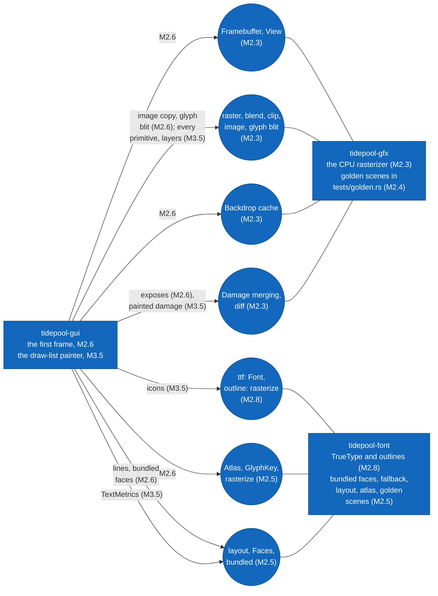

- `gfx`'s glyph blit draws coverage masks from `font`'s atlas, but `gfx`
  may depend only on `core`: `gui` hands the masks over, and no arrow
  joins `gfx` and `font`. `ttf` and `outline` are what `font`'s atlas
  (M2.5) rasterizes glyphs with, and its image is laid out as a `Mask`.
- `gfx`'s and `font`'s golden scenes are tests, not part of their
  libraries: `cargo xtask golden` runs them with `cargo test` and compares
  what they drew with `tests/golden/` (6.1, ADR-0044).

## 4. Languages and toolchains

None of the crates of this section is built: `toolchain`, `vcs`, `term`,
`mobile`, `rpc`, `syntax`, `markdown` and `lang` are empty libraries.

### 4.1 tidepool-toolchain, tidepool-vcs, tidepool-term and tidepool-mobile

Only `toolchain` finds, installs, updates and starts outside programs
(ADR-0002), and `vcs` and `mobile` run theirs through it. `term` parses
what a shell writes to the PTY that `platform` gives it.

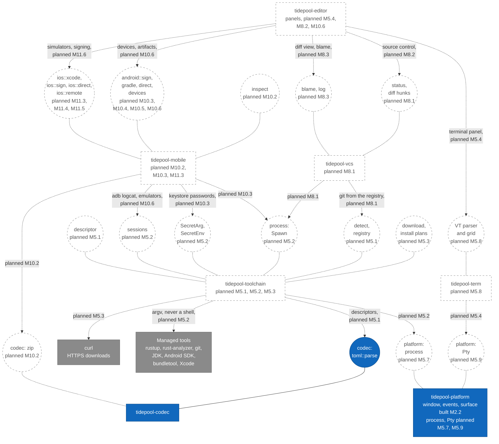

- `lang` (M6.7) and `agent` (M9.3) use `sessions` too; they are drawn in
  4.3 and 5.2.
- The editor's Toolchains panel (M5.6) is backed by `toolchain` in
  `docs/subsystems/editor.md`, and installs that need admin rights run in
  the integrated terminal (`docs/subsystems/toolchains.md`). The matrix
  does not let the editor use `toolchain`, nor `toolchain` use `term`, so
  only the app can join them. Neither edge is drawn, and no arrow goes into
  `install` here.

### 4.2 Languages: what the editor uses

`tidepool-lang` keeps one session per server and workspace root, and gives
the editor its features and services; `syntax` gives it highlights, and
`markdown` the document tree of the preview.

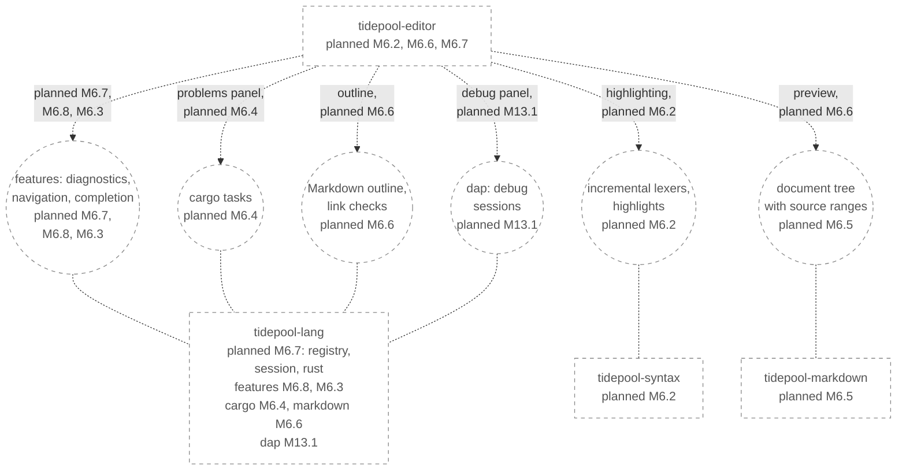

### 4.3 Languages: tidepool-lang, tidepool-rpc and the servers

`rpc` frames JSON-RPC 2.0 with `Content-Length` headers on codec's `json`,
for LSP, DAP and TAP. `lang` starts each server through toolchain's
`sessions`, and talks to it through `rpc`.

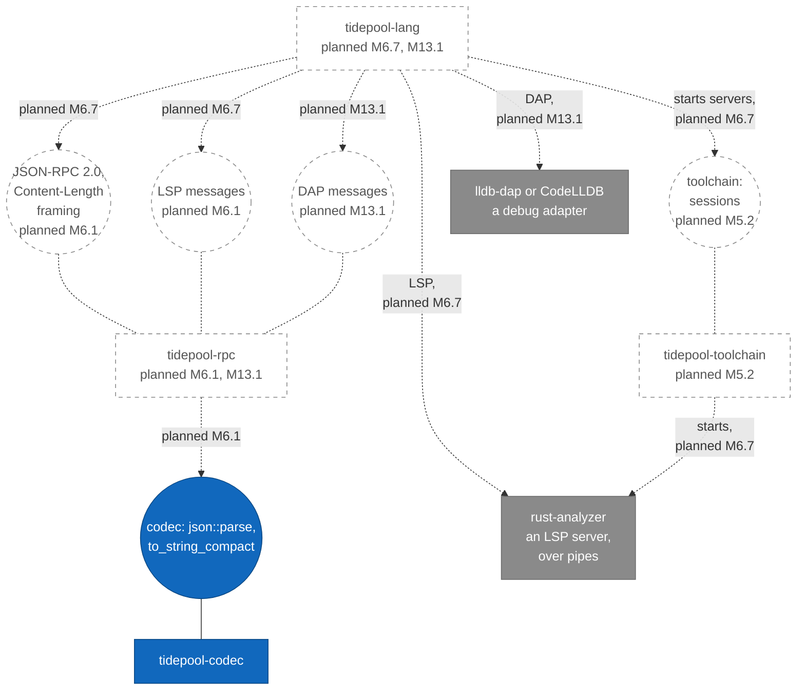

- TAP messages: `AGENTS.md`'s workspace map and `rpc`'s README put them in
  `rpc` (M9.3), and `docs/subsystems/agents.md` puts the TAP message types
  in `agent`'s `tap` module, over `rpc`'s transport. Section 5 draws them
  in `agent` (5.1).

### 4.4 Languages: what tidepool-lang and tidepool-syntax stand on

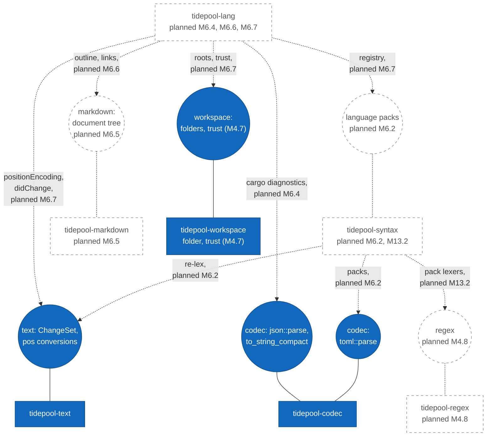

- LSP positions default to UTF-16, and every conversion goes through
  `tidepool-text`; the offset between a CR and its LF, which LSP cannot
  express, is moved by `lang` (M6.7).

## 5. Agents

`tidepool-agent` hosts language agents, decides what context each one
sees, and merges their suggestions with offline predictions
(`docs/subsystems/agents.md`). It is an empty library: `manifest`, `host`,
`tap`, `context` and `consent` come in M9.3, and `predict` and `merge` in
M9.4.

### 5.1 Inside tidepool-agent

What the editor will use, and how the modules will use one another.

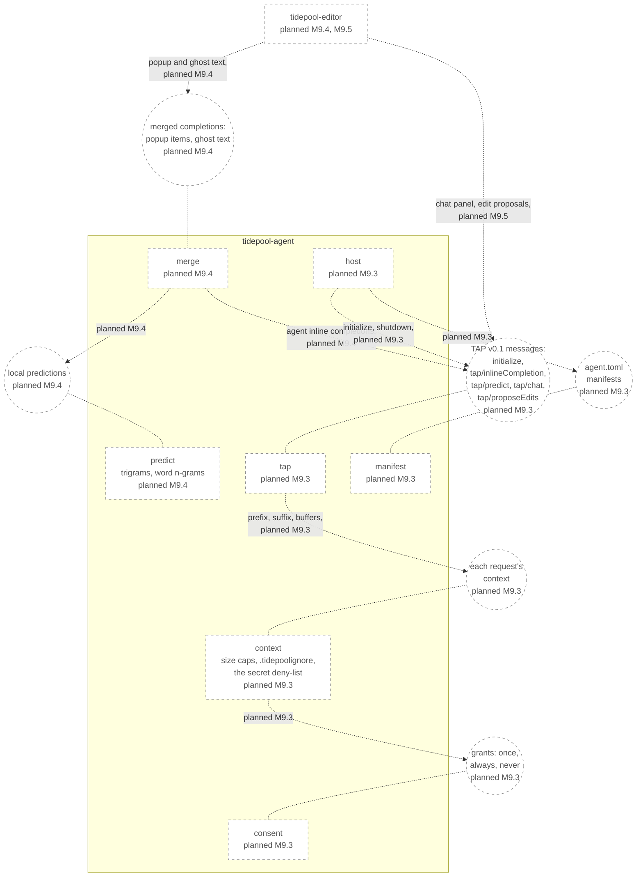

- The spec does not say which module sends each request. The arrows follow
  its module table: `context` builds each request's context, and `host`
  spawns, negotiates with and supervises the agents.

### 5.2 What tidepool-agent stands on

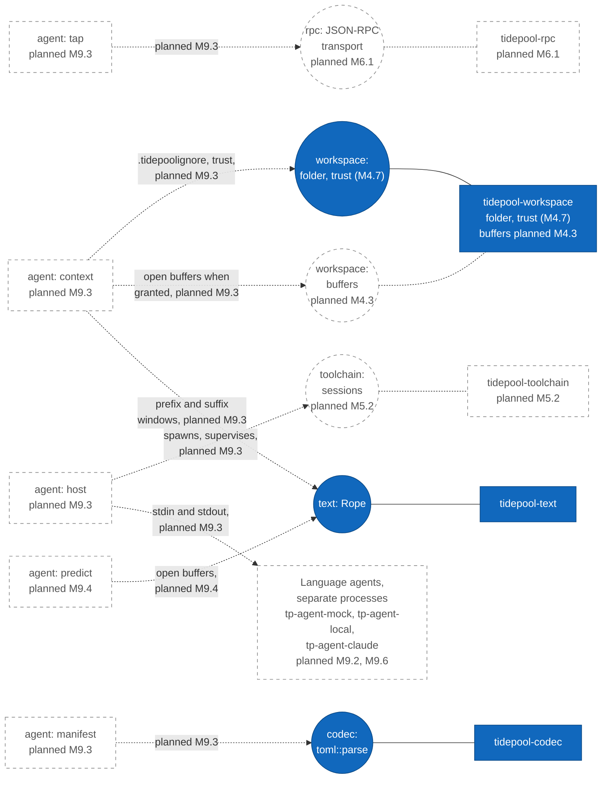

- Every byte an agent receives is assembled by `context`; agents never get
  paths to read, and cannot ask Tidepool to run anything or write files.
- The spec gives `context` symbols from `lang`, and `merge` LSP completions
  from `lang`, but the matrix's row for `agent` has no `lang`. No arrow is
  drawn from `agent` to `lang`: the editor would have to pass them in.

## 6. xtask and the dev tools

Everything in this section is built except `tidepool-testkit` and the
`xtask` commands still to come. `xtask` is dev-only and never shipped. It
uses `core` and `codec`, the two crates its matrix row allows, and starts
one program, `cargo` (ADR-0017); `cargo xtask bench` has cargo build and
run `tidepool-bench` (ADR-0035), and `cargo xtask golden` has it run the
golden scenes in `tidepool-gfx`'s, `tidepool-font`'s and `tidepool-gui`'s
tests (ADR-0044, ADR-0048).

### 6.1 xtask: the checks of ci

`xtask` holds the checks behind `cargo xtask ci`, and `fuzz-smoke` (6.4).
`golden` is a step of `ci` and a command of its own, which `main.rs` runs
for its `--bless`. `crates` checks the root's and each member's manifest,
each README's first line, sections and task IDs, and that each member's
`LICENSE` and `NOTICE` are copies of the root's, byte for byte. `theme`,
the last step, checks that each theme in `themes/` meets WCAG AA for the
pairs of colors it lists for text, and prints its contrast table
(ADR-0047).

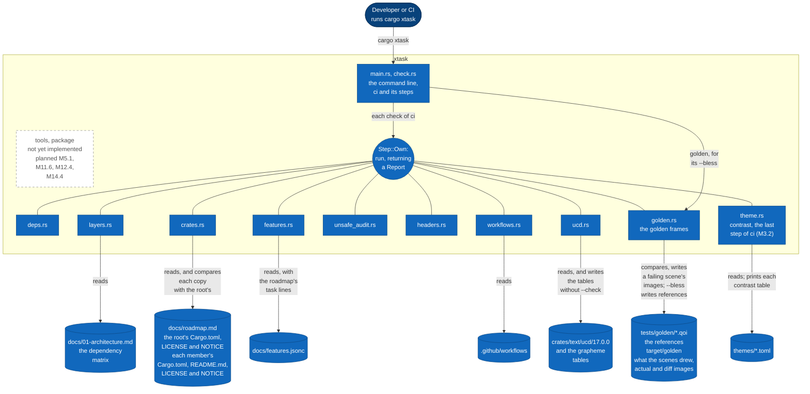

- `headers` and `unsafe-audit` also read the source files, and `deps` the
  manifests, lockfiles and cargo configuration; those files are left out.
- `golden` has cargo run the golden scenes of each crate in its `SCENES`
  table that has a `golden` test, `tidepool-gfx`, `tidepool-font` and
  `tidepool-gui` today, and they write
  what they drew into `target/golden` (6.2, ADR-0044).
- `cargo xtask site` runs these same steps through `check::run_gate`,
  then the two examples, and fills `site/` into `target/site` (6.2,
  ADR-0030).
- The commands still to come exit 1 with "not yet implemented".
- `cargo xtask bench` is not a step of `ci`: `main.rs` hands every
  argument after `bench` to `bench.rs` before parsing (6.2).

### 6.2 xtask: the shared modules

`metadata.rs` runs `cargo metadata` through `cargo.rs`, which starts every
`cargo` that `xtask` runs, and `matrix.rs` reads the dependency matrix and
tells which lines of a document are text.

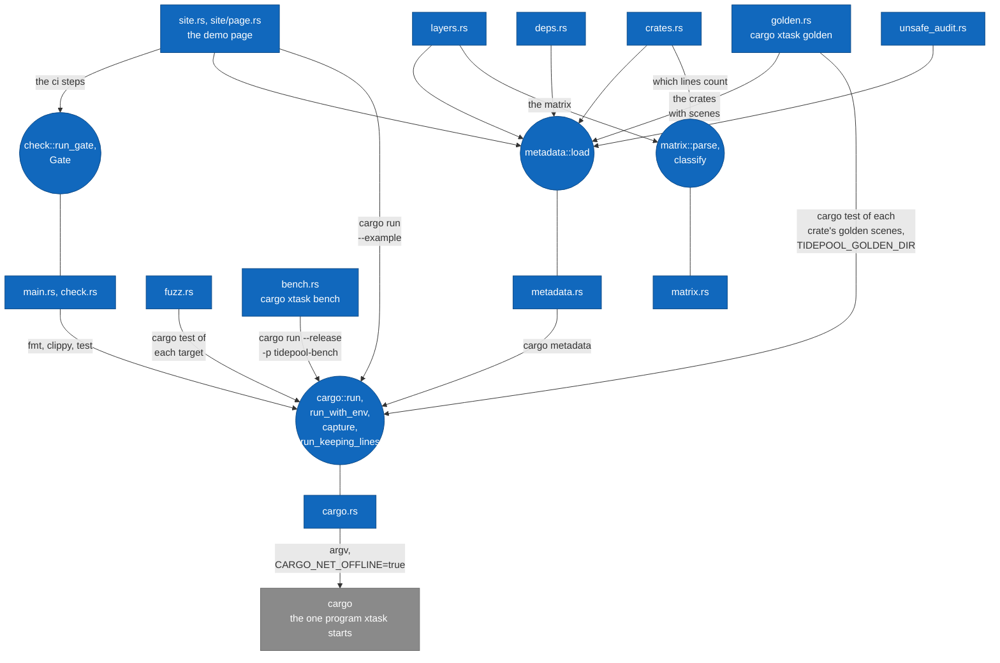

### 6.3 xtask: what it uses from core and codec

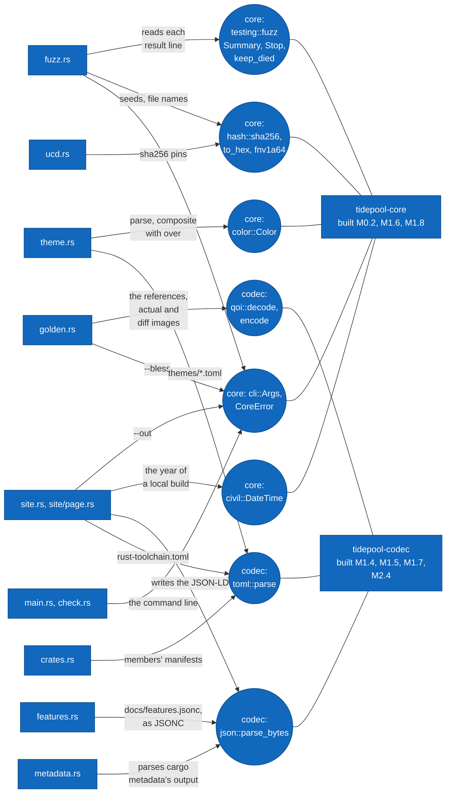

### 6.4 fuzz-smoke and the fuzz targets

`fuzz-smoke` runs each target with `cargo test` and reads the result line
the engine prints.

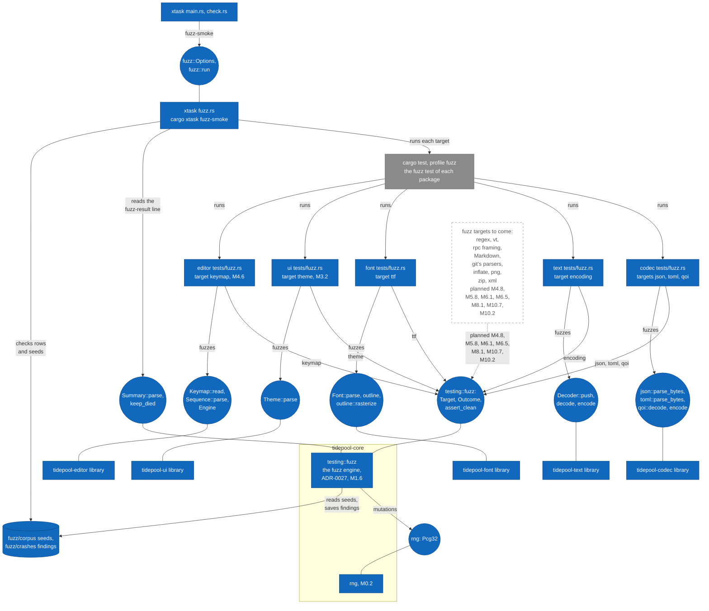

- A `fuzz-smoke` target is a test in its crate's `tests/fuzz.rs`, seeds in
  `fuzz/corpus/<target>/` and a row in `fuzz.rs`'s table (ADR-0027).
  `theme` also reads `themes/` in place (ADR-0047), and `keymap`
  `keymaps/` (ADR-0064).

### 6.5 The property harness, bench and testkit

`core`'s property harness, its `Pcg32` and its fuzz engine (6.4) are the
only code from `core` that the tests of `codec` and `text` use, and neither
library uses `core`. `gfx`'s property tests use the harness and `Pcg32`
too (M2.3); its library uses `core`'s `geom` and `color`. `font`'s
tests use `core`'s FNV-1a hash to pin the bundled faces' coverage, besides
the fuzz engine (M2.8); its library uses no crate. `ui`'s property tests
of layout and of the accessibility invariant use the harness and `Pcg32`
(M3.1), and so do its test of mutated theme files (M3.2), its test
of random edits to a field (M3.6) and its property tests of
collections, tab strips and nested splits (M3.7) and of overlays and
popups (M3.3); its library uses `core`'s `geom`,
`color` and `input`, `codec`'s TOML parser (2.1) and `text`'s grapheme
boundaries (2.2). `gui`'s library uses `core`'s `geom` and `color` and `ui`'s theme
(M3.2), draw lists and `TextMetrics` (M3.5), and its property tests of
the painter's damage use the harness and `Pcg32` (M3.5); the `tidepool`
binary uses `core`'s `cli` (M2.6), outside this view. `xtask` also uses `core`'s `cli`, `hash` and
`testing::fuzz` in its own code (6.3). `tidepool-bench` (M1.9, ADR-0035)
measures `text`'s library with inputs drawn from `Pcg32`, and `font`'s
atlas filling with the bundled Saira (M2.5), and the repaint of `ui`'s
command palette, its text measured with `gui`'s `FontMetrics` (M3.3,
outside this view), and keeps its baseline with `codec`'s JSON and
`text`'s atomic save.

```mermaid
flowchart TB
    c_ctests["codec tests<br/>json.rs, toml.rs, qoi.rs"]
    c_ttests["text tests<br/>model, positions, edits,<br/>unit tests"]
    c_gtests["gfx tests<br/>properties.rs"]
    c_ftests["font tests<br/>bundled.rs"]
    c_utests["ui tests<br/>layout.rs, a11y.rs,<br/>theme.rs, widgets.rs,<br/>collections.rs,<br/>components.rs,<br/>settling.rs,<br/>overlays.rs, popups.rs"]
    c_guitests["gui tests<br/>paint.rs, M3.5"]
    c_bench["tidepool-bench<br/>harness, baseline, cli,<br/>suites::text, suites::font,<br/>suites::ui, the binary"]

    i_check(("testing: check,<br/>check_sized"))
    i_pcg(("rng: Pcg32"))
    i_cparse(("json::parse_bytes,<br/>toml::parse_bytes,<br/>qoi::decode, encode"))
    i_tall(("Rope, ChangeSet,<br/>Selection, History"))
    i_bjson(("json::parse_bytes,<br/>to_string_pretty"))
    i_save(("file::save"))
    i_sha(("hash: fnv1a64"))
    i_fill(("bundled::load,<br/>Atlas::glyph"))

    subgraph sg_core["tidepool-core"]
        c_testing["testing<br/>the property harness, M0.2"]
        c_rng["rng, M0.2"]
        c_hash["hash, M0.2"]
    end
    c_codec["tidepool-codec library"]
    c_text["tidepool-text library"]
    c_font6["tidepool-font library"]

    c_testkit["tidepool-testkit<br/>an empty library<br/>planned M5.1, M6.1"]
    i_fakes(("fake tools,<br/>fake LSP server<br/>planned M5.1, M6.1"))

    c_ctests --> i_check
    c_ctests --> i_pcg
    c_ctests -->|"tests"| i_cparse
    c_ttests --> i_check
    c_ttests --> i_pcg
    c_ttests -->|"against<br/>String models"| i_tall
    c_gtests --> i_check
    c_gtests --> i_pcg
    c_ftests -->|"pins coverage"| i_sha
    c_utests --> i_check
    c_utests --> i_pcg
    c_guitests --> i_check
    c_guitests --> i_pcg
    c_bench -->|"the text suites"| i_tall
    c_bench -->|"the font suite"| i_fill
    c_bench -->|"inputs"| i_pcg
    c_bench -->|"baseline.json"| i_bjson
    c_bench -->|"writes the<br/>baseline"| i_save

    i_check --- c_testing
    c_testing -->|"seeded cases"| i_pcg
    i_pcg --- c_rng
    i_sha --- c_hash
    i_cparse --- c_codec
    i_bjson --- c_codec
    i_tall --- c_text
    i_save --- c_text
    i_fill --- c_font6
    i_fakes -.- c_testkit

    classDef built fill:#1168bd,stroke:#0b4884,color:#ffffff
    classDef planned fill:#ffffff,stroke:#888888,stroke-dasharray: 5 5,color:#555555
    class c_ctests,c_ttests,c_gtests,c_ftests,c_utests,c_guitests,c_bench,c_testing,c_rng,c_hash,c_codec,c_text,c_font6 built
    class i_check,i_pcg,i_cparse,i_tall,i_bjson,i_save,i_sha,i_fill built
    class c_testkit,i_fakes planned
```

- `testkit`'s fakes have no arrow into them: the matrix lets only
  `tidepool-bench` use `tidepool-testkit`, and M5.1 settles the edges
  before the first fake tool (`docs/04-quality.md` → `layers`).

## Sources

Docs:

- `docs/01-architecture.md`: layers, the dependency matrix, the main loop.
- `docs/subsystems/core.md`, `text-and-formats.md`, `sys-and-platform.md`,
  `rendering.md`, `ui-and-theme.md`, `frontends.md`, `editor.md`,
  `languages.md`, `toolchains.md`, `mobile.md`, `agents.md`.
- `docs/04-quality.md`: own harnesses, fakes, fuzz smoke, `xtask` checks.
- `docs/roadmap.md`: every task ID drawn; `docs/decisions.md`: ADR-0002,
  ADR-0010, ADR-0017, ADR-0027, ADR-0028, ADR-0029, ADR-0035, ADR-0044,
  ADR-0046, ADR-0047, ADR-0048, ADR-0049, ADR-0052, ADR-0053, ADR-0054,
  ADR-0055, ADR-0056.
- `AGENTS.md` (workspace map) and each member's `README.md` (`## Status`).

Code:

- Manifests: `crates/*/Cargo.toml`, `xtask/Cargo.toml`, `bench/Cargo.toml`.
- The crate roots: `crates/sys/src/lib.rs`, `crates/platform/src/lib.rs`,
  `crates/app/src/main.rs`.
- `crates/sys/src/`: `dynlib.rs`, `linux.rs`, `linux/libc.rs`,
  `linux/x11.rs`.
- `crates/codec/src/`: `lib.rs`, `limits.rs`, `error.rs`, `json.rs`,
  `json/parse.rs`, `json/write.rs`, `toml.rs`, `toml/parse.rs`,
  `toml/table.rs`, `qoi.rs`.
- `crates/text/src/`: `lib.rs`, `rope.rs`, `pos.rs`, `pos/grapheme.rs`,
  `selection.rs`, `transaction.rs`, `history.rs`, `encoding.rs`, `file.rs`.
- `crates/core/src/`: `lib.rs`, `testing.rs`, `testing/fuzz.rs`, `hash.rs`,
  `cli.rs`, `rng.rs`.
- `crates/ui/src/`: `lib.rs`, `tree.rs`, `layout.rs`, `focus.rs`,
  `input.rs`, `metrics.rs`, `draw.rs`, `a11y.rs`, `theme.rs`, `error.rs`,
  `overlay.rs`,
  `widgets.rs` and `widgets/`;
  `themes/tidepool-dark.toml`; `crates/gui/src/first_frame.rs`,
  `paint.rs`, `metrics.rs`, `icon.rs`.
- Tests: `crates/codec/tests/fuzz.rs`, `json.rs`, `toml.rs`, `qoi.rs`;
  `crates/text/tests/fuzz.rs`, `model.rs`, `positions.rs`, `edits.rs`;
  `crates/gfx/tests/golden.rs`; `crates/font/tests/golden.rs`;
  `crates/ui/tests/layout.rs`, `a11y.rs`, `theme.rs`, `widgets.rs`,
  `collections.rs`, `components.rs`, `settling.rs`, `overlays.rs`,
  `popups.rs`;
  `crates/gui/tests/golden.rs`, `controls/mod.rs`, `components/mod.rs`,
  `overlays/mod.rs`, `paint.rs`.
- `xtask/src/`: `main.rs`, `check.rs`, `cargo.rs`, `metadata.rs`,
  `matrix.rs`, `deps.rs`, `layers.rs`, `crates.rs`, `unsafe_audit.rs`,
  `headers.rs`, `workflows.rs`, `ucd.rs`, `fuzz.rs`, `bench.rs`,
  `golden.rs`, `theme.rs`.
- `bench/src/`: `lib.rs`, `main.rs`, `harness.rs`, `baseline.rs`,
  `cli.rs`, `suites.rs`, `suites/text.rs`, `suites/font.rs`,
  `suites/ui.rs`.
