# UML component diagrams

These diagrams show Tidepool as UML components: the crates, and inside some
of them their modules, with the interfaces each one provides and the
interfaces it uses. Mermaid has no UML component notation, so they are
flowcharts (ADR-0029): a provided interface is a small circle joined to its
component, and a required interface is an arrow from the component that
uses it to the circle. The groups are the subsystems of `docs/subsystems/`,
and every arrow between two crates is an edge that the dependency matrix in
`docs/01-architecture.md` allows.

Drawn from the code and docs as of roadmap task M0.14 (2026-11-08, version 0.1). What the code has is drawn solid; what the roadmap plans is dashed and labelled with the task that builds it (ADR-0029).

## Legend

| Style | Means |
| :- | :- |
| Blue box | A component the code has: a crate, a module, or a file of tests |
| White box with a dashed border | Planned: a crate that is only its doc comment, or a part not built yet; the label names the task that builds it |
| Blue circle | An interface the code provides, named by its public items |
| White circle with a dashed border | A planned interface, labelled with the task that adds it |
| Solid line between a box and a circle | The box provides the interface |
| Dotted line between a box and a circle | The box will provide the interface; the task is on the circle |
| Solid arrow into a circle | A required interface: the box uses it in the code now |
| Dotted arrow into a circle | A planned use, labelled with the task that adds it |
| Dark blue, rounded | A person |
| Grey box | A program outside Tidepool |
| Blue cylinder | Files in the repository |

- A circle names the code's public items where they exist (`json::parse`),
  the spec's names where the code has none yet (`Pty::spawn`), and words
  where the spec names none.
- An arrow between two crates is allowed by the using crate's row in the
  dependency matrix. Arrows inside one crate join its modules.
- A box that has code is drawn solid even where part of it is planned; its
  label says which part. A crate that is only its doc comment is drawn
  planned, with the tasks that give it code.
- A subsystem too big for one readable diagram is drawn in several, so the
  same component can appear in more than one.
- `tidepool-core` is left out of sections 1 to 5: every crate but `sys` may
  use it. Section 6 shows what uses it today.

## 1. Overview: the subsystems

The subsystems and the main interfaces between them, from the top layer
down: 1.1 what the app, the frontends and the editor use, 1.2 what the
agents, languages and toolchains offer one another, and 1.3 what all of
them stand on. Only formats and text (`codec` and `text`) and `xtask` have
code behind their interfaces; the app and the OS layer are their crate
roots (M0.1). Each arrow names the crate in its group that will use an
interface and the task that adds that use.

### 1.1 The app, the frontends and the editor

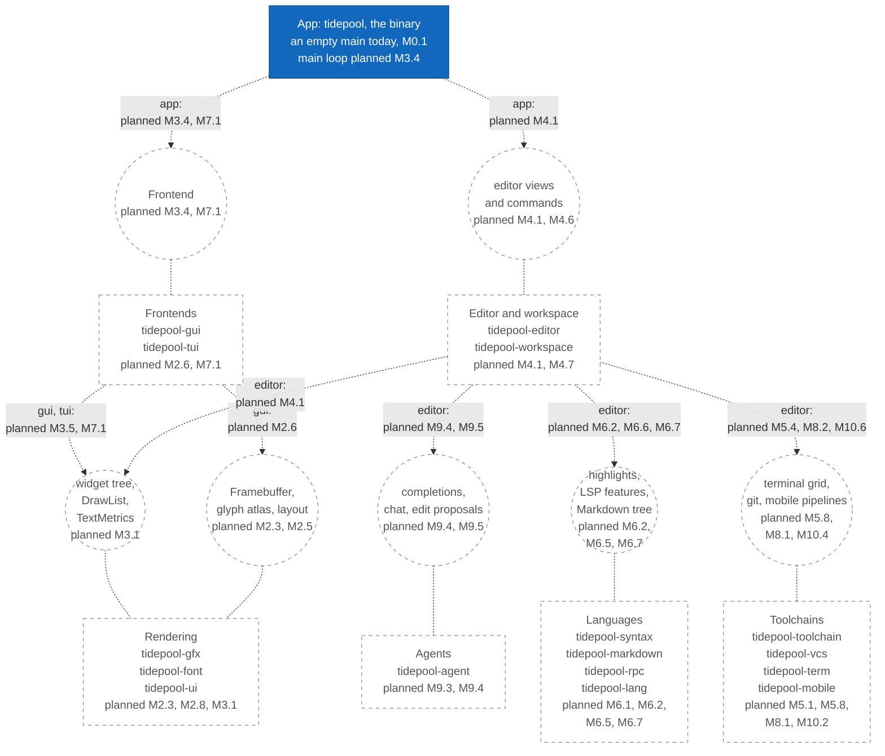

- The app's matrix row is "all crates above", so it may use every crate in
  the rows above its own (not `xtask`, `tidepool-bench` or
  `tidepool-testkit`); only its two main uses are drawn.
- The editor never depends on `gui` or `tui`, and the frontends never
  depend on the editor: the app connects them (`docs/01-architecture.md`).
- `Frontend` is the common interface of `docs/subsystems/frontends.md`. The
  spec does not say which crate defines the trait; `gui` and `tui` cannot
  share one from the app, and the crates both may use are `core`,
  `platform` and `ui`.

### 1.2 Agents, languages and toolchains

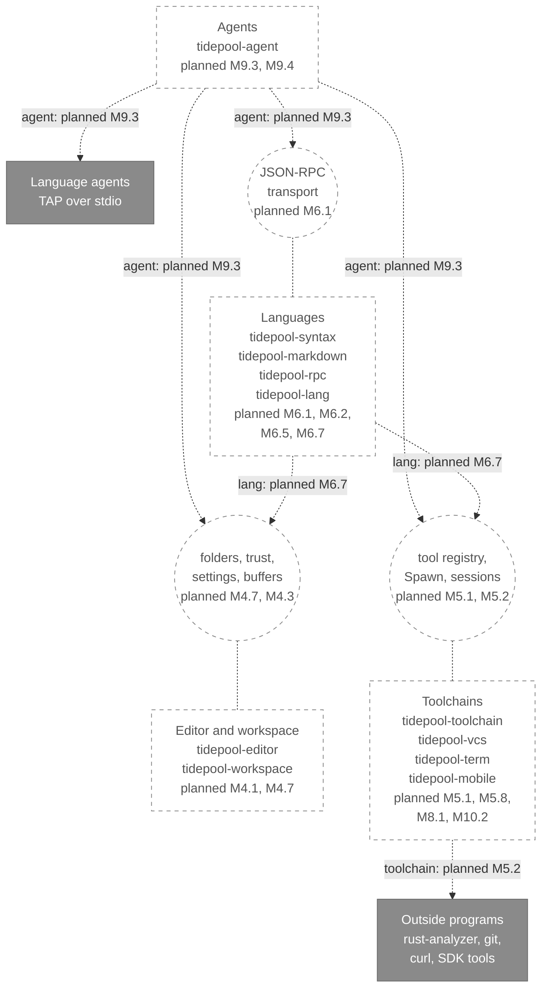

### 1.3 What they stand on: formats and text, and the OS layer

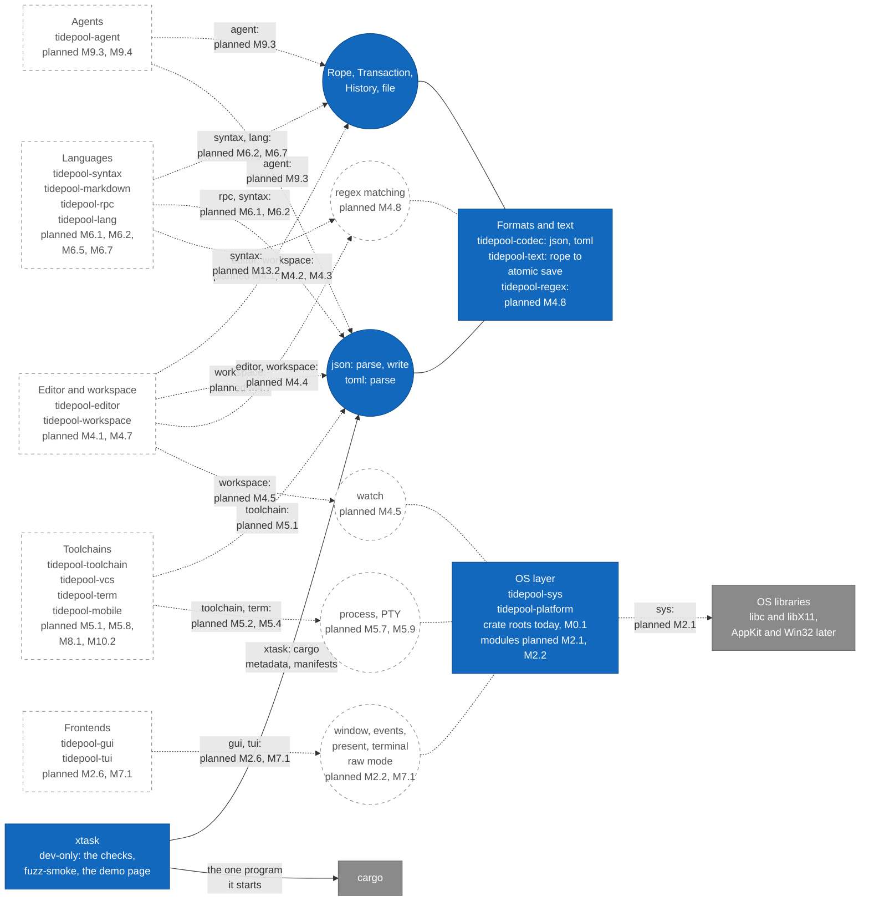

## 2. Text and formats

`tidepool-codec` and `tidepool-text` are built, and neither has a library
dependency: `tidepool-core` is a dev-dependency of each, for their tests
(6.5). `tidepool-regex` is an empty library until M4.8.

### 2.1 tidepool-codec

`json` (M1.4) and `toml` (M1.7) parse within `Limits` and fail with
`CodecError`, and `json` also writes. `xtask` is their only user today:
`metadata.rs` reads `cargo metadata` with `json::parse_bytes`, and
`crates.rs` reads the members' manifests with `toml::parse`.

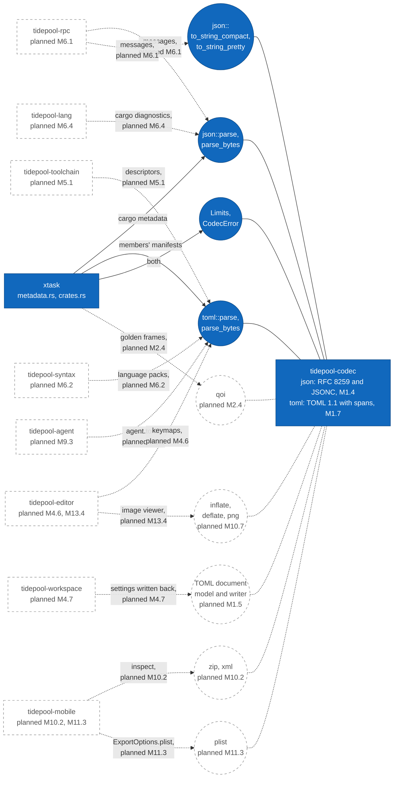

- The YAML subset, CSV and INI in the spec's table are in the backlog, with
  no task, so they are not drawn.
- `ui`'s `theme` loads `themes/tidepool-dark.toml`
  (`docs/subsystems/ui-and-theme.md`, M3.2), but the matrix lets `ui`
  depend only on `core`, so `ui` cannot call `toml::parse`. No arrow is
  drawn from `ui`: the specs do not say which crate reads the theme file.

### 2.2 tidepool-text and tidepool-regex

`tidepool-text` has every module its spec plans (M1.1, M1.2, M1.3); this
diagram draws who will use its interfaces, and 2.3 how its modules use one
another. Each module box names the task that built it.

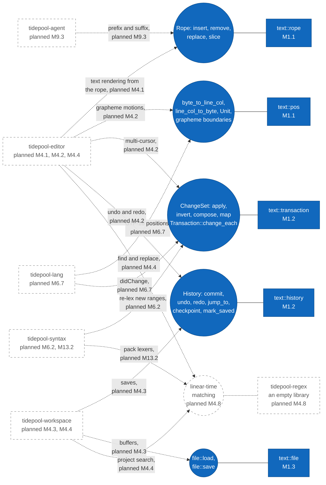

- `pos` adds its conversions and grapheme queries to `Rope` itself, so its
  circle names `Rope` methods.

### 2.3 Inside tidepool-text

`history` applies change sets and restores selections, a `Transaction`
holds the selection after its change, and `file` loads and saves through
`encoding`.

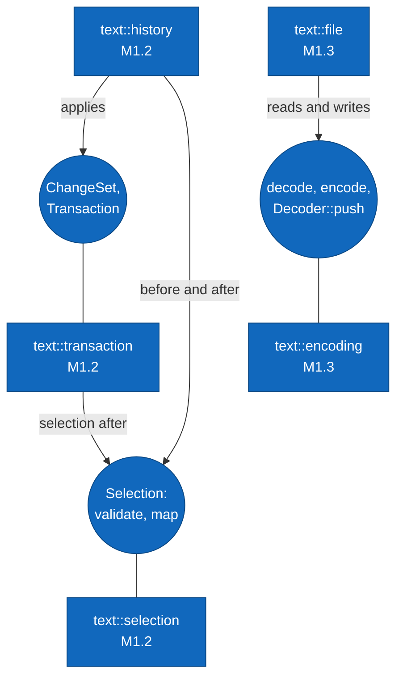

- Every module takes or returns a `Rope`, and `Selection::map` also maps
  through a `ChangeSet`; those arrows are left out to keep the view
  readable.

## 3. The OS layer and rendering

Only the crate roots of `sys` and `platform` are built (M0.1), so they are
drawn solid with their planned modules in their labels; `gfx`, `font` and
`ui` are empty libraries.

### 3.1 tidepool-sys and tidepool-platform: windows and the terminal

`sys` declares the OS interfaces and `platform` wraps them safely; they are
the only crates that allow `unsafe_code`. The modules follow
`docs/subsystems/sys-and-platform.md`, on Linux first; macOS (M11.7, M11.8)
and Windows (M12.1, M12.2) follow. This diagram draws what the frontends
will use and the declarations under it, and 3.2 the rest of `platform`.

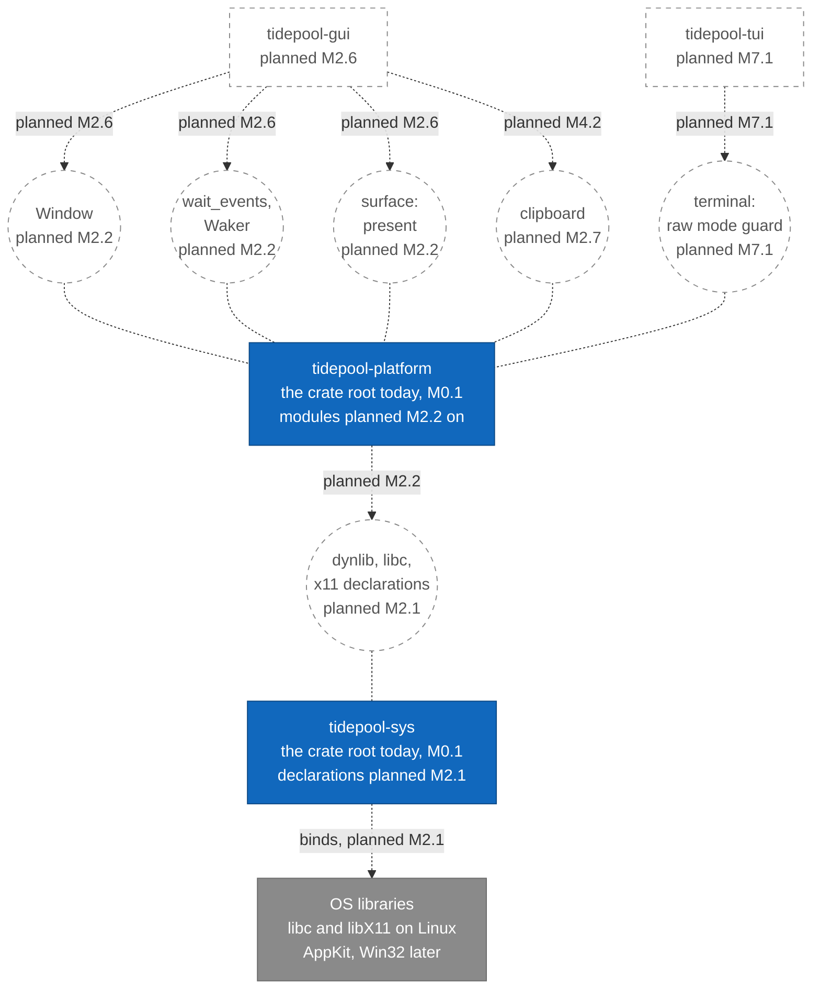

- `Waker::wake` may be called from any thread and interrupts
  `wait_events`; the main loop gets it from the frontend (`Frontend::waker`).

### 3.2 tidepool-platform: paths, watching, processes and the PTY

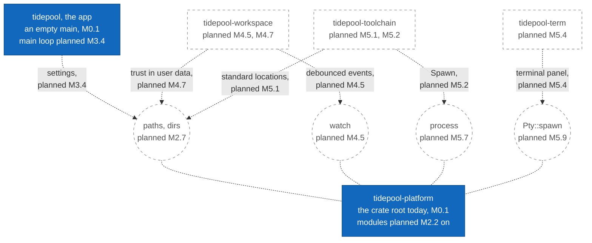

- Of the crates in the binary, only `toolchain`, `term`, `workspace`, `gui`,
  `tui` and the app may depend on `platform` (`tidepool-bench` may use any
  crate), so the editor's terminal panel (M5.4) reaches the PTY through
  `term`.

### 3.3 tidepool-ui

`gfx`, `font` and `ui` are pure: no `unsafe` and no OS calls. `ui` lays out
in logical units and emits draw lists; `gui` rasterizes them with `gfx` and
`font` (3.4), and `tui` maps them onto cells. `TextMetrics` is a trait that
`ui` defines and each frontend implements.

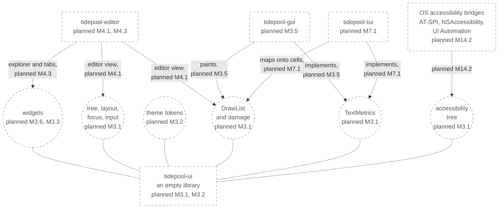

- The accessibility bridges (M14.2) read `ui`'s tree, and no spec names
  the crate that holds them. `platform` may not depend on `ui`, so they
  cannot live in `platform` alone.

### 3.4 tidepool-gfx and tidepool-font

`gui` is the only crate that will use them.

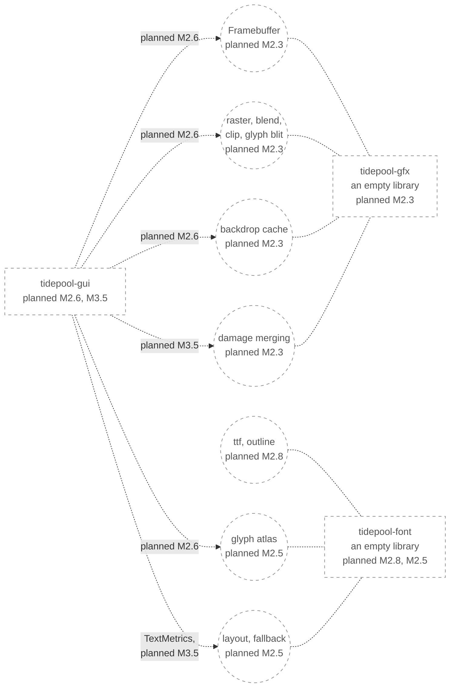

- `gfx`'s glyph blit draws coverage masks from `font`'s atlas, but `gfx`
  may depend only on `core`: `gui` hands the masks over, and no arrow
  joins `gfx` and `font`. `ttf` and `outline` serve `font`'s own atlas.

## 4. Languages and toolchains

None of the crates of this section is built: `toolchain`, `vcs`, `term`,
`mobile`, `rpc`, `syntax`, `markdown` and `lang` are empty libraries.

### 4.1 tidepool-toolchain, tidepool-vcs, tidepool-term and tidepool-mobile

Only `toolchain` finds, installs, updates and starts outside programs
(ADR-0002), and `vcs` and `mobile` run theirs through it. `term` parses
what a shell writes to the PTY that `platform` gives it.

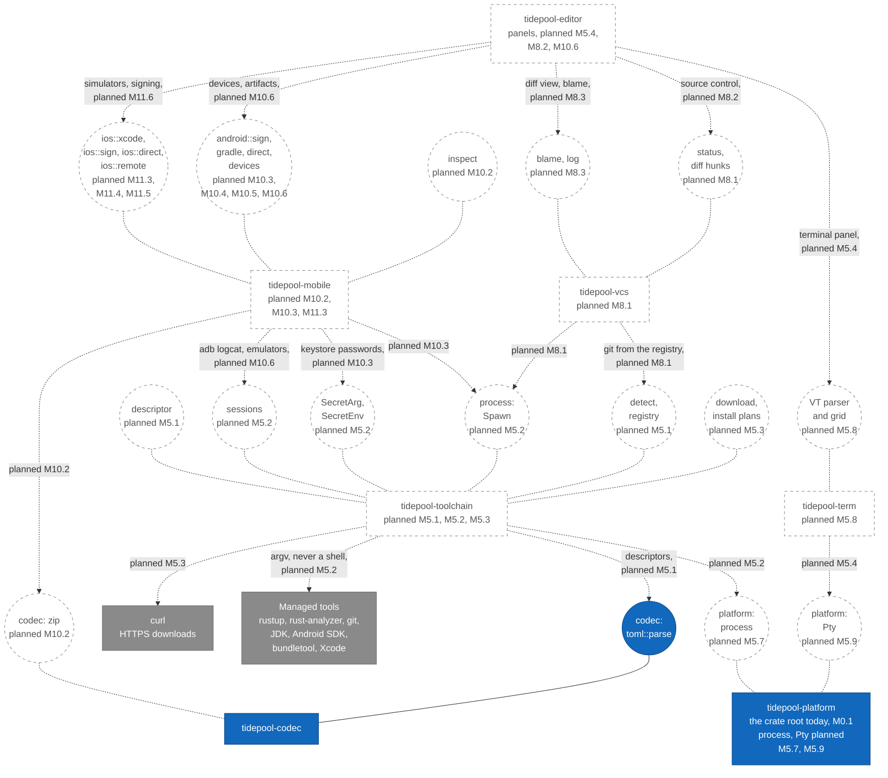

- `lang` (M6.7) and `agent` (M9.3) use `sessions` too; they are drawn in
  4.3 and 5.2.
- The editor's Toolchains panel (M5.6) is backed by `toolchain` in
  `docs/subsystems/editor.md`, and installs that need admin rights run in
  the integrated terminal (`docs/subsystems/toolchains.md`). The matrix
  does not let the editor use `toolchain`, nor `toolchain` use `term`, so
  only the app can join them. Neither edge is drawn, and no arrow goes into
  `install` here.

### 4.2 Languages: what the editor uses

`tidepool-lang` keeps one session per server and workspace root, and gives
the editor its features and services; `syntax` gives it highlights, and
`markdown` the document tree of the preview.

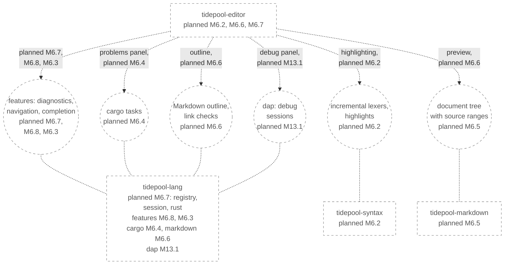

### 4.3 Languages: tidepool-lang, tidepool-rpc and the servers

`rpc` frames JSON-RPC 2.0 with `Content-Length` headers on codec's `json`,
for LSP, DAP and TAP. `lang` starts each server through toolchain's
`sessions`, and talks to it through `rpc`.

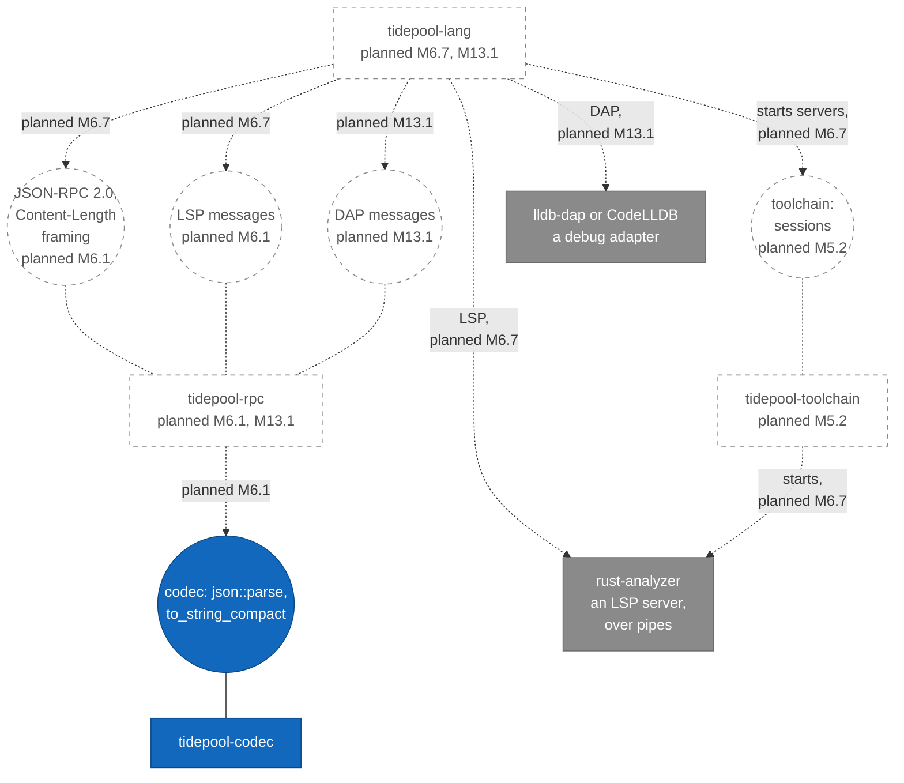

- TAP messages: `AGENTS.md`'s workspace map and `rpc`'s README put them in
  `rpc` (M9.3), and `docs/subsystems/agents.md` puts the TAP message types
  in `agent`'s `tap` module, over `rpc`'s transport. Section 5 draws them
  in `agent` (5.1).

### 4.4 Languages: what tidepool-lang and tidepool-syntax stand on

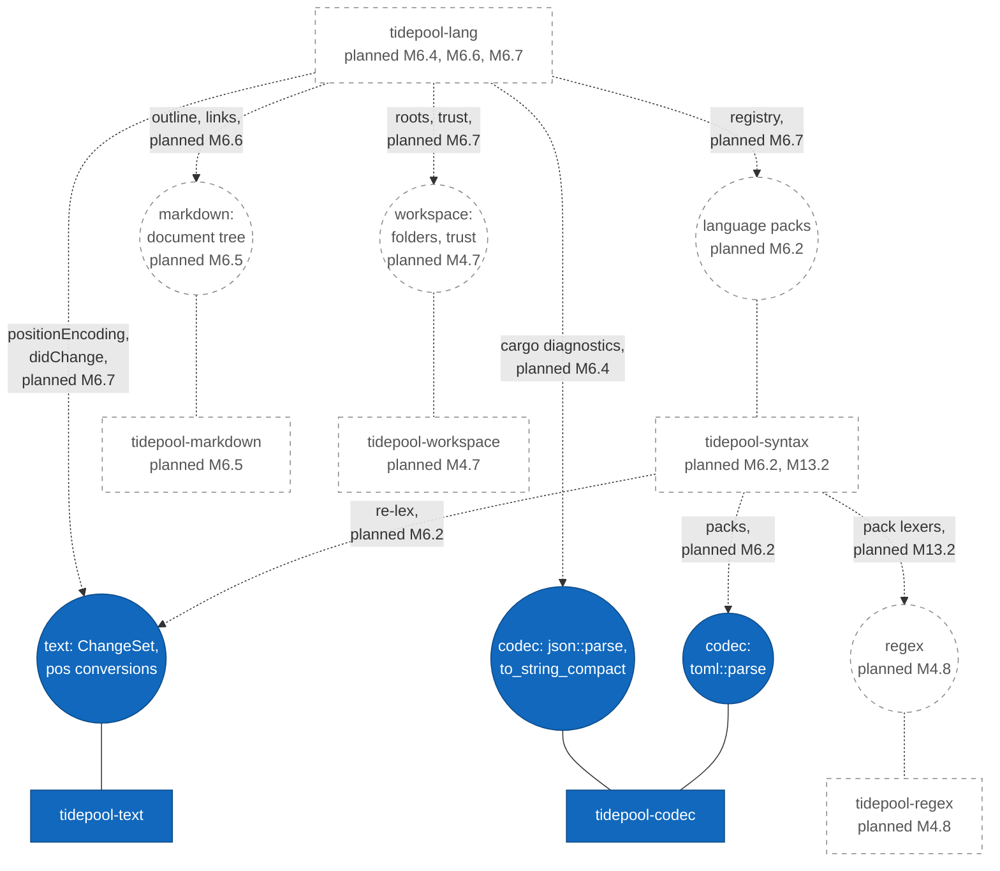

- LSP positions default to UTF-16, and every conversion goes through
  `tidepool-text`; the offset between a CR and its LF, which LSP cannot
  express, is moved by `lang` (M6.7).

## 5. Agents

`tidepool-agent` hosts language agents, decides what context each one
sees, and merges their suggestions with offline predictions
(`docs/subsystems/agents.md`). It is an empty library: `manifest`, `host`,
`tap`, `context` and `consent` come in M9.3, and `predict` and `merge` in
M9.4.

### 5.1 Inside tidepool-agent

What the editor will use, and how the modules will use one another.

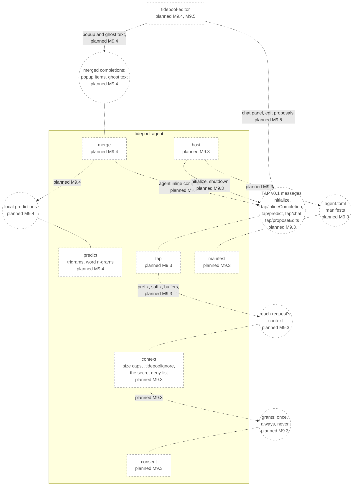

- The spec does not say which module sends each request. The arrows follow
  its module table: `context` builds each request's context, and `host`
  spawns, negotiates with and supervises the agents.

### 5.2 What tidepool-agent stands on

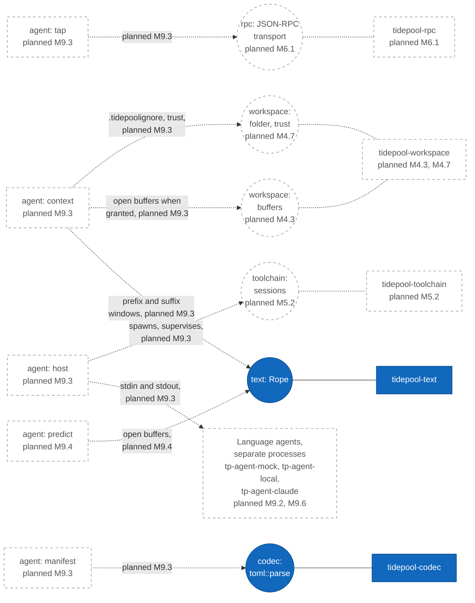

- Every byte an agent receives is assembled by `context`; agents never get
  paths to read, and cannot ask Tidepool to run anything or write files.
- The spec gives `context` symbols from `lang`, and `merge` LSP completions
  from `lang`, but the matrix's row for `agent` has no `lang`. No arrow is
  drawn from `agent` to `lang`: the editor would have to pass them in.

## 6. xtask and the dev tools

Everything in this section is built except `tidepool-bench`,
`tidepool-testkit` and the `xtask` commands still to come. `xtask` is
dev-only and never shipped. It uses `core` and `codec`, the two crates its
matrix row allows, and starts one program, `cargo` (ADR-0017).

### 6.1 xtask: the checks of ci

`xtask` holds the checks behind `cargo xtask ci`, and `fuzz-smoke` (6.4).
`crates` checks the root's and each member's manifest, each README's first
line, sections and task IDs, and that each member's `LICENSE` and `NOTICE`
are copies of the root's, byte for byte.

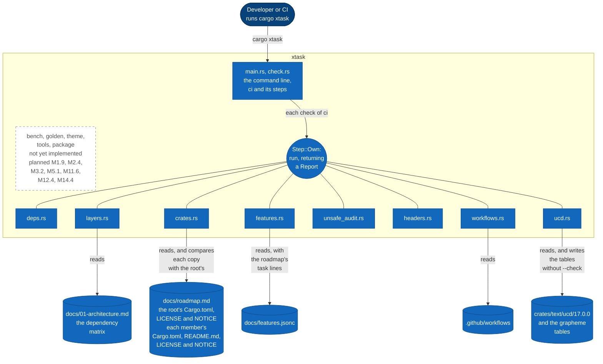

- `headers` and `unsafe-audit` also read the source files, and `deps` the
  manifests, lockfiles and cargo configuration; those files are left out.
- `cargo xtask site` runs these same steps through `check::run_gate`,
  then the two examples, and fills `site/` into `target/site` (6.2,
  ADR-0030).
- The commands still to come exit 1 with "not yet implemented". The table
  of them in `check.rs` still says `bench` has no roadmap task; M1.9 is
  that task.

### 6.2 xtask: the shared modules

`metadata.rs` runs `cargo metadata` through `cargo.rs`, which starts every
`cargo` that `xtask` runs, and `matrix.rs` reads the dependency matrix and
tells which lines of a document are text.

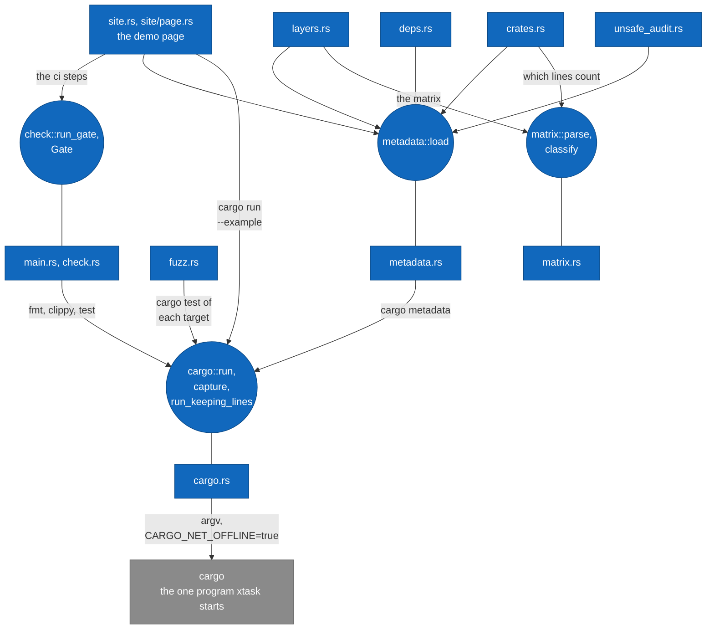

### 6.3 xtask: what it uses from core and codec

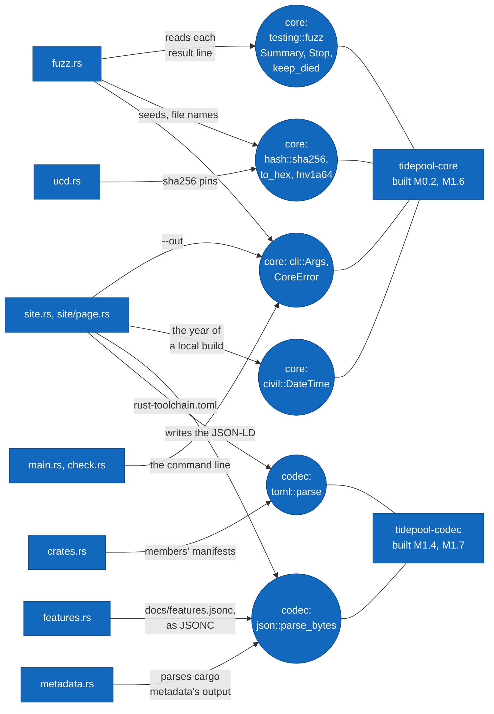

### 6.4 fuzz-smoke and the fuzz targets

`fuzz-smoke` runs each target with `cargo test` and reads the result line
the engine prints.

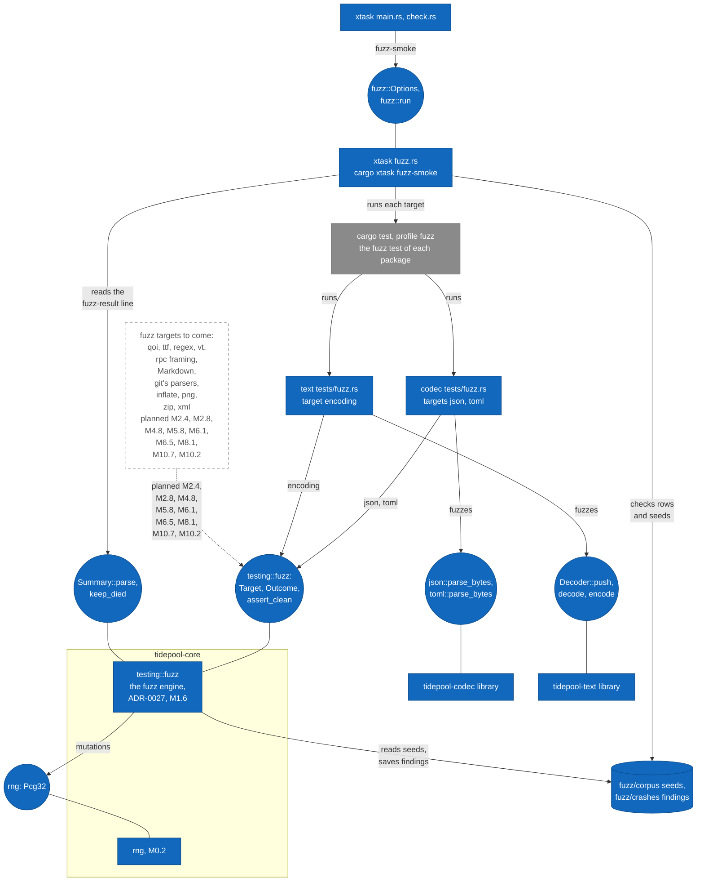

- A `fuzz-smoke` target is a test in its crate's `tests/fuzz.rs`, seeds in
  `fuzz/corpus/<target>/` and a row in `fuzz.rs`'s table (ADR-0027).

### 6.5 The property harness, bench and testkit

`core`'s property harness, its `Pcg32` and its fuzz engine (6.4) are the
only code from `core` that the tests of `codec` and `text` use, and neither
library uses `core`. `xtask` also uses `core`'s `cli`, `hash` and
`testing::fuzz` in its own code (6.3).

```mermaid
flowchart TB
    c_ctests["codec tests<br/>json.rs, toml.rs"]
    c_ttests["text tests<br/>model, positions, edits,<br/>unit tests"]
    c_bench["tidepool-bench<br/>an empty library<br/>harness and text suites<br/>planned M1.9"]

    i_check(("testing: check,<br/>check_sized"))
    i_pcg(("rng: Pcg32"))
    i_cparse(("json::parse_bytes,<br/>toml::parse_bytes"))
    i_tall(("Rope, ChangeSet,<br/>Selection, History"))

    subgraph sg_core["tidepool-core"]
        c_testing["testing<br/>the property harness, M0.2"]
        c_rng["rng, M0.2"]
    end
    c_codec["tidepool-codec library"]
    c_text["tidepool-text library"]

    c_testkit["tidepool-testkit<br/>an empty library<br/>planned M5.1, M6.1"]
    i_fakes(("fake tools,<br/>fake LSP server<br/>planned M5.1, M6.1"))

    c_ctests --> i_check
    c_ctests --> i_pcg
    c_ctests -->|"tests"| i_cparse
    c_ttests --> i_check
    c_ttests --> i_pcg
    c_ttests -->|"against<br/>String models"| i_tall
    c_bench -.->|"text suites,<br/>planned M1.9"| i_tall

    i_check --- c_testing
    c_testing -->|"seeded cases"| i_pcg
    i_pcg --- c_rng
    i_cparse --- c_codec
    i_tall --- c_text
    i_fakes -.- c_testkit

    classDef built fill:#1168bd,stroke:#0b4884,color:#ffffff
    classDef planned fill:#ffffff,stroke:#888888,stroke-dasharray: 5 5,color:#555555
    class c_ctests,c_ttests,c_testing,c_rng,c_codec,c_text built
    class i_check,i_pcg,i_cparse,i_tall built
    class c_bench,c_testkit,i_fakes planned
```

- `testkit`'s fakes have no arrow into them: the matrix lets only
  `tidepool-bench` use `tidepool-testkit`, and M5.1 settles the edges
  before the first fake tool (`docs/04-quality.md` → `layers`).

## Sources

Docs:

- `docs/01-architecture.md`: layers, the dependency matrix, the main loop.
- `docs/subsystems/core.md`, `text-and-formats.md`, `sys-and-platform.md`,
  `rendering.md`, `ui-and-theme.md`, `frontends.md`, `editor.md`,
  `languages.md`, `toolchains.md`, `mobile.md`, `agents.md`.
- `docs/04-quality.md`: own harnesses, fakes, fuzz smoke, `xtask` checks.
- `docs/roadmap.md`: every task ID drawn; `docs/decisions.md`: ADR-0002,
  ADR-0017, ADR-0027, ADR-0028, ADR-0029.
- `AGENTS.md` (workspace map) and each member's `README.md` (`## Status`).

Code:

- Manifests: `crates/*/Cargo.toml`, `xtask/Cargo.toml`, `bench/Cargo.toml`.
- The crate roots: `crates/sys/src/lib.rs`, `crates/platform/src/lib.rs`,
  `crates/app/src/main.rs`.
- `crates/codec/src/`: `lib.rs`, `limits.rs`, `error.rs`, `json.rs`,
  `json/parse.rs`, `json/write.rs`, `toml.rs`, `toml/parse.rs`,
  `toml/table.rs`.
- `crates/text/src/`: `lib.rs`, `rope.rs`, `pos.rs`, `pos/grapheme.rs`,
  `selection.rs`, `transaction.rs`, `history.rs`, `encoding.rs`, `file.rs`.
- `crates/core/src/`: `lib.rs`, `testing.rs`, `testing/fuzz.rs`, `hash.rs`,
  `cli.rs`, `rng.rs`.
- Tests: `crates/codec/tests/fuzz.rs`, `json.rs`, `toml.rs`;
  `crates/text/tests/fuzz.rs`, `model.rs`, `positions.rs`, `edits.rs`.
- `xtask/src/`: `main.rs`, `check.rs`, `cargo.rs`, `metadata.rs`,
  `matrix.rs`, `deps.rs`, `layers.rs`, `crates.rs`, `unsafe_audit.rs`,
  `headers.rs`, `workflows.rs`, `ucd.rs`, `fuzz.rs`.
