# Data flow and state diagrams

These diagrams show how data moves through Tidepool and which states its
parts go through. Sections 1 to 5 are data-flow diagrams: a file through
the text engine and the workspace around it, a managed tool's install, an
agent's context, and fuzz smoke. Sections 6 to 12 are state diagrams: the
fuzz engine's run, a text `History`, a saved file, workspace trust, vim
mode, a managed tool and a language session. The text engine, the fuzz
engine and fuzz smoke are built; the rest is planned.

Drawn from the code and docs as of roadmap task M0.13 (2026-11-08, version 0.1). What the code has is drawn solid; what the roadmap plans is dashed and labelled with the task that builds it (ADR-0029).

## Legend

| Style | Means |
| :- | :- |
| Dark blue box | A person: the user or a developer |
| Grey box | An external entity: a program or system outside Tidepool's code |
| Grey cylinder | A store outside Tidepool's code: files on disk, a tool's install directory |
| Blue rounded box | A process the code has: a function or a command |
| Blue cylinder | A data store the code has, in memory or on disk |
| White shape with a dashed border | Planned: not built yet. Its label names the task that builds it |
| Solid arrow | A data flow the code has, labelled with what moves |
| Dotted arrow | A planned data flow, labelled with what moves and its task |
| Blue state | A state the code has |
| White state with a dashed border | A planned state, labelled with its task |
| Box with states inside | A composite state: the part is in one of the states inside it |
| `[*]` | Where a state diagram starts or ends |
| Diamond | A choice: the next state depends on a check |

- Mermaid cannot dash a transition in a state diagram, so a planned
  transition says "planned M#.#" in its label. In a section whose title
  says "planned", every state and transition is planned, and the note
  names the tasks.
- Names in code font are the code's own. Planned parts use the names their
  spec gives, and are described in words where the spec gives none.
- A diagram split into numbered parts (3.1, 3.2) draws again, in short,
  the nodes or states the parts share.

## 1. Data flow: a file through `tidepool-text` (built)

A caller loads a file, edits its rope through its `History`, and saves a
revision atomically (ADR-0025). Today the caller is `tidepool-text`'s own
tests; `workspace::buffers` takes that place in M4.3 (section 2).

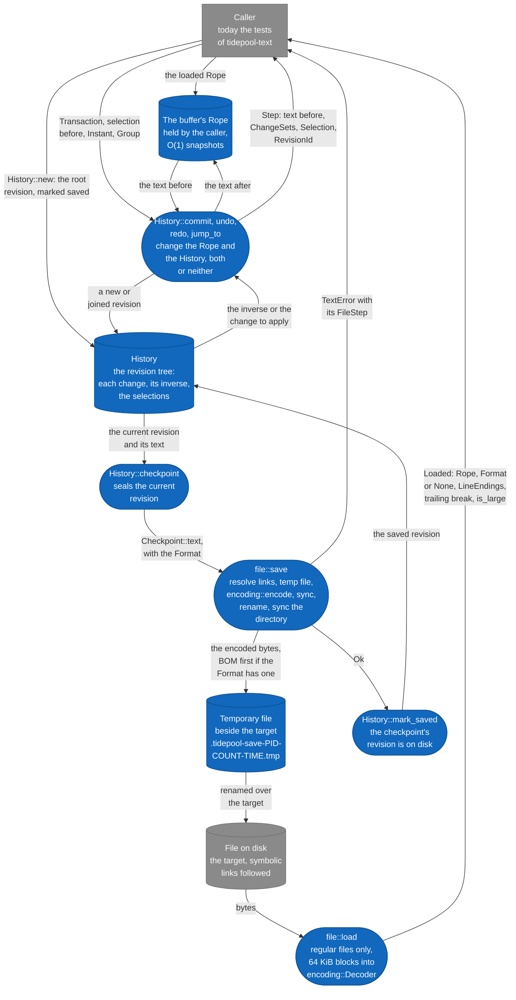

- Decoding never fails: bytes that are not text become U+FFFD and are kept
  beside the text, and such a file has no save `Format` (section 8).
- Line endings and the trailing newline are reported, never changed, so an
  unchanged file saves byte for byte (ADR-0019).
- An error before the rename removes the temporary file and leaves the
  target untouched; a crash before it leaves the temporary file behind.

## 2. Data flow: buffers, watching and session around the text engine (planned)

The workspace wraps section 1: buffers keyed by canonical path, loaded and
saved on workers, watched for outside changes, and remembered in the
session. None of it is built; the text engine it calls is.

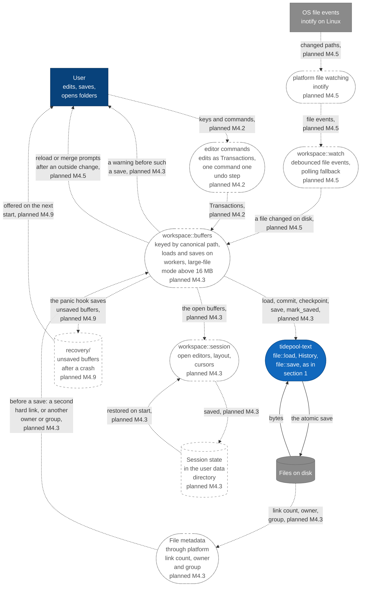

- A save renames a new file over the old one, which splits a hard link
  and gives the file the saver's owner and group (ADR-0025). So buffers
  check the link count, owner and group first, and warn or write in place
  (M4.3).
- The reload or merge prompts after an outside change come with file
  watching (M4.5), whose acceptance checks them.
- Only the main thread touches buffers; other threads get immutable rope
  snapshots (`docs/01-architecture.md` → "Threading model").

## 3. Data flow: a managed tool's install (planned)

A tool is found from its descriptor, and an install or update runs only
after the user confirms its plan; a download is checked against its pinned
SHA-256 before anything from it runs (ADR-0002, ADR-0016). Only the SHA-256
function in `tidepool-core` is built. 3.1 draws how a tool is found, and
3.2 an install or update.

### 3.1 Detecting a tool

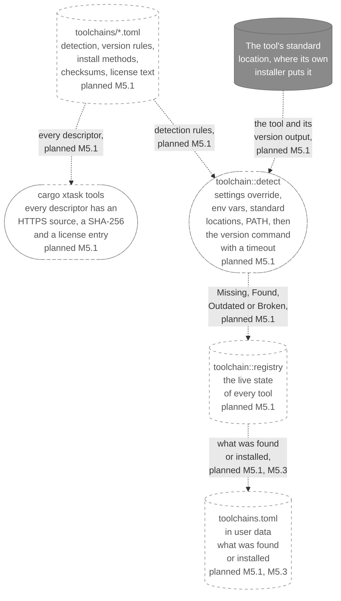

### 3.2 An install or update

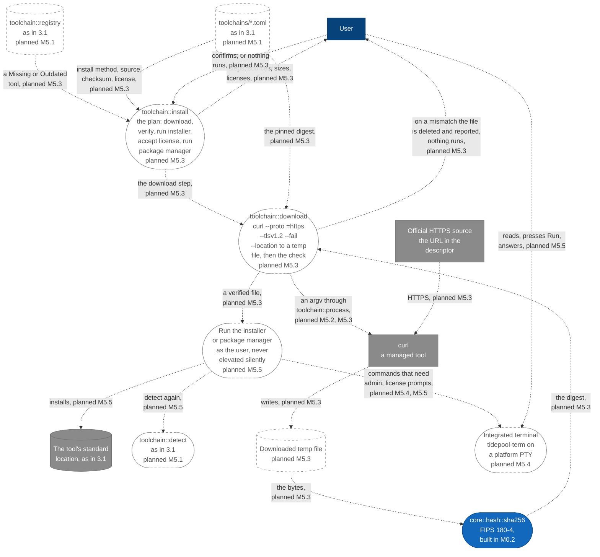

- Descriptor versions and checksums change only by a reviewed change,
  never at runtime (`docs/subsystems/toolchains.md`).
- In an untrusted workspace (ADR-0014) tools get detection only: no
  project-owned executable runs.
- The plan is shown in the Toolchains panel and the first-run checklist
  (M5.6).

## 4. Data flow: an agent's context (planned)

Tidepool assembles every byte an agent receives, gated by consent and
workspace trust and filtered by the context rules; the agent answers over
TAP, and an edit comes back only as a proposal for the user to review
(ADR-0009, `docs/subsystems/agents.md`). Only `History`, where an accepted
proposal lands, is built.

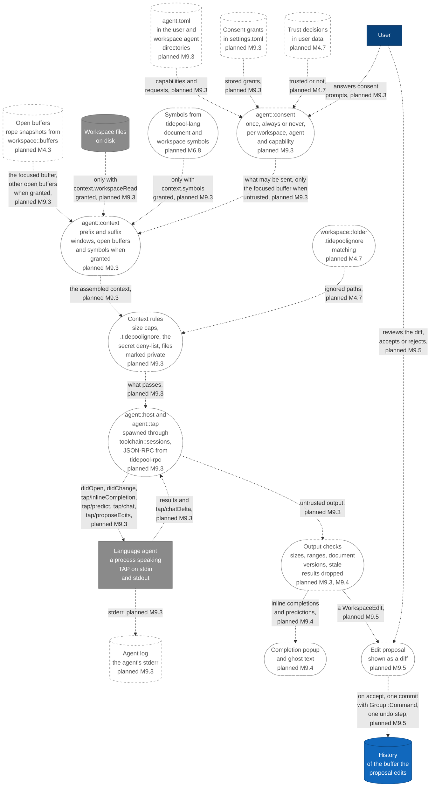

- The deny-list applies always, beside `.tidepoolignore`: `.env*`,
  `*.pem`, `*.key`, `*.jks`, `*.keystore`, `*.p12`, `*.p8`,
  `*.mobileprovision`, `id_*`, `keystore.properties` and `.git/`.
- Agents never get paths to read for themselves, cannot run anything and
  cannot write files. Requests carry the buffer version, are cancelled on
  every keystroke and time out (`docs/subsystems/agents.md` → "Merging and
  display").
- The dependency matrix does not let `agent` depend on `lang`, so the
  symbols must reach `context` through a crate that may use both, such as
  `editor`. The spec does not say which.

## 5. Data flow: fuzz smoke (built)

`cargo xtask fuzz-smoke` runs each fuzz target's test in a `cargo test`
child, which replays the saved crashes and the seeds, then mutates the
seeds, and saves each finding's input (ADR-0027). A plain `cargo test`
runs the same tests with the unchanged inputs only.

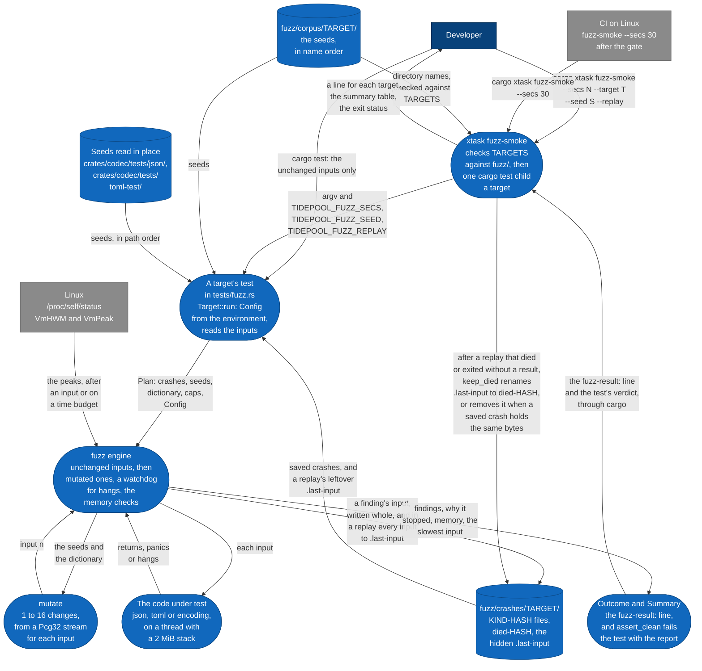

- The targets are `json` and `toml` in `tidepool-codec` and `encoding` in
  `tidepool-text` (`TARGETS` in `xtask/src/fuzz.rs`).
- A file in `fuzz/crashes/TARGET/` is named after its `Kind` and the
  input's FNV-1a hash: `panic-`, `hang-`, `memory-` or `reserve-`, then 16
  hex digits. An unchanged input that fails is named where it is, not
  saved again. `fuzz/crashes/` is made when the first finding is saved.
- When a replay died on an input that a saved crash already holds
  (`Kept::Existing` from `keep_died`), fuzz-smoke says it died on that
  saved crash, which every run replays first: fix what it shows, or
  remove it.
- The memory checks read `/proc/self/status` on Linux only; elsewhere they
  are skipped, and the report says why.

## 6. State: the fuzz engine's run (built)

One run of a target, as `engine::run` and the fuzzing thread go through
it, ending in one of the seven `Stop` reasons that the result line shows
as `stopped=`, or in a `FuzzError` when it cannot start or finish.
Findings do not stop a run, except a hang.

Each input can add a `Finding`, and the run goes on: `Kind::Panic`, one
for each place a panic was raised, counted in `hits`; `Kind::Memory`, the
written peak `VmHWM` past the memory cap; `Kind::Reserved`, the reserved
peak `VmPeak` past its cap, or a `Range` of inputs; `Kind::Hang`, only at
`Stop::Hang` or `Stop::SlowInput`. In a replay each input is written to
`.last-input` before it runs, and the memory is read after every input.

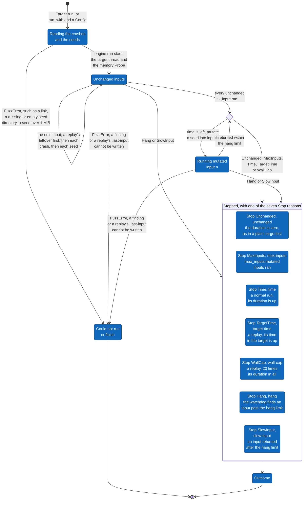

- `Target::run` panics when the run cannot start or finish; `run_with`
  returns the `FuzzError`. `Outcome::assert_clean` fails the test when
  there is a finding.
- A hang ends the run, since a thread stuck in a target cannot be stopped.
  While such a thread is stuck, later runs in the process skip the memory
  checks (`Skip` code `hung-thread`).
- A memory check that does not run says why with a `Skip` code:
  `unreadable`, `no-vmhwm`, `no-vmpeak`, `not-asked`, `hung-thread`,
  `read-failed` or `not-started`.

## 7. State: a text `History` (built)

The undo tree of one buffer (ADR-0020), seen from its current revision:
whether a commit can join it, and how undo, redo and jumps move through
the tree.

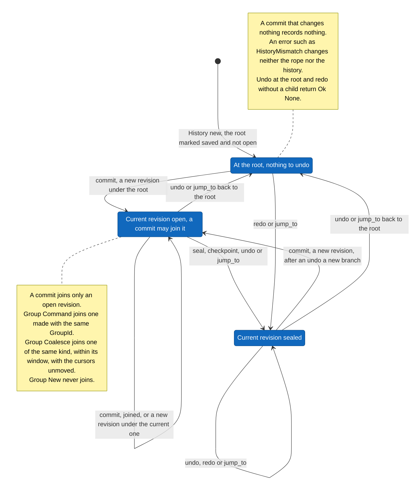

An example tree: revisions 1 and 2 were committed, 2 was undone, and the
next commit made 3, a branch. Undo goes to the parent; redo goes to the
child created or visited last; `jump_to(2)` goes up to 1, the lowest
common ancestor, then down to 2, and makes 2 the last child.

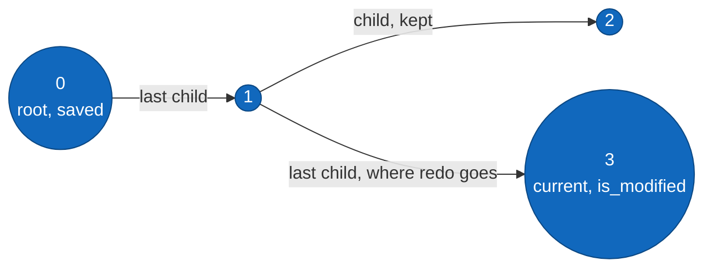

- Nothing is pruned in v1, and deleted text stays in memory until the
  history is dropped.
- `is_modified` is false exactly at the saved revision, on any branch.

## 8. State: a saved file (built, and planned where the workspace adds to it)

What `tidepool-text`'s calls report about one file: `Loaded::read_only`,
`History::is_modified`, `checkpoint`, `file::save` and `mark_saved`. No
type holds these states yet; `workspace::buffers` does from M4.3, and adds
the dashed ones. 8.1 draws what the text engine reports, and 8.2 the
states the workspace adds.

### 8.1 What the text engine reports (built)

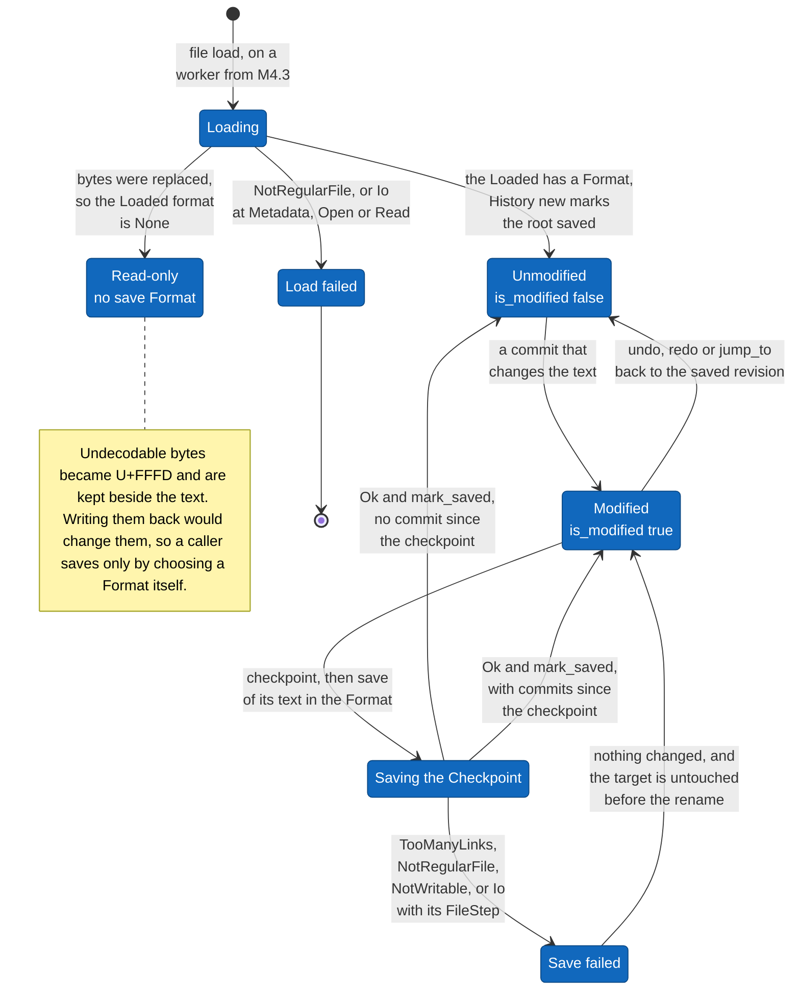

### 8.2 What the workspace adds

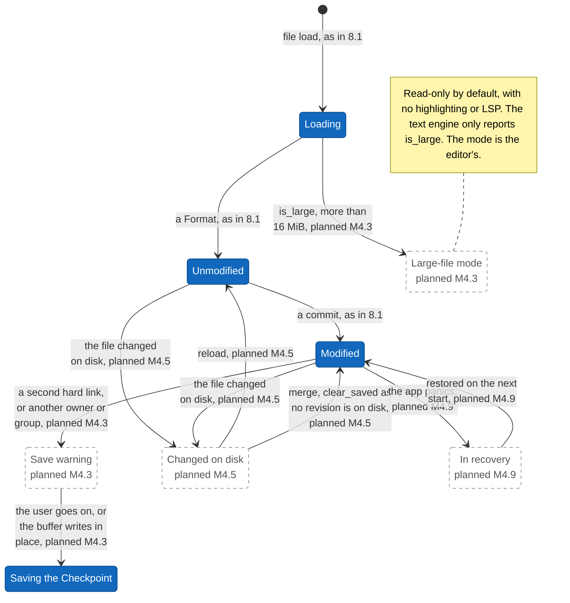

- Saves of one buffer are serialized, so the last `mark_saved` matches the
  disk (`History::checkpoint`).
- An `Io` error at `FileStep::SyncDirectory` comes after the rename: the
  new text is in place, but the save reports an error.

## 9. State: workspace trust (planned)

A folder opens untrusted until the user trusts it, and the decision is
stored in user data (ADR-0014, which M4.7 accepts first). The prompt is
the editor's trust prompt (M4.3).

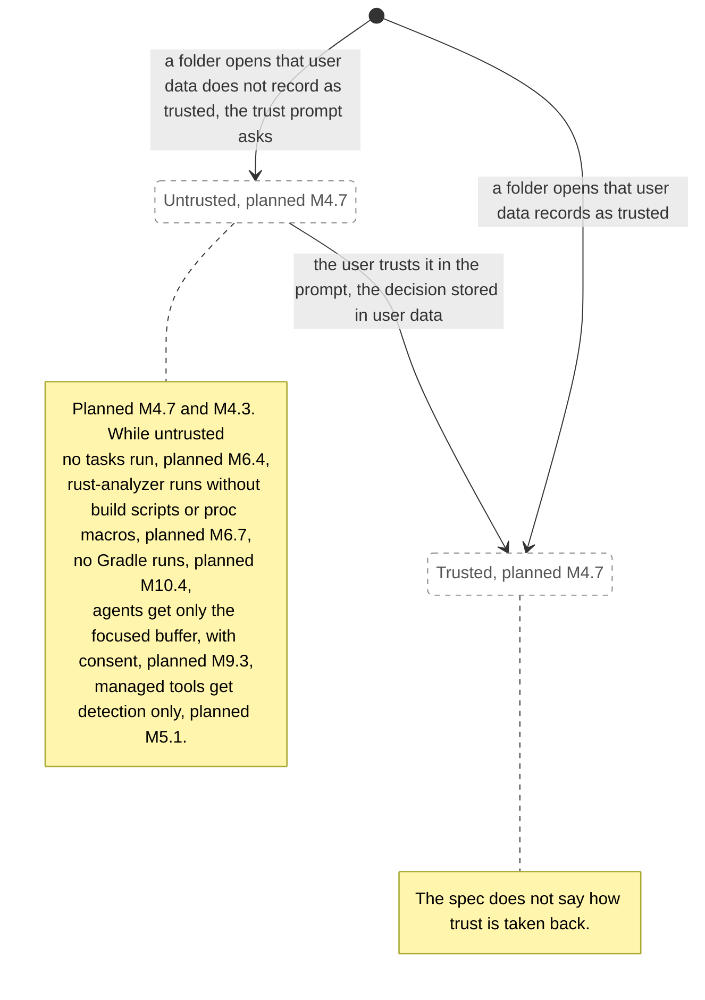

## 10. State: vim modes (planned)

The modes `docs/subsystems/vim-mode.md` names, and the keys of its
supported subset that move between them. The keymap engine is modal from
M4.6; the default keymap is one Insert-like mode, and vim mode adds the
rest (ADR-0006). 10.1 draws Normal mode and the modes a key or an operator
enters from it, and 10.2 the visual modes.

### 10.1 Normal, Insert, Replace, operators, commands and search

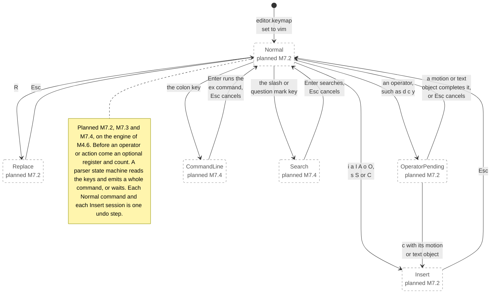

### 10.2 The visual modes

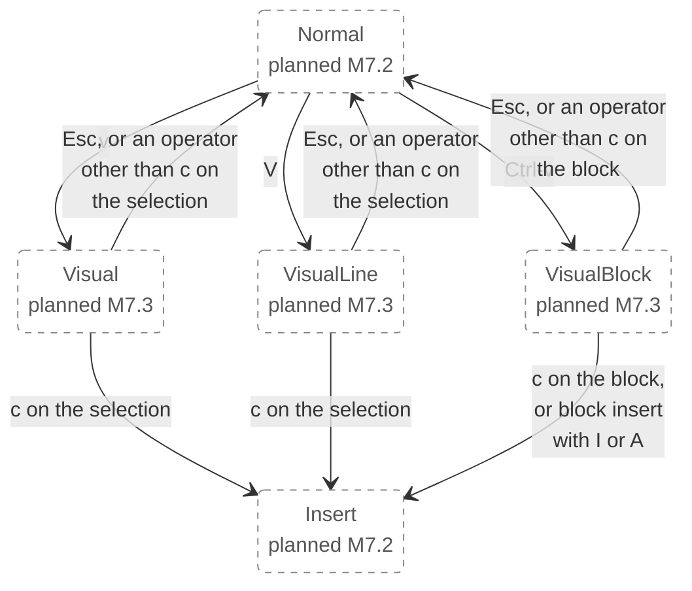

- The status bar shows the mode as a chip (`NORMAL`, `INSERT`,
  `VISUAL`…); the cursor is a block in Normal mode and a bar in Insert.
- In Insert mode `Ctrl-o {cmd}` runs one Normal command; completion and
  ghost text show only in Insert mode.
- A key outside the subset is a no-op with a status-bar message, never a
  silent wrong edit.

## 11. State: a managed tool (planned)

The live states of one tool in `toolchain::registry`, under the names the
spec gives: `Missing`, `Found { path, version }`, `Outdated`, `Installing`
and `Broken { reason }`. Detecting is the run of `toolchain::detect`, not
a registry state.

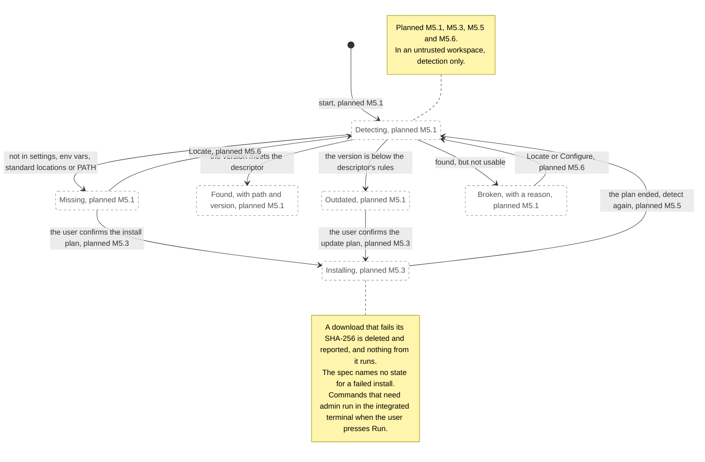

- The registry also records which features each tool unlocks; the
  Toolchains panel shows each tool's state as a status dot (M5.6).

## 12. State: a language session (planned)

One LSP session per server and workspace root, started through
`toolchain::sessions` and restarted after a crash (`docs/subsystems/languages.md`
→ `tidepool-lang`). The spec names no states; these are its steps.

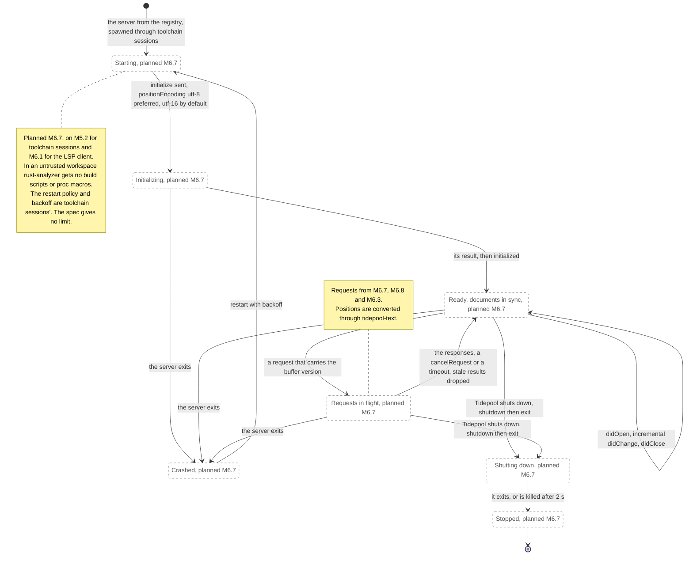

- `rust-toolchain.toml` in the workspace is respected (M6.7).
- The main thread never waits on the server: results come back as
  versioned messages, and one for an older buffer version is dropped
  (`docs/01-architecture.md` → "The main loop").

## Sources

The docs and code these diagrams were drawn from:

- `docs/01-architecture.md`: "Dependency matrix", "The main loop", "Data
  flow", "Threading model", "Configuration and user data"
- `docs/subsystems/text-and-formats.md`: `history`, `encoding`, `file`
- `docs/subsystems/editor.md`: the `tidepool-workspace` modules, the
  editor view, "Dialogs that protect the user"
- `docs/subsystems/toolchains.md`: `tidepool-toolchain`
- `docs/subsystems/agents.md`
- `docs/subsystems/vim-mode.md`
- `docs/subsystems/languages.md`: `tidepool-rpc`, `tidepool-lang`
- `docs/04-quality.md`: "Fuzz smoke"
- `docs/roadmap.md`: M0.2, M4.2, M4.3, M4.5, M4.6, M4.7, M4.9, M5.1 to
  M5.6, M6.1, M6.3, M6.4, M6.7, M6.8, M7.2 to M7.4, M9.3 to M9.5, M10.4
- `docs/decisions.md`: ADR-0002, ADR-0006, ADR-0009, ADR-0014, ADR-0016,
  ADR-0019, ADR-0020, ADR-0025, ADR-0027, ADR-0029
- `crates/text/src/file.rs`, `encoding.rs`, `history.rs`,
  `transaction.rs`, `rope.rs`, `selection.rs`, `error.rs`, `lib.rs`
- `crates/core/src/testing/fuzz.rs`, `testing/fuzz/engine.rs`,
  `testing/fuzz/mutate.rs`, `testing/fuzz/paths.rs`,
  `testing/fuzz/memory.rs`, `rng.rs`, `hash/sha256.rs`
- `crates/codec/tests/fuzz.rs`, `crates/text/tests/fuzz.rs`
- `xtask/src/fuzz.rs`
- `.github/workflows/ci.yml`: the fuzz-smoke step
