# UML sequence diagrams

These diagrams follow Tidepool's flows through time: who calls whom, in
what order, and what comes back. Sections 1 to 7 are read from the code:
`cargo xtask ci`, `cargo xtask fuzz-smoke` and its engine, and loading,
saving, editing and undoing text in `tidepool-text`. Sections 8 to 13 are
the flows the specs plan, from startup to signing an Android package; most
of their code does not exist yet, and what does is marked (built).

Drawn from the code and docs as of roadmap task M2.1 (2026-11-10, version 0.1). What the code has is drawn solid; what the roadmap plans is dashed and labelled with the task that builds it (ADR-0029).

## Legend

| Style | Means |
| :- | :- |
| A box at the top and bottom of a line | A participant: a process, a thread, a module or a person |
| Stick figure | A person, or a CI job standing in for one |
| Solid arrow, filled head (`->>`) | A call, a request or a message written |
| Dashed arrow, filled head (`-->>`) | Its answer: a return value or an exit status |
| Solid arrow, open head (`-)`) | Sent without waiting: through a channel, a pipe or a new thread |
| `alt` / `else` | One of several paths |
| `opt` | A step that happens only in some runs |
| `loop` | Steps that repeat |
| `par` / `and` | Steps that run at the same time, on different threads |
| Note | What a step means, or the rule or budget it keeps |
| "(planned)" in the section title, and a note at the top naming the tasks | The whole flow is planned: not built yet |
| A task ID in a participant's label, such as "(M2.2)" | That participant is planned, and that task builds it |
| "(built)" in a participant's label | That participant exists in the code now, inside a planned flow |

UML draws an answer as a dashed arrow, and Mermaid cannot dash a
participant's box, so a sequence diagram marks planned work by its title,
its note and its participants' labels instead of by dashes. Names in
messages are the code's (sections 1 to 7) or the specs' (sections 8 to
13). Paths are relative to the repository root. A planned flow too long
for one picture is drawn in numbered parts, read in order.

## 1. `cargo xtask ci`

`run_ci` runs its eleven steps in order and keeps going after a failure, so
one run reports every problem. `deps` is the gate: when it fails, `clippy`
and `test`, which compile the workspace and run its code, are not run, and
the summary lists them as "not run" (`xtask/src/check.rs`). `deps`,
`layers`, `crates` and `unsafe-audit` ask `cargo metadata
--format-version 1 --offline`: `deps` with `--locked`, once for each
workspace; `layers` and `crates` with `--no-deps`, for the root
workspace; and `unsafe-audit` with `--no-deps`, once for each workspace.
`crates` checks each member's manifest, and its README: that it starts
with `# <package name>`, has its sections (Status, Usage, an optional
Features, Documentation, Rules, Checks, License) once each and in that
order, and names only task IDs that `docs/roadmap.md` has. It also checks
that each member's copies of `LICENSE` and `NOTICE` are, byte for byte,
the root's (`xtask/src/crates.rs`). `features` checks that every ticked
task belongs to a feature in `docs/features.jsonc`, and that each
feature's `ticked` is what the roadmap ticks (`xtask/src/features.rs`).
`cargo xtask site` runs the same steps through the same runner,
`run_gate` (ADR-0030).

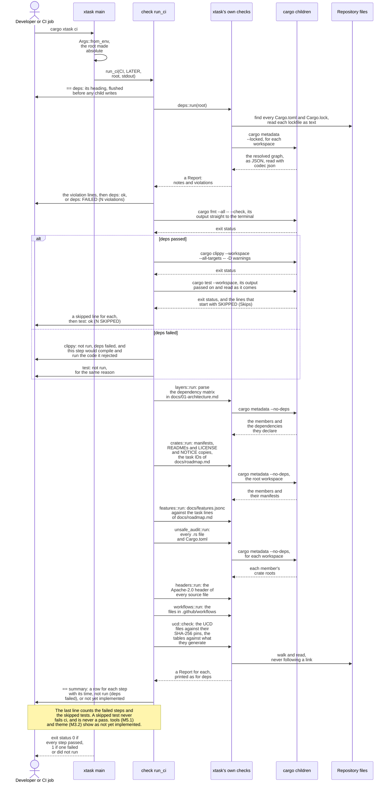

A run that passes ends with `ci: ok: 11 of 11 steps passed; not yet
implemented: tools, theme`; one whose gate failed, with `ci: FAILED: 1 of
11 steps failed: deps; not run: clippy, test; not yet implemented: tools,
theme`.

## 2. `cargo xtask fuzz-smoke`: `xtask` and its children

`fuzz-smoke` checks that `fuzz/` agrees with its table of targets, then
runs each target's test in its own `cargo test`, and reads the one result
line the test prints (`xtask/src/fuzz.rs`). The parsers run in those test
processes, never in `xtask`. The targets run in table order: `json` and
`toml` (`tidepool-codec`), then `encoding` (`tidepool-text`).

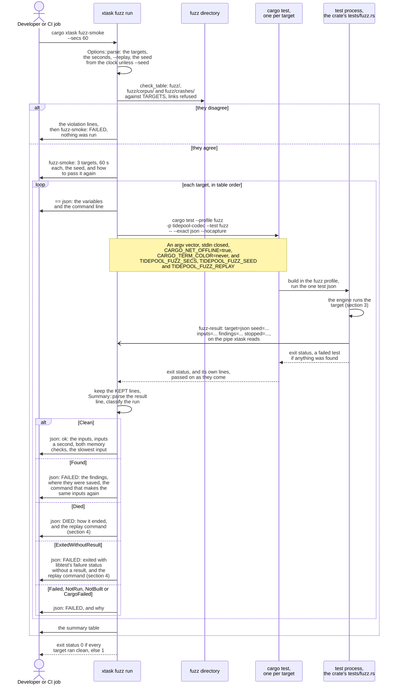

## 3. One fuzz target's run: the engine

Inside the test process, `Target::run_with` reads the saved crashes and the
seeds, and `engine::run` feeds them to the target on a thread of its own
while the test's thread watches the clock (`crates/core/src/testing/fuzz.rs`,
`fuzz/engine.rs`). A plain `cargo test` runs the same test with no
`TIDEPOOL_FUZZ_SECS`: only the unchanged inputs, so every saved crash is a
regression test.

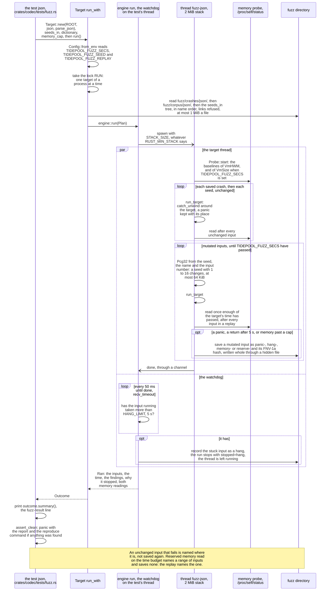

## 4. A death, and the replay that keeps its input

A process that dies, from an allocation too big to make or a stack
overflow, prints no result line. `fuzz-smoke` then prints the replay
command; the replay writes each input to `.last-input` before it runs it,
so the input the process dies on is on disk, and `fuzz-smoke` keeps it as
`died-<hash>` (`xtask/src/fuzz.rs`, `crates/core/src/testing/fuzz/paths.rs`).
When a saved crash of that hash already holds the input (a `panic-`,
`hang-`, `memory-` or `reserve-` file, or an earlier `died-` one),
`keep_died` keeps no second copy, and `fuzz-smoke` says the process died on
that saved crash. A replay that ends without dying can still find
something: a saved crash that still fails, a finding the run it replays
died before reporting, or a reserved-memory input that the replay, reading
the memory after every input, names exactly and saves.

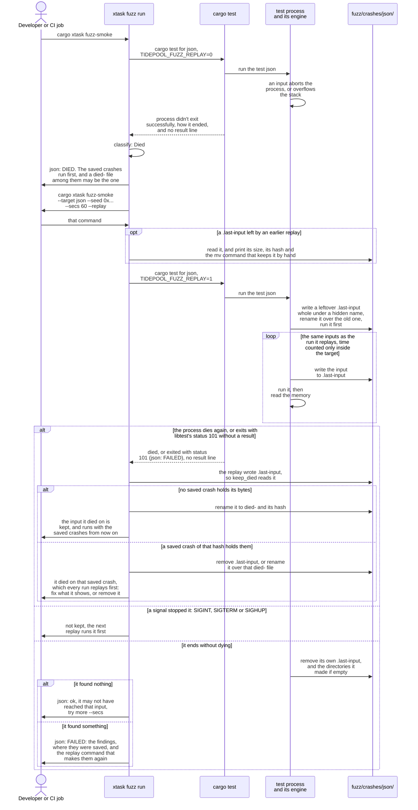

## 5. Loading a file into `tidepool-text`

`text::file::load` reads a regular file in 64 KiB blocks into a streaming
`Decoder`, which picks the encoding from a byte-order mark alone
(`crates/text/src/file.rs`, `encoding.rs`). Nothing is written. A file
with bytes that are not text loads read-only, with those bytes kept beside
the text. Today the callers are tests; `workspace::buffers` runs loads on
workers from M4.3.

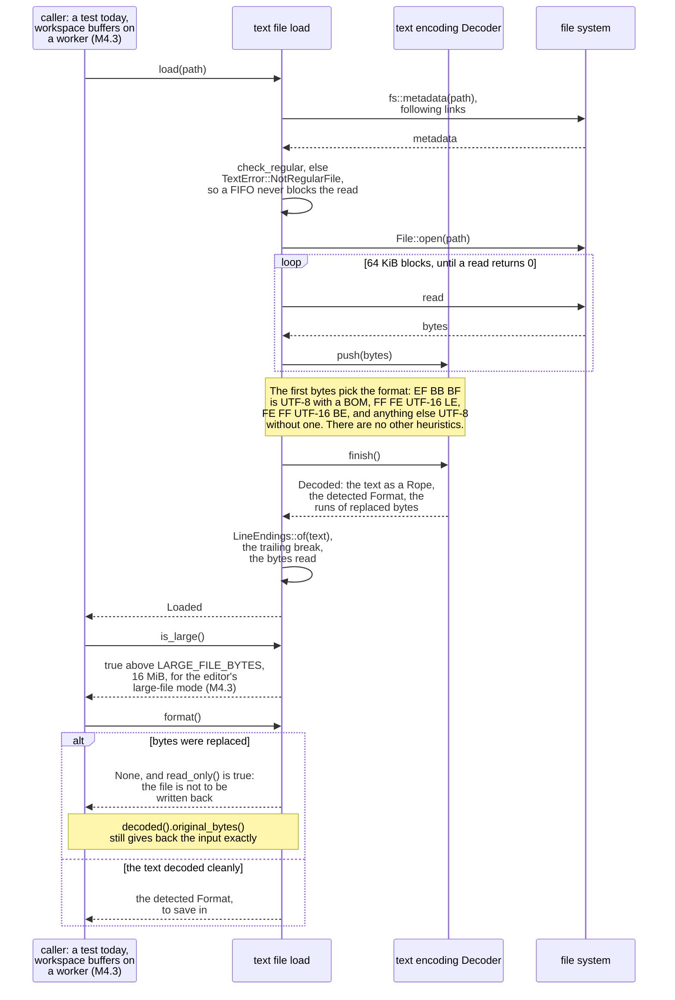

## 6. The atomic save

`text::file::save` replaces a file so that it holds either its old bytes
or exactly the new ones, even after a crash (ADR-0025). The caller seals
the revision first with `History::checkpoint`, and records success with
`mark_saved`; saves of one file are serialized by the caller. The
directory sync after the rename is skipped where the directory cannot be
opened (always on Windows, where `std` cannot open one; on Unix, one the
user may not read) or the file system refuses to sync one (`EINVAL`,
`ENOTSUP`); any other error syncing it fails the save, with the new text
already in place.

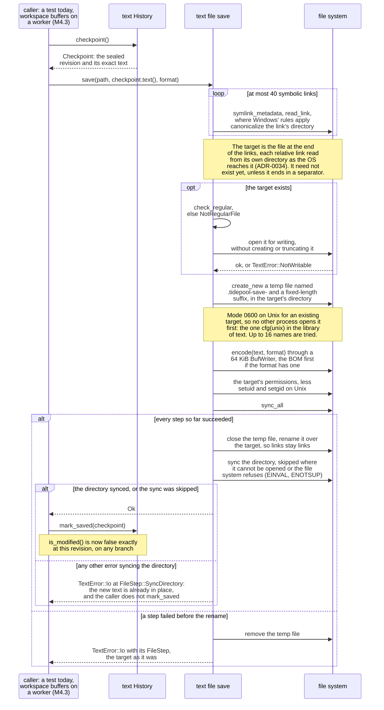

## 7. An edit, its undo and its redo

Every edit of a buffer goes through its `History` (ADR-0020): a
`Transaction` is built from the cursors, `commit` applies it to the rope
and keeps its inverse, and `undo` and `redo` apply one or the other. Each
call changes both the rope and the history or neither, and returns a
`Step`, whose change sets LSP and syntax are to read (planned M6.7,
M6.2) (`crates/text/src/transaction.rs`, `history.rs`). A commit joins the
current revision when that revision is open and the group matches: the
same `Command` id, or `Coalesce` with the same kind, inside the window,
with the cursors unmoved.

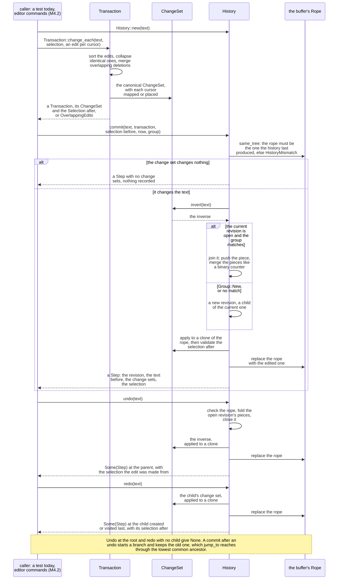

## 8. Startup to the first frame (planned)

From `cargo tp` to the first frame, as `docs/01-architecture.md` → "The
main loop" and `docs/subsystems/frontends.md` plan it. M2.6 draws the first
frame (the backdrop and a line of each face); M3.4 adds the loop and the
shell, on ADR-0012, which is Proposed until then. The binary today is an
empty `main` (M0.1). The frontend draws with `gfx` (the framebuffer and the
backdrop, M2.3) and `font` (the bundled faces, M2.5), libraries it calls:
drawn as the frontend's own steps in 8.1, and as one participant in 8.2.

### 8.1 Opening the frontend

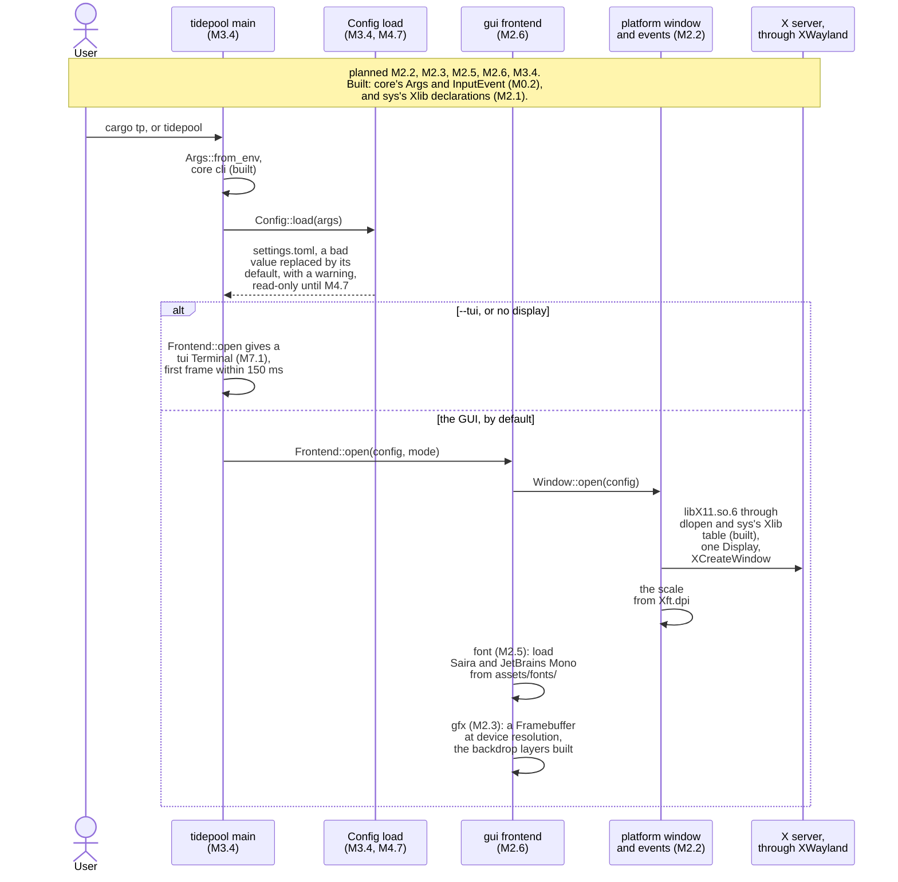

### 8.2 The main loop, to the first frame

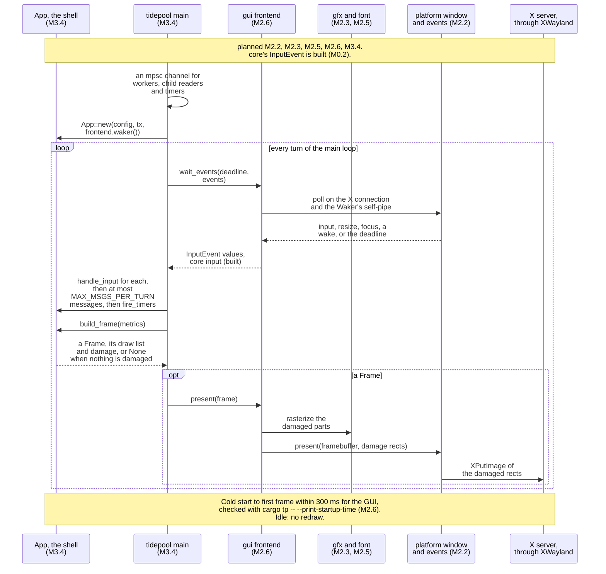

## 9. A keystroke to pixels, on the main thread (planned)

One key press, from the X server to the pixels on screen, all on the main
thread, which never waits on I/O, a child, a server or an agent
(`AGENTS.md` rule 6, `docs/01-architecture.md` → "Data flow"). Work that
could wait goes to other threads with a rope snapshot and the buffer's
version, and comes back as a message the loop reads on a later turn. The
whole flow is planned in M2.2, M2.6, M3.1, M3.4, M4.1, M4.2, M4.3 and
M4.6; `Transaction` and `History` are built (M1.2), and so is core's
`InputEvent` (M0.2).

### 9.1 The key, to the focused editor

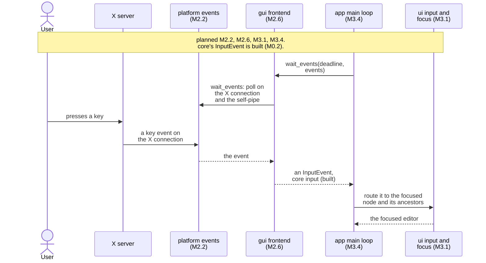

### 9.2 The edit, and the work sent off

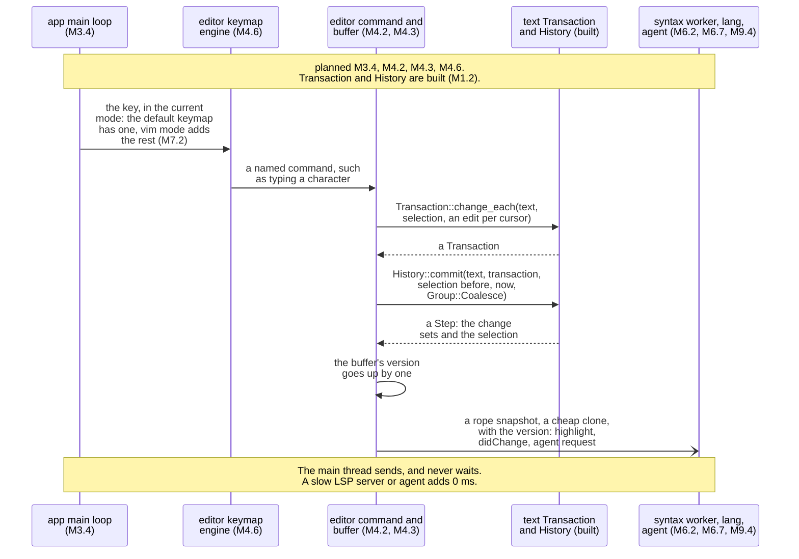

### 9.3 The frame, and a result on a later turn

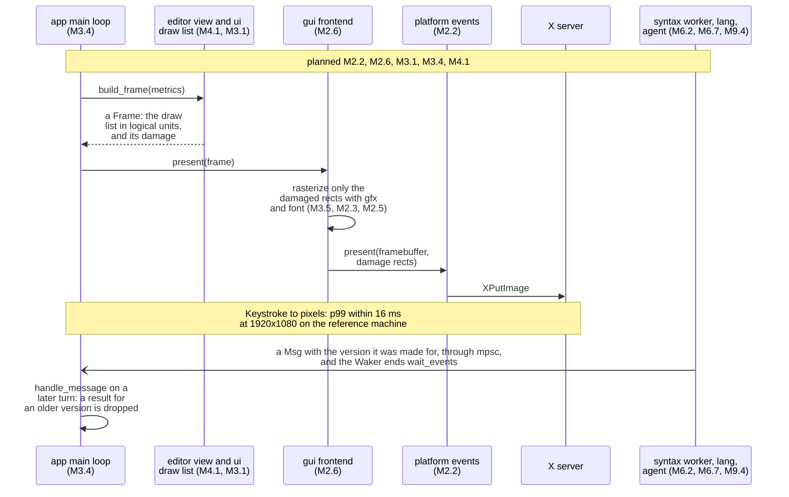

## 10. An LSP request and a stale result (planned)

A completion request to rust-analyzer while the user goes on typing. Every
request carries the buffer version it was made for, and the loop drops a
result for an older version (`docs/01-architecture.md` → "The main loop",
`docs/subsystems/languages.md`). The flow is planned in M3.4, M5.2, M6.1,
M6.3 and M6.7. Earlier, the session started rust-analyzer as a child of
`toolchain`'s sessions (M5.2) and sent `initialize` with
`positionEncoding`, `utf-8` preferred and `utf-16` by default.

### 10.1 The requests, and a cancellation

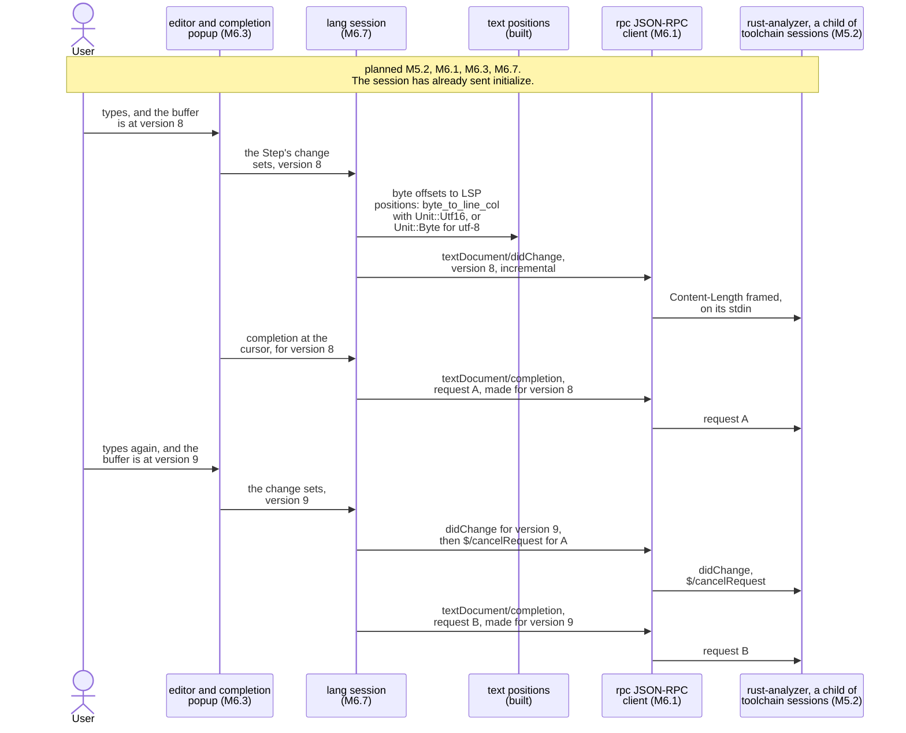

### 10.2 The answers, and the stale one dropped

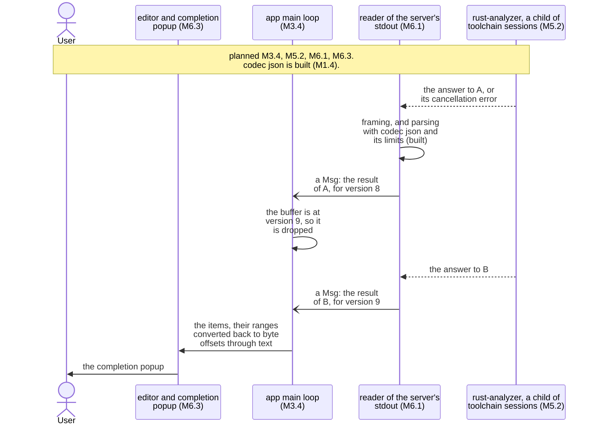

## 11. Installing a managed tool (planned)

Installing rustup from the Toolchains panel (ADR-0002,
`docs/subsystems/toolchains.md`): the plan and its licenses first, nothing
before the user confirms, the download through a `curl` child, and the
SHA-256 check before anything from it runs. `editor`'s row in the
dependency matrix does not list `toolchain`, so the panel reaches it
through `app`, which may use every crate. The flow is planned in M3.4,
M5.1, M5.2, M5.3, M5.4, M5.5 and M5.6; SHA-256 in `core::hash` is built
(M0.2, ADR-0016). The core binary opens no sockets: `curl` does the HTTPS
(`AGENTS.md` rule 8). rust-analyzer then comes from `rustup component add
rust-analyzer` (M5.5).

A step that needs `sudo` or an admin prompt, such as git's package-manager
plan (M5.5), is never elevated silently: `app` puts the command in the
integrated terminal (`editor`'s terminal panel, M5.4), where the user
reads it, presses Run and answers the prompt there.

### 11.1 The plan, and the user's answer

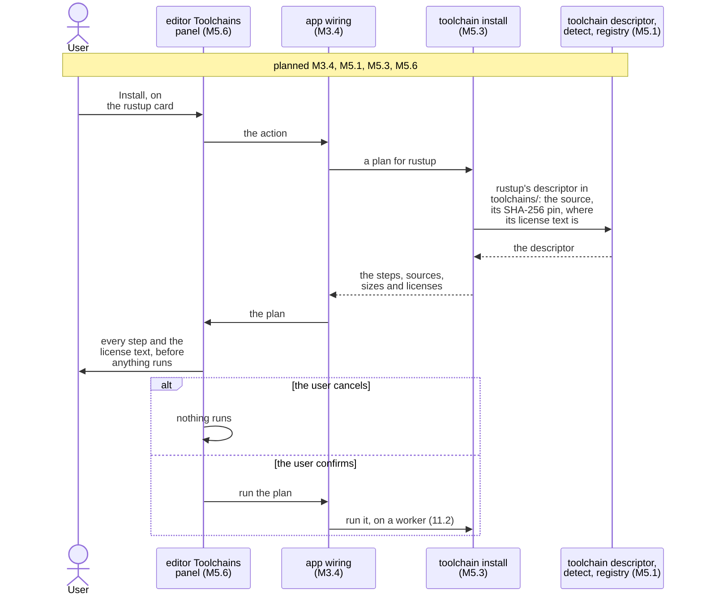

### 11.2 The download, and its check

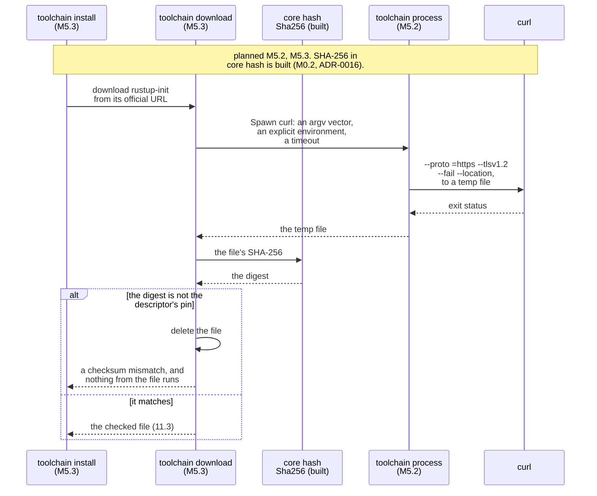

### 11.3 The install, and the result

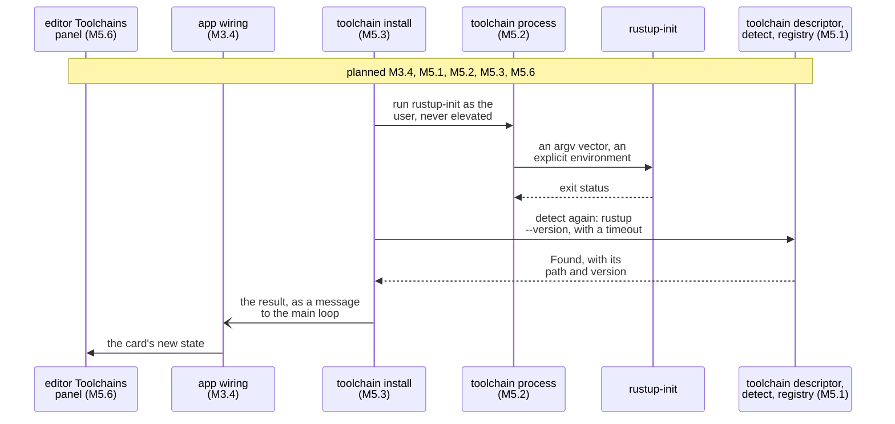

## 12. An agent's edit proposal (planned)

An edit proposal from a language agent over TAP (ADR-0009, Proposed until
M9.1; `docs/subsystems/agents.md`). Tidepool assembles every byte the agent
sees, the agent can only propose, and the user reviews the proposal as a
diff before it touches the buffer. The flow is planned in M5.2, M6.1,
M9.3, M9.5 and M9.6; the agent was spawned through `toolchain`'s sessions
and sent `initialize` with `tapVersion` 0.1.

### 12.1 Consent, and the context

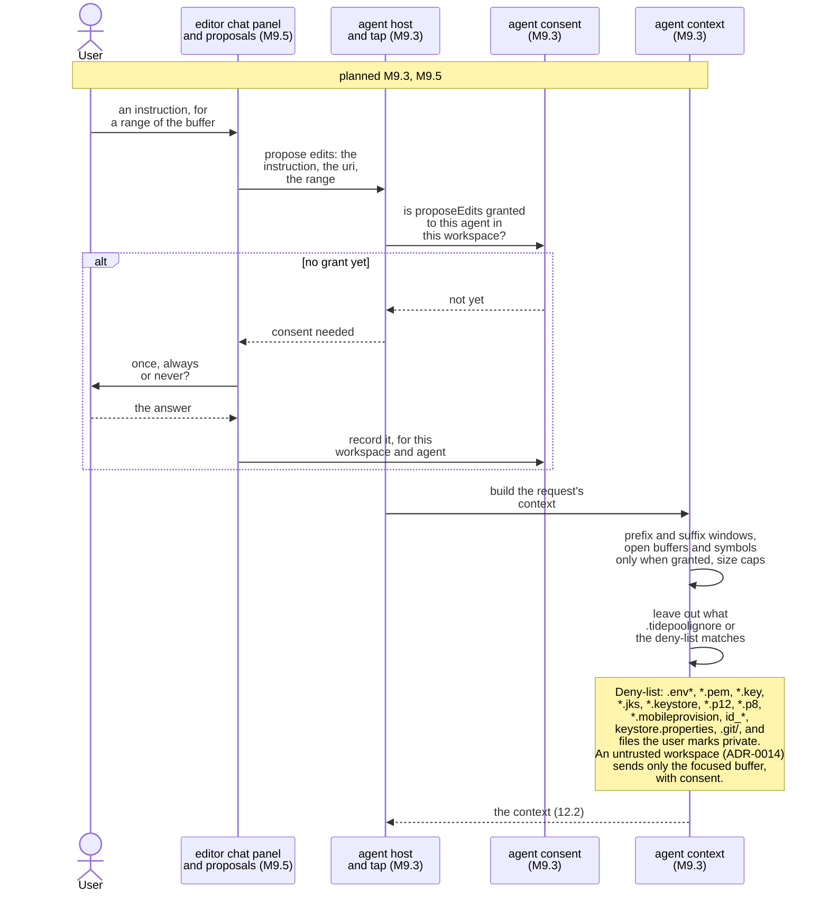

### 12.2 The request, and the user's review

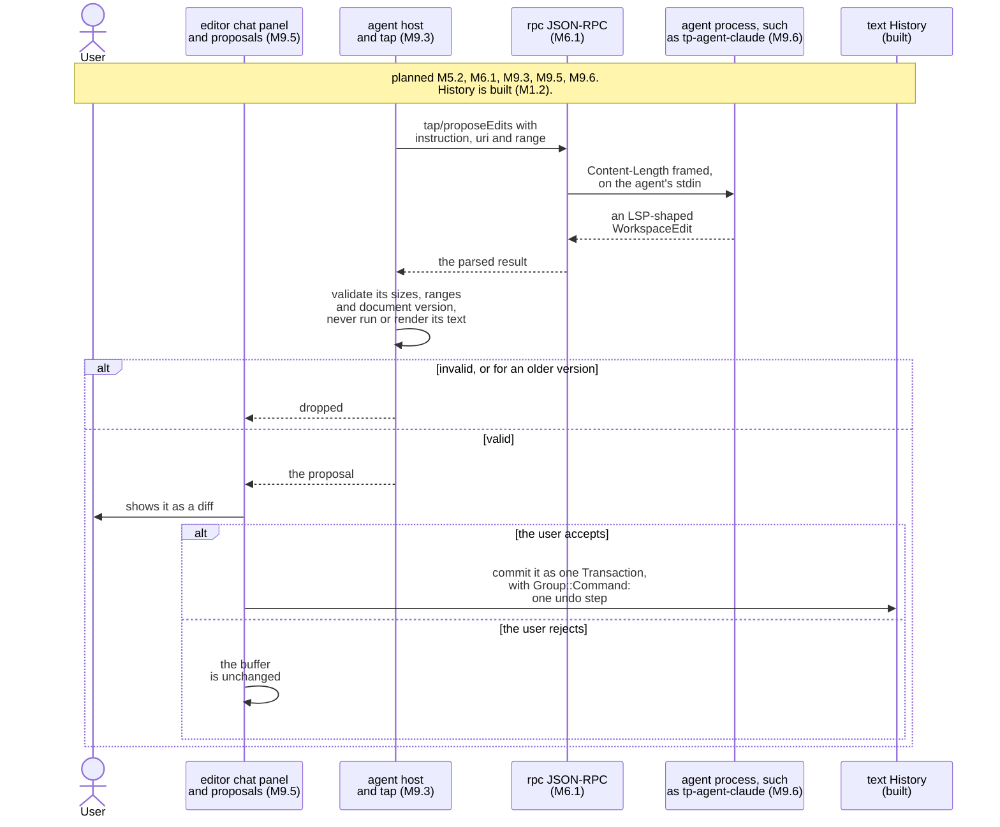

## 13. Building and signing an Android APK (planned)

A release APK from the Gradle-free pipeline, signed by `apksigner`
(ADR-0007, Proposed until M10.3; `docs/subsystems/mobile.md`). The
keystore password stays in memory as a `SecretArg` and reaches `apksigner`
on its standard input, never on argv. The flow is planned in M5.2, M10.1,
M10.2, M10.3, M10.5 and M10.6. An AAB uses `bundletool build-bundle`,
then `jarsigner` with `-storepass:env NAME`, then `jarsigner -verify`.

### 13.1 Building the APK

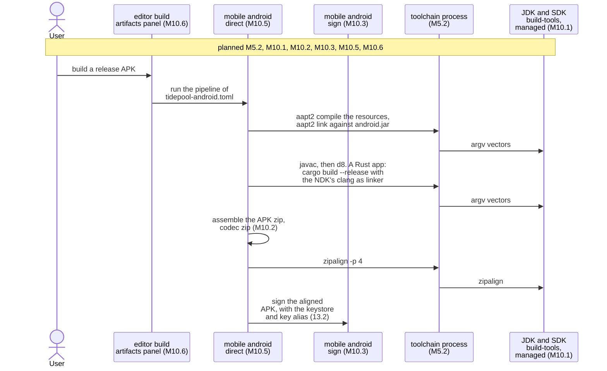

### 13.2 Signing it, and verifying the signature

```mermaid
sequenceDiagram
    actor User
    participant Panel as editor build<br/>artifacts panel (M10.6)
    participant Sign as mobile android<br/>sign (M10.3)
    participant Sec as toolchain secret<br/>(M5.2)
    participant Proc as toolchain process<br/>(M5.2)
    participant Sdk as JDK and SDK<br/>build-tools,<br/>managed (M10.1)

    Note over User,Sdk: planned M5.2, M10.1, M10.3, M10.6
    Sign-->>Panel: the keystore password<br/>is needed
    Panel->>User: asks for it,<br/>once a session
    User-->>Panel: the password
    Panel->>Sign: the password
    Sign->>Sec: hold it as a SecretArg,<br/>in memory only, redacted<br/>in logs and Debug
    Sign->>Proc: apksigner sign<br/>--ks-pass stdin
    Proc->>Sdk: start apksigner, with<br/>no secret on its argv
    Proc->>Sdk: the password,<br/>on its stdin
    Sdk-->>Proc: exit status
    Sign->>Proc: apksigner verify<br/>--verbose
    Proc->>Sdk: apksigner verify
    Sdk-->>Proc: the verifier's<br/>output and status
    Proc-->>Sign: the result
    Sign-->>Panel: the signed APK and<br/>its verification
    Note over User,Sdk: Tidepool never reads the keystore. A test checks<br/>that no constructed argv holds a secret (M10.3).
```

## Sources

- `xtask/src/main.rs`, `check.rs`, `cargo.rs`, `deps.rs`, `layers.rs`,
  `crates.rs`, `metadata.rs`, `ucd.rs`, `workflows.rs`, `fuzz.rs`
- `crates/core/src/testing/fuzz.rs`, `fuzz/engine.rs`, `fuzz/paths.rs`
- `crates/codec/tests/fuzz.rs`, `crates/text/tests/fuzz.rs`
- `crates/text/src/file.rs`, `encoding.rs`, `transaction.rs`,
  `history.rs`, `pos.rs`, `lib.rs`
- `crates/core/src/cli.rs`, `input.rs`, `hash.rs`
- `crates/app/src/main.rs`, `crates/app/README.md`
- `AGENTS.md` (rules 2, 6, 7 and 8)
- `docs/00-overview.md` → "Performance budgets"
- `docs/01-architecture.md` → "Dependency matrix", "The main loop", "Data
  flow", "Threading model"
- `docs/03-platforms.md` → "Linux"
- `docs/04-quality.md` → "Fuzz smoke", "`xtask` checks"
- `docs/subsystems/frontends.md`, `sys-and-platform.md`, `rendering.md`,
  `ui-and-theme.md`, `editor.md`, `languages.md`, `toolchains.md`,
  `agents.md`, `mobile.md`
- `docs/decisions.md`: ADR-0002, ADR-0007, ADR-0009, ADR-0012, ADR-0014,
  ADR-0016, ADR-0017, ADR-0020, ADR-0025, ADR-0027, ADR-0029
- `docs/roadmap.md`: the tasks named in each section
